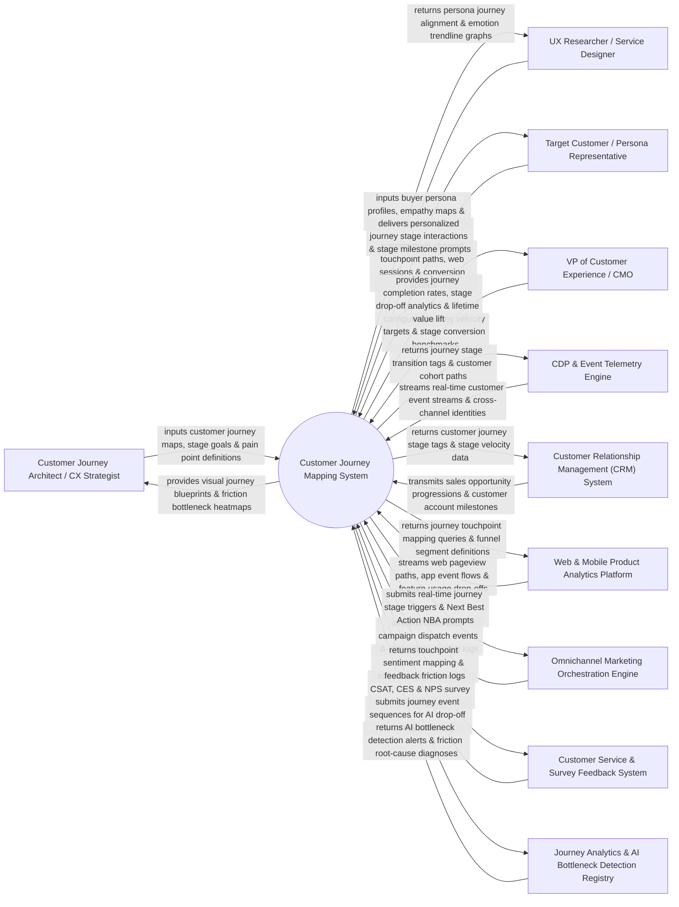

# Context Diagram — Customer Journey Mapping System

## Mermaid Code

## Actor & Interaction Table | Bảng Actor & Tương tác

| # | Actor | Actor Type | Data Sent TO System | Data Received FROM System | Notes |
|---|-------|------------|---------------------|---------------------------|-------|
| 1 | Customer Journey Architect / CX Strategist | Primary | Visual journey maps, lifecycle stage definitions (Awareness, Consideration, Purchase, Retention, Advocacy), friction bottleneck rules. | Visual journey blueprints, stage drop-off heatmaps, touchpoint friction scorecards. | CX strategist modeling end-to-end customer lifecycles, identifying friction, and optimizing touchpoints. |
| 2 | UX Researcher / Service Designer | Primary | Buyer persona profiles, customer empathy maps, qualitative interview notes, emotional trajectory curves. | Persona journey alignment charts, emotion trendline graphs, pain-point frequency rankings. | Researcher mapping qualitative user research and emotional states to specific journey stages. |
| 3 | Target Customer / Persona Representative | Primary | Multi-channel touchpoint interactions, web browsing paths, mobile app sessions, checkout conversions. | Personalized journey stage interactions, next-step guidance, stage milestone prompts. | Consumer navigating the brand ecosystem across digital and physical touchpoints over time. |
| 4 | VP of Customer Experience / CMO | Primary | Journey velocity targets, stage conversion benchmarks, customer lifetime value growth goals. | Journey completion rates, stage drop-off funnel analytics, journey velocity metrics, CX ROI lift. | Executive overseeing customer experience strategy and journey conversion performance. |
| 5 | Customer Data Platform (CDP) & Event Telemetry Engine | Supporting | Real-time customer behavioral event streams, cross-device identity graphs, raw event logs. | Real-time journey stage transition tags, customer cohort journey paths. | Enterprise CDP streaming continuous user event telemetry to track real-time journey progression. |
| 6 | Customer Relationship Management (CRM) System | Supporting | B2B sales deal stage progressions, contract sign dates, customer account milestones. | Customer journey stage tags, journey velocity indicators, relationship age tags. | Enterprise CRM synchronizing sales pipeline deal stages with the customer journey map. |
| 7 | Web & Mobile Product Analytics Platform | Supporting | Web pageview clickstreams, mobile app user session flows, in-app feature usage drop-offs. | Touchpoint mapping queries, funnel segment definitions, product event correlation data. | Product analytics (Mixpanel, Amplitude) supplying granular user clickstream data. |
| 8 | Omnichannel Marketing Orchestration Engine | Supporting | Automated campaign dispatches, email opens, SMS clicks, ad retargeting impressions. | Real-time journey stage transition triggers, Next Best Action (NBA) prompt payloads. | Automation engine receiving journey triggers to deliver stage-appropriate messages. |
| 9 | Customer Service & Survey Feedback System | Supporting | Stage-specific CSAT, CES, and NPS survey ratings, support ticket volume per stage. | Touchpoint sentiment mapping, feedback friction logs, low-CSAT stage flags. | Service platform providing customer sentiment data mapped to specific journey touchpoints. |
| 10 | Journey Analytics & AI Bottleneck Detection Registry | Supporting / AI Engine | Journey event path clustering data, anomaly detection models, friction root-cause algorithms. | AI bottleneck detection alerts, friction root-cause diagnoses, predicted drop-off points. | AI engine analyzing path variance to automatically detect unexpected customer journey friction. |

## System Boundary Description | Mô tả Phạm vi Hệ thống

The **Customer Journey Mapping System** is an enterprise CX lifecycle modeling, journey analytics, real-time journey orchestration, and friction bottleneck identification platform designed to map, visualize, measure, and optimize customer journeys across Awareness, Consideration, Purchase, Retention, and Advocacy.

**Inside System Scope:**
- Interactive visual drag-and-drop Customer Journey Blueprint builder supporting multi-persona journey maps.
- Real-time journey tracking ingesting CDP event streams to track real customer movement through mapped stages.
- Sentiment and emotion mapping overlaying CSAT, CES, and NPS survey ratings onto specific journey touchpoints.
- AI-driven friction bottleneck detection identifying unexpected customer drop-offs, loops, and conversion delays.
- Next Best Action (NBA) engine triggering real-time orchestration prompts to marketing and support systems.

**Outside System Scope:**
- Direct physical modification of store layout architecture (handled by Retail Store Designers).
- Direct manual training of human customer service agents (handled by Corporate Training Departments).
- Direct hosting of core e-commerce payment infrastructure (handled by Payment Service Providers).
