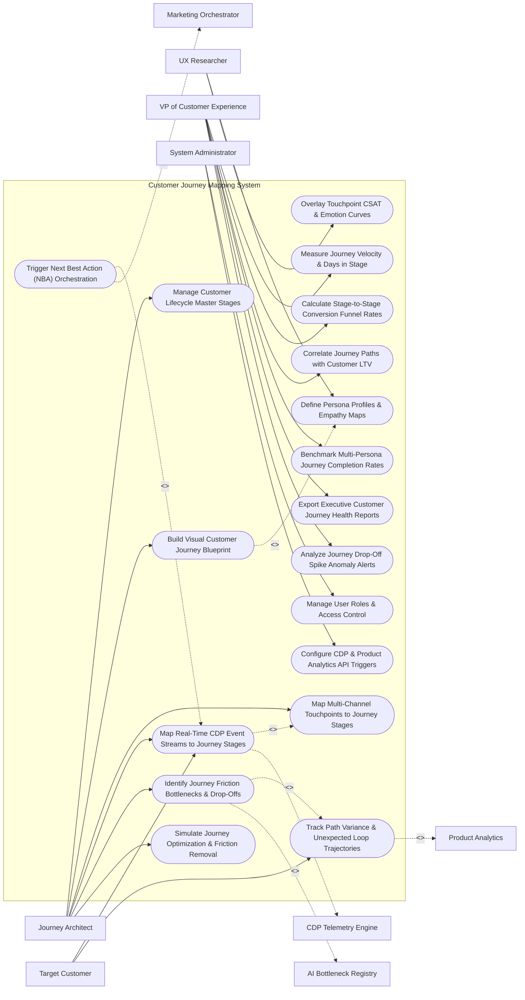

# Use Case Diagram — Customer Journey Mapping System

## Mermaid Code

## Actor Table | Bảng Actor

| # | Actor | Actor Type | Role Description | Related Use Cases |
|---|-------|------------|------------------|-------------------|
| 1 | Journey Architect | Primary | CX strategist designing visual journey blueprints, mapping touchpoints, identifying friction bottlenecks, and simulating optimizations. | UC01, UC02, UC04, UC05, UC08, UC13 |
| 2 | UX Researcher | Primary | Researcher building buyer personas, empathy maps, and overlaying CSAT survey ratings onto emotion curves. | UC03, UC10 |
| 3 | Target Customer | Primary | Consumer navigating mapped journey stages and generating real-time CDP event streams. | UC05, UC06 |
| 4 | VP of Customer Experience | Primary | Executive tracking journey velocity, conversion funnels, LTV correlations, persona completion benchmarks, and drop-off alerts. | UC07, UC09, UC11, UC14, UC15, UC18 |
| 5 | System Administrator | Primary | IT admin managing user RBAC access, CDP API credentials, and product analytics integration endpoints. | UC16, UC17 |
| 6 | CDP Telemetry Engine | System (Secondary) | Enterprise CDP streaming continuous user event logs and cross-device identity graphs. | UC05 |
| 7 | Product Analytics | System (Secondary) | Clickstream service (Mixpanel/Amplitude) providing granular web pageview and mobile session flows. | UC06 |
| 8 | Marketing Orchestrator | System (Secondary) | Omnichannel automation engine receiving Next Best Action (NBA) prompts to trigger targeted touchpoints. | UC12 |
| 9 | AI Bottleneck Registry | System (Secondary) | Machine learning service scanning customer paths to detect unexpected drop-off anomalies and friction. | UC08 |

## Use Case Table | Bảng Use Case

| # | UC ID | Use Case Name | Primary Actor | Secondary Actor | Description | Priority |
|---|-------|---------------|---------------|-----------------|-------------|----------|
| 1 | UC01 | Manage Customer Lifecycle Master Stages | Architect | None | Configures core lifecycle stages (Awareness, Consideration, Evaluation, Purchase, Onboarding, Retention, Advocacy). | High |
| 2 | UC02 | Build Visual Customer Journey Blueprint | Architect | None | Creates visual drag-and-drop journey maps detailing channels, touchpoints, customer goals, and team ownership. | Critical |
| 3 | UC03 | Define Persona Profiles & Empathy Maps | Researcher | None | Builds detailed buyer persona cards (demographics, goals, pain points) and empathy maps (Think/Feel/Say/Do). | High |
| 4 | UC04 | Map Multi-Channel Touchpoints to Journey Stages | Architect | None | Links digital (Email, Web, App, Ads) and physical (Retail Store, Phone Support) touchpoints to journey stages. | High |
| 5 | UC05 | Map Real-Time CDP Event Streams to Journey Stages | Customer | CDP System | Maps streaming CDP event logs to journey stages in real time to track live customer progression. | Critical |
| 6 | UC06 | Track Path Variance & Unexpected Loop Trajectories | Customer | Product Analytics | Analyzes customer clickstreams to identify non-linear path looping (e.g., repeating checkout step 3x). | High |
| 7 | UC07 | Measure Journey Velocity & Days in Stage | CXVP | None | Calculates average time (days/hours) customers spend in each stage before advancing or dropping out. | High |
| 8 | UC08 | Identify Journey Friction Bottlenecks & Drop-Offs | Architect | AI Bottleneck | Uses machine learning path analysis to detect high-friction drop-off points (e.g., 45% drop-off at pricing page). | Critical |
| 9 | UC09 | Calculate Stage-to-Stage Conversion Funnel Rates | CXVP | None | Measures conversion funnel efficiency percentages moving from Stage $N$ to Stage $N+1$. | High |
| 10 | UC10 | Overlay Touchpoint CSAT & Emotion Curves | Researcher | None | Overlays CSAT, CES, and NPS survey ratings onto the journey blueprint to visualize customer emotion curves. | High |
| 11 | UC11 | Correlate Journey Paths with Customer LTV | CXVP | None | Identifies high-performing journey paths that correlate with 3x higher Customer Lifetime Value (LTV). | High |
| 12 | UC12 | Trigger Next Best Action (NBA) Orchestration | Customer | Orchestrator | Dispatches real-time Next Best Action prompts to marketing engines when a customer gets stuck in a stage. | Critical |
| 13 | UC13 | Simulate Journey Optimization & Friction Removal | Architect | None | Simulates expected conversion lift of removing a specific friction step (e.g., removing credit card requirement for trial). | High |
| 14 | UC14 | Benchmark Multi-Persona Journey Completion Rates | CXVP | None | Compares journey completion rates across different buyer personas (e.g., Enterprise IT vs Small Business). | High |
| 15 | UC15 | Export Executive Customer Journey Health Reports | CXVP | None | Renders executive CX dashboards detailing overall journey health, friction scores, and conversion funnels. | High |
| 16 | UC16 | Manage User Roles & Access Control | Admin | None | Controls user login credentials, workspace permissions, and persona blueprint edit rights. | High |
| 17 | UC17 | Configure CDP & Product Analytics API Triggers | Admin | None | Configures API connection parameters to CDP telemetry streams, Mixpanel, and CRM systems. | High |
| 18 | UC18 | Analyze Journey Drop-Off Spike Anomaly Alerts | CXVP | None | Triggers alert notifications when a critical journey stage suffers a sudden drop-off spike $> 20\%$. | High |

## Use Case Specification | Đặc tả Use Case

---

### UC02 — Build Visual Customer Journey Blueprint

| Field | Detail |
|-------|--------|
| **UC ID** | UC02 |
| **Use Case Name** | Build Visual Customer Journey Blueprint |
| **Actor(s)** | Primary: Customer Journey Architect, UX Researcher   Secondary: None |
| **Description** | Composes an interactive visual Customer Journey Blueprint mapping channels, digital/physical touchpoints, customer goals, team ownership, and system backends across lifecycle stages. |
| **Precondition** | 1. Lifecycle master stages (Awareness -> Advocacy) are defined (UC01).   2. Target buyer persona profiles are created (UC03). |
| **Main Flow** | 1. User opens "Visual Journey Blueprint Canvas".   2. User selects Target Persona: `Enterprise IT Director (Alex)`.   3. User configures Horizontal Lifecycle Stages: `1. Awareness` -> `2. Consideration` -> `3. Evaluation` -> `4. Purchase` -> `5. Onboarding` -> `6. Retention`.   4. User adds Swimlane Layers for each stage:   &nbsp;&nbsp;&nbsp;&nbsp; a. Layer 1 (Customer Action): `Searches Google for Cloud ERP -> Reads Blog -> Downloads Whitepaper -> Requests Live Demo -> Signs Contract`.   &nbsp;&nbsp;&nbsp;&nbsp; b. Layer 2 (Touchpoint & Channel): `Google Search Ad (PPC) -> Corporate Blog (CMS) -> Gated PDF (Web) -> Live Zoom Demo (Sales) -> E-Signature (DocuSign)`.   &nbsp;&nbsp;&nbsp;&nbsp; c. Layer 3 (Customer Goal & Emotion): `Find secure solution (Optimistic +4) -> Evaluate pricing (Anxious -2)`.   &nbsp;&nbsp;&nbsp;&nbsp; d. Layer 4 (Frontstage & Backstage Teams): `Marketing Team -> Sales Team -> Customer Success Team`.   &nbsp;&nbsp;&nbsp;&nbsp; e. Layer 5 (Supporting Systems): `SEO System -> CMS -> CRM -> Billing Gateway`.   5. User clicks "Save & Publish Journey Blueprint".   6. System validates blueprint completeness (no unlinked stages) and publishes interactive web blueprint link. |
| **Alternative Flow** | **AF1** — Multi-Persona Blueprint View: User toggles to "Compare Personas" view; System overlays `Small Business Owner (Sam)` journey blueprint side-by-side with `Enterprise IT Director (Alex)` to highlight path differences. |
| **Exception Flow** | **EX1** — Unlinked Lifecycle Stage Error: Blueprint contains a disconnected stage (e.g., Evaluation stage has no outgoing touchpoints to Purchase); System flags warning "Orphaned Stage Detected - Add Transition Touchpoint". |
| **Postcondition** | Visual Customer Journey Blueprint is published, swimlane layers are configured, and journey tracking (UC05) is enabled. |
| **Business Rule** | **BR1**: Customer Journey Blueprints MUST include customer actions, touchpoint channels, customer emotion ratings, and supporting backend systems for every stage. |

---

### UC05 — Map Real-Time CDP Event Streams to Journey Stages

| Field | Detail |
|-------|--------|
| **UC ID** | UC05 |
| **Use Case Name** | Map Real-Time CDP Event Streams to Journey Stages |
| **Actor(s)** | Primary: Target Customer   Secondary: Customer Data Platform (CDP) Telemetry Engine |
| **Description** | Ingests real-time streaming user behavioral event logs from CDP engines and maps them onto the Customer Journey Blueprint to track live customer progression through lifecycle stages. |
| **Precondition** | 1. Customer Journey Blueprint is published (UC02).   2. CDP event stream integration (Segment/mParticle) is active. |
| **Main Flow** | 1. Target Customer `john.smith@acme.com` interacts with digital touchpoints.   2. System ingests real-time CDP Event Stream:   &nbsp;&nbsp;&nbsp;&nbsp; a. Event 1: `Web_Pageview` (`url: /blog/cloud-security`) -> System maps event to Stage 1: `AWARENESS`.   &nbsp;&nbsp;&nbsp;&nbsp; b. Event 2: `Form_Submit` (`asset: whitepaper_pdf`) -> System advances customer to Stage 2: `CONSIDERATION`.   &nbsp;&nbsp;&nbsp;&nbsp; c. Event 3: `Demo_Requested` (`form_id: sales_demo`) -> System advances customer to Stage 3: `EVALUATION`.   &nbsp;&nbsp;&nbsp;&nbsp; d. Event 4: `Contract_Signed` (`value: $50,000`) -> System advances customer to Stage 4: `PURCHASE`.   3. System records stage transition timestamps and calculates stage velocity: `Time in Evaluation Stage = 4 Days`.   4. System updates real-time Customer Journey Profile (`CID_99412`), setting current live stage to `PURCHASE`.   5. System updates aggregate Journey Stage Volume Counter (e.g., Awareness: 10,000 users, Consideration: 2,500 users, Purchase: 300 users). |
| **Alternative Flow** | **AF1** — Retroactive Event Backfilling: New customer record is created; System pulls past 90 days of historical CDP event logs, retroactively constructing the customer's historical journey timeline. |
| **Exception Flow** | **EX1** — Unmapped CDP Event Warning: System receives unrecognized CDP event `Custom_Event_XYZ`; System flags event as `UNMAPPED_EVENT`, logging it in an admin buffer for manual stage assignment. |
| **Postcondition** | CDP events are mapped to journey stages, customer stage progression is updated in real time, and stage velocity metrics are calculated. |
| **Business Rule** | **BR1**: CDP event-to-stage mapping rules MUST process user event streams in real time (latency <= 5 seconds of event receipt). |

---

### UC08 — Identify Journey Friction Bottlenecks & Drop-Offs

| Field | Detail |
|-------|--------|
| **UC ID** | UC08 |
| **Use Case Name** | Identify Journey Friction Bottlenecks & Drop-Offs |
| **Actor(s)** | Primary: Customer Journey Architect   Secondary: AI Bottleneck Detection Registry |
| **Description** | Uses machine learning path analytics to analyze aggregate customer movement through journey stages, detecting high-friction drop-off points, unexpected loops, and conversion bottlenecks. |
| **Precondition** | 1. Real-time CDP event streams are mapped to journey stages (UC05). |
| **Main Flow** | 1. Architect opens "Journey Friction & Bottleneck Analytics Console".   2. System analyzes customer path movement across 10,000 customer journeys in the selected timeframe.   3. System identifies Stage Conversion Funnel Drops:   &nbsp;&nbsp;&nbsp;&nbsp; a. Consideration -> Evaluation: 75% Conversion Rate (Healthy).   &nbsp;&nbsp;&nbsp;&nbsp; b. Evaluation -> Purchase: 18% Conversion Rate -> `HIGH_FRICTION_BOTTLENECK` (57% Drop-off).   4. System invokes AI Bottleneck Detection Engine to diagnose root cause:   &nbsp;&nbsp;&nbsp;&nbsp; a. Path Loop Detection: 42% of users loop between `Pricing Page` and `FAQ Page` 3+ times without clicking "Buy".   &nbsp;&nbsp;&nbsp;&nbsp; b. Form Abandonment: 65% of drop-offs occur at credit card entry step on mobile devices.   &nbsp;&nbsp;&nbsp;&nbsp; c. Sentiment Correlation: Touchpoint CSAT at pricing step is 2.1 / 5.0 (Low).   5. System renders Visual Journey Friction Heatmap, highlighting the `Evaluation -> Purchase` transition node in bright red.   6. System generates Friction Diagnostic Summary: *"Bottleneck Detected: Complex mobile credit card form causing 57% drop-off at Evaluation stage"*.   7. Architect exports bottleneck report and creates optimization task for UX team. |
| **Alternative Flow** | **AF1** — Friction Anomaly Alerting: Sudden spike in friction occurs at a stage (e.g., checkout page error); System triggers UC18 (Analyze Journey Drop-Off Spike Anomaly Alerts), notifying CX VP. |
| **Exception Flow** | **EX1** — Sample Size Insufficient: Stage transition contains < 20 customer paths; System flags "Low Path Data - Friction Confidence Low", recommending extended data collection window. |
| **Postcondition** | Journey friction bottlenecks and drop-off nodes are detected, AI root causes are diagnosed, and visual friction heatmaps are rendered. |
| **Business Rule** | **BR1**: Journey stages suffering a stage-to-stage drop-off rate of >= 50% MUST be automatically flagged as High-Friction Bottlenecks. |

---

### UC10 — Overlay Touchpoint CSAT & Emotion Curves

| Field | Detail |
|-------|--------|
| **UC ID** | UC10 |
| **Use Case Name** | Overlay Touchpoint CSAT & Emotion Curves |
| **Actor(s)** | Primary: UX Researcher, Customer Journey Architect   Secondary: None |
| **Description** | Overlays quantitative survey ratings (CSAT, CES, NPS) and qualitative emotion scores onto specific journey blueprint touchpoints, rendering a visual Customer Emotion Trajectory Curve. |
| **Precondition** | 1. Customer Journey Blueprint is active (UC02).   2. Stage-specific survey feedback data (CSAT/CES) is ingested. |
| **Main Flow** | 1. User opens "Journey Emotion Curve Overlay Studio".   2. User selects Journey Map (`Enterprise IT Director Journey`) and enables "CSAT & Emotion Layer".   3. System retrieves survey feedback ratings mapped to touchpoints:   &nbsp;&nbsp;&nbsp;&nbsp; a. Touchpoint 1 (Blog Reading): CSAT `4.6 / 5.0` -> Emotion Score: `+4 (Delighted)`.   &nbsp;&nbsp;&nbsp;&nbsp; b. Touchpoint 2 (Whitepaper Download): CSAT `4.2 / 5.0` -> Emotion Score: `+3 (Satisfied)`.   &nbsp;&nbsp;&nbsp;&nbsp; c. Touchpoint 3 (Pricing Page View): CES `2.4 / 7.0` -> Emotion Score: `-3 (Frustrated)`.   &nbsp;&nbsp;&nbsp;&nbsp; d. Touchpoint 4 (Sales Demo): CSAT `4.8 / 5.0` -> Emotion Score: `+5 (Excited)`.   &nbsp;&nbsp;&nbsp;&nbsp; e. Touchpoint 5 (Contract Onboarding): CSAT `2.1 / 5.0` -> Emotion Score: `-4 (Anxious)`.   4. System plots Visual Customer Emotion Trajectory Curve across the horizontal journey blueprint.   5. System highlights "Emotional Dip Valleys" (Red Troughs) on the curve corresponding to high customer frustration points (e.g., Pricing Page View and Contract Onboarding).   6. User clicks an emotional valley to view verbatim customer comments associated with that low CSAT rating.   7. User saves emotion curve layer into the master journey blueprint. |
| **Alternative Flow** | **AF1** — Emotion Curve by Customer Segment: User compares Emotion Curve for Enterprise Customers (High Satisfaction) vs Small Business Customers (Low Satisfaction on Pricing) to analyze segment emotional variance. |
| **Exception Flow** | **EX1** — Missing Touchpoint Survey Data: A touchpoint has zero survey ratings; System plots a dashed gray line indicating "Unmeasured Emotional State", prompting researcher to launch a micro-survey. |
| **Postcondition** | CSAT and emotion scores are mapped to touchpoints, and visual Customer Emotion Trajectory Curves are overlaid on the blueprint. |
| **Business Rule** | **BR1**: Emotion trajectory curves MUST plot both quantitative survey ratings (CSAT/CES) and qualitative verbatim sentiment scores for each touchpoint. |

---

### UC12 — Trigger Next Best Action (NBA) Orchestration

| Field | Detail |
|-------|--------|
| **UC ID** | UC12 |
| **Use Case Name** | Trigger Next Best Action (NBA) Orchestration |
| **Actor(s)** | Primary: Target Customer   Secondary: Marketing Orchestrator |
| **Description** | Evaluates real-time customer journey stage progression and triggers automated Next Best Action (NBA) prompts to marketing orchestration engines when a customer gets stuck or stalls in a stage. |
| **Precondition** | 1. Real-time CDP events are mapping customer stages (UC05).   2. Next Best Action rules and orchestration webhooks are configured. |
| **Main Flow** | 1. Target Customer `john.smith@acme.com` advances to Stage 3: `EVALUATION` (Requested Sales Demo).   2. System starts Stage Stalling Monitor: `Stage Velocity Threshold = 5 Days`.   3. Customer remains in `EVALUATION` stage for 6 days without moving to `PURCHASE` (Stalled Customer).   4. System evaluates Next Best Action (NBA) Rule Matrix:   &nbsp;&nbsp;&nbsp;&nbsp; a. Rule Condition: `Customer Stalled in EVALUATION Stage for > 5 Days AND Account Value > $25,000`.   &nbsp;&nbsp;&nbsp;&nbsp; b. NBA Recommendation: `Dispatch Personalized ROI Case Study Video via Email AND Notify Account Exec in CRM`.   5. System constructs Next Best Action Payload:   &nbsp;&nbsp;&nbsp;&nbsp; a. Recipient: `john.smith@acme.com`.   &nbsp;&nbsp;&nbsp;&nbsp; b. Trigger Action: `SEND_EMAIL_CASE_STUDY_CAMPAIGN_402`.   &nbsp;&nbsp;&nbsp;&nbsp; c. CRM Task: `Create Priority Follow-Up Task for Sales Rep`.   6. System transmits NBA payload to Marketing Orchestration Engine and CRM System.   7. Marketing Orchestrator dispatches email, Customer opens case study, and resumes journey progression.   8. System logs NBA execution event and updates journey un-stalling success analytics. |
| **Alternative Flow** | **AF1** — In-App Interstitial Offer NBA: Customer stalls on Pricing Page for > 3 minutes; System triggers real-time web popup NBA offering a live chat session with a product specialist. |
| **Exception Flow** | **EX1** — Opted-Out Customer NBA Suppression: Customer is opted-out of marketing emails; System suppresses email NBA, routing NBA task exclusively as a CRM phone call task for the Account Executive. |
| **Postcondition** | Stalled customer journey is detected, Next Best Action (NBA) is evaluated, and orchestration payload is transmitted to marketing/CRM engines. |
| **Business Rule** | **BR1**: Next Best Action (NBA) triggers MUST respect customer channel communication preferences and frequency caps before dispatching. |
