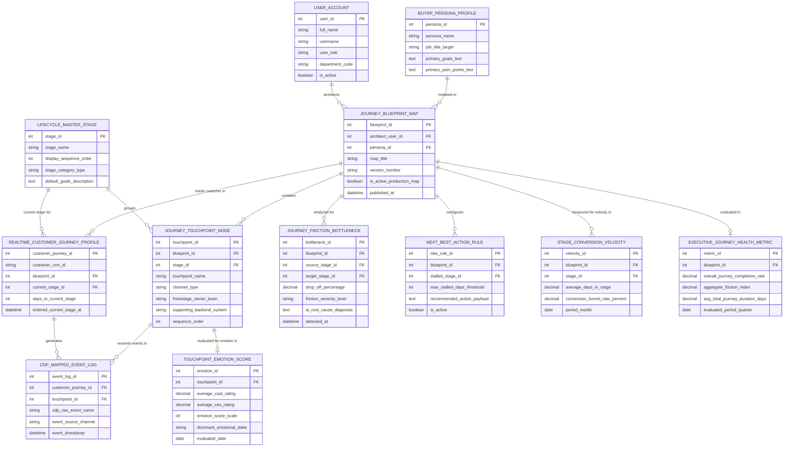

# Conceptual ERD — Customer Journey Mapping System

## Mermaid Code

## Entity Description Table | Bảng mô tả Entity

| # | Entity Name | Vietnamese Name | Description | Key Attributes | Main Relationships |
|---|-------------|-----------------|-------------|----------------|-------------------|
| 1 | USER_ACCOUNT | Tài khoản Nguời dùng | System credentials and access roles for journey architects, UX researchers, and CX VPs. | `user_id`, `username`, `user_role`, `department_code` | Architects `JOURNEY_BLUEPRINT_MAP`. |
| 2 | LIFECYCLE_MASTER_STAGE | Giai đoạn Vòng đời Master | Master lifecycle stage entity defining standard stages (Awareness, Consideration, Evaluation, Purchase, Retention). | `stage_id`, `stage_name`, `display_sequence_order`, `stage_category_type` | Groups `JOURNEY_TOUCHPOINT_NODE`, current stage for `REALTIME_CUSTOMER_JOURNEY_PROFILE`. |
| 3 | BUYER_PERSONA_PROFILE | Profile Buyer Persona | Target buyer persona profile storing job title targets, primary goals, and pain points. | `persona_id`, `persona_name`, `job_title_target`, `primary_goals_text`, `primary_pain_points_text` | Modeled in `JOURNEY_BLUEPRINT_MAP`. |
| 4 | JOURNEY_BLUEPRINT_MAP | Blueprint Hành trình Khách hàng | Master Customer Journey Blueprint map storing map title, version, persona ID, and publication status. | `blueprint_id`, `architect_user_id`, `persona_id`, `map_title`, `version_number`, `is_active_production_map` | Modeled from `BUYER_PERSONA_PROFILE`, contains `JOURNEY_TOUCHPOINT_NODE`, tracks `REALTIME_CUSTOMER_JOURNEY_PROFILE`, analyzed for `JOURNEY_FRICTION_BOTTLENECK`. |
| 5 | JOURNEY_TOUCHPOINT_NODE | Nút Touchpoint Hành trình | Individual touchpoint node specifying channel, frontstage owner team, and supporting backend system. | `touchpoint_id`, `blueprint_id`, `stage_id`, `touchpoint_name`, `channel_type`, `frontstage_owner_team` | Belongs to `JOURNEY_BLUEPRINT_MAP` and `LIFECYCLE_MASTER_STAGE`, receives `CDP_MAPPED_EVENT_LOG`, evaluated for `TOUCHPOINT_EMOTION_SCORE`. |
| 6 | REALTIME_CUSTOMER_JOURNEY_PROFILE | Profile Hành trình Real-time | Real-time customer journey profile tracking current live stage, days in stage, and customer CRM ID. | `customer_journey_id`, `customer_crm_id`, `blueprint_id`, `current_stage_id`, `days_in_current_stage` | Belongs to `JOURNEY_BLUEPRINT_MAP` and `LIFECYCLE_MASTER_STAGE`, generates `CDP_MAPPED_EVENT_LOG`. |
| 7 | CDP_MAPPED_EVENT_LOG | Nhật ký Sự kiện CDP Mapped | Real-time streaming CDP event logs mapped to specific journey touchpoints and stages. | `event_log_id`, `customer_journey_id`, `touchpoint_id`, `cdp_raw_event_name`, `event_source_channel` | Belongs to `REALTIME_CUSTOMER_JOURNEY_PROFILE` and `JOURNEY_TOUCHPOINT_NODE`. |
| 8 | JOURNEY_FRICTION_BOTTLENECK | Bottleneck Điểm nghẽn Hành trình | Detected high-friction journey bottleneck tracking source/target stages, drop-off %, and AI root causes. | `bottleneck_id`, `blueprint_id`, `source_stage_id`, `target_stage_id`, `drop_off_percentage`, `ai_root_cause_diagnosis` | Belongs to `JOURNEY_BLUEPRINT_MAP`. |
| 9 | TOUCHPOINT_EMOTION_SCORE | Điểm Cảm xúc Touchpoint | Quantitative CSAT/CES survey ratings and customer emotion scores mapped to a specific touchpoint. | `emotion_id`, `touchpoint_id`, `average_csat_rating`, `average_ces_rating`, `emotion_score_scale`, `dominant_emotional_state` | Belongs to `JOURNEY_TOUCHPOINT_NODE`. |
| 10 | NEXT_BEST_ACTION_RULE | Quy tắc Next Best Action (NBA) | Rules triggering automated Next Best Action prompts when a customer gets stalled in a stage for $N$ days. | `nba_rule_id`, `blueprint_id`, `stalled_stage_id`, `max_stalled_days_threshold`, `recommended_action_payload` | Belongs to `JOURNEY_BLUEPRINT_MAP`. |
| 11 | STAGE_CONVERSION_VELOCITY | Vận tốc Chuyển đổi Giai đoạn | Monthly stage conversion velocity metric tracking average days in stage and funnel conversion rates. | `velocity_id`, `blueprint_id`, `stage_id`, `average_days_in_stage`, `conversion_funnel_rate_percent` | Belongs to `JOURNEY_BLUEPRINT_MAP`. |
| 12 | EXECUTIVE_JOURNEY_HEALTH_METRIC | Chỉ số Sức khỏe Executive | Executive journey health metric tracking overall completion rate, aggregate friction index, and total duration. | `metric_id`, `blueprint_id`, `overall_journey_completion_rate`, `aggregate_friction_index`, `avg_total_journey_duration_days` | Belongs to `JOURNEY_BLUEPRINT_MAP`. |

## Relationship Description | Mô tả Quan hệ

| # | From Entity | Cardinality | To Entity | Label | Business Explanation |
|---|-------------|-------------|-----------|-------|----------------------|
| 1 | BUYER_PERSONA_PROFILE | 1 to 0..N | JOURNEY_BLUEPRINT_MAP | modeled in | A buyer persona profile is modeled in multiple Customer Journey Blueprints. |
| 2 | JOURNEY_BLUEPRINT_MAP | 1 to 1..N | JOURNEY_TOUCHPOINT_NODE | contains | A Customer Journey Blueprint contains multiple touchpoint nodes. |
| 3 | JOURNEY_BLUEPRINT_MAP | 1 to 0..N | REALTIME_CUSTOMER_JOURNEY_PROFILE | tracks customer in | A blueprint tracks real-time customer progression across stages. |
| 4 | JOURNEY_BLUEPRINT_MAP | 1 to 0..N | JOURNEY_FRICTION_BOTTLENECK | analyzed for | A blueprint is analyzed for friction bottlenecks and high drop-off points. |
| 5 | JOURNEY_BLUEPRINT_MAP | 1 to 0..N | NEXT_BEST_ACTION_RULE | configures | A blueprint configures Next Best Action (NBA) rules for stalled customers. |
| 6 | JOURNEY_BLUEPRINT_MAP | 1 to 0..N | STAGE_CONVERSION_VELOCITY | measured for velocity in | A blueprint is measured for stage conversion velocity in monthly metrics. |
| 7 | JOURNEY_BLUEPRINT_MAP | 1 to 0..1 | EXECUTIVE_JOURNEY_HEALTH_METRIC | evaluated in | A blueprint is evaluated for overall completion rates in health metrics. |
| 8 | LIFECYCLE_MASTER_STAGE | 1 to 1..N | JOURNEY_TOUCHPOINT_NODE | groups | A lifecycle master stage groups related journey touchpoint nodes. |
| 9 | LIFECYCLE_MASTER_STAGE | 1 to 0..N | REALTIME_CUSTOMER_JOURNEY_PROFILE | current stage for | A master stage represents the current live stage for a customer profile. |
| 10 | JOURNEY_TOUCHPOINT_NODE | 1 to 0..N | CDP_MAPPED_EVENT_LOG | receives events in | A touchpoint node receives mapped real-time CDP event logs. |
| 11 | JOURNEY_TOUCHPOINT_NODE | 1 to 0..1 | TOUCHPOINT_EMOTION_SCORE | evaluated for emotion in | A touchpoint node is evaluated for CSAT survey ratings and emotion scores. |
| 12 | REALTIME_CUSTOMER_JOURNEY_PROFILE | 1 to 0..N | CDP_MAPPED_EVENT_LOG | generates | A customer journey profile generates CDP event logs during their interaction. |
| 13 | USER_ACCOUNT | 1 to 0..N | JOURNEY_BLUEPRINT_MAP | architects | A journey architect user account designs visual journey blueprint maps. |
