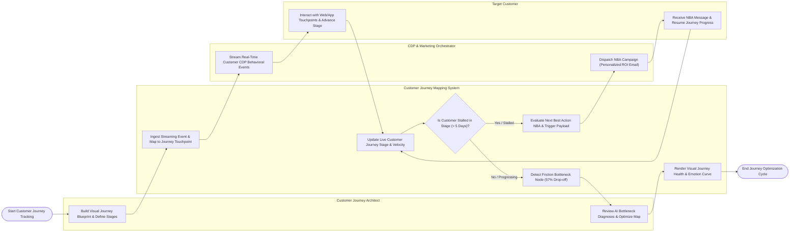

# Swimlane Diagram — Customer Journey Mapping System

## Mermaid Code

## Flow Description | Mô tả luồng

| Lane | Actor | Role in Flow |
|------|-------|-------------|
| 1 | Customer Journey Architect | Designs visual journey blueprint maps across lifecycle stages, specifies channel touchpoints, reviews AI bottleneck friction diagnoses, and optimizes blueprint paths. |
| 2 | Customer Journey Mapping System | Ingests real-time CDP event streams, maps user behaviors to journey stages, tracks stage velocity, monitors for stalled customer progress ($> 5$ days), evaluates Next Best Action (NBA) rules, detects high-friction drop-off nodes, and renders emotion curves. |
| 3 | CDP & Marketing Orchestrator | Streams continuous customer behavioral event logs into the system and receives Next Best Action (NBA) trigger payloads to dispatch stage-appropriate marketing messages. |
| 4 | Target Customer | Interacts with digital and physical touchpoints, generates CDP telemetry events, receives personalized Next Best Action prompts when stalled, and advances through lifecycle stages. |
