# Action Tree — Customer Journey Mapping System

## Mermaid Code

```mermaid
graph TD
    Root["Customer Journey Mapping System"]

    Root --> M1["Journey Blueprint Building & Stage Management"]
    Root --> M2["CDP Telemetry Ingestion & Stage Mapping"]
    Root --> M3["AI Friction Bottleneck & Path Analytics"]
    Root --> M4["Emotion Curve & Sentiment Overlay"]
    Root --> M5["Next Best Action (NBA) Orchestration"]
    Root --> M6["Journey Velocity & Executive Health Metrics"]

    M1 --> A11["Design Visual Interactive Customer Journey Blueprints"]
    M1 --> A12["Define Core Lifecycle Master Stages (Awareness -> Advocacy)"]
    M1 --> A13["Create Target Buyer Persona Profiles & Empathy Maps"]
    M1 --> A14["Map Frontstage Teams & Supporting Backend Systems"]

    M2 --> A21["Ingest Real-Time CDP Behavioral Event Streams"]
    M2 --> A22["Map CDP Events to Specific Journey Touchpoints & Stages"]
    M2 --> A23["Track Customer Path Variance & Non-Linear Loops"]
    M2 --> A24["Calculate Individual Customer Days-in-Stage Real-Time"]

    M3 --> A31["Execute AI Machine Learning Path Analysis Algorithms"]
    M3 --> A32["Detect High-Friction Drop-Off Nodes (Drop-Off >= 50%)"]
    M3 --> A33["Identify Form Abandonment & Checkout Path Loops"]
    M3 --> A34["Render Visual Journey Friction Heatmaps & AI Diagnoses"]

    M4 --> A41["Ingest Touchpoint CSAT, CES & NPS Survey Feedback"]
    M4 --> A42["Plot Visual Customer Emotion Trajectory Curves"]
    M4 --> A43["Highlight Emotional Dips & Customer Frustration Valleys"]
    M4 --> A44["Link Open-Ended Customer Verbatims to Touchpoint Nodes"]

    M5 --> A51["Configure Next Best Action (NBA) Rules for Stalled Customers"]
    M5 --> A52["Monitor Stage Velocity Thresholds (Stalled > 5 Days)"]
    M5 --> A53["Dispatch NBA Trigger Payloads to Marketing Orchestrator"]
    M5 --> A54["Track NBA Message Conversion Lift & Un-Stalling Rates"]

    M6 --> A61["Measure Stage-to-Stage Conversion Funnel Efficiency"]
    M6 --> A62["Correlate Optimal Journey Paths with 3-Year Customer LTV"]
    M6 --> A63["Benchmark Multi-Persona Journey Completion Rates"]
    M6 --> A64["Export Executive Customer Journey Health Scorecard PDFs"]
```

## Module Description | Mô tả Module

| # | Module | Description | Actions |
|---|--------|-------------|---------|
| 1 | Journey Blueprint Building & Stage Management | Designs visual journey blueprints, defines lifecycle master stages, builds buyer persona empathy maps, and maps supporting backend systems. | Design Visual Journey Blueprints, Define Lifecycle Master Stages, Create Buyer Persona Profiles, Map Supporting Backend Systems. |
| 2 | CDP Telemetry Ingestion & Stage Mapping | Ingests streaming CDP events, maps behaviors to touchpoints, tracks path variance loops, and calculates days-in-stage real-time. | Ingest Real-Time CDP Event Streams, Map CDP Events to Journey Touchpoints, Track Path Variance & Loops, Calculate Days-in-Stage Real-Time. |
| 3 | AI Friction Bottleneck & Path Analytics | Runs AI path analysis algorithms, detects high-friction drop-off nodes, identifies checkout loops, and renders friction heatmaps. | Execute AI Path Analysis Algorithms, Detect High-Friction Drop-Off Nodes, Identify Form Abandonment Loops, Render Journey Friction Heatmaps. |
| 4 | Emotion Curve & Sentiment Overlay | Ingests CSAT/CES survey ratings, plots customer emotion trajectory curves, highlights emotional frustration valleys, and links verbatim text. | Ingest Touchpoint Survey Feedback, Plot Customer Emotion Trajectory Curves, Highlight Emotional Frustration Valleys, Link Verbatim Feedback. |
| 5 | Next Best Action (NBA) Orchestration | Configures NBA rules for stalled customers, monitors velocity thresholds, dispatches NBA triggers to orchestrators, and tracks un-stalling rates. | Configure NBA Rules for Stalled Customers, Monitor Stage Velocity Thresholds, Dispatch NBA Trigger Payloads, Track NBA Un-Stalling Rates. |
| 6 | Journey Velocity & Executive Health Metrics | Measures stage conversion funnel efficiency, correlates journey paths with customer LTV, benchmarks personas, and exports health scorecards. | Measure Stage Conversion Funnels, Correlate Journey Paths with LTV, Benchmark Persona Completion Rates, Export Executive Journey Health Scorecards. |
