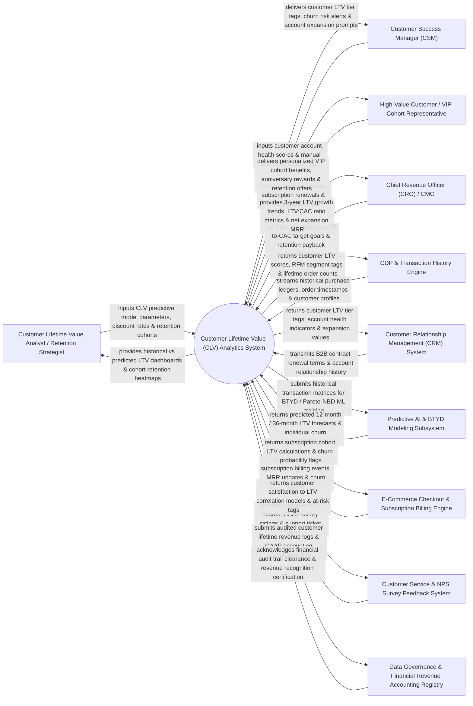

# Context Diagram — Customer Lifetime Value (CLV) Analytics System

## Mermaid Code

## Actor & Interaction Table | Bảng Actor & Tương tác

| # | Actor | Actor Type | Data Sent TO System | Data Received FROM System | Notes |
|---|-------|------------|---------------------|---------------------------|-------|
| 1 | Customer Lifetime Value Analyst / Retention Strategist | Primary | Predictive CLV model parameters, corporate discount rates ($d$), retention cohort definitions, LTV tier thresholds. | Historical vs predicted LTV dashboards, cohort retention heatmaps, RFM segment analysis, LTV sensitivity curves. | Financial analyst modeling customer lifetime value, cohort retention, and customer unit economics. |
| 2 | Customer Success Manager (CSM) | Primary | Customer account health scores, CSM manual intervention logs, quarterly account review notes. | Customer LTV tier tags, churn risk alerts, expansion opportunity values, high-value account playbooks. | CSM managing key B2B accounts, preventing churn, and driving expansion revenue. |
| 3 | High-Value Customer / VIP Cohort Representative | Primary | Recurring subscription renewals, e-commerce order checkouts, loyalty program interactions. | Personalized VIP cohort benefits, anniversary rewards, tailored retention offers, loyalty tier status. | Customer generating recurring revenue streams over their customer lifecycle. |
| 4 | Chief Revenue Officer (CRO) / CMO | Primary | Enterprise LTV-to-CAC target goals ($\text{LTV:CAC} \ge 3.0\times$), retention payback benchmarks, Net Expansion MRR goals. | 3-year LTV growth trends, LTV:CAC ratio metrics, Net Retention Rate (NRR), executive unit economics scorecards. | Executive evaluating long-term customer portfolio value, net retention, and acquisition efficiency. |
| 5 | CDP & Transaction History Engine | Supporting | Historical purchase ledgers, order timestamps, refund records, customer master profiles. | Customer LTV score updates, RFM segment tags, total lifetime order counts, customer age metrics. | Enterprise CDP providing clean, consolidated historical transaction and customer profile data. |
| 6 | CRM System | Supporting | B2B contract renewal terms, account manager assignments, sales deal relationship histories. | Customer LTV tier tags, account health indicators, predicted expansion deal values. | Enterprise CRM synchronizing customer LTV metrics with B2B sales account records. |
| 7 | Predictive AI & BTYD Modeling Subsystem | Supporting | Pareto-NBD, BG-NBD, and Gamma-Gamma regression algorithms, machine learning model weights. | Historical transaction matrices (Recency, Frequency, Monetary value), feature vectors. | AI engine running statistical "Buy 'Til You Die" (BTYD) models to predict future order frequency and spend. |
| 8 | E-Commerce Checkout & Subscription Billing Engine | Supporting | Recurring subscription billing events, Monthly Recurring Revenue (MRR) changes, cancellation events. | Subscription cohort LTV calculations, predicted churn probability flags, billing interval analytics. | Subscription platform (Stripe Billing/Chargebee) supplying recurring revenue data. |
| 9 | Customer Service & NPS Survey Feedback System | Supporting | Customer NPS scores, CSAT survey ratings, support ticket escalation counts, resolution times. | Customer satisfaction to LTV correlation models, low-CSAT at-risk customer tags. | Support system providing customer sentiment data to correlate customer happiness with LTV. |
| 10 | Data Governance & Financial Revenue Accounting Registry | Supporting / Regulatory | GAAP/IFRS revenue recognition rules, audited financial reporting standards, compliance rules. | Audited customer lifetime revenue logs, GAAP accounting audit certificates, financial audit trails. | Regulatory framework ensuring financial reporting integrity for lifetime revenue calculations. |

## System Boundary Description | Mô tả Phạm vi Hệ thống

The **Customer Lifetime Value (CLV) Analytics System** is an enterprise customer unit economics, predictive machine learning LTV forecasting, cohort retention analysis, and RFM (Recency, Frequency, Monetary) segmentation platform designed to measure, predict, and maximize the long-term value of customer relationships.

**Inside System Scope:**
- Historical LTV calculation ($\text{Historical LTV} = \sum \text{Net Margin Revenues}$) and RFM segmentation.
- Predictive Machine Learning LTV forecasting using "Buy 'Til You Die" (BTYD) statistical models (Pareto-NBD, BG-NBD, Gamma-Gamma).
- Cohort Retention Heatmaps tracking monthly/quarterly customer retention decay curves over 36+ months.
- Calculation of LTV-to-CAC Ratio ($\text{LTV:CAC} = \frac{\text{3-Year Predicted LTV}}{\text{Fully Loaded CAC}}$) and Net Retention Rate (NRR).
- Financial audit trail logging compliant with GAAP and IFRS revenue recognition principles.

**Outside System Scope:**
- Direct processing of credit card transactions (handled by E-Commerce Payment Gateways).
- Direct manual outbound phone dialing by CSMs (handled by Telephony & CTI Systems).
- Direct physical delivery of subscription box products (handled by Logistics & Fulfillment Services).
