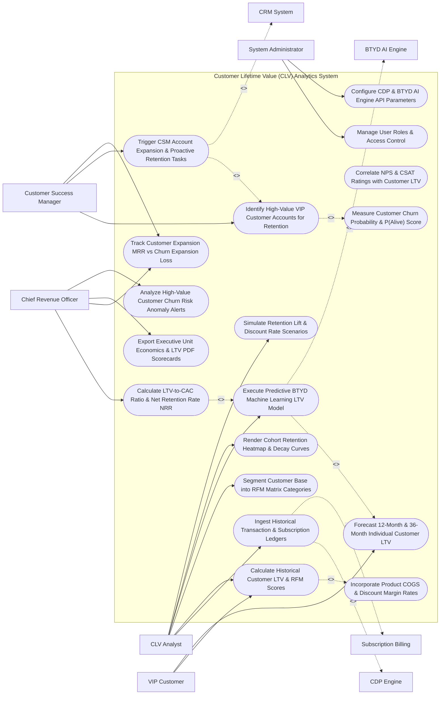

# Use Case Diagram — Customer Lifetime Value (CLV) Analytics System

## Mermaid Code

## Actor Table | Bảng Actor

| # | Actor | Actor Type | Role Description | Related Use Cases |
|---|-------|------------|------------------|-------------------|
| 1 | CLV Analyst | Primary | Financial analyst ingesting ledgers, configuring RFM segments, executing BTYD ML models, rendering retention heatmaps, and simulating scenarios. | UC01, UC02, UC03, UC05, UC08, UC11 |
| 2 | Customer Success Manager | Primary | CSM identifying VIP accounts at risk, triggering retention playbooks, and tracking expansion MRR. | UC12, UC13, UC14 |
| 3 | VIP Customer | Primary | High-value customer generating recurring orders and receiving tailored retention offers. | UC02, UC06 |
| 4 | Chief Revenue Officer | Primary | Executive evaluating LTV:CAC ratios, NRR %, expansion vs churn loss, executive scorecards, and churn alerts. | UC10, UC14, UC15, UC18 |
| 5 | System Administrator | Primary | IT admin managing security roles, CDP API credentials, and BTYD AI engine parameters. | UC16, UC17 |
| 6 | CDP Engine | System (Secondary) | Central CDP supplying consolidated transaction history and order timestamps. | UC01 |
| 7 | BTYD AI Engine | System (Secondary) | Machine learning service running BG-NBD and Gamma-Gamma regression to forecast future transactions. | UC05 |
| 8 | CRM System | System (Secondary) | Enterprise CRM receiving high-value customer tags, churn risk alerts, and CSM expansion tasks. | UC13 |
| 9 | Subscription Billing | System (Secondary) | Subscription platform (Stripe/Chargebee) supplying recurring billing ledgers and MRR updates. | UC01 |

## Use Case Table | Bảng Use Case

| # | UC ID | Use Case Name | Primary Actor | Secondary Actor | Description | Priority |
|---|-------|---------------|---------------|-----------------|-------------|----------|
| 1 | UC01 | Ingest Historical Transaction & Subscription Ledgers | CLV Analyst | CDP System | Ingests multi-year order histories, transaction amounts, subscription MRR ledgers, and refund data. | Critical |
| 2 | UC02 | Calculate Historical Customer LTV & RFM Scores | CLV Analyst | None | Computes cumulative historical net margin revenue and calculates Recency, Frequency, Monetary (RFM) scores. | Critical |
| 3 | UC03 | Segment Customer Base into RFM Matrix Categories | CLV Analyst | None | Categorizes customers into 10 RFM segments (Champions, Loyal Customers, Potential Loyalists, At-Risk, Lost). | High |
| 4 | UC04 | Incorporate Product COGS & Discount Margin Rates | System | None | Deducts product Cost of Goods Sold (COGS) and fulfillment costs to calculate net margin LTV rather than gross revenue. | Critical |
| 5 | UC05 | Execute Predictive BTYD Machine Learning LTV Model | CLV Analyst | BTYD AI Engine | Runs BG-NBD (frequency/recency) and Gamma-Gamma (monetary value) models to forecast future purchasing behavior. | Critical |
| 6 | UC06 | Forecast 12-Month & 36-Month Individual Customer LTV | VIP Customer | BTYD AI Engine | Computes individual 12-month and 36-month predicted future LTV values for every customer record in database. | Critical |
| 7 | UC07 | Correlate NPS & CSAT Ratings with Customer LTV | CLV Analyst | None | Analyzes statistical correlation between customer NPS/CSAT survey scores and subsequent 3-year realized LTV. | High |
| 8 | UC08 | Render Cohort Retention Heatmap & Decay Curves | CLV Analyst | None | Renders interactive monthly cohort retention heatmaps displaying percentage of active customers over 36+ months. | Critical |
| 9 | UC09 | Measure Customer Churn Probability & P(Alive) Score | System | None | Calculates $P(\text{Alive})$ probability score (0.0 to 1.0) predicting whether a non-contract customer is still active. | Critical |
| 10 | UC10 | Calculate LTV-to-CAC Ratio & Net Retention Rate NRR | CRO | None | Computes $\text{LTV:CAC} = \frac{\text{3-Year Predicted LTV}}{\text{Blended CAC}}$ and Net Retention Rate ($\text{NRR} = \frac{\text{Ending MRR}}{\text{Starting MRR}} \times 100\%$). | Critical |
| 11 | UC11 | Simulate Retention Lift & Discount Rate Scenarios | CLV Analyst | None | Simulates enterprise financial impacts of improving cohort retention rates by +5% or adjusting discount rates ($d=10\%$). | High |
| 12 | UC12 | Identify High-Value VIP Customer Accounts for Retention | CSM | None | Identifies top 10% high-LTV accounts ($> \$10,000$ LTV) exhibiting declining engagement or low $P(\text{Alive})$ scores. | Critical |
| 13 | UC13 | Trigger CSM Account Expansion & Proactive Retention Tasks | CSM | CRM System | Automatically creates priority retention tasks in CRM when a high-value VIP customer shows high churn risk. | Critical |
| 14 | UC14 | Track Customer Expansion MRR vs Churn Expansion Loss | CRO | None | Measures monthly net revenue expansion (Upsells/Cross-sells) vs revenue lost to churn and downgrades. | High |
| 15 | UC15 | Export Executive Unit Economics & LTV PDF Scorecards | CRO | None | Generates executive scorecards detailing LTV:CAC ratios, cohort payback periods, NRR %, and top customer profiles. | High |
| 16 | UC16 | Manage User Roles & Access Control | Admin | None | Controls user login credentials, RBAC permissions, and PII masking settings for financial analysts. | High |
| 17 | UC17 | Configure CDP & BTYD AI Engine API Parameters | Admin | None | Configures API connection keys to CDP transaction stores, BTYD ML engines, and subscription billing gateways. | High |
| 18 | UC18 | Analyze High-Value Customer Churn Risk Anomaly Alerts | CRO | None | Sends urgent alerts to CRO and Head of CS when a top 5% LTV enterprise account shows $P(\text{Alive}) < 0.30$. | High |

## Use Case Specification | Đặc tả Use Case

---

### UC02 — Calculate Historical Customer LTV & RFM Scores

| Field | Detail |
|-------|--------|
| **UC ID** | UC02 |
| **Use Case Name** | Calculate Historical Customer LTV & RFM Scores |
| **Actor(s)** | Primary: Customer Lifetime Value Analyst / Retention Strategist   Secondary: None |
| **Description** | Computes cumulative historical net margin revenue and calculates Recency, Frequency, and Monetary (RFM) scores (scale 1 to 5) for every customer profile in the database. |
| **Precondition** | 1. Multi-year transaction ledgers and customer order histories are ingested (UC01).   2. COGS margin rates are configured (UC04). |
| **Main Flow** | 1. Analyst opens "Historical LTV & RFM Calculation Engine".   2. System retrieves customer transaction history for Customer `CID_99412`:   &nbsp;&nbsp;&nbsp;&nbsp; a. Total Orders ($F$): `12 Orders`.   &nbsp;&nbsp;&nbsp;&nbsp; b. Days Since Last Order ($R$): `14 Days`.   &nbsp;&nbsp;&nbsp;&nbsp; c. Cumulative Gross Order Value: `$5,000.00`.   &nbsp;&nbsp;&nbsp;&nbsp; d. Product COGS & Fulfillment Margin (60% COGS / 40% Net Margin): Net Margin Revenue = `$2,000.00`.   3. System calculates Historical Net LTV: `Historical Net LTV = $2,000.00`.   4. System calculates RFM Percentile Scores (Scale 1 to 5 across active customer base):   &nbsp;&nbsp;&nbsp;&nbsp; a. Recency Score ($R$): 14 days ago -> Top 10th percentile -> `Score = 5`.   &nbsp;&nbsp;&nbsp;&nbsp; b. Frequency Score ($F$): 12 orders -> Top 15th percentile -> `Score = 5`.   &nbsp;&nbsp;&nbsp;&nbsp; c. Monetary Score ($M$): $2,000 net margin -> Top 10th percentile -> `Score = 5`.   5. System combines scores into composite RFM Vector: `RFM 555` (Category: `CHAMPIONS`).   6. System saves historical LTV ($2,000.00) and RFM score (`RFM 555`) to customer master record. |
| **Alternative Flow** | **AF1** — RFM Matrix Distribution Breakdown: System aggregates all customer RFM scores, rendering an interactive 5x5 RFM grid showing customer distribution (e.g., Champions 8%, At-Risk 14%, Hibernating 22%). |
| **Exception Flow** | **EX1** — Zero Historical Purchases: Customer profile contains 0 completed orders; System sets Historical LTV to `$0.00` and RFM Score to `000` (`PROSPECT_UNPURCHASED`). |
| **Postcondition** | Historical Net LTV and RFM scores (1-5) are calculated, and customer is assigned to an RFM segment category. |
| **Business Rule** | **BR1**: Historical LTV MUST be calculated on net profit margin (Gross Revenue minus COGS) rather than top-line gross revenue. |

---

### UC05 — Execute Predictive BTYD Machine Learning LTV Model

| Field | Detail |
|-------|--------|
| **UC ID** | UC05 |
| **Use Case Name** | Execute Predictive BTYD Machine Learning LTV Model |
| **Actor(s)** | Primary: Customer Lifetime Value Analyst / Retention Strategist   Secondary: Predictive AI & BTYD Modeling Subsystem |
| **Description** | Runs statistical "Buy 'Til You Die" (BTYD) machine learning regression models (BG-NBD for transaction frequency/recency and Gamma-Gamma for monetary value) to forecast individual future customer purchasing behavior. |
| **Precondition** | 1. Minimum 12 months of historical transaction data is ingested (UC01).   2. BTYD AI modeling engine connection is authorized. |
| **Main Flow** | 1. Analyst opens "Predictive BTYD Machine Learning Studio".   2. Analyst selects Target Prediction Horizon: `36 Months (3 Years)` and Model Algorithm: `BG-NBD + Gamma-Gamma Submodel`.   3. System constructs BTYD Input Data Matrix per customer ($x, t_x, T, M_{\text{obs}}$):   &nbsp;&nbsp;&nbsp;&nbsp; a. $x$: Number of repeat transactions ($x = 11$).   &nbsp;&nbsp;&nbsp;&nbsp; b. $t_x$: Recency (time of last transaction in weeks, $t_x = 48 \text{ weeks}$).   &nbsp;&nbsp;&nbsp;&nbsp; c. $T$: Customer age (time since first transaction in weeks, $T = 52 \text{ weeks}$).   &nbsp;&nbsp;&nbsp;&nbsp; d. $M_{\text{obs}}$: Average observed order net margin value ($M_{\text{obs}} = \$166.66$).   4. System executes BG-NBD (Beta-Geometric / Negative Binomial Distribution) Model:   &nbsp;&nbsp;&nbsp;&nbsp; a. Calculates $P(\text{Alive})$ Probability Score: $P(\text{Alive}) = 0.92$ (92% probability customer is currently active).   &nbsp;&nbsp;&nbsp;&nbsp; b. Predicts Expected Repeat Transactions over next 36 months: $E[X(36\text{m})] = 8.4 \text{ Transactions}$.   5. System executes Gamma-Gamma Submodel:   &nbsp;&nbsp;&nbsp;&nbsp; a. Predicts Expected Average Order Net Margin Value: $E[M] = \$172.50 / \text{Order}$.   6. System computes Total 36-Month Predicted Future LTV ($pLTV_{36}$):   $$pLTV_{36} = E[X(36\text{m})] \times E[M] = 8.4 \times \$172.50 = \$1,449.00 \text{ Predicted Future LTV}$$   7. System computes Total Combined 36-Month LTV: $\text{Historical LTV } (\$2,000) + pLTV_{36} (\$1,449) = \$3,449.00$.   8. System saves predicted LTV score and $P(\text{Alive})$ probability to customer profile. |
| **Alternative Flow** | **AF1** — Contractual Subscription LTV Model: For B2B subscription customers, System executes a Markov Chain / Kaplan-Meier Survival Analysis model based on annual contract churn rates instead of BTYD. |
| **Exception Flow** | **EX1** — Non-Convergence Error: BTYD optimization algorithm fails to converge due to extreme outlier data; System flags "Model Non-Convergence", falling back to cohort-average historical LTV multipliers. |
| **Postcondition** | $P(\text{Alive})$ probability and 36-month predicted future LTV scores are calculated and saved to customer profiles. |
| **Business Rule** | **BR1**: Non-contractual customer LTV forecasting MUST utilize statistical BTYD models (BG-NBD + Gamma-Gamma) to account for customer dropout probability. |

---

### UC08 — Render Cohort Retention Heatmap & Decay Curves

| Field | Detail |
|-------|--------|
| **UC ID** | UC08 |
| **Use Case Name** | Render Cohort Retention Heatmap & Decay Curves |
| **Actor(s)** | Primary: Customer Lifetime Value Analyst / Retention Strategist   Secondary: None |
| **Description** | Renders interactive monthly cohort retention heatmaps and retention decay curves tracking customer retention percentages and cumulative net margin LTV over 36+ months. |
| **Precondition** | 1. Historical customer acquisition dates and multi-year purchase transactions are ingested (UC01). |
| **Main Flow** | 1. Analyst opens "Cohort Retention & Decay Studio".   2. Analyst selects Cohort Grouping: `Monthly Acquisition Cohorts (2025 - 2026)` and Metric: `Customer Retention %`.   3. System retrieves transaction ledgers and groups customers by acquisition month (e.g., `Jan 2025 Cohort - 1,000 Customers`).   4. System calculates month-by-month active customer retention percentages:   &nbsp;&nbsp;&nbsp;&nbsp; a. Month 0 (Jan 2025): 100.0% Active (1,000 / 1,000).   &nbsp;&nbsp;&nbsp;&nbsp; b. Month 1 (Feb 2025): 68.5% Active (685 / 1,000).   &nbsp;&nbsp;&nbsp;&nbsp; c. Month 3 (Apr 2025): 52.0% Active (520 / 1,000).   &nbsp;&nbsp;&nbsp;&nbsp; d. Month 6 (Jul 2025): 41.2% Active (412 / 1,000).   &nbsp;&nbsp;&nbsp;&nbsp; e. Month 12 (Jan 2026): 34.0% Active (340 / 1,000).   5. System renders Interactive Cohort Retention Heatmap Grid (Color-coded: Dark Blue 100% -> Light Yellow 20%).   6. System plots Cohort Retention Decay Curve overlaying 2025 Cohort vs 2026 Cohort to highlight retention improvements.   7. Analyst toggles view to "Cumulative Net LTV per Acquired Customer": Month 12 Cumulative LTV = `$185.00 / Customer`.   8. Analyst exports cohort retention heatmap table and decay curve chart as a high-res PDF. |
| **Alternative Flow** | **AF1** — Cohort Retention by Channel: Analyst filters cohort heatmap by acquisition channel (e.g., Organic Search Cohort 45% 12-month retention vs Paid Social Cohort 22% 12-month retention) to evaluate channel quality. |
| **Exception Flow** | **EX1** — Immature Cohort Warning: Selected cohort has < 3 months of historical data; System displays warning "Immature Cohort - Retention Projection Confidence Low for > Month 3". |
| **Postcondition** | Cohort retention heatmap and decay curves are rendered, retention percentages per month are calculated, and reports export. |
| **Business Rule** | **BR1**: Cohort retention heatmaps MUST track both customer count retention % and cumulative net revenue LTV per cohort. |

---

### UC10 — Calculate LTV-to-CAC Ratio & Net Retention Rate (NRR)

| Field | Detail |
|-------|--------|
| **UC ID** | UC10 |
| **Use Case Name** | Calculate LTV-to-CAC Ratio & Net Retention Rate (NRR) |
| **Actor(s)** | Primary: Chief Revenue Officer / CMO   Secondary: None |
| **Description** | Computes key enterprise unit economics metrics: LTV-to-CAC Ratio ($\text{LTV:CAC} = \frac{\text{3-Year Predicted Net LTV}}{\text{Blended CAC}}$) and Net Dollar Retention Rate ($\text{NRR} = \frac{\text{Ending MRR}}{\text{Starting MRR}} \times 100\%$). |
| **Precondition** | 1. 3-year predicted net LTV is calculated (UC05).   2. Fully loaded Customer Acquisition Cost (CAC) and subscription MRR ledgers are imported. |
| **Main Flow** | 1. User opens "Executive Unit Economics & NRR Dashboard".   2. User selects Analysis Period: `Fiscal Year 2026` and Business Unit: `Enterprise Cloud SaaS`.   3. System retrieves Unit Economics Inputs:   &nbsp;&nbsp;&nbsp;&nbsp; a. 3-Year Predicted Net LTV per Customer ($LTV_{3\text{y}}$): `$12,000.00`.   &nbsp;&nbsp;&nbsp;&nbsp; b. Fully Loaded Blended Customer Acquisition Cost ($CAC$): `$3,000.00`.   &nbsp;&nbsp;&nbsp;&nbsp; c. Starting Monthly Recurring Revenue ($MRR_{\text{start}}$): `$1,000,000.00` (Cohort of 100 enterprise accounts).   &nbsp;&nbsp;&nbsp;&nbsp; d. Expansion MRR ($MRR_{\text{expand}}$): `+$200,000.00` (Account upsells and cross-sells).   &nbsp;&nbsp;&nbsp;&nbsp; e. Downgrade MRR ($MRR_{\text{down}}$): `-$30,000.00`.   &nbsp;&nbsp;&nbsp;&nbsp; f. Churn MRR ($MRR_{\text{churn}}$): `-$50,000.00`.   4. System calculates LTV-to-CAC Ratio:   $$\text{LTV:CAC Ratio} = \frac{\$12,000.00}{\$3,000.00} = 4.00\times \text{ LTV:CAC}$$   5. System evaluates LTV:CAC Health Benchmark: Target ($\ge 3.0\times$) -> Result ($4.0\times$) -> `HEALTHY_UNIT_ECONOMICS` (Green Badge).   6. System calculates Net Dollar Retention Rate ($\text{NRR}$):   $$\text{NRR} = \frac{\$1,000,000 + \$200,000 - \$30,000 - \$50,000}{\$1,000,000} \times 100\% = \frac{\$1,120,000}{\$1,000,000} \times 100\% = 112.0\% \text{ NRR}$$   7. System displays NRR scorecard ($112.0\%$ NRR indicates strong expansion net revenue growth) and exports executive unit economics report. |
| **Alternative Flow** | **AF1** — Gross Dollar Retention (GRR) Calculation: System computes Gross Retention Rate excluding expansion: $\text{GRR} = \frac{\$1,000,000 - \$30,000 - \$50,000}{\$1,000,000} \times 100\% = 92.0\% \text{ GRR}$. |
| **Exception Flow** | **EX1** — Unhealthy LTV:CAC Alert ($< 2.0\times$): LTV-to-CAC drops to $1.8\times$; System flashes red alert "Unhealthy Unit Economics: LTV:CAC < 2.0x", alerting CRO to reduce CAC or improve retention. |
| **Postcondition** | LTV-to-CAC ratio, Net Dollar Retention Rate (NRR), and Gross Retention Rate (GRR) are calculated and rendered on executive scorecards. |
| **Business Rule** | **BR1**: Enterprise unit economics dashboards MUST calculate Net Retention Rate (NRR) by accounting for starting MRR, expansion MRR, downgrade MRR, and churn MRR. |

---

### UC12 — Identify High-Value VIP Customer Accounts for Retention

| Field | Detail |
|-------|--------|
| **UC ID** | UC12 |
| **Use Case Name** | Identify High-Value VIP Customer Accounts for Retention |
| **Actor(s)** | Primary: Customer Success Manager (CSM)   Secondary: None |
| **Description** | Identifies top 10% high-LTV customer accounts ($> \$10,000$ LTV) exhibiting declining engagement, low $P(\text{Alive})$ scores, or low NPS ratings, flagging them for proactive retention intervention. |
| **Precondition** | 1. Predicted 36-month LTV scores are calculated (UC05).   2. $P(\text{Alive})$ churn probability and NPS survey ratings are ingested (UC07/UC09). |
| **Main Flow** | 1. CSM opens "High-Value VIP Retention Console".   2. System queries customer database filtering for At-Risk VIP Accounts:   &nbsp;&nbsp;&nbsp;&nbsp; a. Filter 1 (High LTV Tier): `3-Year Predicted LTV >= $10,000.00`.   &nbsp;&nbsp;&nbsp;&nbsp; b. AND Filter 2 (At-Risk Indicator): `P(Alive) Score < 0.40 OR NPS Score <= 6`.   3. System identifies 28 High-Value At-Risk VIP Accounts (Total At-Risk LTV Pipeline: `$420,000.00`).   4. System renders At-Risk VIP Account List:   &nbsp;&nbsp;&nbsp;&nbsp; a. Account Name: `Acme Enterprise (CID_99412)`.   &nbsp;&nbsp;&nbsp;&nbsp; b. Predicted 3-Year LTV: `$24,000.00`.   &nbsp;&nbsp;&nbsp;&nbsp; c. $P(\text{Alive})$ Score: `0.32` (High Churn Probability - Last login 45 days ago).   &nbsp;&nbsp;&nbsp;&nbsp; d. NPS Rating: `4 / 10` (Detractor).   &nbsp;&nbsp;&nbsp;&nbsp; e. Assigned CSM: `CSM Jane Doe`.   5. CSM selects `Acme Enterprise` account and reviews historical event timeline and NPS comments.   6. CSM clicks "Launch Proactive VIP Retention Task" (UC13).   7. System creates high-priority retention task in CRM and logs CSM intervention workflow. |
| **Alternative Flow** | **AF1** — Automated VIP Anniversary Reward Trigger: System identifies high-LTV VIP customer celebrating 3-year account anniversary with high $P(\text{Alive}) = 0.95$; System automatically issues VIP loyalty gift. |
| **Exception Flow** | **EX1** — Unassigned Account Alert: At-risk VIP account has no assigned CSM; System automatically assigns account to Senior CS Director and dispatches urgent email alert. |
| **Postcondition** | High-value at-risk VIP customer accounts are identified, total at-risk LTV is quantified, and proactive CSM retention tasks are triggered. |
| **Business Rule** | **BR1**: Accounts in the top 10% LTV bracket exhibiting a $P(\text{Alive})$ score $< 0.40$ MUST be automatically flagged as High-Value At-Risk VIP Accounts. |
