# Conceptual ERD — Customer Lifetime Value (CLV) Analytics System

## Mermaid Code

```mermaid
erDiagram
    USER_ACCOUNT {
        int user_id PK
        string full_name
        string username
        string user_role
        string department_code
        boolean is_active
    }

    CUSTOMER_MASTER_PROFILE {
        int master_customer_id PK
        string customer_crm_id
        string primary_email
        string account_tier_level
        decimal historical_gross_revenue
        decimal historical_net_margin_ltv
        datetime customer_since_date
    }

    TRANSACTION_HISTORY_LEDGER {
        int transaction_id PK
        int master_customer_id FK
        string order_number
        decimal gross_order_amount
        decimal product_cogs_amount
        decimal net_margin_amount
        datetime transaction_timestamp
    }

    RFM_SCORE_SEGMENT {
        int rfm_id PK
        int master_customer_id FK
        int recency_score_1to5
        int frequency_score_1to5
        int monetary_score_1to5
        string rfm_category_name
        date calculated_date
    }

    PREDICTIVE_BTYD_MODEL_CONFIG {
        int model_id PK
        int analyst_user_id FK
        string model_name
        string model_algorithm_type
        text model_parameters_json
        datetime evaluated_at
    }

    PREDICTED_LTV_RECORD {
        int pltv_id PK
        int master_customer_id FK
        int model_id FK
        decimal p_alive_probability_score
        decimal predicted_12m_ltv_amount
        decimal predicted_36m_ltv_amount
        date evaluated_date
    }

    COHORT_RETENTION_METRIC {
        int cohort_id PK
        string cohort_acquisition_month
        int initial_cohort_size_count
        int month_number_offset
        decimal active_retention_percentage
        decimal cumulative_net_ltv_per_customer
        date evaluated_date
    }

    NET_RETENTION_RATE_NRR {
        int nrr_id PK
        decimal starting_mrr_amount
        decimal expansion_mrr_amount
        decimal downgrade_mrr_amount
        decimal churn_mrr_amount
        decimal net_retention_rate_percent
        decimal gross_retention_rate_percent
        date period_month
    }

    VIP_ACCOUNT_RETENTION_TASK {
        int task_id PK
        int master_customer_id FK
        int csm_user_id FK
        string task_priority
        string task_status
        text retention_action_notes
        datetime created_at
    }

    CSAT_NPS_LTV_CORRELATION {
        int correlation_id PK
        int master_customer_id FK
        int latest_nps_rating
        decimal average_csat_rating
        decimal realized_3year_ltv_amount
        date evaluated_date
    }

    EXECUTIVE_UNIT_ECONOMICS {
        int economics_id PK
        int cro_user_id FK
        decimal blended_cac_amount
        decimal predicted_3year_net_ltv
        decimal ltv_to_cac_ratio_multiplier
        decimal nrr_percentage
        date period_quarter
    }

    FINANCIAL_LTV_AUDIT_TRAIL {
        int audit_id PK
        int master_customer_id FK
        int verified_by_user_id FK
        string gaap_compliance_status
        string audit_hash_signature
        datetime audited_at
    }

    CUSTOMER_MASTER_PROFILE ||--o{ TRANSACTION_HISTORY_LEDGER : "incurs"
    CUSTOMER_MASTER_PROFILE ||--o| RFM_SCORE_SEGMENT : "categorized in"
    CUSTOMER_MASTER_PROFILE ||--o| PREDICTED_LTV_RECORD : "predicted in"
    CUSTOMER_MASTER_PROFILE ||--o{ VIP_ACCOUNT_RETENTION_TASK : "flagged in"
    CUSTOMER_MASTER_PROFILE ||--o| CSAT_NPS_LTV_CORRELATION : "correlated in"
    CUSTOMER_MASTER_PROFILE ||--o| FINANCIAL_LTV_AUDIT_TRAIL : "audited in"
    PREDICTIVE_BTYD_MODEL_CONFIG ||--o{ PREDICTED_LTV_RECORD : "forecasts"
    USER_ACCOUNT ||--o{ PREDICTIVE_BTYD_MODEL_CONFIG : "configures"
    USER_ACCOUNT ||--o{ VIP_ACCOUNT_RETENTION_TASK : "assigned"
    USER_ACCOUNT ||--o{ EXECUTIVE_UNIT_ECONOMICS : "evaluates"
    USER_ACCOUNT ||--o{ FINANCIAL_LTV_AUDIT_TRAIL : "verifies"
```

## Entity Description Table | Bảng mô tả Entity

| # | Entity Name | Vietnamese Name | Description | Key Attributes | Main Relationships |
|---|-------------|-----------------|-------------|----------------|-------------------|
| 1 | USER_ACCOUNT | Tài khoản Nguời dùng | System credentials and access roles for CLV analysts, CSMs, CROs, and system administrators. | `user_id`, `username`, `user_role`, `department_code` | Configures `PREDICTIVE_BTYD_MODEL_CONFIG`, assigned `VIP_ACCOUNT_RETENTION_TASK`, evaluates `EXECUTIVE_UNIT_ECONOMICS`. |
| 2 | CUSTOMER_MASTER_PROFILE | Profile Khách hàng Master | Central customer profile entity storing CRM ID, email, tier level, historical gross revenue, and historical net LTV. | `master_customer_id`, `customer_crm_id`, `primary_email`, `historical_net_margin_ltv`, `customer_since_date` | Incurs `TRANSACTION_HISTORY_LEDGER`, categorized in `RFM_SCORE_SEGMENT`, predicted in `PREDICTED_LTV_RECORD`, flagged in `VIP_ACCOUNT_RETENTION_TASK`. |
| 3 | TRANSACTION_HISTORY_LEDGER | Sổ cái Lịch sử Giao dịch | Individual transaction order log recording order numbers, gross amounts, COGS amounts, net margin, and timestamps. | `transaction_id`, `master_customer_id`, `order_number`, `gross_order_amount`, `product_cogs_amount`, `net_margin_amount` | Belongs to `CUSTOMER_MASTER_PROFILE`. |
| 4 | RFM_SCORE_SEGMENT | Segment Điểm RFM | Recency, Frequency, and Monetary (RFM) score record storing 1-5 sub-scores, composite category names (e.g., Champions). | `rfm_id`, `master_customer_id`, `recency_score_1to5`, `frequency_score_1to5`, `monetary_score_1to5`, `rfm_category_name` | Belongs to `CUSTOMER_MASTER_PROFILE`. |
| 5 | PREDICTIVE_BTYD_MODEL_CONFIG | Cấu hình Mô hình BTYD ML | Predictive Buy 'Til You Die (BTYD) machine learning model configuration storing algorithm type and parameters. | `model_id`, `analyst_user_id`, `model_name`, `model_algorithm_type`, `model_parameters_json` | Forecasts `PREDICTED_LTV_RECORD`, configured by `USER_ACCOUNT`. |
| 6 | PREDICTED_LTV_RECORD | Bản ghi Predicted LTV | Forecasted future LTV record storing $P(\text{Alive})$ probability score, 12-month $pLTV$, and 36-month $pLTV$ amounts. | `pltv_id`, `master_customer_id`, `model_id`, `p_alive_probability_score`, `predicted_12m_ltv_amount`, `predicted_36m_ltv_amount` | Belongs to `CUSTOMER_MASTER_PROFILE` and `PREDICTIVE_BTYD_MODEL_CONFIG`. |
| 7 | COHORT_RETENTION_METRIC | Chỉ số Retention Cohort | Monthly cohort retention metric tracking initial cohort sizes, month offsets, retention %, and cumulative net LTV per customer. | `cohort_id`, `cohort_acquisition_month`, `initial_cohort_size_count`, `month_number_offset`, `active_retention_percentage` | Standalone cohort retention entity. |
| 8 | NET_RETENTION_RATE_NRR | Chỉ số NRR Tỷ lệ Retention Net | Monthly Net Retention Rate (NRR) log recording starting MRR, expansion MRR, downgrade MRR, churn MRR, and NRR %. | `nrr_id`, `starting_mrr_amount`, `expansion_mrr_amount`, `downgrade_mrr_amount`, `churn_mrr_amount`, `net_retention_rate_percent` | Standalone subscription financial entity. |
| 9 | VIP_ACCOUNT_RETENTION_TASK | Task Retention VIP Account | High-value at-risk VIP account retention task record storing task priority, status, and CSM intervention notes. | `task_id`, `master_customer_id`, `csm_user_id`, `task_priority`, `task_status`, `retention_action_notes` | Belongs to `CUSTOMER_MASTER_PROFILE`, assigned to `USER_ACCOUNT`. |
| 10 | CSAT_NPS_LTV_CORRELATION | Tương quan NPS/CSAT với LTV | Statistical correlation tracking entity relating customer NPS/CSAT survey ratings to realized 3-year net LTV amounts. | `correlation_id`, `master_customer_id`, `latest_nps_rating`, `average_csat_rating`, `realized_3year_ltv_amount` | Belongs to `CUSTOMER_MASTER_PROFILE`. |
| 11 | EXECUTIVE_UNIT_ECONOMICS | Chỉ số Unit Economics Executive | Executive unit economics summary recording blended CAC, 3-year predicted net LTV, LTV:CAC ratio, and NRR %. | `economics_id`, `cro_user_id`, `blended_cac_amount`, `predicted_3year_net_ltv`, `ltv_to_cac_ratio_multiplier`, `nrr_percentage` | Evaluated by `USER_ACCOUNT`. |
| 12 | FINANCIAL_LTV_AUDIT_TRAIL | Nhật ký Audit Tài chính GAAP LTV | Financial LTV audit trail verification record storing GAAP compliance status and cryptographic hash signatures. | `audit_id`, `master_customer_id`, `verified_by_user_id`, `gaap_compliance_status`, `audit_hash_signature` | Belongs to `CUSTOMER_MASTER_PROFILE`, verified by `USER_ACCOUNT`. |

## Relationship Description | Mô tả Quan hệ

| # | From Entity | Cardinality | To Entity | Label | Business Explanation |
|---|-------------|-------------|-----------|-------|----------------------|
| 1 | CUSTOMER_MASTER_PROFILE | 1 to 0..N | TRANSACTION_HISTORY_LEDGER | incurs | A customer master profile incurs multi-year transactions in historical ledgers. |
| 2 | CUSTOMER_MASTER_PROFILE | 1 to 0..1 | RFM_SCORE_SEGMENT | categorized in | A customer profile is categorized in an RFM score segment (1-5). |
| 3 | CUSTOMER_MASTER_PROFILE | 1 to 0..1 | PREDICTED_LTV_RECORD | predicted in | A customer profile is predicted for future LTV and P(Alive) scores. |
| 4 | CUSTOMER_MASTER_PROFILE | 1 to 0..N | VIP_ACCOUNT_RETENTION_TASK | flagged in | A high-value customer profile is flagged in VIP account retention tasks. |
| 5 | CUSTOMER_MASTER_PROFILE | 1 to 0..1 | CSAT_NPS_LTV_CORRELATION | correlated in | A customer profile is correlated for NPS/CSAT ratings vs realized LTV. |
| 6 | CUSTOMER_MASTER_PROFILE | 1 to 0..1 | FINANCIAL_LTV_AUDIT_TRAIL | audited in | A customer profile is audited in GAAP financial LTV audit trails. |
| 7 | PREDICTIVE_BTYD_MODEL_CONFIG | 1 to 0..N | PREDICTED_LTV_RECORD | forecasts | A BTYD model config forecasts predicted LTV records. |
| 8 | USER_ACCOUNT | 1 to 0..N | PREDICTIVE_BTYD_MODEL_CONFIG | configures | A CLV analyst user account configures predictive BTYD machine learning models. |
| 9 | USER_ACCOUNT | 1 to 0..N | VIP_ACCOUNT_RETENTION_TASK | assigned | A CSM user account is assigned VIP account retention tasks. |
| 10 | USER_ACCOUNT | 1 to 0..N | EXECUTIVE_UNIT_ECONOMICS | evaluates | A CRO user account evaluates executive unit economics scorecards. |
| 11 | USER_ACCOUNT | 1 to 0..N | FINANCIAL_LTV_AUDIT_TRAIL | verifies | A financial auditor user account verifies GAAP audit trails. |
