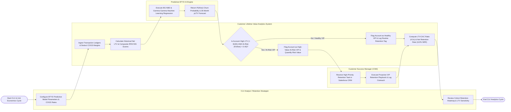

# Swimlane Diagram — Customer Lifetime Value (CLV) Analytics System

## Mermaid Code

## Flow Description | Mô tả luồng

| Lane | Actor | Role in Flow |
|------|-------|-------------|
| 1 | CLV Analyst / Retention Strategist | Configures predictive BTYD model parameters (discount rates, time horizons), sets COGS margin rates, reviews cohort retention heatmaps, and runs LTV sensitivity simulations. |
| 2 | Customer Lifetime Value Analytics System | Ingests multi-year transaction ledgers, deducts product COGS, calculates historical net LTV and RFM 555 scores, evaluates at-risk VIP account thresholds ($LTV \ge \$10,000$ and $P(\text{Alive}) < 0.40$), calculates LTV:CAC ratios and Net Retention Rates (NRR), and renders scorecards. |
| 3 | Predictive BTYD AI Engine | Runs BG-NBD (frequency/recency) and Gamma-Gamma (monetary value) machine learning regression algorithms, returning individual $P(\text{Alive})$ probability scores and 36-month predicted $pLTV$ values. |
| 4 | Customer Success Manager (CSM) | Receives automated high-priority VIP retention tasks in CRM, executes proactive retention playbooks (executive outreach, expansion discount), and logs intervention results. |
