# Action Tree — Customer Lifetime Value (CLV) Analytics System

## Mermaid Code

```mermaid
graph TD
    Root["Customer Lifetime Value CLV Analytics System"]

    Root --> M1["Historical LTV & RFM Segmentation Engine"]
    Root --> M2["Predictive BTYD Machine Learning Forecasting"]
    Root --> M3["Cohort Retention & Decay Analytics"]
    Root --> M4["Unit Economics & LTV:CAC Ratio Management"]
    Root --> M5["High-Value VIP Account Retention & CRM Tasks"]
    Root --> M6["NPS/CSAT LTV Correlation & GAAP Compliance"]

    M1 --> A11["Ingest Multi-Year Transaction & Subscription Ledgers"]
    M1 --> A12["Deduct Product COGS & Fulfillment Margin Overhead"]
    M1 --> A13["Calculate Historical Net Margin LTV per Customer"]
    M1 --> A14["Categorize Customer Base into 5x5 RFM Grid Segments (Scale 1-5)"]

    M2 --> A21["Configure BG-NBD Frequency/Recency Statistical Models"]
    M2 --> A22["Execute Gamma-Gamma Monetary Submodel Regression"]
    M2 --> A23["Forecast Individual 12-Month & 36-Month Predicted LTV (pLTV)"]
    M2 --> A24["Calculate Customer P(Alive) Probability & Churn Risk Scores"]

    M3 --> A31["Render Interactive Monthly Cohort Retention Heatmaps"]
    M3 --> A32["Plot Cohort Retention Decay Curves over 36+ Months"]
    M3 --> A33["Calculate Cumulative Net LTV Realized per Acquired Customer"]
    M3 --> A34["Compare Cohort Retention Performance by Acquisition Channel"]

    M4 --> A41["Calculate LTV-to-CAC Ratio (3-Year Predicted Net LTV / CAC)"]
    M4 --> A42["Calculate Net Dollar Retention Rate (NRR %) across Cohorts"]
    M4 --> A43["Measure Gross Dollar Retention Rate (GRR %) excluding Expansion"]
    M4 --> A44["Simulate Financial Impacts of +5% Retention Lift & Discount Rates"]

    M5 --> A51["Identify Top 10% High-Value VIP Accounts (> $10K LTV)"]
    M5 --> A52["Flag High-Value At-Risk Accounts (P(Alive) < 0.40 or Low NPS)"]
    M5 --> A53["Trigger Proactive Retention Tasks & CRM Alerts for CSMs"]
    M5 --> A54["Track Customer Expansion MRR vs Churn Revenue Loss"]

    M6 --> A61["Correlate Customer NPS/CSAT Survey Scores with Realized LTV"]
    M6 --> A62["Verify GAAP & IFRS Revenue Recognition Compliance"]
    M6 --> A63["Generate Cryptographic Financial LTV Audit Trail Signatures"]
    M6 --> A64["Export Executive Unit Economics & LTV PDF Scorecard Reports"]
```

## Module Description | Mô tả Module

| # | Module | Description | Actions |
|---|--------|-------------|---------|
| 1 | Historical LTV & RFM Segmentation Engine | Ingests transaction ledgers, deducts product COGS, calculates historical net margin LTV, and categorizes customers into 5x5 RFM grid segments. | Ingest Transaction Ledgers, Deduct Product COGS Margins, Calculate Historical Net LTV, Categorize 5x5 RFM Grid Segments. |
| 2 | Predictive BTYD Machine Learning Forecasting | Configures BG-NBD models, runs Gamma-Gamma regression, forecasts 12m/36m predicted $pLTV$, and calculates $P(\text{Alive})$ probability scores. | Configure BG-NBD Models, Execute Gamma-Gamma Submodel Regression, Forecast 12m/36m Predicted LTV, Calculate P(Alive) Probability Scores. |
| 3 | Cohort Retention & Decay Analytics | Renders monthly cohort retention heatmaps, plots 36-month retention decay curves, calculates cumulative net LTV, and compares acquisition channels. | Render Monthly Cohort Heatmaps, Plot Retention Decay Curves, Calculate Cumulative Net LTV, Compare Retention by Channel. |
| 4 | Unit Economics & LTV:CAC Ratio Management | Calculates LTV-to-CAC ratios, measures Net Retention Rate (NRR %), computes Gross Retention Rate (GRR %), and simulates retention lift scenarios. | Calculate LTV-to-CAC Ratios, Calculate Net Retention Rate NRR %, Measure Gross Retention Rate GRR %, Simulate Retention Lift Scenarios. |
| 5 | High-Value VIP Account Retention & CRM Tasks | Identifies top 10% high-LTV VIP accounts, flags at-risk VIP accounts ($P(\text{Alive}) < 0.40$), triggers CSM CRM tasks, and tracks expansion MRR vs churn. | Identify Top 10% High-LTV Accounts, Flag High-Value At-Risk Accounts, Trigger Proactive CSM CRM Tasks, Track Expansion MRR vs Churn Loss. |
| 6 | NPS/CSAT LTV Correlation & GAAP Compliance | Correlates NPS/CSAT survey scores with realized 3-year LTV, verifies GAAP revenue recognition, generates audit trails, and exports scorecards. | Correlate NPS/CSAT Scores with LTV, Verify GAAP Revenue Recognition, Generate Financial LTV Audit Trails, Export Executive Unit Economics Scorecards. |
