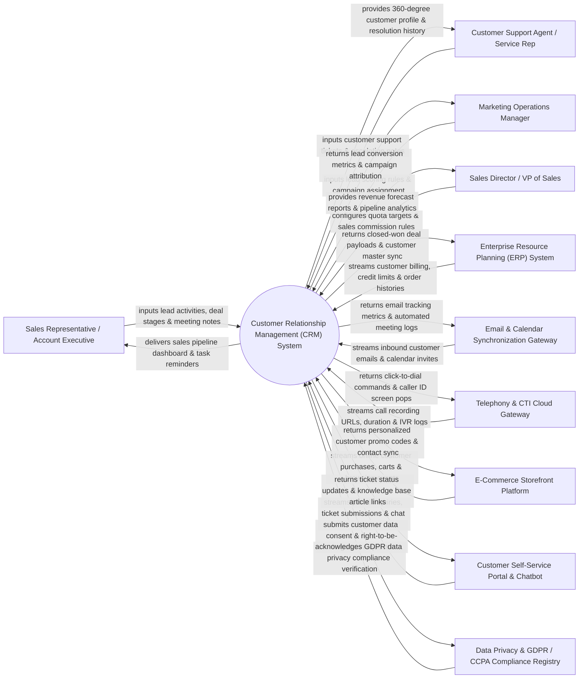

# Context Diagram — Customer Relationship Management (CRM) System

## Mermaid Code

## Actor & Interaction Table | Bảng Actor & Tương tác

| # | Actor | Actor Type | Data Sent TO System | Data Received FROM System | Notes |
|---|-------|------------|---------------------|---------------------------|-------|
| 1 | Sales Representative / Account Executive | Primary | Lead contact details, meeting notes, deal stage progressions, task updates, quote requests. | Sales pipeline Kanban board, automated task reminders, deal probability scores, contact activity timeline. | Front-line sales staff managing customer interactions, negotiating deals, and closing sales opportunities. |
| 2 | Customer Support Agent / Service Rep | Primary | Support ticket creation, case escalation notes, resolution status, customer satisfaction (CSAT) ratings. | 360-degree customer profile, past purchase history, active entitlement SLAs, knowledge base articles. | Customer service agent handling inquiries, resolving complaints, and logging support interactions. |
| 3 | Marketing Operations Manager | Primary | Lead scoring criteria, campaign target lists, lead routing rules, email template designs. | Qualified Lead (MQL) conversion rates, campaign attribution metrics, channel ROI reports. | Marketing professional optimizing lead generation, lead qualification, and marketing-to-sales handoff. |
| 4 | Sales Director / VP of Sales | Primary | Annual sales quota targets, territory assignments, commission structure rules, discount threshold limits. | Real-time revenue forecasts, sales team performance leaderboards, pipeline velocity metrics, win/loss analytics. | Executive leader managing sales strategy, revenue forecasting, territory management, and team quotas. |
| 5 | Enterprise Resource Planning (ERP) System | Supporting | Invoicing status, credit limits, account balance history, fulfilled order line items, product SKUs. | Closed-won opportunity payload, new customer account creation, sales order conversion triggers. | Enterprise backend system managing financial billing, inventory fulfillment, and accounting ledgers. |
| 6 | Email & Calendar Synchronization Gateway | Supporting | Inbound customer emails, calendar appointment acceptances, email open/click tracking events. | Auto-logged outbound email activities, calendar invitation sync, automated follow-up sequences. | Email provider integration (Microsoft Outlook, Gmail) providing seamless two-way email and calendar sync. |
| 7 | Telephony & CTI Cloud Gateway | Supporting | Inbound/outbound call logs, call recording URLs, call duration timestamps, IVR menu selections. | Click-to-dial phone commands, caller ID screen pop payloads, automatic call distribution (ACD) routing tags. | Computer Telephony Integration (CTI) platform (Twilio, RingCentral, Cisco) powering voice call logging and screen pops. |
| 8 | E-Commerce Storefront Platform | Supporting | Customer online orders, abandoned cart events, product page views, lifetime spending totals. | Customer segment tags, personalized promotion codes, unified customer profile synchronization. | Online storefront (Shopify, Magento, Salesforce Commerce Cloud) syncing e-commerce customer behavior data. |
| 9 | Customer Self-Service Portal & Chatbot | Supporting | Customer self-registered tickets, chatbot conversation transcripts, FAQ search queries. | Ticket status updates, automated bot responses, agent escalation handoff payloads. | Customer-facing portal and conversational AI chatbot facilitating self-service inquiry submission. |
| 10 | Data Privacy & GDPR / CCPA Compliance Registry | Supporting / Regulatory | Mandated data privacy rules (GDPR, CCPA), opt-in consent records, data retention policies. | Customer data consent audit logs, subject access requests (SAR), right-to-be-forgotten deletion confirmations. | Regulatory compliance framework ensuring customer data privacy and consent management. |

## System Boundary Description | Mô tả Phạm vi Hệ thống

The **Customer Relationship Management (CRM) System** is an enterprise sales enablement, customer service, and account management platform designed to centralize customer data, automate sales pipelines, streamline customer support cases, and track customer lifecycles.

**Inside System Scope:**
- 360-degree customer account and contact management with activity timelines, communication logs, and relationship hierarchies.
- Opportunity and sales pipeline tracking via visual Kanban boards, stage probability scoring, and automated deal stage progression.
- Customer support case management with SLA tracking, ticket routing, escalation rules, and knowledge base integration.
- Lead scoring, lead routing, and Automated Marketing-to-Sales Qualified Lead (MQL to SQL) handoff workflows.
- Bi-directional integration with ERP, Email/Calendar, Telephony (CTI), and E-Commerce platforms with GDPR/CCPA data privacy enforcement.

**Outside System Scope:**
- Physical inventory warehouse storage and courier package delivery (handled by ERP and Logistics Systems).
- Direct credit card processing and merchant bank payment settlement (handled by Payment Gateways).
- Direct creation of mass advertising creative media assets (handled by Digital Asset Management Systems).
