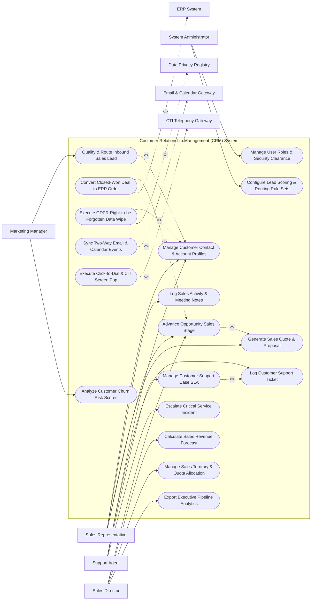

# Use Case Diagram — Customer Relationship Management (CRM) System

## Mermaid Code

## Actor Table | Bảng Actor

| # | Actor | Actor Type | Role Description | Related Use Cases |
|---|-------|------------|------------------|-------------------|
| 1 | Sales Representative | Primary | Account executive or SDR creating contacts, logging meetings, building quotes, and advancing deal stages. | UC01, UC03, UC04, UC05 |
| 2 | Support Agent | Primary | Customer service representative managing support tickets, tracking resolution SLAs, and escalating issues. | UC01, UC07, UC08, UC09 |
| 3 | Marketing Manager | Primary | Marketing ops lead scoring inbound leads, assigning campaigns, and monitoring churn risk analytics. | UC02, UC18 |
| 4 | Sales Director | Primary | Revenue executive reviewing sales forecasts, allocating territories/quotas, and viewing pipeline dashboards. | UC05, UC10, UC11, UC15 |
| 5 | System Administrator | Primary | IT administrative user configuring system security, RBAC roles, and automated lead scoring rules. | UC16, UC17 |
| 6 | ERP System | System (Secondary) | Backend ERP software receiving closed-won deal payloads to trigger automated order fulfillment. | UC06 |
| 7 | Email & Calendar Gateway | System (Secondary) | Cloud email provider (Outlook/Gmail) syncing two-way emails, calendar invites, and tracking opens. | UC13 |
| 8 | CTI Telephony Gateway | System (Secondary) | Cloud phone system providing click-to-dial, call recording links, and caller ID screen pops. | UC14 |
| 9 | Data Privacy Registry | System (Secondary) | Privacy compliance platform verifying GDPR consent and right-to-be-forgotten deletion executions. | UC12 |

## Use Case Table | Bảng Use Case

| # | UC ID | Use Case Name | Primary Actor | Secondary Actor | Description | Priority |
|---|-------|---------------|---------------|-----------------|-------------|----------|
| 1 | UC01 | Manage Customer Contact & Account Profiles | SalesRep | None | Maintains 360-degree customer contact profiles, communication histories, and organizational account hierarchies. | High |
| 2 | UC02 | Qualify & Route Inbound Sales Lead | MarketingMgr | None | Scores raw inbound leads based on demographic and behavioral criteria and assigns qualified leads to sales reps. | High |
| 3 | UC03 | Log Sales Activity & Meeting Notes | SalesRep | None | Records sales call logs, email threads, demo notes, and schedules follow-up task reminders. | High |
| 4 | UC04 | Generate Sales Quote & Proposal | SalesRep | None | Builds multi-line item product quotes, applies approved discounts, and generates PDF proposals for customer sign-off. | High |
| 5 | UC05 | Advance Opportunity Sales Stage | SalesRep | SalesDirector | Updates deal stages on Kanban board (Prospecting -> Discovery -> Proposal -> Negotiation -> Closed-Won). | High |
| 6 | UC06 | Convert Closed-Won Deal to ERP Order | SalesRep | ERP System | Automatically transforms closed-won CRM opportunities into sales orders transmitted to the ERP system. | Critical |
| 7 | UC07 | Log Customer Support Ticket | SupportAgent | None | Ingests and registers customer support inquiries, categorizes issue type, and assigns ticket priority. | High |
| 8 | UC08 | Manage Customer Support Case SLA | SupportAgent | None | Monitors response and resolution countdown timers against active customer Service Level Agreements (SLAs). | High |
| 9 | UC09 | Escalate Critical Service Incident | SupportAgent | None | Triggers multi-tiered escalation notifications to engineering and management for high-severity customer outages. | High |
| 10 | UC10 | Calculate Sales Revenue Forecast | SalesDirector | None | Calculates weighted sales forecasts based on pipeline stage probabilities, historical win rates, and close dates. | Critical |
| 11 | UC11 | Manage Sales Territory & Quota Allocation | SalesDirector | None | Configures geographic/industry sales territories and assigns annual revenue quotas to account teams. | High |
| 12 | UC12 | Execute GDPR Right-to-be-Forgotten Data Wipe | Admin | PrivacyReg | Anonymizes or permanently purges customer PII data upon receiving verified GDPR/CCPA erasure requests. | Critical |
| 13 | UC13 | Sync Two-Way Email & Calendar Events | SalesRep | Email Gateway | Automatically logs inbound/outbound emails and calendar appointments between CRM and Outlook/Gmail. | High |
| 14 | UC14 | Execute Click-to-Dial & CTI Screen Pop | SalesRep | Telephony | Enables one-click phone dialing from contact records and displays caller ID profile screen pops for incoming calls. | Medium |
| 15 | UC15 | Export Executive Pipeline Analytics | SalesDirector | None | Renders visual sales pipeline conversion heatmaps, win/loss ratio charts, and sales velocity reports. | High |
| 16 | UC16 | Manage User Roles & Security Clearance | Admin | None | Controls user login credentials, field-level security access, and role-based data visibility permissions. | High |
| 17 | UC17 | Configure Lead Scoring & Routing Rule Sets | Admin | MarketingMgr | Sets up automated lead scoring point values (e.g., +20 points for pricing page visit) and round-robin assignment. | High |
| 18 | UC18 | Analyze Customer Churn Risk Scores | MarketingMgr | None | Analyzes customer portal activity, support ticket frequency, and usage trends to compute AI churn risk scores. | Medium |

## Use Case Specification | Đặc tả Use Case

---

### UC02 — Qualify & Route Inbound Sales Lead

| Field | Detail |
|-------|--------|
| **UC ID** | UC02 |
| **Use Case Name** | Qualify & Route Inbound Sales Lead |
| **Actor(s)** | Primary: Marketing Operations Manager   Secondary: None |
| **Description** | Automatically evaluates raw inbound sales leads from web forms or marketing campaigns, computes lead qualification scores, and routes qualified Marketing Qualified Leads (MQL) to sales representatives. |
| **Precondition** | 1. Inbound lead form submission is ingested into the system.   2. Lead scoring and round-robin routing rules are configured (UC17). |
| **Main Flow** | 1. System ingests raw lead payload (Name, Email, Company Name, Employee Count, Budget, Phone Number).   2. System checks for duplicate contact records by email domain or phone number.   3. System calculates Demographic Score (e.g., Company Size > 500 employees = +30 points; C-Level Job Title = +20 points).   4. System calculates Behavioral Score (e.g., Downloaded Whitepaper = +15 points; Visited Pricing Page 3x = +25 points).   5. System computes Total Lead Score (e.g., 90 points).   6. System evaluates qualification threshold: Total Score >= 70 points -> Status set to `MARKETING_QUALIFIED_LEAD (MQL)`.   7. System applies territory and round-robin routing matrix to select target Sales Representative (e.g., Assigned to Account Executive John Doe - Enterprise US East).   8. System dispatches real-time notification alert (in-app + email) to assigned Sales Representative. |
| **Alternative Flow** | **AF1** — Low Score Nurture Routing: Total Lead Score < 50 points; System sets lead status to `UNQUALIFIED_NURTURE` and automatically enrolls lead in automated email marketing drip campaign. |
| **Exception Flow** | **EX1** — Existing Active Account Match: Inbound lead belongs to an existing open enterprise account; System bypasses round-robin routing and directly assigns lead to the current Account Manager. |
| **Postcondition** | Lead is scored, status is updated to MQL, contact record is assigned to a sales rep, and notification alert is sent. |
| **Business Rule** | **BR1**: Inbound leads meeting MQL threshold (Score >= 70) MUST be routed and assigned to a sales representative within <= 5 minutes of form submission. |

---

### UC05 — Advance Opportunity Sales Stage

| Field | Detail |
|-------|--------|
| **UC ID** | UC05 |
| **Use Case Name** | Advance Opportunity Sales Stage |
| **Actor(s)** | Primary: Sales Representative   Secondary: Sales Director |
| **Description** | Updates an active sales opportunity's progression through pre-defined deal stages on the interactive Kanban pipeline board, updating stage probability percentages and close forecasts. |
| **Precondition** | 1. Sales opportunity is created and linked to a customer account profile (UC01). |
| **Main Flow** | 1. Sales Representative opens "Sales Pipeline Kanban Board".   2. Rep selects target opportunity card (e.g., Acme Corp Cloud ERP Deal - $150,000).   3. Rep drags card from current stage `DISCOVERY (20% Probability)` to `PROPOSAL_SENT (50% Probability)`.   4. System prompts rep to complete mandatory stage gate requirements:   &nbsp;&nbsp;&nbsp;&nbsp; a. Attach approved PDF Sales Quote (UC04).   &nbsp;&nbsp;&nbsp;&nbsp; b. Input expected Close Date (e.g., Oct 30, 2026).   &nbsp;&nbsp;&nbsp;&nbsp; c. Confirm primary Decision Maker contact.   5. Rep completes required fields and clicks "Save Stage Update".   6. System recalculates weighted deal forecast: `$150,000 * 50% = $75,000 Weighted Revenue`.   7. System updates pipeline totals, logs stage change timestamp in opportunity audit history, and sends updates to executive dashboard (UC15). |
| **Alternative Flow** | **AF1** — Deal Closed-Won: Rep advances deal to `CLOSED_WON (100% Probability)`; System triggers UC06 (Convert Closed-Won Deal to ERP Order), creating sales order in ERP.   **AF2** — Deal Closed-Lost: Rep moves deal to `CLOSED_LOST (0% Probability)`; System prompts mandatory selection of Loss Reason Code (e.g., Price Too High, Competitor Chosen) and competitor name. |
| **Exception Flow** | **EX1** — Discount Threshold Violation: Quote attached to proposal stage contains a 30% discount, exceeding Rep's 15% discount limit; System locks stage advancement and sends automated approval request to Sales Director. |
| **Postcondition** | Opportunity deal stage is updated, stage probability and weighted revenue are recalculated, and audit history is logged. |
| **Business Rule** | **BR1**: Advancing an opportunity to `PROPOSAL_SENT` or higher MUST require an attached, system-validated sales quote document. |

---

### UC08 — Manage Customer Support Case SLA

| Field | Detail |
|-------|--------|
| **UC ID** | UC08 |
| **Use Case Name** | Manage Customer Support Case SLA |
| **Actor(s)** | Primary: Customer Support Agent   Secondary: None |
| **Description** | Tracks active customer support tickets against Service Level Agreement (SLA) response and resolution time targets based on customer entitlement tiers (Platinum, Gold, Standard). |
| **Precondition** | 1. Customer support ticket is logged and categorized (UC07).   2. Customer account has an active service entitlement contract. |
| **Main Flow** | 1. System receives newly logged support case (e.g., Ticket #88412 - Severity 1 Outage for Platinum Account Acme Corp).   2. System retrieves customer Entitlement SLA parameters:   &nbsp;&nbsp;&nbsp;&nbsp; a. First Response SLA Target: 15 minutes.   &nbsp;&nbsp;&nbsp;&nbsp; b. Case Resolution SLA Target: 4 hours.   3. System initializes real-time visual SLA countdown timers on Support Agent workspace ticket view.   4. Support Agent posts first response to customer within 10 minutes.   5. System stops First Response SLA timer, records `SLA_MET` status, and maintains Resolution SLA countdown.   6. Agent works with engineering team, applies software fix, and closes ticket at 2 hours 45 minutes.   7. System stops Resolution SLA timer, marks ticket status as `CLOSED_RESOLVED`, and dispatches CSAT survey to customer. |
| **Alternative Flow** | **AF1** — Paused SLA on Customer Response Wait: Agent requests additional diagnostic logs from customer; Agent sets ticket status to `WAITING_ON_CUSTOMER`, and System automatically pauses SLA countdown timer until customer replies. |
| **Exception Flow** | **EX1** — SLA Warning & Breach Escalation: Resolution SLA countdown reaches 75% without resolution; System turns timer red, flashes "SLA Warning Alert", and dispatches automated escalation notification to Support Team Lead (UC09). |
| **Postcondition** | Support case SLA timers are tracked, response/resolution compliance is recorded, and SLA metrics are updated. |
| **Business Rule** | **BR1**: Severity 1 incidents for Platinum Entitlement accounts MUST enforce a First Response SLA of <= 15 minutes. |

---

### UC10 — Calculate Sales Revenue Forecast

| Field | Detail |
|-------|--------|
| **UC ID** | UC10 |
| **Use Case Name** | Calculate Sales Revenue Forecast |
| **Actor(s)** | Primary: Sales Director / VP of Sales   Secondary: None |
| **Description** | Aggregates all open pipeline opportunities, applies stage probability weighting, historical velocity algorithms, and rep commitments to generate comprehensive sales revenue forecasts. |
| **Precondition** | 1. Active sales opportunities exist with valid close dates, deal amounts, and stages (UC05). |
| **Main Flow** | 1. Sales Director opens "Revenue Forecasting & Analytics" module.   2. Director selects Forecast Period (e.g., Q4 2026) and Territory Filter (e.g., Global Enterprise Sales).   3. System retrieves all open opportunities closing in Q4 2026.   4. System calculates 4-Category Forecast Model:   &nbsp;&nbsp;&nbsp;&nbsp; a. Closed-Won: $1,200,000 (100% committed closed deals).   &nbsp;&nbsp;&nbsp;&nbsp; b. Commit Category: $850,000 (Deals in late negotiation with rep commitment).   &nbsp;&nbsp;&nbsp;&nbsp; c. Best Case Category: $600,000 (Upside opportunities in proposal stage).   &nbsp;&nbsp;&nbsp;&nbsp; d. Pipeline Category: $400,000 (Early stage discovery deals).   5. System computes Weighted AI Forecast: `$1,200,000 + ($850,000 * 90%) + ($600,000 * 50%) + ($400,000 * 20%) = $2,345,000`.   6. System compares forecasted revenue against quarterly quota target ($2,500,000), highlighting a `$155,000 Quota Gap`.   7. Director adjusts forecast overrides, adds commentary notes, and exports executive summary report. |
| **Alternative Flow** | **AF1** — Historical Rep Accuracy Weighting: System applies AI rep accuracy factor (e.g., Rep John Doe historically over-estimates by 15%); AI adjusts Rep John's committed deals down by 15% for higher forecast precision. |
| **Exception Flow** | **EX1** — Stale Close Date Alert: Opportunities totaling $300,000 have close dates in the past; System flags "Stale Close Date Warning", excluding them from active Q4 forecast until reps update close dates. |
| **Postcondition** | Revenue forecast is calculated across 4 categories, weighted AI predictions are rendered, and quota gap analysis is displayed. |
| **Business Rule** | **BR1**: Revenue forecasts MUST automatically exclude opportunities with close dates in the past until close dates are updated by account reps. |

---

### UC12 — Execute GDPR Right-to-be-Forgotten Data Wipe

| Field | Detail |
|-------|--------|
| **UC ID** | UC12 |
| **Use Case Name** | Execute GDPR Right-to-be-Forgotten Data Wipe |
| **Actor(s)** | Primary: System Administrator   Secondary: Data Privacy & GDPR Compliance Registry |
| **Description** | Anonymizes or permanently purges customer Personally Identifiable Information (PII) across all CRM contact records, activity logs, and email threads in compliance with GDPR/CCPA erasure mandates. |
| **Precondition** | 1. Formal Data Subject Erasure Request is submitted and verified by Data Privacy Registry.   2. Admin holds Data Privacy Officer (DPO) security clearance. |
| **Main Flow** | 1. Admin opens "GDPR & Data Privacy Erasure Console".   2. Admin inputs target Customer Identification (Email: `john.smith@acme.com` or Contact ID `#CN-99412`).   3. System scans database and compiles PII references across all CRM modules:   &nbsp;&nbsp;&nbsp;&nbsp; a. Contact Profile (Name, Phone, Home Address, Birthdate).   &nbsp;&nbsp;&nbsp;&nbsp; b. Sales Activities (Call recordings, Meeting notes, Email sync threads).   &nbsp;&nbsp;&nbsp;&nbsp; c. Support Tickets (Customer comments, CSAT survey entries).   4. System checks legal retention exception rules: Customer has active open financial invoices in ERP; System flags "Financial Audit Exemption - Retain Billing Transaction History for 7 Years".   5. System executes PII Data Anonymization:   &nbsp;&nbsp;&nbsp;&nbsp; a. Replaces PII text fields with `ANONYMIZED_USER_99412`.   &nbsp;&nbsp;&nbsp;&nbsp; b. Permanently purges email activity body text and call recording audio files.   6. System generates cryptographic Deletion Certificate (`HASH_DEL_2026_88192`).   7. System transmits compliance acknowledgment token to Data Privacy Registry and archives deletion audit log. |
| **Alternative Flow** | **AF1** — Full Hard Delete: Customer has zero financial transactions or legal obligations; System performs a permanent hard delete of the contact record and all associated child entities. |
| **Exception Flow** | **EX1** — Ongoing Legal Hold Lock: Customer contact is subject to an active litigation hold; System blocks data wipe execution, alerting "Data Erasure Blocked: Contact Subject to Legal Hold #LH-402". |
| **Postcondition** | Customer PII is anonymized or purged, communication logs are destroyed, deletion certificate is issued, and GDPR compliance is fulfilled. |
| **Business Rule** | **BR1**: Verified GDPR Right-to-be-Forgotten erasure requests MUST be fully executed and confirmed within 30 calendar days of receipt. |
