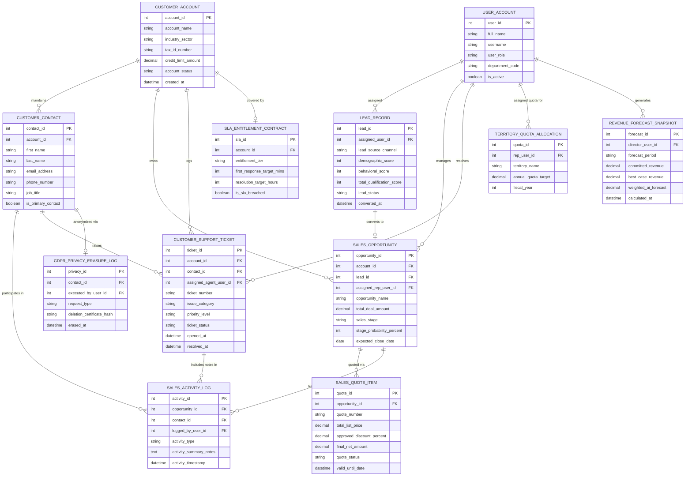

# Conceptual ERD — Customer Relationship Management (CRM) System

## Mermaid Code

## Entity Description Table | Bảng mô tả Entity

| # | Entity Name | Vietnamese Name | Description | Key Attributes | Main Relationships |
|---|-------------|-----------------|-------------|----------------|-------------------|
| 1 | USER_ACCOUNT | Tài khoản Nguời dùng | System user credentials, sales roles, department codes, and security clearance profiles. | `user_id`, `username`, `user_role`, `department_code` | Assigned `LEAD_RECORD`, manages `SALES_OPPORTUNITY`, resolves `CUSTOMER_SUPPORT_TICKET`, assigned `TERRITORY_QUOTA_ALLOCATION`. |
| 2 | CUSTOMER_ACCOUNT | Tài khoản Khách hàng (Doanh nghiệp) | Master B2B enterprise customer profile detailing company name, industry sector, tax ID, and credit limit. | `account_id`, `account_name`, `industry_sector`, `credit_limit_amount`, `account_status` | Maintains `CUSTOMER_CONTACT`, owns `SALES_OPPORTUNITY`, logs `CUSTOMER_SUPPORT_TICKET`, covered by `SLA_ENTITLEMENT_CONTRACT`. |
| 3 | CUSTOMER_CONTACT | Người liên hệ Khách hàng | Individual customer contact details (name, email, phone, job title) linked to an enterprise account. | `contact_id`, `account_id`, `first_name`, `last_name`, `email_address`, `is_primary_contact` | Belongs to `CUSTOMER_ACCOUNT`, participates in `SALES_ACTIVITY_LOG`, anonymized via `GDPR_PRIVACY_ERASURE_LOG`. |
| 4 | LEAD_RECORD | Hồ sơ Khách hàng Tiem năng | Inbound sales lead record capturing demographic/behavioral qualification scores and conversion status. | `lead_id`, `assigned_user_id`, `lead_source_channel`, `total_qualification_score`, `lead_status` | Assigned to `USER_ACCOUNT`, converts to `SALES_OPPORTUNITY`. |
| 5 | SALES_OPPORTUNITY | Cơ hội Bán hàng | Sales pipeline deal entity tracking deal name, total amount, stage, probability %, and close date. | `opportunity_id`, `account_id`, `assigned_rep_user_id`, `total_deal_amount`, `sales_stage`, `stage_probability_percent` | Belongs to `CUSTOMER_ACCOUNT`, quoted via `SALES_QUOTE_ITEM`, tracked via `SALES_ACTIVITY_LOG`. |
| 6 | SALES_QUOTE_ITEM | Báo giá Bán hàng | System-generated multi-line item quote PDF document attached to an opportunity with discount rules. | `quote_id`, `opportunity_id`, `quote_number`, `total_list_price`, `approved_discount_percent`, `final_net_amount` | Belongs to `SALES_OPPORTUNITY`. |
| 7 | CUSTOMER_SUPPORT_TICKET | Phiếu Hỗ trợ Khách hàng | Customer service ticket record capturing issue category, priority level, resolution status, and SLA timestamps. | `ticket_id`, `account_id`, `contact_id`, `assigned_agent_user_id`, `priority_level`, `ticket_status` | Belongs to `CUSTOMER_ACCOUNT` and `CUSTOMER_CONTACT`, resolved by `USER_ACCOUNT`. |
| 8 | SLA_ENTITLEMENT_CONTRACT | Hợp đồng SLA Hỗ trợ | Customer service level entitlement agreement defining target response and resolution timeframes. | `sla_id`, `account_id`, `entitlement_tier`, `first_response_target_mins`, `resolution_target_hours` | Belongs to `CUSTOMER_ACCOUNT`. |
| 9 | SALES_ACTIVITY_LOG | Nhật ký Hoạt động Bán hàng | Communication event logs recording calls, emails, product demos, meeting notes, and follow-up tasks. | `activity_id`, `opportunity_id`, `contact_id`, `logged_by_user_id`, `activity_type`, `activity_timestamp` | Relates `SALES_OPPORTUNITY`, `CUSTOMER_CONTACT`, and `USER_ACCOUNT`. |
| 10 | TERRITORY_QUOTA_ALLOCATION | Phân bổ Chỉ tiêu Lãnh thổ | Sales territory assignments and annual revenue quota targets allocated to account reps. | `quota_id`, `rep_user_id`, `territory_name`, `annual_quota_target`, `fiscal_year` | Belongs to `USER_ACCOUNT`. |
| 11 | GDPR_PRIVACY_ERASURE_LOG | Nhật ký Xóa dữ liệu GDPR | Data privacy erasure audit logs recording customer PII anonymization and deletion certificates. | `privacy_id`, `contact_id`, `executed_by_user_id`, `request_type`, `deletion_certificate_hash` | Belongs to `CUSTOMER_CONTACT`, executed by `USER_ACCOUNT`. |
| 12 | REVENUE_FORECAST_SNAPSHOT | Snapshot Dự báo Doanh thu | Calculated sales forecast snapshots aggregating committed, best-case, and weighted AI predictions. | `forecast_id`, `director_user_id`, `forecast_period`, `committed_revenue`, `weighted_ai_forecast` | Generated by `USER_ACCOUNT`. |

## Relationship Description | Mô tả Quan hệ

| # | From Entity | Cardinality | To Entity | Label | Business Explanation |
|---|-------------|-------------|-----------|-------|----------------------|
| 1 | CUSTOMER_ACCOUNT | 1 to 1..N | CUSTOMER_CONTACT | maintains | A customer account maintains multiple individual customer contacts. |
| 2 | CUSTOMER_ACCOUNT | 1 to 0..N | SALES_OPPORTUNITY | owns | A customer account owns multiple sales opportunities over time. |
| 3 | CUSTOMER_ACCOUNT | 1 to 0..N | CUSTOMER_SUPPORT_TICKET | logs | A customer account logs customer support tickets. |
| 4 | CUSTOMER_ACCOUNT | 1 to 0..1 | SLA_ENTITLEMENT_CONTRACT | covered by | A customer account is covered by an SLA entitlement contract. |
| 5 | CUSTOMER_CONTACT | 1 to 0..N | SALES_ACTIVITY_LOG | participates in | A customer contact participates in sales activity communication logs. |
| 6 | CUSTOMER_CONTACT | 1 to 0..N | CUSTOMER_SUPPORT_TICKET | raises | A customer contact raises support tickets. |
| 7 | CUSTOMER_CONTACT | 1 to 0..1 | GDPR_PRIVACY_ERASURE_LOG | anonymized via | A customer contact is anonymized via a GDPR privacy erasure log. |
| 8 | LEAD_RECORD | 1 to 0..1 | SALES_OPPORTUNITY | converts to | A qualified sales lead converts to a new sales opportunity. |
| 9 | SALES_OPPORTUNITY | 1 to 0..N | SALES_QUOTE_ITEM | quoted via | A sales opportunity is quoted via sales quote items. |
| 10 | SALES_OPPORTUNITY | 1 to 0..N | SALES_ACTIVITY_LOG | tracked via | A sales opportunity is tracked via sales activity logs. |
| 11 | USER_ACCOUNT | 1 to 0..N | LEAD_RECORD | assigned | A sales user account is assigned inbound sales leads. |
| 12 | USER_ACCOUNT | 1 to 0..N | SALES_OPPORTUNITY | manages | A sales user account manages sales opportunities. |
| 13 | USER_ACCOUNT | 1 to 0..N | CUSTOMER_SUPPORT_TICKET | resolves | A support agent user account resolves customer support tickets. |
| 14 | USER_ACCOUNT | 1 to 0..N | TERRITORY_QUOTA_ALLOCATION | assigned quota for | A sales rep user account is assigned annual revenue quotas. |
| 15 | USER_ACCOUNT | 1 to 0..N | REVENUE_FORECAST_SNAPSHOT | generates | A sales director user account generates revenue forecast snapshots. |
