# Swimlane Diagram — Customer Relationship Management (CRM) System

## Mermaid Code

```mermaid
flowchart LR
    Start(["Start Lead & Deal Lifecycle"])

    subgraph Lane_Marketing["Marketing Operations Manager"]
        M1["Configure Inbound Lead Scoring Rules"]
        M2["Evaluate Lead Qualification Score Threshold"]
    end

    subgraph Lane_SalesRep["Sales Representative"]
        R1["Review Assigned MQL Lead & Log Discovery Call"]
        R2["Build Sales Quote & Advance Deal Stage"]
        R3["Negotiate Deal Terms & Sign Proposal"]
    end

    subgraph Lane_CRM["Customer Relationship Management System"]
        S1["Ingest Lead Payload & Calculate Lead Score"]
        S2["Route MQL Lead to Sales Rep via Round-Robin"]
        S3["Update Kanban Pipeline & Recalculate Weighted Forecast"]
        S4{"Is Deal Approved Closed-Won?"}
        S5["Transform Deal Payload & Trigger Order Fulfillment"]
        S6["Mark Opportunity as Closed-Lost & Prompt Loss Reason"]
    end

    subgraph Lane_ERP["Enterprise Resource Planning (ERP) System"]
        E1["Receive Closed-Won Deal Payload"]
        E2["Generate Financial Sales Order & Customer Master Record"]
    end

    Finish(["End Deal Fulfillment Cycle"])

    Start --> M1 --> S1 --> M2 --> S2 --> R1 --> R2 --> S3 --> R3 --> S4
    S4 -->|"Yes"| S5 --> E1 --> E2 --> Finish
    S4 -->|"No / Lost"| S6 --> Finish
```

## Flow Description | Mô tả luồng

| Lane | Actor | Role in Flow |
|------|-------|-------------|
| 1 | Marketing Operations Manager | Configures inbound lead scoring rules, evaluates lead qualification scores, and establishes marketing-to-sales qualification thresholds. |
| 2 | Sales Representative | Reviews assigned Marketing Qualified Leads (MQL), logs discovery call notes, builds multi-line item sales quotes, advances deal stages on the Kanban board, and signs final proposals. |
| 3 | Customer Relationship Management System | Ingests raw leads, calculates demographic/behavioral scores, routes MQLs via round-robin matrices, updates sales pipeline Kanban boards, recalculates weighted revenue forecasts, and validates closed-won status. |
| 4 | Enterprise Resource Planning (ERP) System | Ingests verified closed-won deal payloads from the CRM system, creates customer master records, and generates financial sales orders for inventory fulfillment. |
