# Action Tree — Customer Relationship Management (CRM) System

## Mermaid Code

```mermaid
graph TD
    Root["Customer Relationship Management CRM System"]

    Root --> M1["Account & Contact Management"]
    Root --> M2["Lead Qualification & Routing"]
    Root --> M3["Opportunity & Pipeline Management"]
    Root --> M4["Customer Support Case Management"]
    Root --> M5["Revenue Forecasting & Territory Management"]
    Root --> M6["System Integration & Data Privacy"]

    M1 --> A11["Maintain 360-Degree Customer Account Profiles"]
    M1 --> A12["Track Individual Customer Contact Histories"]
    M1 --> A13["Log Sales Calls, Emails & Meeting Notes"]
    M1 --> A14["Map Account Organizational Hierarchy Trees"]

    M2 --> A21["Calculate Demographic & Behavioral Lead Scores"]
    M2 --> A22["Qualify Leads to MQL Status (Score >= 70)"]
    M2 --> A23["Route MQL Leads via Round-Robin Assignment"]
    M2 --> A24["Enroll Low-Score Leads in Email Nurture Campaigns"]

    M3 --> A31["Manage Visual Opportunity Kanban Pipeline Boards"]
    M3 --> A32["Build PDF Sales Quotes with Discount Rules"]
    M3 --> A33["Advance Opportunity Stages & Probability Weights"]
    M3 --> A34["Convert Closed-Won Deals to ERP Sales Orders"]

    M4 --> A41["Ingest Support Tickets & Assign Case Priority"]
    M4 --> A42["Monitor Entitlement First-Response & Resolution SLAs"]
    M4 --> A43["Escalate High-Severity Outage Tickets to Management"]
    M4 --> A44["Dispatch Post-Resolution CSAT Surveys"]

    M5 --> A51["Calculate Weighted AI Revenue Forecasts"]
    M5 --> A52["Allocate Sales Territories & Annual Rep Quotas"]
    M5 --> A53["Render Sales Pipeline Conversion Heatmaps"]
    M5 --> A54["Analyze Win/Loss Ratios & Sales Velocity Rates"]

    M6 --> A61["Sync Two-Way Email & Calendar Events (Outlook/Gmail)"]
    M6 --> A62["Execute Click-to-Dial & CTI Caller ID Screen Pops"]
    M6 --> A63["Execute GDPR Right-to-be-Forgotten PII Erasures"]
    M6 --> A64["Manage RBAC User Roles & Field Security Clearance"]
```

## Module Description | Mô tả Module

| # | Module | Description | Actions |
|---|--------|-------------|---------|
| 1 | Account & Contact Management | Manages B2B enterprise customer accounts, contact profiles, communication histories, meeting notes, and org structures. | Maintain Account Profiles, Track Contact Histories, Log Calls & Meeting Notes, Map Account Hierarchies. |
| 2 | Lead Qualification & Routing | Scores inbound leads, qualifies MQL status, routes leads via round-robin matrices, and enrolls low-score leads in nurture campaigns. | Calculate Lead Scores, Qualify MQL Status, Route MQL Leads, Enroll Low-Score Leads in Nurture. |
| 3 | Opportunity & Pipeline Management | Manages visual Kanban deal boards, builds multi-line sales quotes, advances stage probabilities, and converts closed-won deals to ERP. | Manage Kanban Pipeline, Build PDF Quotes, Advance Deal Stages, Convert Deals to ERP Orders. |
| 4 | Customer Support Case Management | Ingests support tickets, tracks SLA response/resolution timers, escalates critical outages, and dispatches CSAT surveys. | Ingest Support Tickets, Monitor Case SLAs, Escalate High-Severity Outages, Dispatch CSAT Surveys. |
| 5 | Revenue Forecasting & Territory Management | Calculates weighted AI revenue forecasts, allocates annual rep quotas, renders pipeline heatmaps, and analyzes sales velocity. | Calculate AI Forecasts, Allocate Quotas & Territories, Render Pipeline Heatmaps, Analyze Sales Velocity. |
| 6 | System Integration & Data Privacy | Executes two-way email/calendar sync, CTI click-to-dial screen pops, GDPR right-to-be-forgotten PII wipes, and RBAC security. | Sync Email & Calendar, Execute Click-to-Dial CTI, Execute GDPR PII Erasures, Manage RBAC Roles. |
