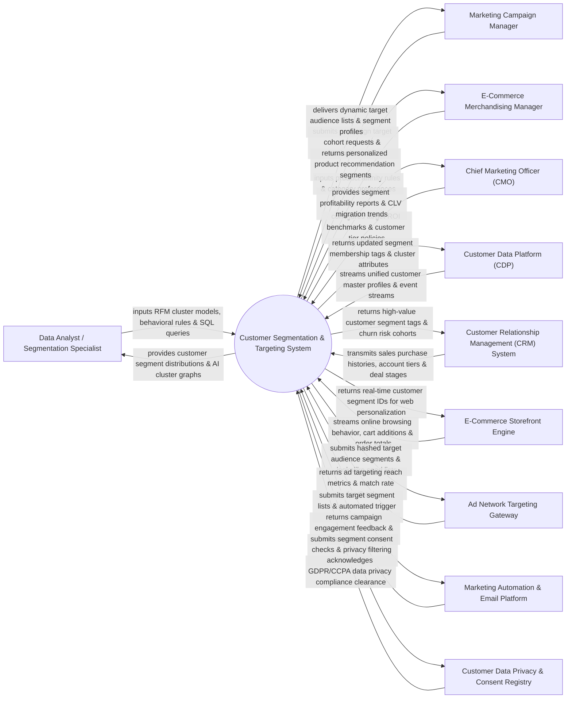

# Context Diagram — Customer Segmentation & Targeting System

## Mermaid Code

## Actor & Interaction Table | Bảng Actor & Tương tác

| # | Actor | Actor Type | Data Sent TO System | Data Received FROM System | Notes |
|---|-------|------------|---------------------|---------------------------|-------|
| 1 | Data Analyst / Segmentation Specialist | Primary | Recency, Frequency, Monetary (RFM) parameters, k-Means machine learning cluster rules, custom SQL queries. | Visual customer segment distribution charts, AI cluster scatter plots, segment overlap Venn diagrams. | Analytics expert designing complex segmentation models, predictive clusters, and cohort analysis. |
| 2 | Marketing Campaign Manager | Primary | Target cohort creation requests, audience suppression criteria, channel preference filters. | Dynamic target audience lists, segment demographic breakdowns, estimated audience reach numbers. | Campaign marketer utilizing segments to launch targeted multi-channel promotions. |
| 3 | E-Commerce Merchandising Manager | Primary | Product category affinity rules, cross-sell/up-sell criteria, price sensitivity brackets. | Personalized product recommendation segments, high-affinity customer lists by product category. | Merchandising lead aligning product promotion strategies with specific customer buying behaviors. |
| 4 | Chief Marketing Officer (CMO) | Primary | Target ROI benchmarks, customer tier policy definitions, lifetime value (CLV) growth goals. | Segment profitability reports, customer tier migration trends (Bronze -> Silver -> Gold), cohort retention metrics. | Executive evaluating portfolio segment value, customer migration dynamics, and marketing efficiency. |
| 5 | Customer Data Platform (CDP) | Supporting | Unified customer master profiles, cross-channel identity graphs, raw behavioral event streams. | Real-time segment membership tags, cluster attribute updates, calculated RFM scores. | Central data platform providing unified single customer view data for multi-dimensional segmentation. |
| 6 | Customer Relationship Management (CRM) System | Supporting | Historical sales transactions, account tiers, sales opportunity stages, support ticket history. | High-value customer segment tags, churn-risk cohort flags, account tier upgrade alerts. | Enterprise CRM supplying historical transaction records and receiving updated customer segment tags. |
| 7 | E-Commerce Storefront Engine | Supporting | Real-time online browsing events, cart additions, search queries, order checkout totals. | Real-time customer segment IDs for dynamic homepage banner and promo personalization. | Storefront engine fetching real-time segment IDs to personalize web user experiences. |
| 8 | Ad Network Targeting Gateway | Supporting | Ad targeting match rate feedback, lookalike reach metrics, campaign impression costs. | Hashed target audience lists (SHA-256), lookalike seed audience segments, retargeting pools. | Digital advertising networks (Google Ads, Meta Ads, LinkedIn) receiving targeted audience segments. |
| 9 | Marketing Automation & Email Platform | Supporting | Campaign engagement metrics (email opens, link clicks), email unsubscribe events. | Target segment contact lists, automated event-triggered campaign cohorts. | Automation platform executing targeted email broadcasts based on system-generated segments. |
| 10 | Customer Data Privacy & Consent Registry | Supporting / Regulatory | GDPR, CCPA, and ePrivacy consent rules, opt-out registries, data minimisation guidelines. | Segment consent audit logs, privacy-filtered target lists, data subject erasure confirmations. | Governance framework enforcing privacy compliance and filtering out non-consented contacts. |

## System Boundary Description | Mô tả Phạm vi Hệ thống

The **Customer Segmentation & Targeting System** is an enterprise predictive analytics, machine learning clustering, and audience management platform designed to partition customer bases into actionable demographic, behavioral, psychographic, and value-based segments.

**Inside System Scope:**
- Multi-dimensional segmentation modeling (RFM scoring, k-Means ML clustering, behavioral cohort analysis).
- Real-time dynamic segment calculation based on streaming web events, purchase histories, and engagement metrics.
- Audience lookalike seed generation, segment overlap analysis, and cross-channel suppression rule enforcement.
- Automated API export of target audience segments to CRM, Marketing Automation, E-Commerce, and Social Ad Networks.
- Privacy-compliant segment filtering ensuring strict adherence to GDPR, CCPA, and opt-out preferences.

**Outside System Scope:**
- Direct raw data warehouse storage of petabyte-scale unindexed server logs (handled by Cloud Data Lakes).
- Direct delivery of mass email dispatches (handled by Email Marketing Management Systems).
- Direct hosting of physical e-commerce server infrastructure (handled by Cloud Hosting Providers).
