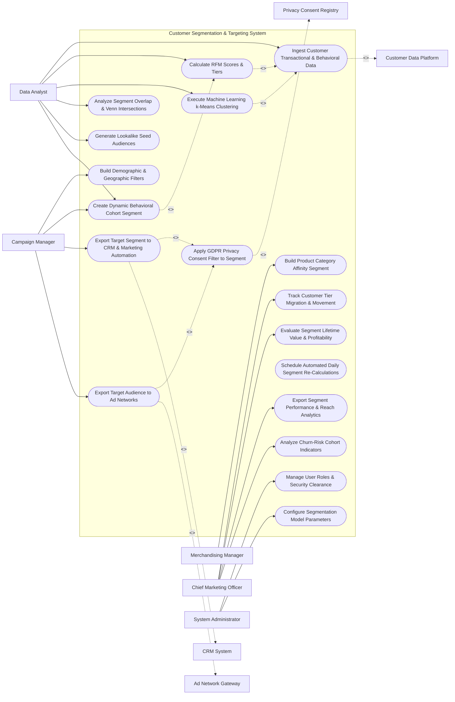

# Use Case Diagram — Customer Segmentation & Targeting System

## Mermaid Code

## Actor Table | Bảng Actor

| # | Actor | Actor Type | Role Description | Related Use Cases |
|---|-------|------------|------------------|-------------------|
| 1 | Data Analyst | Primary | Analytics expert configuring RFM models, running ML k-Means clustering, and analyzing segment overlaps. | UC01, UC02, UC05, UC06, UC07, UC08 |
| 2 | Campaign Manager | Primary | Marketer building demographic filters, dynamic behavioral cohorts, and exporting target audiences to channels. | UC03, UC08, UC09, UC10 |
| 3 | Merchandising Manager | Primary | E-commerce lead building product category affinity segments for targeted up-sell promotions. | UC04 |
| 4 | Chief Marketing Officer | Primary | Executive tracking customer tier migrations, segment profitability, CLV growth, and churn risk trends. | UC11, UC13, UC15, UC18 |
| 5 | System Administrator | Primary | IT administrative user managing security roles, automation schedules, and segmentation rule parameters. | UC16, UC17 |
| 6 | Customer Data Platform | System (Secondary) | Enterprise CDP streaming unified customer master profiles, cross-channel events, and identity graphs. | UC01 |
| 7 | CRM System | System (Secondary) | Connected CRM receiving high-value customer segment tags and churn-risk cohort flags. | UC09 |
| 8 | Ad Network Gateway | System (Secondary) | Digital ad platforms (Google/Meta/LinkedIn) receiving hashed target audience lists for ad retargeting. | UC10 |
| 9 | Privacy Consent Registry | System (Secondary) | Compliance registry enforcing GDPR, CCPA, and opt-out rules on all generated audience segments. | UC12 |

## Use Case Table | Bảng Use Case

| # | UC ID | Use Case Name | Primary Actor | Secondary Actor | Description | Priority |
|---|-------|---------------|---------------|-----------------|-------------|----------|
| 1 | UC01 | Ingest Customer Transactional & Behavioral Data | DataAnalyst | CDP System | Ingests unified customer profiles, purchase transactions, web browsing events, and engagement metrics. | High |
| 2 | UC02 | Calculate RFM Scores & Tiers | DataAnalyst | None | Computes Recency, Frequency, and Monetary (RFM 1-5 scale) scores and categorizes customers into RFM personas. | Critical |
| 3 | UC03 | Build Demographic & Geographic Filters | CampaignMgr | None | Filters customer database by age, gender, location, income bracket, or occupational attributes. | High |
| 4 | UC04 | Build Product Category Affinity Segment | Merchandiser | None | Identifies customer cohorts displaying high buying affinity for specific product categories (e.g., Electronics). | High |
| 5 | UC05 | Execute Machine Learning k-Means Clustering | DataAnalyst | None | Runs unsupervised k-Means ML algorithms to discover natural, hidden customer behavioral clusters. | Critical |
| 6 | UC06 | Analyze Segment Overlap & Venn Intersections | DataAnalyst | None | Renders visual Venn diagrams calculating customer overlap percentages between multiple active segments. | High |
| 7 | UC07 | Generate Lookalike Seed Audiences | DataAnalyst | None | Extracts top 5% highest-value customer profiles to serve as seed lists for social ad network lookalike modeling. | High |
| 8 | UC08 | Create Dynamic Behavioral Cohort Segment | CampaignMgr | None | Builds self-updating dynamic segments based on multi-condition behavioral rules (e.g., Bought in 30 days + No email click). | Critical |
| 9 | UC09 | Export Target Segment to CRM & Marketing Automation | CampaignMgr | CRM System | Exports target audience contact lists to CRM and marketing automation platforms via automated API pipelines. | Critical |
| 10 | UC10 | Export Target Audience to Ad Networks | CampaignMgr | Ad Network | Transmits SHA-256 hashed email audience lists to Meta Ads, Google Ads, and LinkedIn Campaign Manager. | High |
| 11 | UC11 | Track Customer Tier Migration & Movement | CMO | None | Monitors monthly customer movement between value tiers (e.g., 500 customers upgraded from Silver to Gold tier). | High |
| 12 | UC12 | Apply GDPR Privacy Consent Filter to Segment | CampaignMgr | PrivacyReg | Filters out non-consented, opted-out, or suppressed contacts from audience segments prior to export. | Critical |
| 13 | UC13 | Evaluate Segment Lifetime Value & Profitability | CMO | None | Computes average Customer Lifetime Value (CLV) and net margin profitability for each distinct customer segment. | High |
| 14 | UC14 | Schedule Automated Daily Segment Re-Calculations | Admin | None | Configures automated nightly batch jobs to recalculate dynamic segment memberships and RFM scores. | High |
| 15 | UC15 | Export Segment Performance & Reach Analytics | CMO | None | Renders visual dashboards displaying total addressable audience size, segment growth rates, and channel reach. | High |
| 16 | UC16 | Manage User Roles & Security Clearance | Admin | None | Controls user login accounts, RBAC permissions, and PII data masking settings for data analysts. | High |
| 17 | UC17 | Configure Segmentation Model Parameters | Admin | DataAnalyst | Configures RFM score quintile boundaries, k-Means cluster count $K$, and lookalike threshold limits. | High |
| 18 | UC18 | Analyze Churn-Risk Cohort Indicators | CMO | None | Identifies customer cohorts displaying early churn signals (declining visit frequency + zero orders in 60 days). | High |

## Use Case Specification | Đặc tả Use Case

---

### UC02 — Calculate Recency, Frequency, Monetary (RFM) Scores

| Field | Detail |
|-------|--------|
| **UC ID** | UC02 |
| **Use Case Name** | Calculate Recency, Frequency, Monetary (RFM) Scores |
| **Actor(s)** | Primary: Data Analyst / Segmentation Specialist   Secondary: None |
| **Description** | Evaluates customer historical order data to compute individual Recency (R: days since last order), Frequency (F: total order count), and Monetary (M: total spend) scores on a 1-5 quintile scale and assigns RFM persona tiers. |
| **Precondition** | 1. Customer order history data is ingested from CDP/CRM systems (UC01).   2. RFM quintile boundaries are configured in system (UC17). |
| **Main Flow** | 1. Analyst opens "RFM Segmentation Engine" and selects observation window (e.g., Past 365 Days).   2. System retrieves all customer purchase records and calculates raw metrics:   &nbsp;&nbsp;&nbsp;&nbsp; a. Recency = Days elapsed since last order.   &nbsp;&nbsp;&nbsp;&nbsp; b. Frequency = Total count of completed orders in window.   &nbsp;&nbsp;&nbsp;&nbsp; c. Monetary = Sum of net order revenue in window.   3. System sorts customer base into 5 equal quintiles for each dimension (Scores 1 to 5, where 5 is best).   4. System assigns composite 3-digit RFM Code (e.g., `555`, `111`, `511`, `155`).   5. System maps RFM Codes to Standard Customer Personas:   &nbsp;&nbsp;&nbsp;&nbsp; a. Code `555`, `554` -> `CHAMPIONS` (Best Customers).   &nbsp;&nbsp;&nbsp;&nbsp; b. Code `511`, `411` -> `NEW_CUSTOMERS` (High Recency, Low Frequency).   &nbsp;&nbsp;&nbsp;&nbsp; c. Code `155`, `255` -> `AT_RISK_LOYALISTS` (High Spend/Frequency, Long Recency).   &nbsp;&nbsp;&nbsp;&nbsp; d. Code `111` -> `HIBERNATING` (Lowest R, F, M).   6. System saves RFM scores and persona tags to customer profiles and updates RFM distribution charts. |
| **Alternative Flow** | **AF1** — Customized Weighted RFM Model: Analyst assigns custom weights (e.g., Recency 40%, Frequency 30%, Monetary 30%); System computes weighted composite score (1.0 to 5.0 scale). |
| **Exception Flow** | **EX1** — Zero Purchase History: Customer has zero completed orders (Leads/Prospects); System assigns RFM score `000` (`PROSPECT_NON_BUYER`) and excludes customer from monetary quintile calculations. |
| **Postcondition** | RFM scores (1-5) and persona tags are saved, and RFM segment distribution charts are updated. |
| **Business Rule** | **BR1**: RFM quintile boundaries MUST be recalculated dynamically across the active customer base to maintain equal 20% distribution buckets. |

---

### UC05 — Execute Machine Learning k-Means Clustering

| Field | Detail |
|-------|--------|
| **UC ID** | UC05 |
| **Use Case Name** | Execute Machine Learning k-Means Clustering |
| **Actor(s)** | Primary: Data Analyst / Segmentation Specialist   Secondary: None |
| **Description** | Runs unsupervised k-Means machine learning algorithms across multi-dimensional customer feature vectors to discover natural, hidden behavioral clusters and customer micro-segments. |
| **Precondition** | 1. Multi-dimensional customer dataset (RFM, web page visits, email clicks, category preferences) is normalized. |
| **Main Flow** | 1. Analyst opens "Machine Learning Clustering Studio".   2. Analyst selects Feature Variables for clustering: `[Recency, Total Spend, Avg Order Value, Category Affinity Score, Email Click Rate, Mobile App Sessions]`.   3. Analyst sets Cluster Count parameter $K$ (e.g., $K = 5$ clusters) OR selects "Auto-Elbow Method" to calculate optimal $K$.   4. System executes k-Means clustering algorithm:   &nbsp;&nbsp;&nbsp;&nbsp; a. Standardizes features using Z-score normalization.   &nbsp;&nbsp;&nbsp;&nbsp; b. Initializes $K$ random cluster centroids.   &nbsp;&nbsp;&nbsp;&nbsp; c. Iteratively assigns customers to nearest centroid using Euclidean distance until convergence.   5. System generates 3D Cluster Visualization Scatter Plot and centroid profile table.   6. System identifies 5 distinct clusters:   &nbsp;&nbsp;&nbsp;&nbsp; a. Cluster 1: `High-Spend Mobile App Bargain Hunters`.   &nbsp;&nbsp;&nbsp;&nbsp; b. Cluster 2: `Occasional B2B Bulk Buyers`.   &nbsp;&nbsp;&nbsp;&nbsp; c. Cluster 3: `Disengaged Email Deal Seekers`.   7. Analyst labels clusters and clicks "Save ML Segments"; System tags customer profiles with ML cluster IDs. |
| **Alternative Flow** | **AF1** — Hierarchical Clustering Model: Analyst selects Hierarchical Agglomerative Clustering; System renders a visual Dendrogram tree allowing analyst to cut tree at desired similarity threshold. |
| **Exception Flow** | **EX1** — Non-Convergence Warning: Algorithm fails to converge within 100 iterations due to extreme outlier data; System displays warning, applies 99th percentile outlier capping, and re-executes clustering. |
| **Postcondition** | ML customer clusters are generated, 3D scatter plots are displayed, and customer profiles are tagged with cluster IDs. |
| **Business Rule** | **BR1**: ML k-Means feature vectors MUST apply Z-score normalization prior to distance calculations to prevent high-magnitude features (e.g., Revenue) from distorting clusters. |

---

### UC08 — Create Dynamic Behavioral Cohort Segment

| Field | Detail |
|-------|--------|
| **UC ID** | UC08 |
| **Use Case Name** | Create Dynamic Behavioral Cohort Segment |
| **Actor(s)** | Primary: Marketing Campaign Manager   Secondary: None |
| **Description** | Configures self-updating dynamic audience segments defined by multi-condition logical rules combining demographic attributes, past purchase behaviors, and real-time digital body language. |
| **Precondition** | 1. User holds campaign manager segmentation permissions. |
| **Main Flow** | 1. User opens "Dynamic Segment Builder".   2. User inputs Segment Name: `VIP Repeat Buyers - At Risk of Churn`.   3. User configures Multi-Condition Rule Logic using AND/OR operators:   &nbsp;&nbsp;&nbsp;&nbsp; a. Condition 1 (Demographic): `Customer Tier EQUALS "Gold" OR "Platinum"`.   &nbsp;&nbsp;&nbsp;&nbsp; b. AND Condition 2 (Purchase Behavior): `Lifetime Orders >= 5 AND Total Spend >= $1,000`.   &nbsp;&nbsp;&nbsp;&nbsp; c. AND Condition 3 (Recency/Inactivity): `Last Purchase Date > 60 Days Ago`.   &nbsp;&nbsp;&nbsp;&nbsp; d. AND Condition 4 (Digital Engagement): `No Email Clicks in Last 30 Days`.   4. User clicks "Run Segment Preview".   5. System queries customer database, applies rule filters, and calculates matching contact count: `3,420 Contacts`.   6. System displays sample matching contacts, demographic breakdown charts, and estimated email reachability %.   7. User clicks "Save & Activate Dynamic Segment".   8. System activates segment; System automatically updates membership in real time as customer behaviors change. |
| **Alternative Flow** | **AF1** — Nested Exclusion Group: User adds Exclusion Sub-Rule: `EXCLUDE Contacts who have an Open Support Ticket (Priority = High)`, preventing dissatisfied customers from receiving promotional offers. |
| **Exception Flow** | **EX1** — Zero Matching Contacts: Rule combination yields 0 matching contacts; System displays warning "Empty Segment: No customers match these combined criteria", prompting user to broaden rule conditions. |
| **Postcondition** | Dynamic segment is created, initial membership is calculated, and real-time self-updating rule evaluation is activated. |
| **Business Rule** | **BR1**: Dynamic segments MUST re-evaluate membership in real time when triggered by high-priority events (e.g., purchase or support ticket creation). |

---

### UC10 — Export Target Audience to Ad Networks

| Field | Detail |
|-------|--------|
| **UC ID** | UC10 |
| **Use Case Name** | Export Target Audience to Ad Networks |
| **Actor(s)** | Primary: Marketing Campaign Manager   Secondary: Ad Network Gateway |
| **Description** | Exports privacy-filtered target audience lists to Google Ads, Meta Ads, and LinkedIn Campaign Manager via secure APIs for multi-channel ad retargeting and lookalike audience modeling. |
| **Precondition** | 1. Target audience segment is created and verified (UC08).   2. GDPR/CCPA privacy consent filter is applied (UC12).   3. Ad network API integration credentials are connected. |
| **Main Flow** | 1. User opens "Ad Network Audience Export Console".   2. User selects Source Segment: `VIP Repeat Buyers - At Risk of Churn` (3,420 Contacts).   3. System automatically applies UC12 (Apply GDPR Privacy Consent Filter), suppressing 120 contacts who opted out of ad targeting -> `3,300 Privacy-Cleared Contacts`.   4. User selects Target Ad Networks: `Meta Ads - Custom Audience ID #99412` and `Google Ads - Customer Match List #4412`.   5. System hashes contact email addresses and phone numbers using `SHA-256` encryption.   6. System transmits hashed payload via HTTPS REST API to Meta Ads and Google Ads Gateways.   7. Ad Network Gateways match hashed IDs against user profiles and return match rate statistics:   &nbsp;&nbsp;&nbsp;&nbsp; a. Meta Ads: 2,475 Matched Profiles (75.0% Match Rate).   &nbsp;&nbsp;&nbsp;&nbsp; b. Google Ads: 2,310 Matched Profiles (70.0% Match Rate).   8. System logs export history and displays active ad targeting audience size. |
| **Alternative Flow** | **AF1** — Lookalike Seed Export: User selects segment as "Lookalike Seed Audience" and exports to Meta Ads API, requesting Meta to build a 1% Lookalike Audience (approx. 2.4 million profiles). |
| **Exception Flow** | **EX1** — API Match Rate Below Minimum ($< 30\%$): Match rate returns at 22%; System displays warning "Low Match Rate (22%) - Verify Email Quality or Phone Format", but completes audience creation. |
| **Postcondition** | Hashed target audience is exported to ad networks, ad custom audiences are updated, and retargeting campaigns are enabled. |
| **Business Rule** | **BR1**: Plaintext customer emails MUST NEVER be transmitted to external ad networks; all email and phone payloads MUST be SHA-256 hashed prior to API export. |

---

### UC12 — Apply GDPR Privacy Consent Filter to Segment

| Field | Detail |
|-------|--------|
| **UC ID** | UC12 |
| **Use Case Name** | Apply GDPR Privacy Consent Filter to Segment |
| **Actor(s)** | Primary: Marketing Campaign Manager   Secondary: Privacy Consent Registry |
| **Description** | Automatically filters out non-consented, opted-out, or privacy-suppressed customer contacts from any target audience segment prior to channel export in compliance with GDPR, CCPA, and ePrivacy regulations. |
| **Precondition** | 1. Audience segment is generated (UC08).   2. Privacy Consent Registry contains active opt-in/opt-out consent records. |
| **Main Flow** | 1. System prepares audience segment for export to marketing channel (Email, SMS, Social Ads, Telemarketing).   2. System queries Privacy Consent Registry API for each contact in segment.   3. System evaluates consent flags based on target export channel:   &nbsp;&nbsp;&nbsp;&nbsp; a. Channel = Email -> Check `EMAIL_MARKETING_CONSENT = TRUE` AND `NOT_IN_GLOBAL_SUPPRESSION`.   &nbsp;&nbsp;&nbsp;&nbsp; b. Channel = SMS -> Check `SMS_MARKETING_OPT_IN = TRUE`.   &nbsp;&nbsp;&nbsp;&nbsp; c. Channel = Social Ads -> Check `THIRD_PARTY_DATA_SHARING_CONSENT = TRUE`.   4. System identifies non-consented contacts (e.g., 150 contacts opted out of third-party data sharing).   5. System suppresses non-consented contacts from export queue.   6. System generates Privacy-Cleared Audience List (Original: 3,420 -> Cleared: 3,270).   7. System logs privacy audit record detailing number of suppressed contacts and clearance timestamp. |
| **Alternative Flow** | **AF1** — Country-Specific Legal Rule Application: Contact is located in Germany (GDPR + UWG strict law); System enforces mandatory double opt-in verification requirement before allowing email marketing clearance. |
| **Exception Flow** | **EX1** — Unverified Consent Status: Contact consent record is null/unknown; System defaults to "Privacy Protection Mode", suppressing contact from commercial marketing exports until explicit consent is logged. |
| **Postcondition** | Non-consented contacts are suppressed, privacy-cleared audience list is generated, and privacy compliance audit log is recorded. |
| **Business Rule** | **BR1**: Target audience segments MUST apply channel-specific privacy consent filtering prior to any external API export or campaign dispatch. |
