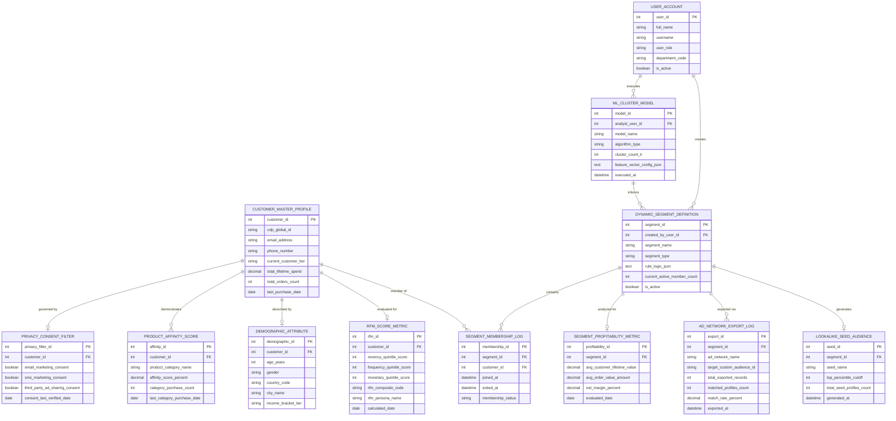

# Conceptual ERD — Customer Segmentation & Targeting System

## Mermaid Code

## Entity Description Table | Bảng mô tả Entity

| # | Entity Name | Vietnamese Name | Description | Key Attributes | Main Relationships |
|---|-------------|-----------------|-------------|----------------|-------------------|
| 1 | USER_ACCOUNT | Tài khoản Nguời dùng | System credentials and access roles for data analysts, campaign managers, and admins. | `user_id`, `username`, `user_role`, `department_code` | Executes `ML_CLUSTER_MODEL`, creates `DYNAMIC_SEGMENT_DEFINITION`. |
| 2 | CUSTOMER_MASTER_PROFILE | Hồ sơ Khách hàng Master | Central customer profile entity storing CDP global ID, email, total spend, order count, and customer tier. | `customer_id`, `cdp_global_id`, `email_address`, `total_lifetime_spend`, `current_customer_tier` | Evaluated for `RFM_SCORE_METRIC`, member of `SEGMENT_MEMBERSHIP_LOG`, governed by `PRIVACY_CONSENT_FILTER`. |
| 3 | RFM_SCORE_METRIC | Chỉ số RFM Segment | Calculated Recency, Frequency, Monetary (RFM 1-5 quintile) scores and mapped customer persona names. | `rfm_id`, `customer_id`, `recency_quintile_score`, `rfm_composite_code`, `rfm_persona_name` | Belongs to `CUSTOMER_MASTER_PROFILE`. |
| 4 | DEMOGRAPHIC_ATTRIBUTE | Thuộc tính Nhân khẩu học | Customer demographic and geographic data attributes (age, gender, country, city, income tier). | `demographic_id`, `customer_id`, `age_years`, `gender`, `country_code`, `income_bracket_tier` | Belongs to `CUSTOMER_MASTER_PROFILE`. |
| 5 | PRODUCT_AFFINITY_SCORE | Điểm Tương quan Sản phẩm | Calculated purchasing affinity percentage scores across specific product categories. | `affinity_id`, `customer_id`, `product_category_name`, `affinity_score_percent`, `category_purchase_count` | Belongs to `CUSTOMER_MASTER_PROFILE`. |
| 6 | ML_CLUSTER_MODEL | Mô hình Cluster Machine Learning | Unsupervised k-Means machine learning clustering model execution parameters and feature configs. | `model_id`, `analyst_user_id`, `model_name`, `algorithm_type`, `cluster_count_k`, `executed_at` | Informs `DYNAMIC_SEGMENT_DEFINITION`, executed by `USER_ACCOUNT`. |
| 7 | DYNAMIC_SEGMENT_DEFINITION | Định nghĩa Segment Động | Target audience segment rules defined by multi-condition logical rules (JSON) and active member counts. | `segment_id`, `created_by_user_id`, `segment_name`, `rule_logic_json`, `current_active_member_count` | Contains `SEGMENT_MEMBERSHIP_LOG`, generates `LOOKALIKE_SEED_AUDIENCE`, exported via `AD_NETWORK_EXPORT_LOG`. |
| 8 | SEGMENT_MEMBERSHIP_LOG | Nhật ký Thành viên Segment | Real-time tracking log recording customer entry, exit, and active status within dynamic segments. | `membership_id`, `segment_id`, `customer_id`, `joined_at`, `exited_at`, `membership_status` | Relates `DYNAMIC_SEGMENT_DEFINITION` and `CUSTOMER_MASTER_PROFILE`. |
| 9 | LOOKALIKE_SEED_AUDIENCE | Tập Seed Audience Lookalike | Top-percentile seed audience lists generated from high-value segments for social ad lookalike modeling. | `seed_id`, `segment_id`, `seed_name`, `top_percentile_cutoff`, `total_seed_profiles_count` | Belongs to `DYNAMIC_SEGMENT_DEFINITION`. |
| 10 | AD_NETWORK_EXPORT_LOG | Nhật ký Export Network Quang cao | Export execution log tracking SHA-256 hashed audience list dispatches to Google/Meta/LinkedIn. | `export_id`, `segment_id`, `ad_network_name`, `target_custom_audience_id`, `matched_profiles_count`, `match_rate_percent` | Belongs to `DYNAMIC_SEGMENT_DEFINITION`. |
| 11 | PRIVACY_CONSENT_FILTER | Bộ lọc Quyền Riêng tư (Consent) | Channel-specific privacy consent permissions (Email, SMS, Social Ads) enforcing GDPR/CCPA filtering. | `privacy_filter_id`, `customer_id`, `email_marketing_consent`, `sms_marketing_consent`, `third_party_ad_sharing_consent` | Belongs to `CUSTOMER_MASTER_PROFILE`. |
| 12 | SEGMENT_PROFITABILITY_METRIC | Chỉ số Lợi nhuận Segment | Aggregated Customer Lifetime Value (CLV), average order value, and net margin metrics by segment. | `profitability_id`, `segment_id`, `avg_customer_lifetime_value`, `avg_order_value_amount`, `net_margin_percent` | Belongs to `DYNAMIC_SEGMENT_DEFINITION`. |

## Relationship Description | Mô tả Quan hệ

| # | From Entity | Cardinality | To Entity | Label | Business Explanation |
|---|-------------|-------------|-----------|-------|----------------------|
| 1 | CUSTOMER_MASTER_PROFILE | 1 to 0..1 | RFM_SCORE_METRIC | evaluated for | A customer profile is evaluated for RFM quintile scores and persona names. |
| 2 | CUSTOMER_MASTER_PROFILE | 1 to 0..1 | DEMOGRAPHIC_ATTRIBUTE | described by | A customer profile is described by demographic and geographic attributes. |
| 3 | CUSTOMER_MASTER_PROFILE | 1 to 0..N | PRODUCT_AFFINITY_SCORE | demonstrates | A customer profile demonstrates product category buying affinity scores. |
| 4 | CUSTOMER_MASTER_PROFILE | 1 to 0..N | SEGMENT_MEMBERSHIP_LOG | member of | A customer profile is a member of multiple dynamic segments over time. |
| 5 | CUSTOMER_MASTER_PROFILE | 1 to 0..1 | PRIVACY_CONSENT_FILTER | governed by | A customer profile is governed by privacy consent filter preferences. |
| 6 | DYNAMIC_SEGMENT_DEFINITION | 1 to 0..N | SEGMENT_MEMBERSHIP_LOG | contains | A dynamic segment definition contains customer membership logs. |
| 7 | DYNAMIC_SEGMENT_DEFINITION | 1 to 0..1 | LOOKALIKE_SEED_AUDIENCE | generates | A dynamic segment generates lookalike seed audience lists. |
| 8 | DYNAMIC_SEGMENT_DEFINITION | 1 to 0..N | AD_NETWORK_EXPORT_LOG | exported via | A dynamic segment is exported via ad network export logs. |
| 9 | DYNAMIC_SEGMENT_DEFINITION | 1 to 0..1 | SEGMENT_PROFITABILITY_METRIC | analyzed for | A dynamic segment is analyzed for CLV and net margin profitability metrics. |
| 10 | ML_CLUSTER_MODEL | 1 to 0..N | DYNAMIC_SEGMENT_DEFINITION | informs | Machine learning cluster models inform dynamic segment definitions. |
| 11 | USER_ACCOUNT | 1 to 0..N | ML_CLUSTER_MODEL | executes | A data analyst user account executes ML cluster models. |
| 12 | USER_ACCOUNT | 1 to 0..N | DYNAMIC_SEGMENT_DEFINITION | creates | A campaign manager user account creates dynamic segment definitions. |
