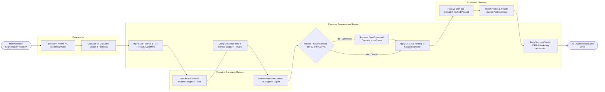

# Swimlane Diagram — Customer Segmentation & Targeting System

## Mermaid Code

## Flow Description | Mô tả luồng

| Lane | Actor | Role in Flow |
|------|-------|-------------|
| 1 | Data Analyst | Executes unsupervised k-Means machine learning cluster models, calculates RFM quintile scores, and defines customer persona categories. |
| 2 | Marketing Campaign Manager | Configures multi-condition dynamic behavioral segment rules, reviews segment membership previews, and selects target destination channels for campaign export. |
| 3 | Customer Segmentation System | Ingests unified CDP behavioral events, calculates dynamic segment rules, previews audience matches, enforces channel-specific GDPR/CCPA privacy consent filters, applies SHA-256 email hashing, and updates segment tags across connected systems. |
| 4 | Ad Network Gateway | Ingests secure SHA-256 hashed audience lists from the system via HTTPS APIs, matches profiles against ad network users, and updates custom retargeting audience sizes. |
