# Action Tree — Customer Segmentation & Targeting System

## Mermaid Code

```mermaid
graph TD
    Root["Customer Segmentation & Targeting System"]

    Root --> M1["Data Ingestion & Attribute Normalization"]
    Root --> M2["RFM Scoring & Predictive ML Clustering"]
    Root --> M3["Dynamic Segment & Cohort Builder"]
    Root --> M4["Privacy Consent & Suppression Engine"]
    Root --> M5["Multi-Channel Ad Network & API Export"]
    Root --> M6["Segment Profitability & CLV Analytics"]

    M1 --> A11["Ingest CDP Unified Profiles & Transaction Logs"]
    M1 --> A12["Normalize Multi-Dimensional Feature Vectors"]
    M1 --> A13["Map Demographic & Geographic Attribute Fields"]
    M1 --> A14["Track E-Commerce Product Category Buying Affinities"]

    M2 --> A21["Calculate Recency, Frequency & Monetary (RFM) Quintiles"]
    M2 --> A22["Map Composite RFM Codes to Customer Personas"]
    M2 --> A23["Execute Unsupervised k-Means ML Cluster Algorithms"]
    M2 --> A24["Identify Early Churn-Risk Behavioral Indicators"]

    M3 --> A31["Build Multi-Condition Logical Rules (AND/OR Logic)"]
    M3 --> A32["Create Dynamic Real-Time Self-Updating Cohorts"]
    M3 --> A33["Calculate Segment Overlap & Visual Venn Diagrams"]
    M3 --> A34["Generate Top 5% Lookalike Seed Audience Lists"]

    M4 --> A41["Apply Channel-Specific Privacy Consent Filters"]
    M4 --> A42["Suppress Opted-Out Contacts from Export Queues"]
    M4 --> A43["Enforce Country-Specific Double Opt-In Verification"]
    M4 --> A44["Log Privacy Clearance Audit & Erasure Records"]

    M5 --> A51["Apply Cryptographic SHA-256 Hashing to Email/Phone"]
    M5 --> A52["Export Custom Audiences to Meta Ads & Google Ads"]
    M5 --> A53["Sync Account Segments to LinkedIn Campaign Manager"]
    M5 --> A54["Push Real-Time Segment IDs to E-Commerce Engine"]

    M6 --> A61["Track Monthly Customer Tier Migration Dynamics"]
    M6 --> A62["Calculate Segment Customer Lifetime Value (CLV)"]
    M6 --> A63["Analyze Segment Net Margin & Order Value Averages"]
    M6 --> A64["Render Visual Audience Reach & Growth Dashboards"]
```

## Module Description | Mô tả Module

| # | Module | Description | Actions |
|---|--------|-------------|---------|
| 1 | Data Ingestion & Attribute Normalization | Ingests CDP unified profiles, normalizes feature vectors, maps demographics, and tracks e-commerce category affinities. | Ingest CDP Unified Profiles, Normalize Feature Vectors, Map Demographic Fields, Track Product Category Affinities. |
| 2 | RFM Scoring & Predictive ML Clustering | Calculates RFM quintiles, maps RFM codes to personas, executes k-Means ML clustering, and identifies churn-risk indicators. | Calculate RFM Quintiles, Map RFM Personas, Execute k-Means ML Clustering, Identify Churn-Risk Indicators. |
| 3 | Dynamic Segment & Cohort Builder | Builds multi-condition dynamic rules, creates real-time updating cohorts, calculates segment overlap, and generates lookalike seeds. | Build Logical Rule Conditions, Create Dynamic Real-Time Cohorts, Calculate Segment Overlap, Generate Lookalike Seed Audiences. |
| 4 | Privacy Consent & Suppression Engine | Applies privacy consent filters, suppresses opted-out contacts, enforces double opt-in rules, and logs privacy audit records. | Apply Privacy Consent Filters, Suppress Opted-Out Contacts, Enforce Double Opt-In Verification, Log Privacy Audit Records. |
| 5 | Multi-Channel Ad Network & API Export | Applies SHA-256 email hashing, exports custom audiences to Meta/Google/LinkedIn Ads, and pushes segment IDs to e-commerce engines. | Apply SHA-256 Hashing, Export Audiences to Meta & Google, Sync Lists to LinkedIn Ad Manager, Push Segment IDs to E-Commerce. |
| 6 | Segment Profitability & CLV Analytics | Tracks customer tier migrations, calculates segment CLV, analyzes net margins, and renders audience reach dashboards. | Track Customer Tier Migration, Calculate Segment CLV, Analyze Net Margin Averages, Render Audience Reach Dashboards. |
