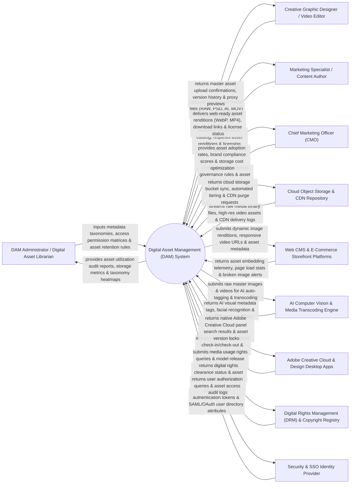

# Context Diagram — Digital Asset Management (DAM) System

## Mermaid Code

## Actor & Interaction Table | Bảng Actor & Tương tác

| # | Actor | Actor Type | Data Sent TO System | Data Received FROM System | Notes |
|---|-------|------------|---------------------|---------------------------|-------|
| 1 | DAM Administrator / Digital Asset Librarian | Primary | Metadata taxonomy schemas, access permission matrices, folder structures, asset retention and archiving rules. | Asset utilization audit reports, storage capacity metrics, taxonomy compliance heatmaps, metadata logs. | Asset librarian managing taxonomy metadata, asset governance, permissions, and storage lifecycles. |
| 2 | Creative Graphic Designer / Video Editor | Primary | Master media uploads (RAW photography, Photoshop `.psd`, Illustrator `.ai`, 4K video `.mov`), version updates. | Master asset upload confirmations, version history tree, low-res proxy previews, file lock status. | Designer uploading raw creative assets, checking out files, and maintaining asset version control. |
| 3 | Marketing Specialist / Content Author | Primary | Visual asset search queries, asset rendition requests (specific dimensions/formats), usage context. | Web-ready asset renditions (WebP, MP4), direct CDN download links, usage rights clearance badges. | Content creator searching the DAM for approved brand assets, downloading web-ready image/video formats. |
| 4 | CMO | Primary | Global brand asset governance policies, asset reuse targets, cloud storage budget caps. | Asset adoption rates, global brand compliance scores, storage cost optimization metrics, asset ROI. | Executive monitoring global asset efficiency, storage cost optimizations, and creative workflow ROI. |
| 5 | Cloud Object Storage & CDN Repository | Supporting | Raw media binary streams (AWS S3 / Google Cloud Storage), CDN delivery traffic logs, storage class events. | Cloud storage bucket sync commands, S3 Glacier lifecycle tiering requests, CDN cache purge tokens. | Cloud storage and CDN infrastructure storing binary media assets and serving fast global downloads. |
| 6 | Web CMS & E-Commerce Storefront Platforms | Supporting | Asset embedding telemetry, page load performance stats, broken image link alerts. | Dynamic image renditions, responsive video URLs, asset ALT text metadata, focal-point cropped images. | Web CMS (WordPress, AEM) and e-commerce platforms (Shopify) embedding DAM media via APIs. |
| 7 | AI Computer Vision & Media Transcoding Engine | Supporting | AI visual metadata tags (objects, colors, facial recognition), transcoded multi-format media renditions. | Raw master image and video files, auto-tagging confidence thresholds, transcoding profile jobs. | AI media service (AWS Rekognition / FFmpeg) performing automated image tagging, OCR, and video transcoding. |
| 8 | Adobe Creative Cloud & Design Desktop Apps | Supporting | Direct desktop plugin check-in/check-out commands, metadata edits, active document saves. | Native Adobe Creative Cloud extension panel search results, asset version locks, asset download streams. | Desktop software (Photoshop, InDesign, Premiere Pro) integrating with the DAM via native plugins. |
| 9 | Digital Rights Management (DRM) & Copyright Registry | Supporting | Model release contracts, stock photo license agreements, usage territory restrictions, copyright expiration dates. | Digital rights clearance status, license expiration warnings, usage restriction flags. | Legal DRM subsystem verifying media licensing contracts, talent model releases, and usage rights. |
| 10 | Security & SSO Identity Provider | Supporting | User authentication SAML 2.0 / OAuth tokens, active directory group memberships, user security attributes. | User authorization queries, asset access audit logs, single sign-on verification requests. | Enterprise Identity Provider (Okta, Azure AD) authenticating users and enforcing role-based access controls. |

## System Boundary Description | Mô tả Phạm vi Hệ thống

The **Digital Asset Management (DAM) System** is an enterprise centralized media library, AI auto-tagging, version control, automated media transcoding, Digital Rights Management (DRM), and CDN distribution platform designed to organize and govern brand assets.

**Inside System Scope:**
- Centralized ingestion and storage of master high-res media files (RAW, PSD, AI, EPS, 4K Video, PDF).
- AI-powered computer vision auto-tagging (object detection, color extraction, OCR text extraction, facial recognition).
- Dynamic media transcoding generating web-ready renditions (WebP, AVIF, MP4, HLS) on-the-fly with smart focal-point cropping.
- Version control tracking checkout/check-in locks, visual diff side-by-side comparisons, and version rollback.
- Digital Rights Management (DRM) tracking model releases, stock licensing, territory restrictions, and expiration alerts.

**Outside System Scope:**
- Direct physical shooting of RAW photography in photo studios (handled by Professional Photographers).
- Direct physical printing of paper brochures on commercial printing presses (handled by Commercial Print Houses).
- Direct hosting of corporate email servers (handled by Enterprise Email Providers).
