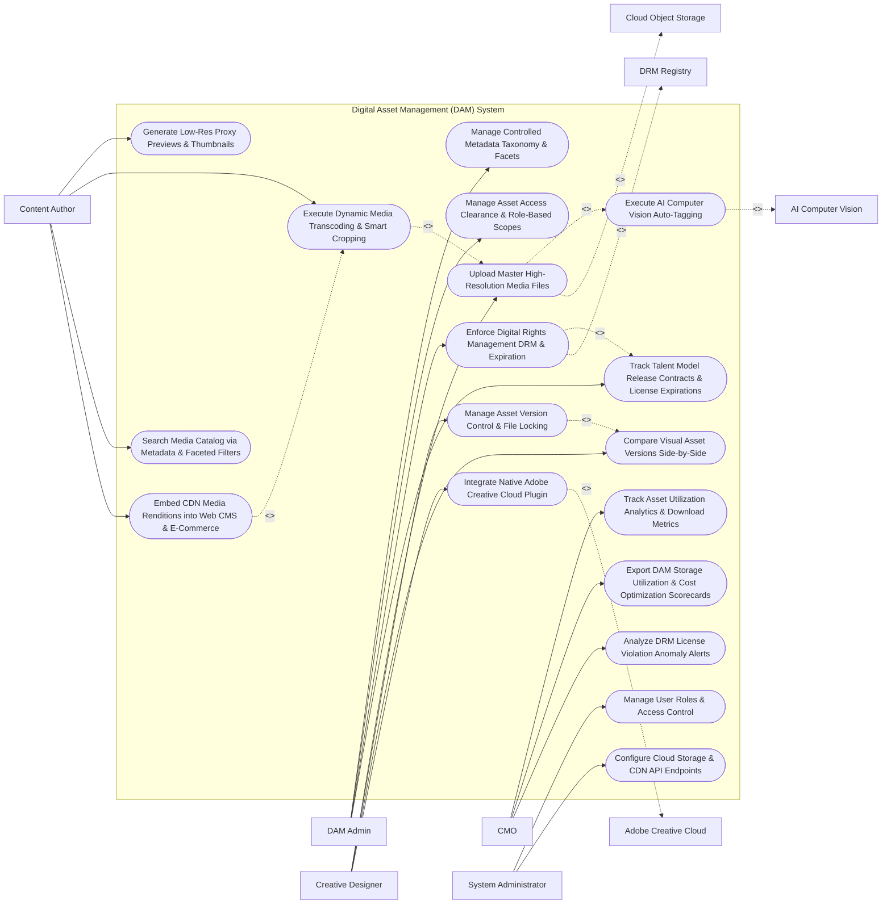

# Use Case Diagram — Digital Asset Management (DAM) System

## Mermaid Code

## Actor Table | Bảng Actor

| # | Actor | Actor Type | Role Description | Related Use Cases |
|---|-------|------------|------------------|-------------------|
| 1 | DAM Admin | Primary | Asset librarian managing metadata taxonomies, access clearance, role-based scopes, and DRM licensing compliance. | UC01, UC07, UC10, UC11 |
| 2 | Creative Designer | Primary | Designer uploading master RAW media files, managing version control locks, performing visual diff comparisons, and using Adobe plugins. | UC03, UC08, UC09, UC12 |
| 3 | Content Author | Primary | Content specialist searching asset catalogs, requesting dynamic media renditions (WebP/MP4), and embedding CDN links in Web CMS. | UC04, UC05, UC06, UC13 |
| 4 | CMO | Primary | Executive monitoring asset utilization analytics, storage optimization scorecards, DRM license alerts, and brand asset adoption. | UC14, UC15, UC18 |
| 5 | System Administrator | Primary | IT admin managing security roles, cloud storage bucket keys (S3), and CDN endpoints. | UC16, UC17 |
| 6 | AI Computer Vision | System (Secondary) | Machine learning service (AWS Rekognition / Vision API) analyzing images for auto-tagging, OCR, and face detection. | UC02 |
| 7 | Cloud Object Storage | System (Secondary) | Scalable cloud storage (AWS S3 / Google Cloud Storage) holding master binary media files and proxy previews. | UC03 |
| 8 | Adobe Creative Cloud | System (Secondary) | Desktop design software (Photoshop, InDesign, Premiere) integrating with DAM via native extension panels. | UC12 |
| 9 | DRM Registry | System (Secondary) | Rights management registry tracking talent model releases, copyright contracts, and asset expiration dates. | UC10 |

## Use Case Table | Bảng Use Case

| # | UC ID | Use Case Name | Primary Actor | Secondary Actor | Description | Priority |
|---|-------|---------------|---------------|-----------------|-------------|----------|
| 1 | UC01 | Manage Controlled Metadata Taxonomy & Facets | DAMAdmin | None | Defines standardized metadata schemas, IPTC/EXIF field mappings, controlled vocabulary, and taxonomy facets. | Critical |
| 2 | UC02 | Execute AI Computer Vision Auto-Tagging | Designer | AI Engine | Analyzes uploaded images/videos using computer vision to auto-generate descriptive tags, dominant colors, and OCR text. | Critical |
| 3 | UC03 | Upload Master High-Resolution Media Files | Designer | Cloud Storage | Uploads high-res master files (RAW, PSD, AI, EPS, 4K MOV) to cloud object storage with chunked multi-part uploading. | Critical |
| 4 | UC04 | Generate Low-Res Proxy Previews & Thumbnails | ContentAuthor | None | Automatically creates lightweight proxy preview images and video streaming previews for instant browser browsing. | High |
| 5 | UC05 | Execute Dynamic Media Transcoding & Smart Cropping | ContentAuthor | None | Transcodes images/videos on-the-fly to modern web formats (WebP, AVIF, MP4, HLS) with AI focal-point smart cropping. | Critical |
| 6 | UC06 | Search Media Catalog via Metadata & Faceted Filters | ContentAuthor | None | Provides fast search across title, AI tags, EXIF data, file format, aspect ratio, color palette, and licensing status. | Critical |
| 7 | UC07 | Manage Asset Access Clearance & Role-Based Scopes | DAMAdmin | None | Configures role-based access permissions, confidential asset watermarking, and regional workspace visibility rules. | High |
| 8 | UC08 | Manage Asset Version Control & File Locking | Designer | None | Tracks asset version trees (v1.0, v1.1, v2.0), supports file check-out locking, and allows version rollback. | Critical |
| 9 | UC09 | Compare Visual Asset Versions Side-by-Side | Designer | None | Renders a visual diff tool allowing designers to compare two image or document versions side-by-side on canvas. | High |
| 10 | UC10 | Enforce Digital Rights Management DRM & Expiration | DAMAdmin | DRM Registry | Enforces legal usage restrictions, model release expirations, and territory usage rights, blocking expired downloads. | Critical |
| 11 | UC11 | Track Talent Model Release Contracts & License Expirations | DAMAdmin | None | Links talent model release PDFs and stock photo licenses to assets, setting automated expiration alert timers. | High |
| 12 | UC12 | Integrate Native Adobe Creative Cloud Plugin | Designer | Adobe CC | Provides a native extension panel inside Photoshop/InDesign for direct asset search, check-out, and version check-in. | Critical |
| 13 | UC13 | Embed CDN Media Renditions into Web CMS & E-Commerce | ContentAuthor | None | Generates responsive CDN image `<picture>` tags and dynamic video embeds for WordPress, AEM, and Shopify. | High |
| 14 | UC14 | Track Asset Utilization Analytics & Download Metrics | CMO | None | Measures asset download frequency, embed traffic, popular search queries, and un-utilized orphan assets. | High |
| 15 | UC15 | Export DAM Storage Utilization & Cost Optimization Scorecards | CMO | None | Renders executive scorecards detailing S3 storage growth, Glacier archival savings, and CDN bandwidth costs. | High |
| 16 | UC16 | Manage User Roles & Access Control | Admin | None | Controls user login credentials, RBAC permissions, and administrative system configuration rights. | High |
| 17 | UC17 | Configure Cloud Storage & CDN API Endpoints | Admin | None | Configures S3 bucket credentials, Cloudfront CDN distribution domains, and FFmpeg transcoding worker nodes. | High |
| 18 | UC18 | Analyze DRM License Violation Anomaly Alerts | CMO | None | Dispatches urgent alert notifications when an expired asset is embedded on an active public web page. | High |

## Use Case Specification | Đặc tả Use Case

---

### UC02 — Execute AI Computer Vision Auto-Tagging

| Field | Detail |
|-------|--------|
| **UC ID** | UC02 |
| **Use Case Name** | Execute AI Computer Vision Auto-Tagging |
| **Actor(s)** | Primary: Creative Graphic Designer, DAM Administrator   Secondary: AI Computer Vision Engine |
| **Description** | Automatically analyzes uploaded images, graphics, and video frames using computer vision (object detection, scene recognition, color extraction, OCR text) to auto-generate search metadata tags. |
| **Precondition** | 1. Master media file is uploaded to the DAM system (UC03).   2. AI computer vision API (AWS Rekognition / Google Vision API) credentials are connected. |
| **Main Flow** | 1. System receives new master image upload (`marketing_campaign_photo.jpg`).   2. System dispatches image binary stream to AI Computer Vision Engine.   3. AI Computer Vision Engine analyzes image features:   &nbsp;&nbsp;&nbsp;&nbsp; a. Object Detection: Detects `["Person", "Laptop", "Office Desk", "Coffee Cup", "Modern Architecture"]` (Confidence > 85%).   &nbsp;&nbsp;&nbsp;&nbsp; b. Color Histogram Analysis: Extracts dominant hex color codes `["#0052CC", "#FFFFFF", "#333333"]`.   &nbsp;&nbsp;&nbsp;&nbsp; c. Optical Character Recognition (OCR): Extracts embedded text `"ACME CLOUD SOFTWARE 2026"`.   &nbsp;&nbsp;&nbsp;&nbsp; d. Face & Emotion Analysis: Detects 2 faces with `Happy / Smiling` expressions.   4. System attaches auto-generated AI tags to asset metadata record.   5. System indexer updates Elasticsearch search index in real time.   6. Designer views asset details card; AI tags appear under "Auto-Generated Tags" tab, allowing designer to accept or remove individual tags. |
| **Alternative Flow** | **AF1** — Automated Video Scene Auto-Tagging: System analyzes video file (`promo_video.mp4`), extracting keyframes every 5 seconds, generating video transcript captions via Speech-to-Text, and tagging scene content. |
| **Exception Flow** | **EX1** — Explicit Content Detection Block: AI computer vision engine flags uploaded image for explicit/inappropriate content (Confidence > 95%); System blocks asset publishing and dispatches alert to DAM Admin. |
| **Postcondition** | AI visual metadata tags, dominant colors, and OCR text are attached to the asset record and indexed for search. |
| **Business Rule** | **BR1**: AI auto-tagging MUST attach object, color, and OCR metadata to all uploaded images with a confidence threshold of >= 80%. |

---

### UC05 — Execute Dynamic Media Transcoding & Smart Cropping

| Field | Detail |
|-------|--------|
| **UC ID** | UC05 |
| **Use Case Name** | Execute Dynamic Media Transcoding & Smart Cropping |
| **Actor(s)** | Primary: Content Author, Marketing Specialist   Secondary: None |
| **Description** | Transcodes master media files on-the-fly into web-optimized image formats (WebP, AVIF) and video streams (MP4, HLS), executing AI focal-point smart cropping for different screen aspect ratios. |
| **Precondition** | 1. Master high-res media file is stored in cloud object storage (UC03).   2. Transcoding worker nodes (FFmpeg / ImageMagick) are online. |
| **Main Flow** | 1. Content Author or Web CMS requests asset rendition URL: `https://cdn.company.com/assets/photo123.jpg?format=webp&width=800&height=400&crop=smart`.   2. CDN Edge Server checks image cache: Cache Miss -> Passes request to DAM Dynamic Transcoding Engine.   3. Transcoding Engine retrieves master high-res image (`photo123_master.raw` - 45MB).   4. Transcoding Engine evaluates Smart Cropping AI Focal Point:   &nbsp;&nbsp;&nbsp;&nbsp; a. AI detects primary subject (Human Face) located at coordinates `(X: 1200, Y: 800)`.   &nbsp;&nbsp;&nbsp;&nbsp; b. Engine calculates optimal 2:1 aspect ratio crop centered around the face focal point.   5. Engine performs dynamic image transformations:   &nbsp;&nbsp;&nbsp;&nbsp; a. Formats image from RAW to WebP.   &nbsp;&nbsp;&nbsp;&nbsp; b. Resizes dimensions to 800px x 400px.   &nbsp;&nbsp;&nbsp;&nbsp; c. Applies WebP compression (Quality = 82%).   &nbsp;&nbsp;&nbsp;&nbsp; d. Output Rendition Size: `48 KB` (reduced from 45 MB master).   6. Engine returns transformed WebP image to CDN Edge Server for caching.   7. Browser receives dynamic WebP image and renders responsive visual element. |
| **Alternative Flow** | **AF1** — On-Demand Video HLS Stream Transcoding: System transcodes 4K master video into adaptive bitrate HLS stream (`.m3u8` playlist) with 1080p, 720p, and 480p renditions for mobile streaming. |
| **Exception Flow** | **EX1** — Unsupported Format Transcoding Error: User requests conversion of unsupported file type (`.PSD` to 3D mesh); System returns HTTP 400 Bad Request "Unsupported Transcoding Output Format". |
| **Postcondition** | Dynamic image/video rendition is generated on-the-fly, smart cropped around AI focal points, cached on CDN, and served to browser. |
| **Business Rule** | **BR1**: Dynamic image transcoding MUST generate WebP/AVIF renditions with AI smart cropping centered on primary subject focal points. |

---

### UC08 — Manage Asset Version Control & File Locking

| Field | Detail |
|-------|--------|
| **UC ID** | UC08 |
| **Use Case Name** | Manage Asset Version Control & File Locking |
| **Actor(s)** | Primary: Creative Graphic Designer   Secondary: None |
| **Description** | Tracks hierarchical asset version trees (v1.0, v1.1, v2.0), supports file check-out locking to prevent editing conflicts, and enables visual diff side-by-side comparisons and version rollbacks. |
| **Precondition** | 1. Master asset item exists in the DAM system (UC03). |
| **Main Flow** | 1. Designer opens DAM asset detail page for `brochure_design.psd` (Current Active Version: `v1.0`).   2. Designer clicks "Check Out File for Edit".   3. System places File Lock on asset:   &nbsp;&nbsp;&nbsp;&nbsp; a. Lock Status: `LOCKED_BY_ALEX`.   &nbsp;&nbsp;&nbsp;&nbsp; b. System blocks other users from overwriting or checking out the asset.   4. Designer edits file in Photoshop and saves updated design.   5. Designer opens DAM panel and clicks "Check In New Version".   6. Designer inputs Version Notes: *"Updated corporate color palette to 2026 brand tokens and revised headline copy"*.   7. System uploads modified file, creates Version Record `v2.0`, updates active version pointer to `v2.0`, and releases file lock.   8. System maintains complete historical version tree (`v1.0`, `v1.1`, `v2.0`), preserving all historical binary files for rollback.   9. System triggers UC09 (Compare Visual Asset Versions Side-by-Side), displaying a visual split-screen comparison between `v1.0` and `v2.0`. |
| **Alternative Flow** | **AF1** — Version Rollback Execution: Designer discovers error in `v2.0`; Designer clicks "Rollback to Version 1.0"; System sets active production pointer back to `v1.0` and logs version rollback audit event. |
| **Exception Flow** | **EX1** — File Lock Conflict Error: Second designer attempts to check out an already locked asset; System displays error "Asset Locked: File is currently checked out by Alex Smith (Locked 45 mins ago)". |
| **Postcondition** | Asset version `v2.0` is checked in, file lock is released, version history tree updates, and visual diff comparison renders. |
| **Business Rule** | **BR1**: Checking out an asset MUST apply an exclusive file lock, preventing other users from overwriting the file until checked in. |

---

### UC10 — Enforce Digital Rights Management (DRM) & Expiration

| Field | Detail |
|-------|--------|
| **UC ID** | UC10 |
| **Use Case Name** | Enforce Digital Rights Management (DRM) & Expiration |
| **Actor(s)** | Primary: DAM Administrator   Secondary: Digital Rights Management (DRM) & Copyright Registry |
| **Description** | Links talent model releases, stock photo license agreements, and geographic usage restrictions to media assets, enforcing automatic download blocks and watermarking upon license expiration. |
| **Precondition** | 1. Media asset is linked to a DRM contract record in system (UC11).   2. License expiration date (e.g., Oct 30, 2026) and usage restrictions are defined. |
| **Main Flow** | 1. Content Author searches DAM catalog for campaign image `stock_hero_photo.jpg`.   2. System checks DRM Rights Management Status for `stock_hero_photo.jpg`:   &nbsp;&nbsp;&nbsp;&nbsp; a. Model Release Status: `Signed Model Release attached (John Doe)`.   &nbsp;&nbsp;&nbsp;&nbsp; b. Allowed Usage Territory: `North America & Europe Only`.   &nbsp;&nbsp;&nbsp;&nbsp; c. License Expiration Date: `October 15, 2026`.   &nbsp;&nbsp;&nbsp;&nbsp; d. Current Date: `October 30, 2026` (License Expired 15 Days Ago).   3. System evaluates DRM Enforcement Policy: License is Expired -> `ACCESS_RESTRICTED`.   4. System updates Asset Status to `EXPIRED_DRM_LOCKED`.   5. System blocks download attempt by Content Author, displaying alert: *"DRM ALERT: Stock photo license expired on Oct 15, 2026. Download blocked to prevent copyright violation."*   6. System applies prominent red watermark to asset preview thumbnail: `EXPIRED - DO NOT USE`.   7. System triggers UC18 (Analyze DRM License Violation Anomaly Alerts), notifying DAM Admin to renew license or purge embedded CMS links. |
| **Alternative Flow** | **AF1** — Regional Usage Restriction Enforcement: User in Japan attempts to download an asset licensed strictly for North America; System blocks download displaying "Territory Restriction: Asset licensed for North America usage only". |
| **Exception Flow** | **EX1** — Admin Emergency Licensing Override: DAM Admin uploads renewed stock licensing contract PDF; System updates expiration date to Oct 15, 2028, unlocking asset downloads. |
| **Postcondition** | Expired asset downloads are blocked, DRM watermarks are applied to thumbnails, and license expiration notifications update. |
| **Business Rule** | **BR1**: Assets with expired DRM stock licenses or model releases MUST automatically block user downloads and render expiration watermarks. |

---

### UC12 — Integrate Native Adobe Creative Cloud Plugin

| Field | Detail |
|-------|--------|
| **UC ID** | UC12 |
| **Use Case Name** | Integrate Native Adobe Creative Cloud Plugin |
| **Actor(s)** | Primary: Creative Graphic Designer   Secondary: Adobe Creative Cloud (Photoshop / InDesign / Premiere Pro) |
| **Description** | Operates a native CEP/UXP extension panel inside Adobe Photoshop, Illustrator, InDesign, and Premiere Pro, enabling designers to search DAM assets, check out files, and check in new versions directly from desktop apps. |
| **Precondition** | 1. DAM Adobe Creative Cloud Plugin extension is installed on designer's workstation.   2. Designer is authenticated via SSO (SAML 2.0). |
| **Main Flow** | 1. Designer opens Adobe Photoshop CC on desktop workstation.   2. Designer opens "DAM Extension Panel" inside Photoshop (`Window -> Extensions -> Enterprise DAM`).   3. Designer types search query in plugin panel: `"Brand Logo Vector 2026"`.   4. Plugin panel calls DAM Search API (`GET /v1/assets/search?q=Brand+Logo`), returning thumbnail search results inside Photoshop.   5. Designer selects asset `logo_vector_master.ai` and clicks "Place Linked Asset".   6. Plugin streams high-res vector file into Photoshop canvas as a linked smart object.   7. Designer modifies design and clicks "Check In as New Version" inside the Photoshop extension panel.   8. Plugin panel prompts for version notes, uploads modified `.psd` file to DAM cloud storage, updates DAM version history to `v3.0`, and releases file lock. |
| **Alternative Flow** | **AF1** — InDesign Linked Asset Packaging: Designer opens InDesign layout; Plugin scans all linked DAM images in the InDesign document, verifying that none of the linked images are expired or unapproved. |
| **Exception Flow** | **EX1** — Desktop Plugin Authentication Failure: SSO session token expires; Extension panel displays "Session Expired - Re-authenticate via SSO", prompting designer to log in. |
| **Postcondition** | Designers search, place linked assets, check out files, and check in new versions directly within Adobe Creative Cloud desktop apps. |
| **Business Rule** | **BR1**: The Adobe CC extension panel MUST support direct native file check-in/check-out and version history tagging without requiring browser downloads. |
