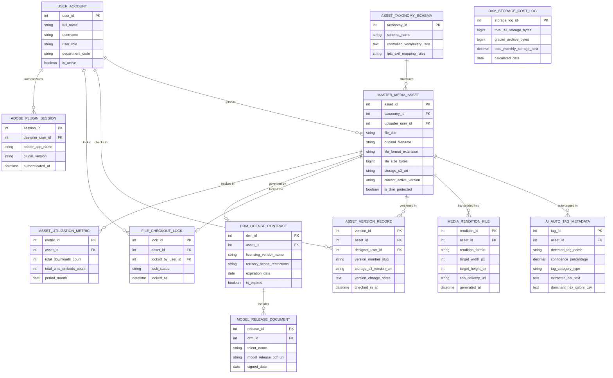

# Conceptual ERD — Digital Asset Management (DAM) System

## Mermaid Code

## Entity Description Table | Bảng mô tả Entity

| # | Entity Name | Vietnamese Name | Description | Key Attributes | Main Relationships |
|---|-------------|-----------------|-------------|----------------|-------------------|
| 1 | USER_ACCOUNT | Tài khoản Nguời dùng | System credentials and access roles for DAM admins, creative designers, content authors, and CMOs. | `user_id`, `username`, `user_role`, `department_code` | Uploads `MASTER_MEDIA_ASSET`, checks in `ASSET_VERSION_RECORD`, locks `FILE_CHECKOUT_LOCK`. |
| 2 | ASSET_TAXONOMY_SCHEMA | Schema Taxonomy Metadata | Controlled metadata taxonomy definition storing controlled vocabulary, IPTC/EXIF mappings, and facet rules. | `taxonomy_id`, `schema_name`, `controlled_vocabulary_json`, `iptc_exif_mapping_rules` | Structures `MASTER_MEDIA_ASSET`. |
| 3 | MASTER_MEDIA_ASSET | Master Asset Truyền thông | Master media file record storing title, format extension, file size, S3 URI, active version, and DRM status. | `asset_id`, `taxonomy_id`, `uploader_user_id`, `file_title`, `file_format_extension`, `storage_s3_uri`, `current_active_version` | Structured by `ASSET_TAXONOMY_SCHEMA`, auto-tagged in `AI_AUTO_TAG_METADATA`, transcoded into `MEDIA_RENDITION_FILE`, versioned in `ASSET_VERSION_RECORD`, locked via `FILE_CHECKOUT_LOCK`, governed by `DRM_LICENSE_CONTRACT`. |
| 4 | AI_AUTO_TAG_METADATA | Metadata AI Auto-Tag | AI computer vision metadata tag record storing detected object tags, confidence %, OCR text, and dominant colors. | `tag_id`, `asset_id`, `detected_tag_name`, `confidence_percentage`, `extracted_ocr_text`, `dominant_hex_colors_csv` | Belongs to `MASTER_MEDIA_ASSET`. |
| 5 | MEDIA_RENDITION_FILE | File Rendition Truyền thông | Transcoded dynamic media rendition file (WebP, AVIF, MP4, HLS) storing dimensions, format, and CDN delivery URL. | `rendition_id`, `asset_id`, `rendition_format`, `target_width_px`, `target_height_px`, `cdn_delivery_url` | Belongs to `MASTER_MEDIA_ASSET`. |
| 6 | ASSET_VERSION_RECORD | Bản ghi Version Asset | Historical asset version tree record tracking version numbers (`v1.0`, `v2.0`), S3 version URIs, and check-in notes. | `version_id`, `asset_id`, `designer_user_id`, `version_number_slug`, `storage_s3_version_uri`, `version_change_notes` | Belongs to `MASTER_MEDIA_ASSET`, checked in by `USER_ACCOUNT`. |
| 7 | FILE_CHECKOUT_LOCK | Lock Check-Out File | Exclusive file check-out lock entity tracking lock status (`LOCKED_BY_USER`), locking user ID, and timestamps. | `lock_id`, `asset_id`, `locked_by_user_id`, `lock_status`, `locked_at` | Belongs to `MASTER_MEDIA_ASSET`, locked by `USER_ACCOUNT`. |
| 8 | DRM_LICENSE_CONTRACT | Hợp đồng License DRM | Digital Rights Management legal contract recording vendor names, territory scope restrictions, expiration dates, and expired flags. | `drm_id`, `asset_id`, `licensing_vendor_name`, `territory_scope_restrictions`, `expiration_date`, `is_expired` | Governs `MASTER_MEDIA_ASSET`, includes `MODEL_RELEASE_DOCUMENT`. |
| 9 | MODEL_RELEASE_DOCUMENT | Văn bản Release Model | Talent model release contract document linking model names and release PDF storage URIs to DRM contracts. | `release_id`, `drm_id`, `talent_name`, `model_release_pdf_uri`, `signed_date` | Belongs to `DRM_LICENSE_CONTRACT`. |
| 10 | ADOBE_PLUGIN_SESSION | Session Plugin Adobe CC | Desktop Adobe Creative Cloud plugin integration session tracking Adobe app names (Photoshop/InDesign) and versions. | `session_id`, `designer_user_id`, `adobe_app_name`, `plugin_version`, `authenticated_at` | Belongs to `USER_ACCOUNT`. |
| 11 | ASSET_UTILIZATION_METRIC | Chỉ số Sử dụng Asset | Monthly asset utilization telemetry recording download counts, CMS embed counts, and page load impacts. | `metric_id`, `asset_id`, `total_downloads_count`, `total_cms_embeds_count`, `period_month` | Belongs to `MASTER_MEDIA_ASSET`. |
| 12 | DAM_STORAGE_COST_LOG | Sổ cái Chi phí Storage DAM | Monthly cloud object storage cost log tracking total S3 storage bytes, Glacier archive bytes, and monthly storage costs. | `storage_log_id`, `total_s3_storage_bytes`, `glacier_archive_bytes`, `total_monthly_storage_cost` | Standalone cloud infrastructure accounting entity. |

## Relationship Description | Mô tả Quan hệ

| # | From Entity | Cardinality | To Entity | Label | Business Explanation |
|---|-------------|-------------|-----------|-------|----------------------|
| 1 | ASSET_TAXONOMY_SCHEMA | 1 to 0..N | MASTER_MEDIA_ASSET | structures | A metadata taxonomy schema structures master media assets. |
| 2 | MASTER_MEDIA_ASSET | 1 to 0..N | AI_AUTO_TAG_METADATA | auto-tagged in | A master media asset is auto-tagged in AI computer vision metadata. |
| 3 | MASTER_MEDIA_ASSET | 1 to 0..N | MEDIA_RENDITION_FILE | transcoded into | A master media asset is transcoded into dynamic web renditions (WebP, MP4). |
| 4 | MASTER_MEDIA_ASSET | 1 to 1..N | ASSET_VERSION_RECORD | versioned in | A master media asset is versioned in historical version records. |
| 5 | MASTER_MEDIA_ASSET | 1 to 0..1 | FILE_CHECKOUT_LOCK | locked via | A master media asset is locked via a file check-out lock. |
| 6 | MASTER_MEDIA_ASSET | 1 to 0..1 | DRM_LICENSE_CONTRACT | governed by | A master media asset is governed by a DRM license contract. |
| 7 | MASTER_MEDIA_ASSET | 1 to 0..N | ASSET_UTILIZATION_METRIC | tracked in | A master media asset is tracked in asset utilization metrics. |
| 8 | DRM_LICENSE_CONTRACT | 1 to 0..N | MODEL_RELEASE_DOCUMENT | includes | A DRM license contract includes signed talent model release documents. |
| 9 | USER_ACCOUNT | 1 to 0..N | MASTER_MEDIA_ASSET | uploads | A creative designer user account uploads master media assets. |
| 10 | USER_ACCOUNT | 1 to 0..N | ASSET_VERSION_RECORD | checks in | A creative designer user account checks in asset versions. |
| 11 | USER_ACCOUNT | 1 to 0..N | FILE_CHECKOUT_LOCK | locks | A creative designer user account locks files during check-out. |
| 12 | USER_ACCOUNT | 1 to 0..N | ADOBE_PLUGIN_SESSION | authenticates | A designer user account authenticates desktop Adobe CC plugin sessions. |
