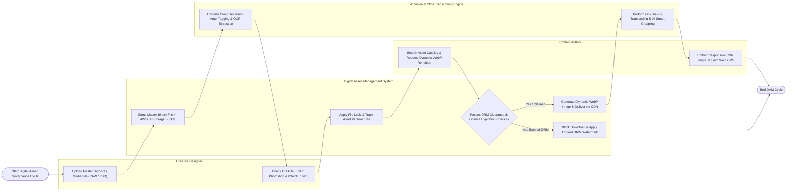

# Swimlane Diagram — Digital Asset Management (DAM) System

## Mermaid Code

## Flow Description | Mô tả luồng

| Lane | Actor | Role in Flow |
|------|-------|-------------|
| 1 | Creative Designer | Uploads high-res master media files (RAW photography, Photoshop `.psd`), checks out files to apply exclusive locks, edits in Photoshop, checks in new asset versions, and performs visual diff comparisons. |
| 2 | Content Author | Searches the asset catalog using metadata facets and AI tags, requests web-ready dynamic image renditions (WebP/AVIF), and embeds responsive CDN tags into web CMS platforms. |
| 3 | Digital Asset Management System | Stores master binary files in AWS S3 buckets, manages file checkout locks, tracks hierarchical version trees, verifies DRM model releases and expiration dates, blocks expired downloads, and dispatches CDN cache purges. |
| 4 | AI Vision & CDN Transcoding Engine | Runs computer vision AI to auto-tag images, extract OCR text, and extract dominant colors, performing on-the-fly media transcoding and AI smart cropping around primary subject focal points. |
