# Action Tree — Digital Asset Management (DAM) System

## Mermaid Code

```mermaid
graph TD
    Root["Digital Asset Management DAM System"]

    Root --> M1["Master Asset Ingestion & Cloud Storage"]
    Root --> M2["AI Computer Vision & Auto-Tagging Engine"]
    Root --> M3["Dynamic Media Transcoding & Smart Cropping"]
    Root --> M4["Version Control & Adobe CC Desktop Integration"]
    Root --> M5["Digital Rights Management DRM & Model Releases"]
    Root --> M6["Asset Utilization & Storage Cost Optimization"]

    M1 --> A11["Upload High-Res Master Media Files (RAW, PSD, AI, 4K Video)"]
    M1 --> A12["Store Master Media Binaries in AWS S3 Object Storage"]
    M1 --> A13["Manage Controlled Metadata Taxonomies & Faceted Filters"]
    M1 --> A14["Generate Low-Res Proxy Previews & Video Streaming Thumbnails"]

    M2 --> A21["Execute AI Computer Vision Object & Scene Detection (AWS Rekognition)"]
    M2 --> A22["Extract Optical Character Recognition (OCR) Text from Graphics"]
    M2 --> A23["Extract Dominant HEX Color Palettes for Image Filtering"]
    M2 --> A24["Detect Faces & Emotion Attributes in Photography"]

    M3 --> A31["Transcode Images On-The-Fly to WebP & AVIF Web Formats"]
    M3 --> A32["Transcode 4K Master Video into Adaptive Bitrate HLS Streams"]
    M3 --> A33["Execute AI Focal-Point Smart Cropping for Responsive Ratios"]
    M3 --> A34["Deliver Renditions via Global CDN Edge Acceleration (Cloudfront)"]

    M4 --> A41["Manage Asset Version Trees (v1.0, v1.1, v2.0) & Check-In Notes"]
    M4 --> A42["Apply Exclusive File Check-Out Locks to Prevent Editing Conflicts"]
    M4 --> A43["Render Side-by-Side Visual Diff Comparisons for Image Versions"]
    M4 --> A44["Integrate Native Extension Panels inside Adobe Photoshop & InDesign"]

    M5 --> A51["Link Talent Model Release PDFs & Stock License Contracts to Assets"]
    M5 --> A52["Enforce Geographic Territory Usage & Media Expiration Dates"]
    M5 --> A53["Block Expired Asset Downloads & Apply Red DRM Watermarks"]
    M5 --> A54["Alert DAM Admins on Expired Assets Embedded in Public Web CMS"]

    M6 --> A61["Track Asset Download Metrics & Web CMS Embedding Telemetry"]
    M6 --> A62["Identify Un-Utilized Orphan Assets for Storage Archiving"]
    M6 --> A63["Automate Lifecycle Tiering from S3 Standard to Glacier Archive"]
    M6 --> A64["Export Executive DAM Storage Cost & Asset ROMI PDF Scorecards"]
```

## Module Description | Mô tả Module

| # | Module | Description | Actions |
|---|--------|-------------|---------|
| 1 | Master Asset Ingestion & Cloud Storage | Uploads master high-res media files, stores binary files in AWS S3, manages controlled metadata taxonomies, and creates proxy previews. | Upload Master High-Res Media Files, Store Binaries in AWS S3 Storage, Manage Controlled Metadata Taxonomies, Generate Low-Res Proxy Previews. |
| 2 | AI Computer Vision & Auto-Tagging Engine | Executes AI visual object detection, extracts OCR text from graphics, extracts dominant color palettes, and detects facial expressions. | Execute AI Object Detection, Extract OCR Text from Graphics, Extract Dominant HEX Color Palettes, Detect Facial Expression Attributes. |
| 3 | Dynamic Media Transcoding & Smart Cropping | Transcodes media on-the-fly to WebP/AVIF and HLS video streams, applies AI smart cropping around focal points, and accelerates CDN delivery. | Transcode Images to WebP & AVIF, Transcode Video into HLS Streams, Execute AI Smart Cropping, Deliver Renditions via CDN Acceleration. |
| 4 | Version Control & Adobe CC Desktop Integration | Tracks version trees, applies file checkout locks, renders side-by-side visual diff comparisons, and integrates native Adobe CC plugins. | Manage Asset Version Trees, Apply File Check-Out Locks, Render Visual Diff Comparisons, Integrate Native Adobe CC Plugins. |
| 5 | Digital Rights Management DRM & Model Releases | Links model releases and stock contracts, enforces territory/expiration rules, blocks expired downloads, and alerts on DRM breaches. | Link Model Release Contracts to Assets, Enforce Territory & Expiration Rules, Block Expired Asset Downloads, Alert Admins on DRM Breaches. |
| 6 | Asset Utilization & Storage Cost Optimization | Tracks download and CMS embed telemetry, identifies un-utilized orphan assets, automates S3 Glacier archiving, and exports storage cost scorecards. | Track Asset Download Telemetry, Identify Un-Utilized Orphan Assets, Automate S3 Glacier Archiving, Export Executive Storage Cost Scorecards. |
