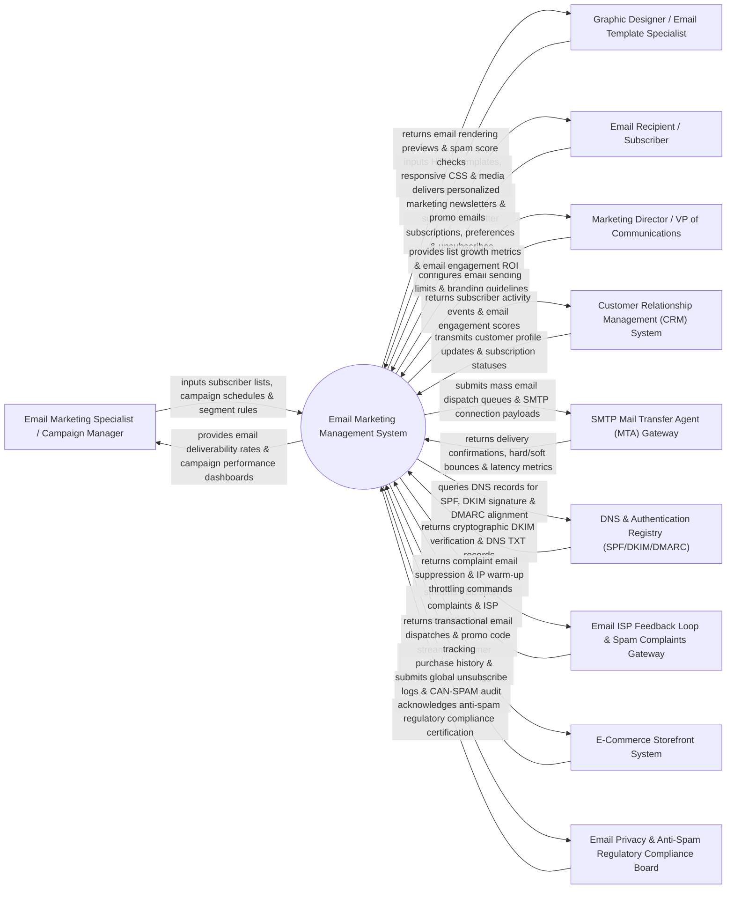

# Context Diagram — Email Marketing Management System

## Mermaid Code

## Actor & Interaction Table | Bảng Actor & Tương tác

| # | Actor | Actor Type | Data Sent TO System | Data Received FROM System | Notes |
|---|-------|------------|---------------------|---------------------------|-------|
| 1 | Email Marketing Specialist / Campaign Manager | Primary | Subscriber list imports, campaign sending schedules, list segmentation rules, RSS-to-email feeds. | Real-time deliverability dashboards, open/click rate analytics, inbox placement metrics, unsubscribe counts. | Email marketer building mass newsletter campaigns, managing lists, and optimizing deliverability. |
| 2 | Graphic Designer / Email Template Specialist | Primary | Responsive HTML email templates, MJML markup, inline CSS styles, email banner graphics. | Litmus/Email-on-Acid cross-client rendering previews (Gmail, Outlook, Apple Mail), pre-send spam score checks. | Designer building visually appealing, cross-client compatible email layouts. |
| 3 | Email Recipient / Subscriber | Primary | Newsletter sign-up form entries, preference center choices (frequency/topics), link clicks, email unsubscribes. | Personalized newsletter broadcasts, promotional offers, re-engagement emails, automated transactional notes. | Target consumer receiving email communications and managing subscription preferences. |
| 4 | Marketing Director / VP of Communications | Primary | Monthly email dispatch volume limits, brand styling guidelines, domain sending policies. | Subscriber list growth reports, email-driven revenue metrics, list churn analysis. | Executive overseeing email communication strategies and brand compliance. |
| 5 | Customer Relationship Management (CRM) System | Supporting | Contact profile updates, customer life-stage changes, subscription consent tags. | Subscriber email open/click events, engagement tier updates, email bounce flags. | Enterprise CRM synchronizing subscriber contacts and email engagement histories. |
| 6 | SMTP Mail Transfer Agent (MTA) Gateway | Supporting | Mass SMTP delivery receipts, hard/soft bounce notifications, delivery latency metrics. | High-throughput outbound SMTP mail queues, DKIM-signed email payloads, sending rate throttling rules. | High-performance MTA infrastructure (SendGrid, Postmark, Amazon SES, PowerMTA) handling email dispatches. |
| 7 | DNS & Authentication Registry (SPF/DKIM/DMARC) | Supporting | DNS TXT records, SPF authorization lists, public DKIM keys, DMARC policy enforcement rules (`p=reject`). | Cryptographic DKIM signing confirmations, DNS alignment check results, DMARC aggregate report data. | Domain Name System (DNS) infrastructure verifying sender identity and domain authentication. |
| 8 | Email ISP Feedback Loop & Spam Complaints Gateway | Supporting | Feedback Loop (FBL) spam complaint webhooks (Gmail, Yahoo, Microsoft), ISP inbox placement scores. | Immediate spam complaint email suppressions, IP warm-up rate throttling commands. | Internet Service Provider (ISP) feedback loop APIs reporting when users flag emails as spam. |
| 9 | E-Commerce Storefront System | Supporting | Customer purchase events, abandoned cart triggers, product recommendations, promo codes. | Automated transactional receipt dispatches, abandoned cart email triggers, promo code usage tracking. | E-commerce platform feeding transaction events to trigger automated transactional and promotional emails. |
| 10 | Email Privacy & Anti-Spam Regulatory Compliance Board | Supporting / Regulatory | CAN-SPAM Act, CASL, GDPR email compliance standards, physical mailing address requirements. | Global suppression list audit trails, one-click unsubscribe execution logs, compliance certificates. | Legal anti-spam regulatory body enforcing email marketing laws and consumer opt-out compliance. |

## System Boundary Description | Mô tả Phạm vi Hệ thống

The **Email Marketing Management System** is a dedicated high-volume email dispatch, template design, subscriber list management, and inbox deliverability platform engineered to create, send, and analyze promotional newsletters, automated transactional emails, and drip broadcasts.

**Inside System Scope:**
- Drag-and-drop HTML email builder with cross-client rendering previews (Gmail, Outlook, Mobile) and spam score testing.
- Subscriber list management with double opt-in verification, preference centers, and dynamic segmentation.
- Sender authentication management (SPF, DKIM, DMARC alignment) and IP address warm-up throttling algorithms.
- Real-time deliverability analytics tracking open rates, click-through rates (CTR), heatmaps, and ISP Feedback Loop (FBL) spam complaints.
- RFC 8058 one-click List-Unsubscribe handling, global suppression list maintenance, and CAN-SPAM/GDPR compliance.

**Outside System Scope:**
- Direct physical postal mail printing and envelope stuffing (handled by Direct Mail Services).
- Direct hosting of corporate domain web servers (handled by Cloud Web Hosting Providers).
- Direct credit card processing for e-commerce purchases (handled by Payment Gateways).
