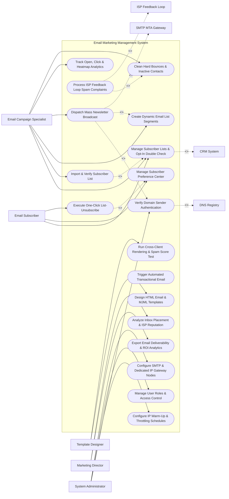

# Use Case Diagram — Email Marketing Management System

## Mermaid Code

## Actor Table | Bảng Actor

| # | Actor | Actor Type | Role Description | Related Use Cases |
|---|-------|------------|------------------|-------------------|
| 1 | Email Campaign Specialist | Primary | Email marketer importing subscriber lists, building segments, dispatching newsletters, and analyzing click heatmaps. | UC01, UC02, UC07, UC08, UC11, UC14 |
| 2 | Template Designer | Primary | Designer crafting MJML/HTML email layouts, executing cross-client rendering previews, and running pre-send spam checks. | UC03, UC04 |
| 3 | Email Subscriber | Primary | Target user opting into newsletters, updating preference center topics, or clicking one-click unsubscribes. | UC01, UC12, UC13 |
| 4 | Marketing Director | Primary | Executive reviewing deliverability metrics, inbox placement scores, list growth rates, and ISP sender reputation. | UC15, UC18 |
| 5 | System Administrator | Primary | IT admin configuring domain authentication (SPF/DKIM/DMARC), dedicated IP warm-up schedules, and SMTP nodes. | UC05, UC06, UC16, UC17 |
| 6 | SMTP MTA Gateway | System (Secondary) | Outbound mail infrastructure executing high-volume SMTP dispatches and returning delivery webhooks. | UC08 |
| 7 | DNS Registry | System (Secondary) | Domain name system verifying SPF records, DKIM public keys, and DMARC alignment rules. | UC05 |
| 8 | ISP Feedback Loop | System (Secondary) | ISP spam complaint gateway (Gmail/Yahoo/Microsoft) streaming user spam flag webhooks. | UC10 |
| 9 | CRM System | System (Secondary) | Connected CRM synchronizing contact opt-in statuses and engagement scores. | UC01 |

## Use Case Table | Bảng Use Case

| # | UC ID | Use Case Name | Primary Actor | Secondary Actor | Description | Priority |
|---|-------|---------------|---------------|-----------------|-------------|----------|
| 1 | UC01 | Manage Subscriber Lists & Opt-In Double Check | Specialist | CRM System | Manages subscriber lists, enforces double opt-in verification emails, and tracks subscription dates. | High |
| 2 | UC02 | Import & Verify Subscriber List | Specialist | None | Imports CSV contact lists and runs real-time syntax and MX record verification to remove spam traps. | High |
| 3 | UC03 | Design HTML Email & MJML Templates | Designer | None | Builds responsive HTML email templates using MJML markup for mobile and desktop rendering. | High |
| 4 | UC04 | Run Cross-Client Rendering & Spam Score Test | Designer | None | Previews email rendering across 40+ email clients (Outlook, Gmail, iOS) and checks SpamAssassin scores. | High |
| 5 | UC05 | Verify Domain Sender Authentication | Admin | DNS Registry | Validates SPF records, DKIM 2048-bit cryptographic signatures, and DMARC `p=reject` alignment. | Critical |
| 6 | UC06 | Configure IP Warm-Up & Throttling Schedules | Admin | None | Establishes automated daily sending volume ramp-up schedules for new dedicated IP addresses. | High |
| 7 | UC07 | Create Dynamic Email List Segments | Specialist | None | Builds dynamic audience segments based on engagement recency, location, or purchase behavior. | High |
| 8 | UC08 | Dispatch Mass Newsletter Broadcast | Specialist | MTA Gateway | Dispatches mass email broadcasts to targeted segments via high-throughput SMTP MTA gateways. | Critical |
| 9 | UC09 | Trigger Automated Transactional Email | System | None | Instantly dispatches automated password resets, purchase receipts, and order confirmations. | High |
| 10 | UC10 | Process ISP Feedback Loop Spam Complaints | Specialist | FBL Gateway | Ingests ISP Feedback Loop (FBL) webhooks, immediately suppressing contacts who flag email as spam. | Critical |
| 11 | UC11 | Track Open, Click & Heatmap Analytics | Specialist | None | Tracks unique open rates, click-through rates (CTR), click heatmaps, and device breakdown statistics. | High |
| 12 | UC12 | Manage Subscriber Preference Center | Subscriber | None | Provides self-service portal for subscribers to update email frequency (Daily/Weekly) and topic choices. | High |
| 13 | UC13 | Execute One-Click List-Unsubscribe | Subscriber | None | Enforces RFC 8058 `List-Unsubscribe` header POST processing for instant one-click unsubscribe execution. | Critical |
| 14 | UC14 | Clean Hard Bounces & Inactive Contacts | Specialist | None | Automatically purges hard bounces (invalid mailboxes) and suppresses long-term unengaged subscribers. | High |
| 15 | UC15 | Export Email Deliverability & ROI Analytics | Director | None | Compiles deliverability summaries, inbox placement rates, unsubscribe trends, and revenue attribution. | High |
| 16 | UC16 | Manage User Roles & Access Control | Admin | None | Controls user login accounts, RBAC permissions, and team sending approval workflows. | High |
| 17 | UC17 | Configure SMTP & Dedicated IP Gateway Nodes | Admin | None | Manages dedicated IP pool assignments, SMTP relay credentials, and sending rate limits. | High |
| 18 | UC18 | Analyze Inbox Placement & ISP Reputation | Director | None | Monitors sender domain reputation scores, Google Postmaster Tools metrics, and spam folder placement %. | Medium |

## Use Case Specification | Đặc tả Use Case

---

### UC02 — Import & Verify Subscriber List

| Field | Detail |
|-------|--------|
| **UC ID** | UC02 |
| **Use Case Name** | Import & Verify Subscriber List |
| **Actor(s)** | Primary: Email Campaign Specialist   Secondary: None |
| **Description** | Imports bulk CSV subscriber lists, executes real-time email syntax checks, domain MX record verification, and suppresses disposable addresses and known spam traps to protect sender reputation. |
| **Precondition** | 1. Specialist holds active list management permissions.   2. CSV file containing email addresses and subscriber attributes is available. |
| **Main Flow** | 1. Specialist opens "Subscriber List Import Manager" and uploads target CSV file (e.g., 50,000 subscriber records).   2. Specialist maps CSV columns to system subscriber fields (Email, First Name, Subscription Source).   3. System initiates automated Email Verification Engine:   &nbsp;&nbsp;&nbsp;&nbsp; a. Syntax Validation (RFC 5322 regex formatting check).   &nbsp;&nbsp;&nbsp;&nbsp; b. Domain MX Record Lookup (Verifies domain has active mail exchanger records).   &nbsp;&nbsp;&nbsp;&nbsp; c. Disposable Email Detection (Filters temporary addresses like `@mailinator.com`).   &nbsp;&nbsp;&nbsp;&nbsp; d. Spam Trap & Role Account Filter (Suppresses `@admin`, `@info`, `@sales` generic addresses).   4. System identifies list verification results:   &nbsp;&nbsp;&nbsp;&nbsp; a. Valid Deliverable Emails: 47,200.   &nbsp;&nbsp;&nbsp;&nbsp; b. Invalid / Syntax Errors: 1,400 (Suppressed).   &nbsp;&nbsp;&nbsp;&nbsp; c. Disposable / Spam Traps: 1,400 (Suppressed).   5. System imports the 47,200 verified contacts into target subscriber list.   6. System displays verification summary report and emails completion receipt to Specialist. |
| **Alternative Flow** | **AF1** — Double Opt-In Email Trigger: Specialist imports unverified web leads; System imports list with status `PENDING_CONFIRMATION` and automatically dispatches double opt-in confirmation emails. |
| **Exception Flow** | **EX1** — High Spam Risk List Rejection: Verification engine detects $> 10\%$ invalid or spam trap rate in CSV file; System blocks list import, displaying error "High Risk List Detected (> 10% Invalid) - Import Rejected to Protect Sender Reputation". |
| **Postcondition** | Verified valid subscribers are imported, invalid/spam trap emails are suppressed, and list health is preserved. |
| **Business Rule** | **BR1**: Subscriber list imports containing $> 5\%$ invalid email addresses MUST be automatically rejected to prevent IP blacklisting. |

---

### UC05 — Verify Domain Sender Authentication (DKIM/DMARC)

| Field | Detail |
|-------|--------|
| **UC ID** | UC05 |
| **Use Case Name** | Verify Domain Sender Authentication (DKIM/DMARC) |
| **Actor(s)** | Primary: System Administrator   Secondary: DNS Registry |
| **Description** | Validates SPF authorization records, configures 2048-bit DKIM cryptographic signatures, and enforces DMARC domain alignment (`p=reject` or `p=quarantine`) to ensure maximum inbox deliverability. |
| **Precondition** | 1. Sending domain (e.g., `news.company.com`) is registered in system.   2. Admin has access to public DNS management. |
| **Main Flow** | 1. Admin opens "Domain Sender Authentication Console" and selects sending domain `news.company.com`.   2. System generates domain authentication DNS TXT records:   &nbsp;&nbsp;&nbsp;&nbsp; a. SPF Record: `v=spf1 include:sendgrid.net include:mktomail.com ~all`.   &nbsp;&nbsp;&nbsp;&nbsp; b. DKIM Selector Key (2048-bit): `s1._domainkey.news.company.com`.   &nbsp;&nbsp;&nbsp;&nbsp; c. DMARC Policy Record: `v=DMARC1; p=reject; rua=mailto:dmarc-reports@company.com`.   3. Admin publishes DNS TXT records to public DNS host.   4. Admin clicks "Verify Authentication Alignment".   5. System queries public DNS servers to validate published records.   6. System confirms 3-Tier Authentication Alignment:   &nbsp;&nbsp;&nbsp;&nbsp; a. SPF: `MATCHED_VALID`.   &nbsp;&nbsp;&nbsp;&nbsp; b. DKIM Signature: `2048-BIT_RSA_VERIFIED`.   &nbsp;&nbsp;&nbsp;&nbsp; c. DMARC Alignment: `P=REJECT_STRICT_PASS`.   7. System unlocks domain for high-volume email dispatches and displays green "Domain Authenticated" status badge. |
| **Alternative Flow** | **AF1** — DMARC Subdomain Alignment: System validates strict DMARC alignment where Return-Path domain matches From Header domain (`news.company.com`). |
| **Exception Flow** | **EX1** — Missing DKIM Key DNS Error: Public DNS lookup cannot find published DKIM selector key; System displays error "DKIM Verification Failed - DNS Record Not Found", blocking mass dispatches from domain. |
| **Postcondition** | Sender domain SPF, DKIM, and DMARC alignment are cryptographically verified, and domain is approved for dispatch. |
| **Business Rule** | **BR1**: Mass email dispatches MUST enforce strict DKIM 2048-bit signing and DMARC alignment compliant with Gmail and Yahoo 2024 sender requirements. |

---

### UC08 — Dispatch Mass Newsletter Broadcast

| Field | Detail |
|-------|--------|
| **UC ID** | UC08 |
| **Use Case Name** | Dispatch Mass Newsletter Broadcast |
| **Actor(s)** | Primary: Email Campaign Specialist   Secondary: SMTP MTA Gateway |
| **Description** | Dispatches a scheduled mass email newsletter broadcast to target subscriber segments, signing DKIM headers, enforcing IP rate throttling, and streaming delivery status webhooks. |
| **Precondition** | 1. Approved HTML email template (UC03) and dynamic segment (UC07) are selected.   2. Sending domain authentication is verified (UC05). |
| **Main Flow** | 1. Specialist opens "Campaign Dispatch Manager".   2. Specialist selects Email Template: `Weekly Tech Digest #142` and Audience Segment: `Active Engaged Subscribers (250,000 Contacts)`.   3. Specialist sets Send Time: `Send Now` or `Schedule for Oct 30, 2026 at 09:00 AM EST`.   4. System checks pre-dispatch safety rules:   &nbsp;&nbsp;&nbsp;&nbsp; a. Verifies sender domain DKIM authentication signature.   &nbsp;&nbsp;&nbsp;&nbsp; b. Suppresses contacts on Global Unsubscribe Suppression List (UC13).   &nbsp;&nbsp;&nbsp;&nbsp; c. Verifies physical postal address is present in footer (CAN-SPAM).   5. Specialist clicks "Confirm & Launch Broadcast".   6. System generates 250,000 personalized MIME email payloads, signs DKIM headers, and pushes queue to SMTP MTA Gateway.   7. MTA Gateway executes parallel dispatches according to IP warm-up throttling schedules (e.g., 50,000 emails/hour).   8. System ingests real-time delivery webhooks from MTA: Delivered (98.4%), Soft Bounces (1.2%), Hard Bounces (0.4%).   9. System updates real-time campaign dispatch dashboard. |
| **Alternative Flow** | **AF1** — Send Time Optimization (STO): Specialist enables "Send Time Optimization"; System dispatches emails individually at each subscriber's predicted peak open time based on historical activity. |
| **Exception Flow** | **EX1** — Sudden Hard Bounce Spike ($> 3\%$): MTA detects hard bounce rate exceeding 3% during initial batch dispatch; System pauses broadcast, alerts Specialist, and prevents further list damage. |
| **Postcondition** | Mass email broadcast is dispatched, MTA delivery status webhooks are ingested, and real-time campaign metrics update. |
| **Business Rule** | **BR1**: Mass email dispatches MUST include a physical postal address and a working one-click unsubscribe mechanism in every email header/footer. |

---

### UC10 — Process ISP Feedback Loop Spam Complaints

| Field | Detail |
|-------|--------|
| **UC ID** | UC10 |
| **Use Case Name** | Process ISP Feedback Loop Spam Complaints |
| **Actor(s)** | Primary: Email Campaign Specialist   Secondary: ISP Feedback Loop |
| **Description** | Ingests real-time Feedback Loop (FBL) spam complaint webhooks from major ISPs (Gmail, Yahoo, Microsoft), immediately suppressing complaining subscribers to protect domain reputation. |
| **Precondition** | 1. FBL agreements are active with major email ISPs.   2. Webhook endpoints are configured to receive complaint event payloads. |
| **Main Flow** | 1. Email recipient clicks "Report Spam" button in Yahoo Mail web interface.   2. Yahoo FBL Gateway generates ARF (Abuse Reporting Format) complaint payload and posts to system FBL webhook URL.   3. System ingests FBL complaint webhook: Extracts original Message-ID, Campaign ID, and Recipient Email (`user@yahoo.com`).   4. System immediately sets subscriber preference `IS_SPAM_COMPLAINT = TRUE`.   5. System adds `user@yahoo.com` to Global Unsubscribe Suppression List (UC13/UC14).   6. System updates campaign analytics: Increments spam complaint count (+1) and calculates spam complaint rate % (e.g., 0.02%).   7. System checks ISP Spam Threshold: Complaint Rate (0.02%) is below ISP danger limit (0.10%).   8. System dispatches suppression update to connected CRM system. |
| **Alternative Flow** | **AF1** — Google Postmaster Spam Rate Alert: System ingests Google Postmaster Tools API data; Domain spam rate reaches 0.08%, System dispatches yellow warning alert to Campaign Specialist. |
| **Exception Flow** | **EX1** — Critical Spam Rate Threshold Breach ($> 0.10\%$): Campaign spam complaint rate reaches 0.15%, breaching Gmail/Yahoo 0.10% maximum limit; System automatically halts active campaign broadcast and locks dedicated IP dispatches. |
| **Postcondition** | Complaining subscriber is immediately suppressed, spam complaint metrics update, and ISP sender reputation is protected. |
| **Business Rule** | **BR1**: Email spam complaint rates MUST be maintained below 0.10% (1 per 1,000 sent) to avoid domain throttling and inbox blocking by Gmail and Yahoo. |

---

### UC12 — Manage Subscriber Preference Center

| Field | Detail |
|-------|--------|
| **UC ID** | UC12 |
| **Use Case Name** | Manage Subscriber Preference Center |
| **Actor(s)** | Primary: Email Subscriber   Secondary: None |
| **Description** | Provides a self-service web portal for subscribers to manage their email subscription topics, choose sending frequencies (Daily, Weekly, Monthly), or pause emails without opting out completely. |
| **Precondition** | 1. Subscriber clicks "Manage Preferences" link in an email footer. |
| **Main Flow** | 1. Subscriber arrives at branded "Subscription Preference Center" web page.   2. System retrieves and displays subscriber active subscriptions:   &nbsp;&nbsp;&nbsp;&nbsp; a. Weekly Product Digest -> Subscribed.   &nbsp;&nbsp;&nbsp;&nbsp; b. Promotional Deals & Discounts -> Subscribed.   &nbsp;&nbsp;&nbsp;&nbsp; c. Technical Release Notes -> Subscribed.   3. Subscriber changes preferences:   &nbsp;&nbsp;&nbsp;&nbsp; a. Unchecks "Promotional Deals & Discounts".   &nbsp;&nbsp;&nbsp;&nbsp; b. Changes frequency for "Weekly Product Digest" to "Monthly Summary".   &nbsp;&nbsp;&nbsp;&nbsp; c. Selects "Pause All Marketing Emails for 30 Days".   4. Subscriber clicks "Save Preferences".   5. System updates subscriber profile in database with new topic and frequency flags.   6. System sets temporary pause expiration date (30 days from current date).   7. System displays confirmation message: "Your email preferences have been saved." |
| **Alternative Flow** | **AF1** — Complete Unsubscribe from Preference Center: Subscriber clicks "Unsubscribe From All Emails"; System triggers UC13 (Execute One-Click List-Unsubscribe), adding contact to global suppression list. |
| **Exception Flow** | **EX1** — Expired Token Access: Preference link security token has expired (> 30 days old); System prompts subscriber to enter email address to receive a fresh secure login magic link. |
| **Postcondition** | Subscriber topic, frequency, and pause preferences are saved, reducing list unsubscribe rates. |
| **Business Rule** | **BR1**: Preference center choices MUST take effect immediately, updating sending queue filters for all future campaign dispatches. |
