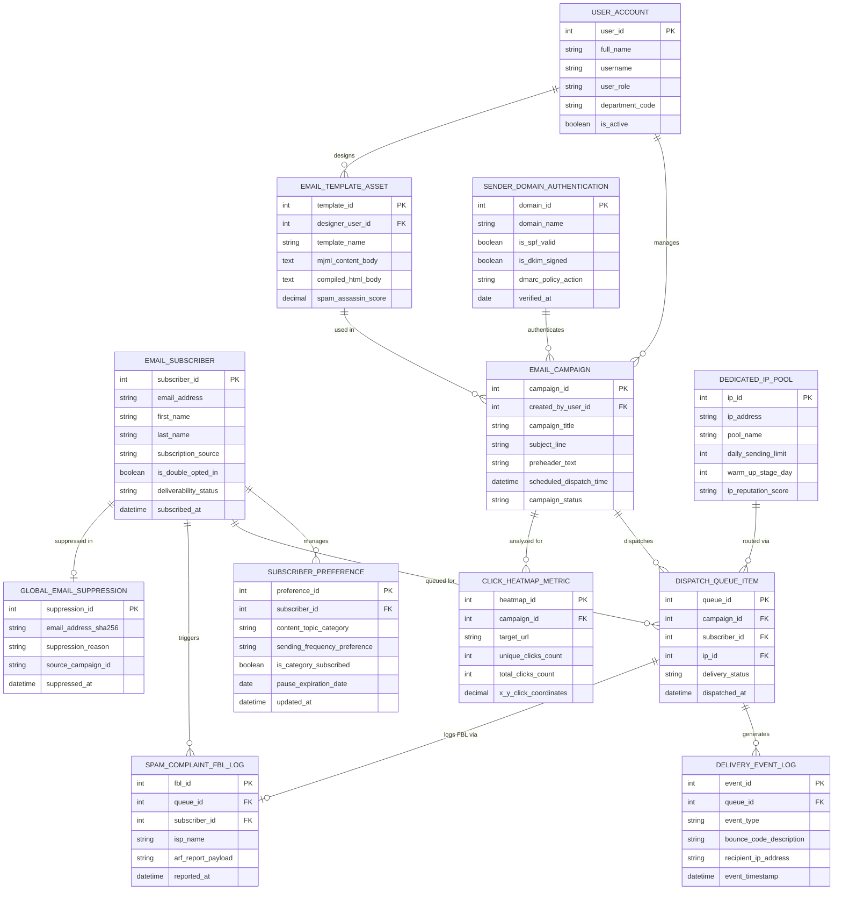

# Conceptual ERD — Email Marketing Management System

## Mermaid Code

## Entity Description Table | Bảng mô tả Entity

| # | Entity Name | Vietnamese Name | Description | Key Attributes | Main Relationships |
|---|-------------|-----------------|-------------|----------------|-------------------|
| 1 | USER_ACCOUNT | Tài khoản Nguời dùng | System credentials and access roles for email specialists, designers, marketing directors, and admins. | `user_id`, `username`, `user_role`, `department_code` | Manages `EMAIL_CAMPAIGN`, designs `EMAIL_TEMPLATE_ASSET`. |
| 2 | EMAIL_SUBSCRIBER | Người Đăng ký Email | Master subscriber record storing email address, double opt-in status, and deliverability health. | `subscriber_id`, `email_address`, `is_double_opted_in`, `deliverability_status`, `subscribed_at` | Manages `SUBSCRIBER_PREFERENCE`, queued for `DISPATCH_QUEUE_ITEM`, suppressed in `GLOBAL_EMAIL_SUPPRESSION`. |
| 3 | SUBSCRIBER_PREFERENCE | Tùy chọn Người Đăng ký | Self-service subscriber preferences detailing topic choices, sending frequency, and pause dates. | `preference_id`, `subscriber_id`, `content_topic_category`, `sending_frequency_preference`, `pause_expiration_date` | Belongs to `EMAIL_SUBSCRIBER`. |
| 4 | EMAIL_CAMPAIGN | Chiến dịch Email Mass | Mass email campaign broadcast header storing subject line, scheduled time, and status. | `campaign_id`, `created_by_user_id`, `campaign_title`, `subject_line`, `scheduled_dispatch_time`, `campaign_status` | Dispatches `DISPATCH_QUEUE_ITEM`, analyzed for `CLICK_HEATMAP_METRIC`, authenticated by `SENDER_DOMAIN_AUTHENTICATION`. |
| 5 | EMAIL_TEMPLATE_ASSET | Mẫu Email Design Asset | MJML and responsive HTML email templates with pre-send SpamAssassin scores. | `template_id`, `designer_user_id`, `template_name`, `mjml_content_body`, `spam_assassin_score` | Used in `EMAIL_CAMPAIGN`, designed by `USER_ACCOUNT`. |
| 6 | SENDER_DOMAIN_AUTHENTICATION | Xác thực Tên miền Sender | Domain authentication records tracking SPF TXT records, DKIM public keys, and DMARC alignment. | `domain_id`, `domain_name`, `is_spf_valid`, `is_dkim_signed`, `dmarc_policy_action` | Authenticates `EMAIL_CAMPAIGN`. |
| 7 | DEDICATED_IP_POOL | Pool IP Gửi Email Dedicated | Dedicated IP pool management tracking daily sending limits, warm-up stages, and IP reputation. | `ip_id`, `ip_address`, `pool_name`, `daily_sending_limit`, `warm_up_stage_day`, `ip_reputation_score` | Routed via `DISPATCH_QUEUE_ITEM`. |
| 8 | DISPATCH_QUEUE_ITEM | Mục Hàng chờ Gửi Email | Individual email queue item generated for each subscriber receiving a campaign broadcast. | `queue_id`, `campaign_id`, `subscriber_id`, `ip_id`, `delivery_status`, `dispatched_at` | Belongs to `EMAIL_CAMPAIGN`, `EMAIL_SUBSCRIBER`, and `DEDICATED_IP_POOL`, generates `DELIVERY_EVENT_LOG`. |
| 9 | DELIVERY_EVENT_LOG | Nhật ký Sự kiện Gửi Mail | Real-time SMTP delivery event logs recording opens, clicks, hard/soft bounces, and latency. | `event_id`, `queue_id`, `event_type`, `bounce_code_description`, `event_timestamp` | Belongs to `DISPATCH_QUEUE_ITEM`. |
| 10 | SPAM_COMPLAINT_FBL_LOG | Nhật ký Báo cáo Spam (FBL) | ISP Feedback Loop (FBL) spam complaint log records capturing ARF abuse payloads. | `fbl_id`, `queue_id`, `subscriber_id`, `isp_name`, `arf_report_payload`, `reported_at` | Belongs to `DISPATCH_QUEUE_ITEM` and `EMAIL_SUBSCRIBER`. |
| 11 | CLICK_HEATMAP_METRIC | Chỉ số Visual Click Heatmap | Visual click heatmap metric tracking target URL click coordinates and unique click counts. | `heatmap_id`, `campaign_id`, `target_url`, `unique_clicks_count`, `total_clicks_count` | Belongs to `EMAIL_CAMPAIGN`. |
| 12 | GLOBAL_EMAIL_SUPPRESSION | Danh sách Chặn Email Toàn cục | SHA-256 hashed global suppression list storing unsubscribed, hard bounced, and spam complaint emails. | `suppression_id`, `email_address_sha256`, `suppression_reason`, `source_campaign_id`, `suppressed_at` | Belongs to `EMAIL_SUBSCRIBER`. |

## Relationship Description | Mô tả Quan hệ

| # | From Entity | Cardinality | To Entity | Label | Business Explanation |
|---|-------------|-------------|-----------|-------|----------------------|
| 1 | EMAIL_SUBSCRIBER | 1 to 0..N | SUBSCRIBER_PREFERENCE | manages | An email subscriber manages their topic and frequency preferences. |
| 2 | EMAIL_SUBSCRIBER | 1 to 0..N | DISPATCH_QUEUE_ITEM | queued for | An email subscriber is queued for campaign dispatch queue items. |
| 3 | EMAIL_SUBSCRIBER | 1 to 0..N | SPAM_COMPLAINT_FBL_LOG | triggers | A subscriber triggers FBL spam complaint logs if they flag an email as spam. |
| 4 | EMAIL_SUBSCRIBER | 1 to 0..1 | GLOBAL_EMAIL_SUPPRESSION | suppressed in | An opted-out subscriber is suppressed in the global suppression list. |
| 5 | EMAIL_CAMPAIGN | 1 to 0..N | DISPATCH_QUEUE_ITEM | dispatches | An email campaign dispatches thousands of individual queue items. |
| 6 | EMAIL_CAMPAIGN | 1 to 0..N | CLICK_HEATMAP_METRIC | analyzed for | An email campaign is analyzed for visual click heatmap metrics. |
| 7 | EMAIL_TEMPLATE_ASSET | 1 to 0..N | EMAIL_CAMPAIGN | used in | An HTML email template asset is used across multiple campaign broadcasts. |
| 8 | DEDICATED_IP_POOL | 1 to 0..N | DISPATCH_QUEUE_ITEM | routed via | A dedicated IP pool routes email dispatch queue items. |
| 9 | DISPATCH_QUEUE_ITEM | 1 to 0..N | DELIVERY_EVENT_LOG | generates | A dispatch queue item generates real-time delivery event logs (opens/clicks/bounces). |
| 10 | DISPATCH_QUEUE_ITEM | 1 to 0..1 | SPAM_COMPLAINT_FBL_LOG | logs FBL via | A dispatch queue item logs FBL spam complaints when reported by an ISP. |
| 11 | SENDER_DOMAIN_AUTHENTICATION | 1 to 0..N | EMAIL_CAMPAIGN | authenticates | Domain authentication authenticates sender headers for email campaigns. |
| 12 | USER_ACCOUNT | 1 to 0..N | EMAIL_CAMPAIGN | manages | A campaign specialist user account manages email campaigns. |
