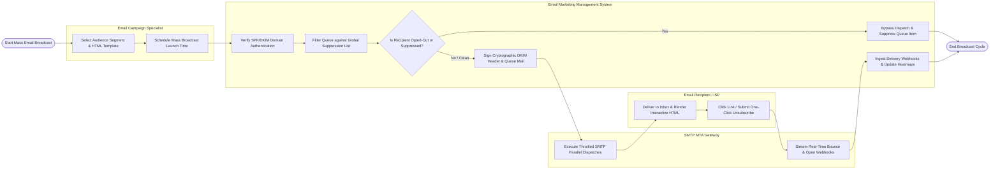

# Swimlane Diagram — Email Marketing Management System

## Mermaid Code

## Flow Description | Mô tả luồng

| Lane | Actor | Role in Flow |
|------|-------|-------------|
| 1 | Email Campaign Specialist | Selects audience segments, chooses responsive HTML templates, configures broadcast schedules, and approves final dispatches. |
| 2 | Email Marketing Management System | Verifies domain SPF/DKIM authentication, filters subscriber queues against global suppression lists, signs cryptographic DKIM headers, ingests delivery webhooks, updates heatmaps, and handles unsubscribes. |
| 3 | SMTP MTA Gateway | Receives MIME email payloads, executes throttled parallel SMTP dispatches according to IP warm-up rules, and streams real-time delivery, open, and bounce webhooks. |
| 4 | Email Recipient / ISP | Receives email in inbox, renders HTML layouts, interacts with links, and submits one-click unsubscribe requests or ISP feedback loop complaints. |
