# Action Tree — Email Marketing Management System

## Mermaid Code

```mermaid
graph TD
    Root["Email Marketing Management System"]

    Root --> M1["Subscriber List & Verification"]
    Root --> M2["Template Design & Rendering QA"]
    Root --> M3["Domain Authentication & IP Warm-Up"]
    Root --> M4["Mass Broadcast & Transactional Dispatch"]
    Root --> M5["Deliverability, FBL & Heatmap Analytics"]
    Root --> M6["Preference Center & Anti-Spam Compliance"]

    M1 --> A11["Import CSV Lists & Verify Syntax/MX Records"]
    M1 --> A12["Enforce Double Opt-In Email Confirmations"]
    M1 --> A13["Create Dynamic Engagement Audience Segments"]
    M1 --> A14["Purge Disposable Emails & Spam Trap Addresses"]

    M2 --> A21["Build Responsive MJML & HTML Email Templates"]
    M2 --> A22["Preview Rendering across 40+ Email Clients"]
    M2 --> A23["Run Pre-Send SpamAssassin Score Inspections"]
    M2 --> A24["Insert Dynamic Subscriber Merge Tags & Links"]

    M3 --> A31["Verify SPF TXT Records & Public DKIM Keys"]
    M3 --> A32["Enforce DMARC Strict Alignment Policies (p=reject)"]
    M3 --> A33["Configure Daily Dedicated IP Warm-Up Schedules"]
    M3 --> A34["Monitor Google Postmaster Sender Reputation"]

    M4 --> A41["Dispatch Mass Newsletter Broadcasts to Segments"]
    M4 --> A42["Trigger Automated Transactional Receipt Emails"]
    M4 --> A43["Execute Send Time Optimization (STO) Dispatches"]
    M4 --> A44["Sign Cryptographic 2048-Bit DKIM Mail Headers"]

    M5 --> A51["Ingest Real-Time Delivery, Open & CTR Webhooks"]
    M5 --> A52["Process ISP Feedback Loop (FBL) Spam Complaints"]
    M5 --> A53["Render Visual Link Click Heatmap Analytics"]
    M5 --> A54["Auto-Suppress Hard Bounced Email Mailboxes"]

    M6 --> A61["Provide Self-Service Subscriber Preference Portals"]
    M6 --> A62["Execute RFC 8058 One-Click List-Unsubscribe Links"]
    M6 --> A63["Maintain SHA-256 Hashed Global Suppression Lists"]
    M6 --> A64["Enforce CAN-SPAM, CASL & GDPR Legal Compliance"]
```

## Module Description | Mô tả Module

| # | Module | Description | Actions |
|---|--------|-------------|---------|
| 1 | Subscriber List & Verification | Imports subscriber lists, validates MX syntax, enforces double opt-in, creates dynamic segments, and purges spam traps. | Import CSV Lists, Enforce Double Opt-In, Create Dynamic Segments, Purge Spam Traps. |
| 2 | Template Design & Rendering QA | Builds MJML/HTML email layouts, previews cross-client rendering, runs SpamAssassin checks, and inserts merge tags. | Build Responsive HTML Templates, Preview Cross-Client Rendering, Run SpamAssassin Inspections, Insert Dynamic Merge Tags. |
| 3 | Domain Authentication & IP Warm-Up | Validates SPF/DKIM/DMARC alignment, configures dedicated IP warm-up schedules, and tracks sender reputation. | Verify SPF & DKIM Records, Enforce DMARC Alignment, Configure IP Warm-Up Schedules, Monitor Sender Reputation. |
| 4 | Mass Broadcast & Transactional Dispatch | Dispatches mass newsletters, triggers transactional receipts, executes Send Time Optimization (STO), and signs DKIM headers. | Dispatch Mass Newsletters, Trigger Transactional Receipts, Execute Send Time Optimization, Sign Cryptographic DKIM Headers. |
| 5 | Deliverability, FBL & Heatmap Analytics | Ingests delivery/open/click webhooks, processes FBL spam complaints, renders click heatmaps, and suppresses hard bounces. | Ingest Delivery Webhooks, Process FBL Spam Complaints, Render Click Heatmaps, Suppress Hard Bounces. |
| 6 | Preference Center & Anti-Spam Compliance | Provides self-service preference portals, executes one-click unsubscribes, maintains suppression lists, and enforces anti-spam compliance. | Provide Subscriber Preference Portals, Execute One-Click Unsubscribes, Maintain Suppression Lists, Enforce Anti-Spam Compliance. |
