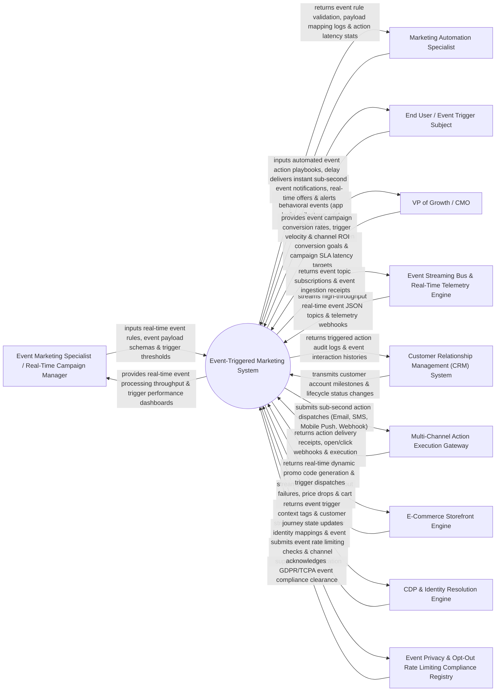

# Context Diagram — Event-Triggered Marketing System

## Mermaid Code

## Actor & Interaction Table | Bảng Actor & Tương tác

| # | Actor | Actor Type | Data Sent TO System | Data Received FROM System | Notes |
|---|-------|------------|---------------------|---------------------------|-------|
| 1 | Event Marketing Specialist / Real-Time Campaign Manager | Primary | Event trigger rules, event payload schemas, real-time threshold limits, event campaign priority logic. | Real-time event processing throughput, trigger performance dashboards, event rule match rates. | Marketer defining real-time event rules (e.g., cart abandon, birthday, flight delay, price drop). |
| 2 | Marketing Automation Specialist | Primary | Automated action playbooks, delay rules, payload field mapping (JSON path), channel fallback logic. | Event rule validation checks, payload mapping logs, action execution latency stats. | Technical specialist configuring payload parsing and multi-channel action dispatches. |
| 3 | End User / Event Trigger Subject | Primary | Real-time behavioral events (mobile app opens, geo-fence enter, cart additions, subscription renewals). | Instant sub-second event notifications, real-time promo codes, milestone celebration alerts. | Customer generating real-time behavioral events and receiving sub-second event responses. |
| 4 | VP of Growth / CMO | Primary | Event-driven conversion goals, sub-second latency SLA targets, campaign ROI benchmarks. | Event campaign conversion rates, trigger velocity, sub-second SLA compliance reports, incremental revenue. | Executive monitoring real-time marketing efficiency and event-driven revenue growth. |
| 5 | Event Streaming Bus & Real-Time Telemetry Engine | Supporting | Real-time event JSON topics (Apache Kafka, RabbitMQ, AWS Kinesis), system webhooks. | Event topic subscriptions, event ingestion receipts, partition offset acknowledgments. | High-throughput streaming bus supplying millions of real-time event telemetry messages per second. |
| 6 | Customer Relationship Management (CRM) System | Supporting | Customer milestone events (contract renewal date, anniversary, VIP tier upgrade). | Triggered action audit logs, customer event interaction histories, lifecycle state updates. | Enterprise CRM providing customer milestone triggers and recording event interaction audit logs. |
| 7 | Multi-Channel Action Execution Gateway | Supporting | Message delivery receipts, click webhooks, action execution latency metrics. | Sub-second action dispatches (Email, SMS, Mobile Push, Webhooks, In-App Banner). | Execution engine delivering multi-channel messages within milliseconds of event detection. |
| 8 | E-Commerce Storefront Engine | Supporting | Real-time storefront event streams (checkout failure, inventory restock, cart abandon, price drop). | Real-time dynamic promo code generation payloads, instant trigger dispatches. | E-commerce engine feeding real-time shopping events and receiving dynamic promo triggers. |
| 9 | CDP & Identity Resolution Engine | Supporting | Unified customer identity mappings, cross-device profile attributes, event context data. | Event trigger context tags, real-time customer journey state updates. | Central CDP enriching raw event telemetry with full customer profile context. |
| 10 | Event Privacy & Opt-Out Rate Limiting Compliance Registry | Supporting / Regulatory | Real-time event rate limiting rules, TCPA quiet hours, GDPR opt-out registries. | Event rate limit clearance receipts, channel suppression verification tokens. | Regulatory compliance framework enforcing event message rate limits and TCPA quiet hours. |

## System Boundary Description | Mô tả Phạm vi Hệ thống

The **Event-Triggered Marketing System** is an enterprise real-time event stream processing, sub-second rule evaluation, event enrichment, and multi-channel action orchestration platform designed to react instantly to customer behavioral, transactional, and environmental events.

**Inside System Scope:**
- High-throughput event stream ingestion from Apache Kafka, RabbitMQ, AWS Kinesis, and REST Webhooks.
- Sub-second event rule processing engine evaluating complex conditional logic (e.g., Event = `CART_ABANDON` AND Customer = `VIP` AND Latency < 1s).
- Event enrichment merging raw event payloads with CDP customer master profiles in real time.
- Multi-channel sub-second action dispatching (Mobile Push, SMS, Email, Webhooks, In-App Banners).
- Rate limiting, TCPA quiet hours enforcement (blocking night SMS dispatches), and sub-second SLA performance analytics.

**Outside System Scope:**
- Direct physical hosting of streaming Kafka cluster servers (handled by Cloud Infrastructure Providers).
- Direct mobile cellular tower message routing (handled by Telecom Carriers).
- Direct inventory warehouse product stocking (handled by ERP and Warehouse Management Systems).
