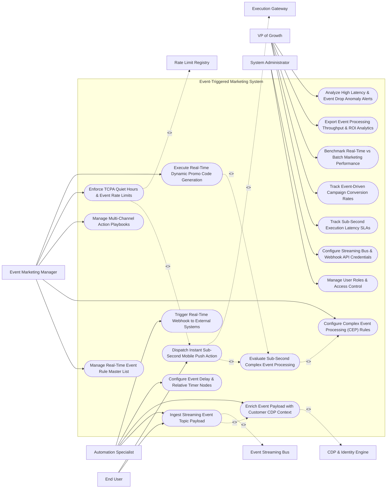

# Use Case Diagram — Event-Triggered Marketing System

## Mermaid Code

## Actor Table | Bảng Actor

| # | Actor | Actor Type | Role Description | Related Use Cases |
|---|-------|------------|------------------|-------------------|
| 1 | Event Marketing Manager | Primary | Marketer defining real-time event rules, action playbooks, rate limits, and dynamic promo code rules. | UC01, UC03, UC06, UC10, UC12 |
| 2 | Automation Specialist | Primary | Technical specialist configuring event streaming topics, JSON payload enrichment, delay timers, and webhooks. | UC02, UC04, UC07, UC09 |
| 3 | End User | Primary | Consumer generating real-time behavioral events and receiving sub-second push notifications and SMS alerts. | UC02, UC08 |
| 4 | VP of Growth | Primary | Executive monitoring sub-second latency SLAs, event-driven conversions, processing throughput, and ROI. | UC11, UC13, UC14, UC15, UC18 |
| 5 | System Administrator | Primary | IT admin managing security roles, Kafka streaming cluster credentials, and webhook endpoints. | UC16, UC17 |
| 6 | Event Streaming Bus | System (Secondary) | High-throughput message bus (Apache Kafka/RabbitMQ) supplying real-time event JSON streams. | UC02 |
| 7 | Execution Gateway | System (Secondary) | Sub-second delivery engine dispatching mobile push notifications, SMS texts, and webhooks. | UC08 |
| 8 | CDP & Identity Engine | System (Secondary) | Enterprise CDP enriching raw event telemetry with full customer profile context. | UC04 |
| 9 | Rate Limit Registry | System (Secondary) | Compliance registry enforcing event rate limits, TCPA quiet hours, and channel suppression. | UC10 |

## Use Case Table | Bảng Use Case

| # | UC ID | Use Case Name | Primary Actor | Secondary Actor | Description | Priority |
|---|-------|---------------|---------------|-----------------|-------------|----------|
| 1 | UC01 | Manage Real-Time Event Rule Master List | EventMgr | None | Centralizes all real-time event rules (Cart Abandonment, Price Drop, Milestone, Geo-Fence Enter). | High |
| 2 | UC02 | Ingest Streaming Event Topic Payload | AutomationSpec | Kafka Bus | Ingests high-throughput JSON event payloads from Apache Kafka, RabbitMQ, or REST webhooks in real time. | Critical |
| 3 | UC03 | Configure Complex Event Processing (CEP) Rules | EventMgr | None | Defines multi-condition CEP rules combining event types, time windows, and customer attributes. | Critical |
| 4 | UC04 | Enrich Event Payload with Customer CDP Context | AutomationSpec | CDP System | Merges raw event payloads with customer master profiles (Tier, LTV, Preferences) in real time. | Critical |
| 5 | UC05 | Evaluate Sub-Second Complex Event Processing | System | None | Evaluates streaming events against CEP rules in memory, matching events to action playbooks in $< 100 \text{ ms}$. | Critical |
| 6 | UC06 | Manage Multi-Channel Action Playbooks | EventMgr | None | Maps matched event rules to multi-channel action dispatches (Push, SMS, Email, Webhook). | High |
| 7 | UC07 | Configure Event Delay & Relative Timer Nodes | AutomationSpec | None | Configures relative time delays (e.g., Send SMS 15 minutes after event IF cart remains unpurchased). | High |
| 8 | UC08 | Dispatch Instant Sub-Second Mobile Push Action | EndUser | Execution GW | Dispatches targeted iOS/Android mobile push notifications within sub-second latency ($< 500 \text{ ms}$). | Critical |
| 9 | UC09 | Trigger Real-Time Webhook to External Systems | AutomationSpec | None | Dispatches real-time HTTPS REST webhooks to external CRM, E-Commerce, or Fulfillment platforms. | High |
| 10 | UC10 | Enforce TCPA Quiet Hours & Event Rate Limits | EventMgr | Rate Limit Reg | Enforces TCPA quiet hours (no SMS between 21:00 and 08:00) and max 3 event messages per customer/day. | Critical |
| 11 | UC11 | Track Sub-Second Execution Latency SLAs | GrowthVP | None | Measures end-to-end event execution latency (from event detection to action dispatch) against sub-second SLAs. | High |
| 12 | UC12 | Execute Real-Time Dynamic Promo Code Generation | EventMgr | None | Generates single-use, time-sensitive promo codes (e.g., 10% off valid for 60 mins) upon event trigger. | High |
| 13 | UC13 | Track Event-Driven Campaign Conversion Rates | GrowthVP | None | Measures conversion rates and revenue generated specifically by real-time event-triggered campaigns. | High |
| 14 | UC14 | Benchmark Real-Time vs Batch Marketing Performance | GrowthVP | None | Compares conversion lift of real-time sub-second triggers vs traditional scheduled batch email dispatches. | High |
| 15 | UC15 | Export Event Processing Throughput & ROI Analytics | GrowthVP | None | Renders executive dashboards displaying total events processed/sec, match rates, and event-driven ROMI. | High |
| 16 | UC16 | Manage User Roles & Access Control | Admin | None | Controls user login accounts, RBAC permissions, and event rule publishing authorization. | High |
| 17 | UC17 | Configure Streaming Bus & Webhook API Credentials | Admin | None | Configures API connection parameters to Kafka clusters, AWS Kinesis streams, and webhook endpoints. | High |
| 18 | UC18 | Analyze High Latency & Event Drop Anomaly Alerts | GrowthVP | None | Triggers urgent alert notifications when event processing latency exceeds 1.0 second or event drops spike. | High |

## Use Case Specification | Đặc tả Use Case

---

### UC02 — Ingest Streaming Event Topic Payload

| Field | Detail |
|-------|--------|
| **UC ID** | UC02 |
| **Use Case Name** | Ingest Streaming Event Topic Payload |
| **Actor(s)** | Primary: Automation Specialist, End User   Secondary: Event Streaming Bus (Apache Kafka / RabbitMQ) |
| **Description** | Ingests high-throughput real-time event JSON payloads from Apache Kafka topics, RabbitMQ queues, AWS Kinesis, or REST Webhooks with sub-millisecond ingestion latency. |
| **Precondition** | 1. Kafka cluster connection credentials and topic subscriptions are active (UC17). |
| **Main Flow** | 1. End User performs action in mobile app (e.g., Adds item to cart and leaves app -> `CART_ABANDON_EVENT`).   2. Mobile app dispatches event JSON payload to Apache Kafka event bus topic `telemetry.mobile.events`.   3. System streaming ingestion consumer receives event payload:   &nbsp;&nbsp;&nbsp;&nbsp; a. Event Type: `CART_ABANDON`.   &nbsp;&nbsp;&nbsp;&nbsp; b. Customer ID: `CID_99412`.   &nbsp;&nbsp;&nbsp;&nbsp; c. Event Timestamp: `2026-10-30T14:32:01.120Z`.   &nbsp;&nbsp;&nbsp;&nbsp; d. Payload Data: `cart_id: "cart_402"`, `cart_value: 150.00`, `currency: "USD"`, `item_skus: ["SKU-884", "SKU-992"]`.   4. System validates JSON schema integrity: `SCHEMA_VALID`.   5. System acknowledges Kafka partition offset (`ACK_OFFSET_SUCCESS`).   6. System passes ingested event payload to UC04 (Enrich Event Payload with Customer CDP Context) for real-time profile merging. |
| **Alternative Flow** | **AF1** — Direct Inbound REST Webhook Ingestion: E-commerce server posts event directly to system HTTPS Webhook listener (`POST /v1/events/ingest`), receiving HTTP 200 OK within 15 ms. |
| **Exception Flow** | **EX1** — Malformed Event JSON Error: Ingested event payload contains invalid JSON syntax; System rejects payload, writes error to dead-letter queue (DLQ), and increments event error counter. |
| **Postcondition** | Streaming event JSON payload is ingested, schema is validated, Kafka offset is acknowledged, and payload is routed for CDP enrichment. |
| **Business Rule** | **BR1**: Event stream ingestion MUST process incoming event payloads with an ingestion latency of <= 50 milliseconds. |

---

### UC05 — Evaluate Sub-Second Complex Event Processing (CEP)

| Field | Detail |
|-------|--------|
| **UC ID** | UC05 |
| **Use Case Name** | Evaluate Sub-Second Complex Event Processing (CEP) |
| **Actor(s)** | Primary: Event Marketing Specialist   Secondary: None |
| **Description** | Evaluates enriched real-time event payloads against Complex Event Processing (CEP) in-memory rule matrices to match events with multi-channel action playbooks in $< 100 \text{ ms}$. |
| **Precondition** | 1. Event payload is enriched with customer CDP context (UC04).   2. CEP rules are active in memory (UC03). |
| **Main Flow** | 1. System receives enriched event payload: `Event: CART_ABANDON`, `Customer: CID_99412 (VIP Gold Tier)`, `Cart Value: $150.00`, `Last Purchase: 12 Days Ago`.   2. System in-memory CEP engine scans active rule matrix:   &nbsp;&nbsp;&nbsp;&nbsp; a. Rule 104 (`CART_ABANDON_VIP`):   &nbsp;&nbsp;&nbsp;&nbsp;&nbsp;&nbsp;&nbsp;&nbsp; i. Condition 1: `event_type == "CART_ABANDON"`.   &nbsp;&nbsp;&nbsp;&nbsp;&nbsp;&nbsp;&nbsp;&nbsp; ii. AND Condition 2: `cart_value >= 100.00`.   &nbsp;&nbsp;&nbsp;&nbsp;&nbsp;&nbsp;&nbsp;&nbsp; iii. AND Condition 3: `customer_tier == "Gold" OR "Platinum"`.   &nbsp;&nbsp;&nbsp;&nbsp;&nbsp;&nbsp;&nbsp;&nbsp; iv. AND Condition 4: `customer_opt_in_push == TRUE`.   3. CEP engine evaluates all conditions to `TRUE` -> `MATCH_SUCCESS (Rule #104)`.   4. System measures CEP Evaluation Time: `12 milliseconds` (Target: <= 100 ms).   5. System maps matched rule to Action Playbook `PLAYBOOK_VIP_CART_RECOVERY`:   &nbsp;&nbsp;&nbsp;&nbsp; a. Action 1: Generate 10% Dynamic Promo Code (UC12).   &nbsp;&nbsp;&nbsp;&nbsp; b. Action 2: Dispatch Instant Mobile Push Notification (UC08).   6. System passes action execution payload to UC08. |
| **Alternative Flow** | **AF1** — Multi-Event Sequence Matching: CEP rule requires a sequence of 2 events within 10 minutes (`SEARCH_FLIGHT` followed by `FLIGHT_PRICE_DROP`); System CEP engine matches sequence across rolling in-memory event sliding windows. |
| **Exception Flow** | **EX1** — No Rule Match: Enriched event payload matches 0 active rules; System logs status `NO_RULE_MATCH` and discards event without triggering action dispatches. |
| **Postcondition** | Enriched event is evaluated against in-memory CEP rules in $< 100 \text{ ms}$, matched rule is identified, and action playbook payload is passed for execution. |
| **Business Rule** | **BR1**: Complex Event Processing (CEP) rule evaluations MUST complete in memory within <= 100 milliseconds of event enrichment. |

---

### UC08 — Dispatch Instant Sub-Second Mobile Push Action

| Field | Detail |
|-------|--------|
| **UC ID** | UC08 |
| **Use Case Name** | Dispatch Instant Sub-Second Mobile Push Action |
| **Actor(s)** | Primary: End User   Secondary: Execution Gateway (Firebase / OneSignal) |
| **Description** | Dispatches a personalized iOS/Android mobile push notification or in-app alert to the customer's smartphone within sub-second latency ($< 500 \text{ ms}$) of the triggering event. |
| **Precondition** | 1. CEP engine matches event to an action playbook (UC05).   2. Customer has a valid mobile push token registered and `PUSH_OPT_IN = TRUE`.   3. Rate limiting and TCPA quiet hours checks are cleared (UC10). |
| **Main Flow** | 1. System receives action payload for Customer `CID_99412`: `Playbook: PLAYBOOK_VIP_CART_RECOVERY`, `Promo Code: "SAVE10-99412"`.   2. System retrieves customer device push token: `token_ios_88412` (Device: `iPhone 15 Pro`).   3. System constructs personalized Mobile Push Payload:   &nbsp;&nbsp;&nbsp;&nbsp; a. Push Title: `"Alex, your cart is waiting!"`.   &nbsp;&nbsp;&nbsp;&nbsp; b. Push Body: `"Complete your order now and take 10% off with code SAVE10-99412. Offer valid for 60 mins!"`.   &nbsp;&nbsp;&nbsp;&nbsp; c. Deep Link URL: `app://checkout?cart_id=cart_402&promo=SAVE10-99412`.   4. System transmits HTTPS REST API payload to Execution Gateway (Firebase Cloud Messaging API).   5. Firebase API receives payload and delivers push notification to customer's iPhone screen.   6. System measures End-to-End Latency:   &nbsp;&nbsp;&nbsp;&nbsp; a. Event Ingestion: 20 ms.   &nbsp;&nbsp;&nbsp;&nbsp; b. CEP Evaluation: 12 ms.   &nbsp;&nbsp;&nbsp;&nbsp; c. Push Dispatch API: 180 ms.   &nbsp;&nbsp;&nbsp;&nbsp; d. Total End-to-End Latency: `212 ms` (Target: <= 500 ms -> SLA MET).   7. System logs sub-second execution record and updates latency performance dashboards. |
| **Alternative Flow** | **AF1** — In-App Banner Trigger: Customer is currently active inside the mobile app when event occurs; System dispatches instant in-app slide-up banner payload directly to active app session. |
| **Exception Flow** | **EX1** — Expired Push Token Error: Firebase API returns `UNREGISTERED_DEVICE_TOKEN`; System catches error, flags token as invalid, and initiates channel fallback to SMS or Email. |
| **Postcondition** | Sub-second mobile push notification is delivered to customer smartphone, deep link is attached, and end-to-end execution latency is logged. |
| **Business Rule** | **BR1**: Real-time event-triggered mobile push actions MUST achieve an end-to-end execution latency of <= 500 milliseconds from event detection to API dispatch. |

---

### UC10 — Enforce TCPA Quiet Hours & Event Rate Limits

| Field | Detail |
|-------|--------|
| **UC ID** | UC10 |
| **Use Case Name** | Enforce TCPA Quiet Hours & Event Rate Limits |
| **Actor(s)** | Primary: Event Marketing Specialist   Secondary: Rate Limit Registry |
| **Description** | Evaluates event action dispatches against TCPA legal quiet hours (blocking night SMS dispatches between 21:00 and 08:00 local time) and global event rate limits to prevent over-messaging. |
| **Precondition** | 1. Action playbook payload is generated by CEP engine (UC05).   2. Customer geographic timezone is identified in profile. |
| **Main Flow** | 1. System prepares to dispatch an event-triggered action (e.g., SMS Text Alert to Customer `CID_99412`).   2. System checks Customer Local Timezone: `US Eastern Time (EST)` -> Current Customer Local Time: `22:30 PM (10:30 PM)`.   3. System checks TCPA Quiet Hours Policy:   &nbsp;&nbsp;&nbsp;&nbsp; a. Rule: "No commercial SMS text messages allowed between 21:00 PM and 08:00 AM local recipient time".   &nbsp;&nbsp;&nbsp;&nbsp; b. Evaluation: 22:30 PM is within Quiet Hours -> `TCPA_VIOLATION_PREVENTED`.   4. System checks Event Rate Limit Policy:   &nbsp;&nbsp;&nbsp;&nbsp; a. Rule: "Max 3 event-triggered messages per customer per 24 hours".   &nbsp;&nbsp;&nbsp;&nbsp; b. Evaluation: Customer received 1 message today -> Rate Limit `PASSED`.   5. Because TCPA Quiet Hours are active for SMS, System applies Channel Shift:   &nbsp;&nbsp;&nbsp;&nbsp; a. Option A: Convert SMS to Mobile Push Notification (Silent Push).   &nbsp;&nbsp;&nbsp;&nbsp; b. Option B: Defer SMS dispatch to 08:05 AM EST the next morning.   6. System selects Option B: Schedules deferred SMS dispatch for `08:05 AM EST`.   7. System logs compliance audit record: `SMS_DEFERRED_TCPA_QUIET_HOURS`. |
| **Alternative Flow** | **AF1** — High-Priority Fraud Alert Exemption: Event type is a Critical Security Alert (e.g., Password Change or Fraudulent Login Attempt); System bypasses TCPA quiet hours, delivering immediate SMS security alert. |
| **Exception Flow** | **EX1** — Daily Event Rate Limit Exceeded: Customer reached 3 event messages today; System suppresses non-critical event action, logging `SUPPRESSED_RATE_LIMIT_EXCEEDED`. |
| **Postcondition** | Event action dispatches are verified against TCPA quiet hours and rate limits, protecting legal compliance and customer experience. |
| **Business Rule** | **BR1**: Commercial SMS text dispatches MUST be automatically deferred if the recipient's local time falls within TCPA quiet hours (21:00 to 08:00). |

---

### UC12 — Execute Real-Time Dynamic Promo Code Generation

| Field | Detail |
|-------|--------|
| **UC ID** | UC12 |
| **Use Case Name** | Execute Real-Time Dynamic Promo Code Generation |
| **Actor(s)** | Primary: Event Marketing Specialist   Secondary: None |
| **Description** | Generates unique, single-use, time-sensitive promo codes (e.g., 10% discount expiring in 60 minutes) in real time upon event trigger detection to drive immediate conversion urgency. |
| **Precondition** | 1. Event trigger rule requires dynamic promo code generation (UC05).   2. E-commerce promo code generator parameters are active. |
| **Main Flow** | 1. System CEP engine triggers dynamic promo code generation request for Customer `CID_99412` on `CART_ABANDON_EVENT`.   2. System retrieves Promo Code Template Rules:   &nbsp;&nbsp;&nbsp;&nbsp; a. Discount Type: `10% Percentage Discount`.   &nbsp;&nbsp;&nbsp;&nbsp; b. Expiration Window: `60 Minutes from Generation`.   &nbsp;&nbsp;&nbsp;&nbsp; c. Usage Limit: `Single-Use Only (1 Redemption Allowed)`.   &nbsp;&nbsp;&nbsp;&nbsp; d. Minimum Cart Spend: `$50.00`.   3. System generates unique cryptographic promo string: `SAVE10-99412-X82`.   4. System sets Expiration Timestamp: `Current Time + 60 Minutes` (e.g., `15:32:00 EST`).   5. System posts promo code payload via API to E-Commerce Storefront Engine to activate code in checkout database.   6. System inserts promo code string `SAVE10-99412-X82` and expiration countdown into the mobile push action payload (UC08).   7. System starts promo code expiration timer in database; At 60 minutes, System deactivates promo code in E-Commerce Storefront Engine if unredeemed. |
| **Alternative Flow** | **AF1** — Tiered VIP Discount Scaling: Customer is a Platinum VIP Account; System generates a `20% Discount` code (`VIP20-99412-Z99`) instead of standard 10%. |
| **Exception Flow** | **EX1** — E-Commerce Promo API Error: E-Commerce Storefront API returns 500 error; System falls back to a static backup promo code pool (`FLASH10`), logging API failure. |
| **Postcondition** | Single-use dynamic promo code is generated, activated in e-commerce checkout, attached to action payload, and expiration timer is set. |
| **Business Rule** | **BR1**: Dynamically generated promo codes MUST be single-use only and enforce automatic expiration timestamps to drive conversion urgency. |
