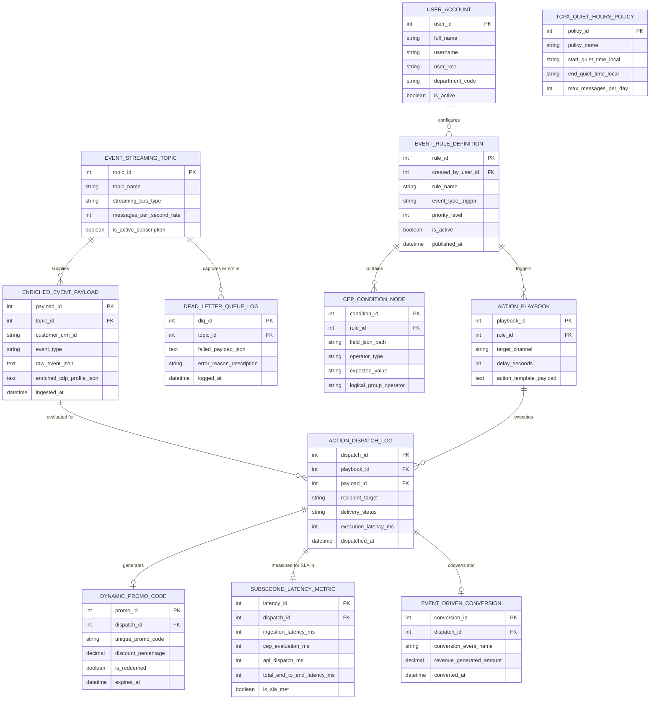

# Conceptual ERD — Event-Triggered Marketing System

## Mermaid Code

## Entity Description Table | Bảng mô tả Entity

| # | Entity Name | Vietnamese Name | Description | Key Attributes | Main Relationships |
|---|-------------|-----------------|-------------|----------------|-------------------|
| 1 | USER_ACCOUNT | Tài khoản Nguời dùng | System credentials and access roles for event marketing managers, automation specialists, and growth VPs. | `user_id`, `username`, `user_role`, `department_code` | Configures `EVENT_RULE_DEFINITION`. |
| 2 | EVENT_STREAMING_TOPIC | Topic Streaming Event | Streaming message bus topic configuration (Kafka/RabbitMQ topic name, throughput, subscription status). | `topic_id`, `topic_name`, `streaming_bus_type`, `messages_per_second_rate`, `is_active_subscription` | Supplies `ENRICHED_EVENT_PAYLOAD`, captures errors in `DEAD_LETTER_QUEUE_LOG`. |
| 3 | EVENT_RULE_DEFINITION | Định nghĩa Quy tắc Event | Master real-time event rule definition storing rule name, event type trigger, priority, and status. | `rule_id`, `created_by_user_id`, `rule_name`, `event_type_trigger`, `priority_level`, `is_active` | Contains `CEP_CONDITION_NODE`, triggers `ACTION_PLAYBOOK`, configured by `USER_ACCOUNT`. |
| 4 | CEP_CONDITION_NODE | Nút Điều kiện CEP | Individual Complex Event Processing (CEP) conditional rule node (field path, operator, value). | `condition_id`, `rule_id`, `field_json_path`, `operator_type`, `expected_value`, `logical_group_operator` | Belongs to `EVENT_RULE_DEFINITION`. |
| 5 | ENRICHED_EVENT_PAYLOAD | Payload Event Đã Enrich | Ingested real-time event payload merged with customer CDP master profile context data. | `payload_id`, `topic_id`, `customer_crm_id`, `event_type`, `raw_event_json`, `enriched_cdp_profile_json` | Belongs to `EVENT_STREAMING_TOPIC`, evaluated for `ACTION_DISPATCH_LOG`. |
| 6 | ACTION_PLAYBOOK | Playbook Hành động Đa kênh | Multi-channel action playbook mapped to a matched rule (target channel, delay, action payload). | `playbook_id`, `rule_id`, `target_channel`, `delay_seconds`, `action_template_payload` | Belongs to `EVENT_RULE_DEFINITION`, executes `ACTION_DISPATCH_LOG`. |
| 7 | ACTION_DISPATCH_LOG | Nhật ký Dispatch Action | Execution log recording sub-second action dispatches (Mobile Push, SMS, Webhook), status, and latency. | `dispatch_id`, `playbook_id`, `payload_id`, `recipient_target`, `delivery_status`, `execution_latency_ms` | Belongs to `ACTION_PLAYBOOK` and `ENRICHED_EVENT_PAYLOAD`, generates `DYNAMIC_PROMO_CODE`, measured in `SUBSECOND_LATENCY_METRIC`, converts into `EVENT_DRIVEN_CONVERSION`. |
| 8 | DYNAMIC_PROMO_CODE | Mã Promo Động Real-time | Dynamically generated single-use, time-sensitive promo code (discount %, expiration timestamp). | `promo_id`, `dispatch_id`, `unique_promo_code`, `discount_percentage`, `is_redeemed`, `expires_at` | Belongs to `ACTION_DISPATCH_LOG`. |
| 9 | SUBSECOND_LATENCY_METRIC | Chỉ số Độ trễ Sub-second | Sub-second latency performance tracking log recording ingestion, CEP evaluation, API dispatch, and SLA status. | `latency_id`, `dispatch_id`, `ingestion_latency_ms`, `cep_evaluation_ms`, `api_dispatch_ms`, `total_end_to_end_latency_ms` | Belongs to `ACTION_DISPATCH_LOG`. |
| 10 | TCPA_QUIET_HOURS_POLICY | Chính sách Quiet Hours TCPA | Legal quiet hours compliance policy storing start/end quiet times local and daily message rate limits. | `policy_id`, `policy_name`, `start_quiet_time_local`, `end_quiet_time_local`, `max_messages_per_day` | Standalone legal compliance entity. |
| 11 | EVENT_DRIVEN_CONVERSION | Chuyển đổi từ Event | Conversion tracking entity recording conversion event name, revenue generated, and timestamps. | `conversion_id`, `dispatch_id`, `conversion_event_name`, `revenue_generated_amount`, `converted_at` | Belongs to `ACTION_DISPATCH_LOG`. |
| 12 | DEAD_LETTER_QUEUE_LOG | Nhật ký Dead-Letter Queue (DLQ) | Error log capturing malformed, failed, or un-processable event JSON payloads for developer troubleshooting. | `dlq_id`, `topic_id`, `failed_payload_json`, `error_reason_description`, `logged_at` | Belongs to `EVENT_STREAMING_TOPIC`. |

## Relationship Description | Mô tả Quan hệ

| # | From Entity | Cardinality | To Entity | Label | Business Explanation |
|---|-------------|-------------|-----------|-------|----------------------|
| 1 | EVENT_STREAMING_TOPIC | 1 to 0..N | ENRICHED_EVENT_PAYLOAD | supplies | An event streaming topic supplies real-time enriched event payloads. |
| 2 | EVENT_STREAMING_TOPIC | 1 to 0..N | DEAD_LETTER_QUEUE_LOG | captures errors in | An event streaming topic captures malformed payload errors in a dead-letter queue. |
| 3 | EVENT_RULE_DEFINITION | 1 to 1..N | CEP_CONDITION_NODE | contains | An event rule definition contains multiple CEP condition nodes. |
| 4 | EVENT_RULE_DEFINITION | 1 to 1..N | ACTION_PLAYBOOK | triggers | An event rule definition triggers multi-channel action playbooks. |
| 5 | ENRICHED_EVENT_PAYLOAD | 1 to 0..N | ACTION_DISPATCH_LOG | evaluated for | An enriched event payload is evaluated for action dispatches. |
| 6 | ACTION_PLAYBOOK | 1 to 0..N | ACTION_DISPATCH_LOG | executes | An action playbook executes sub-second action dispatches. |
| 7 | ACTION_DISPATCH_LOG | 1 to 0..1 | DYNAMIC_PROMO_CODE | generates | An action dispatch log generates a single-use dynamic promo code. |
| 8 | ACTION_DISPATCH_LOG | 1 to 0..1 | SUBSECOND_LATENCY_METRIC | measured for SLA in | An action dispatch log is measured for sub-second execution latency SLAs. |
| 9 | ACTION_DISPATCH_LOG | 1 to 0..1 | EVENT_DRIVEN_CONVERSION | converts into | An action dispatch log converts into an event-driven revenue conversion. |
| 10 | USER_ACCOUNT | 1 to 0..N | EVENT_RULE_DEFINITION | configures | An event marketing manager user account configures event rule definitions. |
