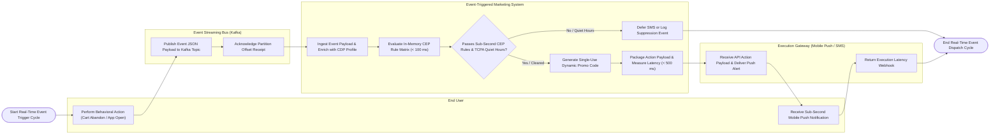

# Swimlane Diagram — Event-Triggered Marketing System

## Mermaid Code

## Flow Description | Mô tả luồng

| Lane | Actor | Role in Flow |
|------|-------|-------------|
| 1 | End User | Performs real-time behavioral or transactional actions (app login, cart abandon, milestone reached), generating event telemetry and receiving sub-second push notifications. |
| 2 | Event Streaming Bus (Kafka) | Receives real-time event JSON payloads on active Kafka topics, acknowledges partition offsets, and streams messages to the system in sub-milliseconds. |
| 3 | Event-Triggered Marketing System | Ingests event payloads, merges customer CDP context, evaluates in-memory Complex Event Processing (CEP) rules ($< 100 \text{ ms}$), verifies TCPA quiet hours and rate limits, generates single-use dynamic promo codes, packages action payloads, and tracks sub-second SLA latency. |
| 4 | Execution Gateway (Mobile Push / SMS) | Receives action payloads via APIs (Firebase/Twilio), delivers instant iOS/Android mobile push notifications or SMS texts, and streams execution latency webhooks back to the system. |
