# Action Tree — Event-Triggered Marketing System

## Mermaid Code

```mermaid
graph TD
    Root["Event-Triggered Marketing System"]

    Root --> M1["Streaming Event Ingestion & In-Memory Ingestion"]
    Root --> M2["CDP Profile Enrichment & Context Integration"]
    Root --> M3["Complex Event Processing (CEP) Rule Engine"]
    Root --> M4["Multi-Channel Action Execution & Webhooks"]
    Root --> M5["Dynamic Promo Code & Urgency Generation"]
    Root --> M6["Sub-Second Latency SLAs & Compliance Governance"]

    M1 --> A11["Ingest Real-Time Event JSON Streams (Kafka, RabbitMQ)"]
    M1 --> A12["Validate Event Payload JSON Schema Integrity"]
    M1 --> A13["Acknowledge Partition Offset Receipts in Sub-Milliseconds"]
    M1 --> A14["Capture Malformed Event Failures in Dead-Letter Queue (DLQ)"]

    M2 --> A21["Extract Customer IDs & Query CDP Master Profiles"]
    M2 --> A22["Merge Real-Time Event Attributes with Customer LTV & Tier"]
    M2 --> A23["Attach Real-Time Location & Geo-Fence Context"]
    M2 --> A24["Update Customer Journey Lifecycle State Real-Time"]

    M3 --> A31["Configure Complex Event Processing (CEP) Rule Matrices"]
    M3 --> A32["Evaluate In-Memory Multi-Condition Event Rules (< 100 ms)"]
    M3 --> A33["Match Event Sequences across Sliding Time Windows"]
    M3 --> A34["Map Matched Event Rules to Multi-Channel Action Playbooks"]

    M4 --> A41["Dispatch Sub-Second Mobile Push Notifications (Firebase/OneSignal)"]
    M4 --> A42["Send Real-Time Event SMS Text Alerts (< 500 ms)"]
    M4 --> A43["Trigger Instant REST HTTPS Webhooks to External Systems"]
    M4 --> A44["Display In-App Slide-Up Banner Prompts to Active Sessions"]

    M5 --> A51["Generate Single-Use Cryptographic Dynamic Promo Codes"]
    M5 --> A52["Configure Expiration Time Windows (e.g., Valid 60 Mins)"]
    M5 --> A53["Sync Dynamic Promo Codes to E-Commerce Checkout API"]
    M5 --> A54["Auto-Deactivate Expired Un-Redeemed Promo Codes"]

    M6 --> A61["Enforce TCPA Quiet Hours (Block Night SMS 21:00 to 08:00)"]
    M6 --> A62["Enforce Global Event Rate Limits (Max 3 Msgs/Day)"]
    M6 --> A63["Track End-to-End Sub-Second Latency SLAs (< 500 ms)"]
    M6 --> A64["Alert on High Latency (> 1.0s) & Processing Drops"]
```

## Module Description | Mô tả Module

| # | Module | Description | Actions |
|---|--------|-------------|---------|
| 1 | Streaming Event Ingestion & In-Memory Ingestion | Ingests real-time event JSON streams via Kafka, validates JSON schemas, acknowledges offsets, and logs DLQ errors. | Ingest Kafka Event Streams, Validate Event JSON Schemas, Acknowledge Partition Offsets, Capture Malformed Failures in DLQ. |
| 2 | CDP Profile Enrichment & Context Integration | Extracts customer IDs, merges CDP profile context (Tier, LTV), attaches geo-location data, and updates customer journey state. | Extract Customer IDs, Merge CDP Profile Context, Attach Geo-Fence Location, Update Customer Journey State. |
| 3 | Complex Event Processing (CEP) Rule Engine | Configures CEP rules, evaluates in-memory logic in $< 100 \text{ ms}$, matches sliding event sequences, and maps action playbooks. | Configure CEP Rule Matrices, Evaluate In-Memory Rules (< 100 ms), Match Sliding Event Sequences, Map Matched Rules to Action Playbooks. |
| 4 | Multi-Channel Action Execution & Webhooks | Dispatches sub-second mobile push notifications, SMS text alerts, HTTPS webhooks, and active session in-app banners. | Dispatch Mobile Push Notifications, Send Real-Time Event SMS Alerts, Trigger REST Webhooks, Display In-App Banner Prompts. |
| 5 | Dynamic Promo Code & Urgency Generation | Generates single-use dynamic promo codes, sets expiration countdowns (60 mins), syncs e-commerce checkout APIs, and deactivates expired codes. | Generate Single-Use Dynamic Promo Codes, Configure Expiration Time Windows, Sync Promo Codes to Checkout API, Auto-Deactivate Expired Codes. |
| 6 | Sub-Second Latency SLAs & Compliance Governance | Enforces TCPA quiet hours, enforces daily event rate limits, tracks sub-second execution latency SLAs, and alerts on processing anomalies. | Enforce TCPA Quiet Hours, Enforce Event Rate Limits, Track Sub-Second Latency SLAs, Alert on High Latency Anomalies. |
