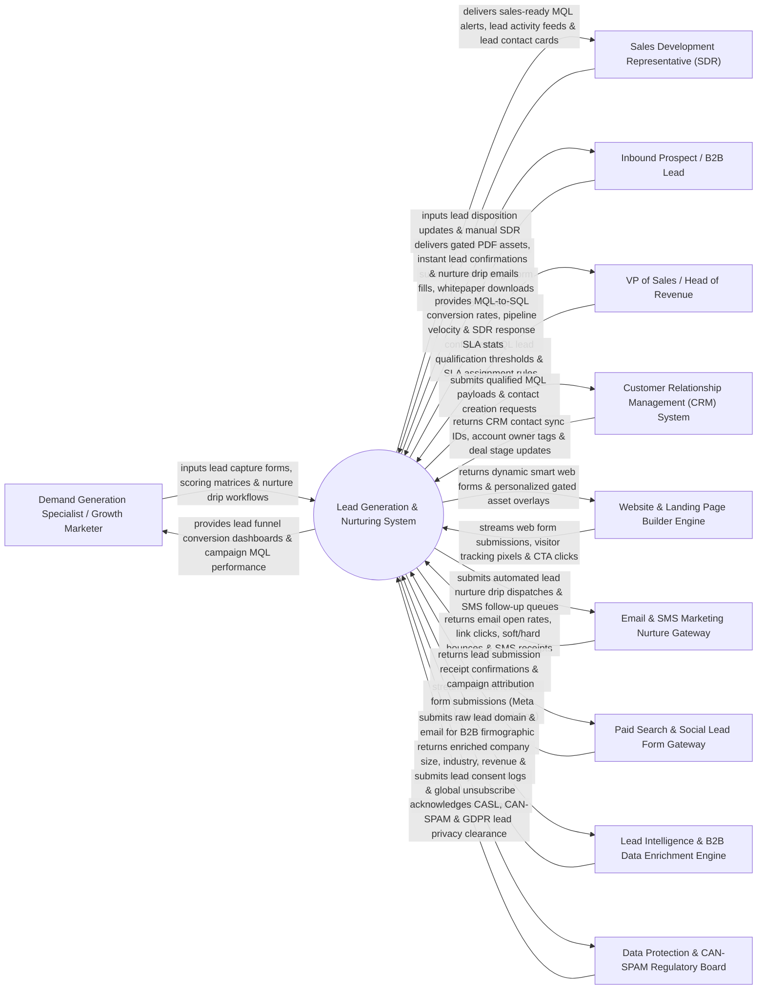

# Context Diagram — Lead Generation & Nurturing System

## Mermaid Code

## Actor & Interaction Table | Bảng Actor & Tương tác

| # | Actor | Actor Type | Data Sent TO System | Data Received FROM System | Notes |
|---|-------|------------|---------------------|---------------------------|-------|
| 1 | Demand Generation Specialist / Growth Marketer | Primary | Gated lead capture form designs, lead scoring point matrices, automated nurture drip workflows, lead magnet content. | Lead funnel conversion dashboards, MQL generation volume, campaign channel ROI, lead scoring heatmaps. | Growth marketer capturing inbound leads, designing nurture drip workflows, and optimizing lead conversion funnels. |
| 2 | Sales Development Representative (SDR) | Primary | Lead disposition updates (Accepted/Rejected/Nurture), manual SDR outreach notes, phone call logs. | Real-time Marketing Qualified Lead (MQL) alerts, lead activity timelines, enriched contact cards. | SDR receiving qualified sales leads, conducting initial discovery calls, and converting MQLs to SQLs. |
| 3 | Inbound Prospect / B2B Lead | Primary | Web form submission data (Name, Email, Work Phone, Company, Job Title), whitepaper download requests. | Gated PDF whitepapers, instant lead confirmation emails, automated nurture drip communications. | Prospective buyer submitting lead forms on landing pages or social media lead ads. |
| 4 | VP of Sales / Head of Revenue | Primary | MQL qualification score thresholds, SDR response SLA target limits (e.g., 5-minute SLA), territory routing matrices. | MQL-to-SQL conversion funnel rates, sales pipeline velocity, SDR response time SLA compliance stats. | Executive managing lead qualification handoff SLA efficiency and revenue pipeline growth. |
| 5 | Customer Relationship Management (CRM) System | Supporting | Contact creation confirmations, account owner assignments, deal stage updates, closed sales conversions. | Qualified MQL lead payloads, contact activity history logs, lead score updates. | Enterprise CRM receiving qualified lead payloads and synchronizing sales pipeline deal stages. |
| 6 | Website & Landing Page Builder Engine | Supporting | Web form submission payloads, tracking pixel events, CTA button click telemetry, page visit duration. | Dynamic smart web forms, progressive profiling form fields, personalized gated asset popups. | Landing page platform hosting lead capture forms and tracking web visitor behaviors. |
| 7 | Email & SMS Marketing Nurture Gateway | Supporting | Nurture email delivery receipts, open/click webhooks, bounce alerts, SMS text delivery receipts. | Automated lead nurture drip dispatches, SMS text message follow-up queues, MIME email payloads. | Delivery gateway executing automated drip sequences and SMS follow-ups for lead nurturing. |
| 8 | Paid Search & Social Lead Form Gateway | Supporting | Instant lead ad form submission webhooks (Meta Instant Lead Ads, LinkedIn Lead Gen Forms). | Lead submission receipt acknowledgments, paid ad campaign attribution tags. | Social ad platforms submitting instant lead form entries directly into the system via APIs. |
| 9 | Lead Intelligence & B2B Data Enrichment Engine | Supporting | Enriched firmographic data (Company Size, Industry, Annual Revenue, Tech Stack, Employee Count). | Raw lead email domains (`@company.com`), company name queries. | Intelligence API (Clearbit, ZoomInfo) enriching sparse lead form entries with full B2B company profiles. |
| 10 | Data Protection & CAN-SPAM Regulatory Board | Supporting / Regulatory | CAN-SPAM, CASL, GDPR lead consent regulations, double opt-in requirements. | Lead consent audit trails, global suppression list sync, opt-out receipts. | Regulatory framework governing lead data collection privacy and anti-spam legal compliance. |

## System Boundary Description | Mô tả Phạm vi Hệ thống

The **Lead Generation & Nurturing System** is an enterprise inbound lead capture, B2B data enrichment, behavioral lead scoring, automated drip nurturing, and SDR sales handoff platform designed to turn anonymous web traffic into Sales Qualified Leads (SQL).

**Inside System Scope:**
- Drag-and-drop gated landing page form builder with progressive profiling and dynamic smart fields.
- Automated API integration with Meta Lead Ads and LinkedIn Lead Gen Forms for instant lead ingestion.
- Real-time B2B firmographic data enrichment (Clearbit/ZoomInfo) enriching company size, industry, and revenue.
- Multi-channel nurture drip campaign builder with behavioral triggers, delay timers, and re-engagement flows.
- Behavioral lead scoring, lead grading, 5-minute SDR response SLA routing, and two-way CRM sync.

**Outside System Scope:**
- Direct physical hosting of corporate web servers (handled by Cloud Web Hosting Providers).
- Direct manual telemarketing phone dialing by SDRs (handled by Telephony & CTI Cloud Systems).
- Direct hosting of physical trade show exhibition booths (handled by Corporate Event Teams).
