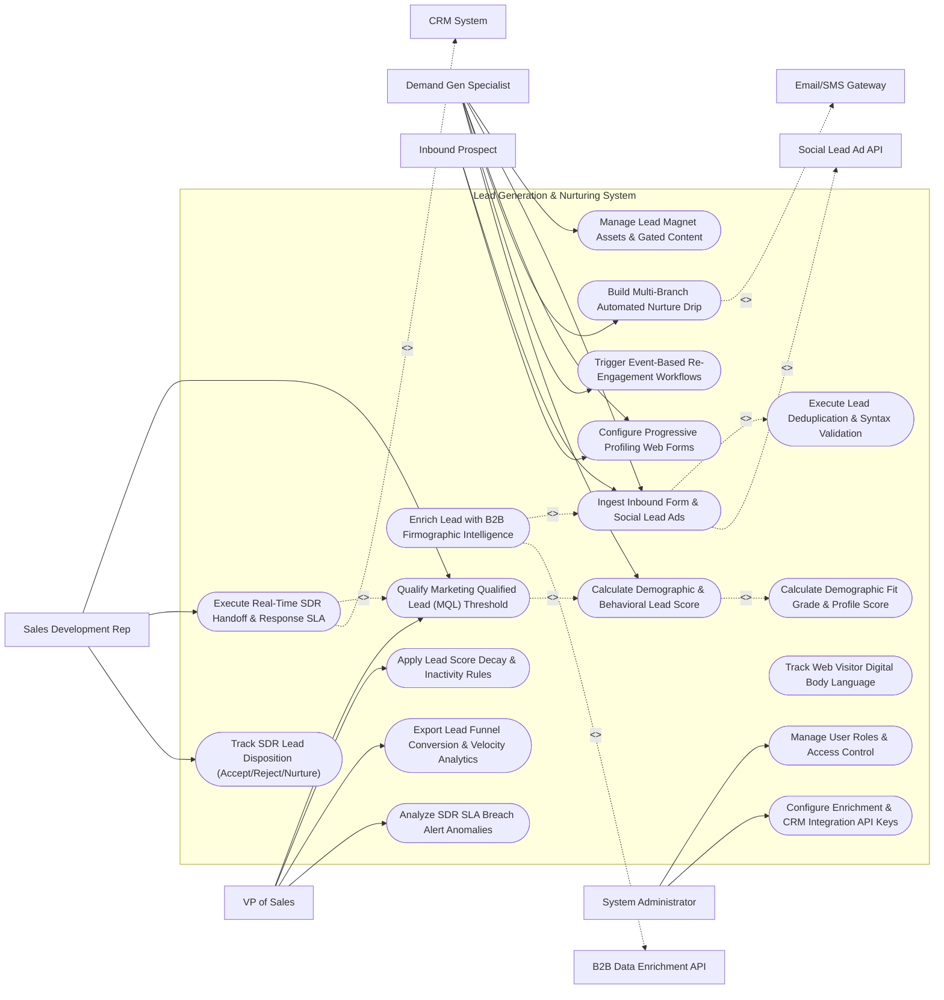

# Use Case Diagram — Lead Generation & Nurturing System

## Mermaid Code

## Actor Table | Bảng Actor

| # | Actor | Actor Type | Role Description | Related Use Cases |
|---|-------|------------|------------------|-------------------|
| 1 | Demand Gen Specialist | Primary | Growth marketer creating lead magnets, landing page forms, nurture drip workflows, and lead scoring matrices. | UC01, UC02, UC03, UC08, UC09, UC10 |
| 2 | Sales Development Rep | Primary | SDR accepting qualified MQL lead handoffs, conducting discovery calls, and logging lead dispositions. | UC11, UC12, UC13 |
| 3 | Inbound Prospect | Primary | B2B buyer filling out web lead forms, downloading whitepapers, and receiving nurture communications. | UC02, UC03 |
| 4 | VP of Sales | Primary | Revenue leader configuring MQL thresholds, SDR response SLAs, lead score decay, and lead funnel velocity analytics. | UC11, UC14, UC15, UC18 |
| 5 | System Administrator | Primary | IT admin managing user security roles, CRM API connections, and B2B enrichment credentials. | UC16, UC17 |
| 6 | CRM System | System (Secondary) | Connected CRM (Salesforce/HubSpot) receiving MQL lead payloads and syncing SDR task alerts. | UC12 |
| 7 | B2B Data Enrichment API | System (Secondary) | Intelligence service (Clearbit/ZoomInfo) enriching sparse lead entries with firmographic company data. | UC05 |
| 8 | Email/SMS Gateway | System (Secondary) | Message delivery infrastructure executing automated nurture drip dispatches and SMS follow-ups. | UC08 |
| 9 | Social Lead Ad API | System (Secondary) | Social ad platforms (Meta Ads / LinkedIn Lead Gen) submitting instant lead form entries via webhooks. | UC02 |

## Use Case Table | Bảng Use Case

| # | UC ID | Use Case Name | Primary Actor | Secondary Actor | Description | Priority |
|---|-------|---------------|---------------|-----------------|-------------|----------|
| 1 | UC01 | Manage Lead Magnet Assets & Gated Content | DemandGen | None | Uploads and manages whitepapers, e-books, webinar recordings, and free trial offers used to capture leads. | High |
| 2 | UC02 | Ingest Inbound Form & Social Lead Ads | DemandGen | Social Ads | Ingests web form submission payloads and instant social lead ad webhooks from Meta Ads and LinkedIn. | Critical |
| 3 | UC03 | Configure Progressive Profiling Web Forms | DemandGen | Prospect | Builds dynamic smart forms that ask new questions on repeat visits (e.g., Visit 1: Email -> Visit 2: Company Size). | High |
| 4 | UC04 | Execute Lead Deduplication & Syntax Validation | System | None | Validates email syntax, filters disposable email domains, and deduplicates records against existing database IDs. | Critical |
| 5 | UC05 | Enrich Lead with B2B Firmographic Intelligence | System | Enrichment API | Automatically calls Clearbit/ZoomInfo APIs to enrich company revenue, employee count, industry, and tech stack. | Critical |
| 6 | UC06 | Calculate Demographic Fit Grade & Profile Score | System | None | Grades lead demographic fit (Grade A, B, C, D) based on target company size, job title, and industry parameters. | High |
| 7 | UC07 | Track Web Visitor Digital Body Language | DemandGen | None | Ingests web tracking pixel telemetry to record prospect web page views, pricing page visits, and video watch time. | High |
| 8 | UC08 | Build Multi-Branch Automated Nurture Drip | DemandGen | Nurture Gateway | Configures automated drip campaign journeys with delay timers, conditional splits, and multi-channel steps. | Critical |
| 9 | UC09 | Trigger Event-Based Re-Engagement Workflows | DemandGen | None | Automatically enrolls inactive leads in re-engagement workflows when a high-intent event (e.g., Pricing Visit) occurs. | High |
| 10 | UC10 | Calculate Demographic & Behavioral Lead Score | DemandGen | None | Computes total lead score combining demographic fit grade and real-time behavioral engagement point values. | Critical |
| 11 | UC11 | Qualify Marketing Qualified Lead (MQL) Threshold | SDR | None | Evaluates lead scores against MQL qualification thresholds (Score >= 80 points) to trigger sales handoff. | Critical |
| 12 | UC12 | Execute Real-Time SDR Handoff & Response SLA | SDR | CRM System | Routes qualified MQLs to target SDRs via round-robin matrices and initiates real-time 5-minute response SLA countdowns. | Critical |
| 13 | UC13 | Track SDR Lead Disposition (Accept/Reject/Nurture) | SDR | None | Tracks SDR lead disposition decisions (Accepted SQL, Rejected Unqualified, Returned to Nurture) with reason codes. | High |
| 14 | UC14 | Apply Lead Score Decay & Inactivity Rules | SalesVP | None | Automatically decrements lead scores (-10 points per 30 days of inactivity) to maintain lead list freshness. | High |
| 15 | UC15 | Export Lead Funnel Conversion & Velocity Analytics | SalesVP | None | Renders reports tracking lead funnel stage conversion rates (Inbound -> MQL -> SQL -> Closed-Won) and velocity. | High |
| 16 | UC16 | Manage User Roles & Access Control | Admin | None | Controls user login credentials, RBAC permissions, and team lead assignment permissions. | High |
| 17 | UC17 | Configure Enrichment & CRM Integration API Keys | Admin | None | Manages API keys, OAuth tokens, and webhook endpoints for Clearbit, ZoomInfo, Salesforce, and HubSpot. | High |
| 18 | UC18 | Analyze SDR SLA Breach Alert Anomalies | SalesVP | None | Sends urgent SMS/email notifications to Sales Managers when an SDR fails to contact an MQL within the 5-minute SLA. | High |

## Use Case Specification | Đặc tả Use Case

---

### UC02 — Ingest Inbound Form & Social Lead Ads

| Field | Detail |
|-------|--------|
| **UC ID** | UC02 |
| **Use Case Name** | Ingest Inbound Form & Social Lead Ads |
| **Actor(s)** | Primary: Demand Generation Specialist, Inbound Prospect   Secondary: Social Lead Ad API |
| **Description** | Ingests real-time lead capture form submission payloads from landing pages and instant lead ad webhooks from Meta Ads (Facebook/Instagram) and LinkedIn Lead Gen Forms via secure REST APIs. |
| **Precondition** | 1. Landing page forms or social lead ad campaigns are active.   2. Webhook listener endpoints are authorized. |
| **Main Flow** | 1. Inbound Prospect completes form on website landing page OR submits LinkedIn Instant Lead Ad form.   2. Source platform dispatches real-time JSON lead payload to system API endpoint:   &nbsp;&nbsp;&nbsp;&nbsp; a. Lead Payload: `First Name: Alex`, `Last Name: Smith`, `Work Email: alex.smith@acme.com`, `Phone: +1-555-0192`, `Company: Acme Corp`, `Job Title: VP of IT`.   &nbsp;&nbsp;&nbsp;&nbsp; b. Source Attribution: `LinkedIn Lead Gen Ad Campaign #88412`.   3. System receives payload and executes UC04 (Execute Lead Deduplication & Syntax Validation):   &nbsp;&nbsp;&nbsp;&nbsp; a. Syntax Validation: `alex.smith@acme.com` -> `VALID_SYNTAX`.   &nbsp;&nbsp;&nbsp;&nbsp; b. Disposable Email Check: Not a disposable domain -> `PASS`.   &nbsp;&nbsp;&nbsp;&nbsp; c. Database Deduplication: Email not found in active contacts -> `NEW_LEAD_RECORD`.   4. System creates new Lead Profile in database with status `NEW_INBOUND_LEAD`.   5. System immediately triggers UC05 (Enrich Lead with B2B Firmographic Intelligence).   6. System sends instant lead confirmation email containing whitepaper PDF download link to the prospect. |
| **Alternative Flow** | **AF1** — Ingestion of Existing Contact: Deduplication check finds existing lead record; System updates contact timeline with new form submission event without creating a duplicate record. |
| **Exception Flow** | **EX1** — Malformed Payload Webhook Error: Inbound webhook payload contains malformed JSON; System flags `WEBHOOK_PAYLOAD_ERROR`, stores raw payload in error buffer, and dispatches alert to Admin. |
| **Postcondition** | Lead payload is ingested, validated, deduplicated, new lead record is created, and enrichment pipeline is triggered. |
| **Business Rule** | **BR1**: Inbound leads from all digital channels MUST be ingested and processed in real time (latency <= 3 seconds of form submission). |

---

### UC05 — Enrich Lead with B2B Firmographic Intelligence

| Field | Detail |
|-------|--------|
| **UC ID** | UC05 |
| **Use Case Name** | Enrich Lead with B2B Firmographic Intelligence |
| **Actor(s)** | Primary: Demand Generation Specialist   Secondary: B2B Data Enrichment API |
| **Description** | Automatically queries B2B intelligence APIs (Clearbit / ZoomInfo) using the lead's email domain (`@acme.com`) to enrich company size, annual revenue, industry sector, and technology stack attributes. |
| **Precondition** | 1. New lead record is ingested with a valid corporate email address (UC02).   2. B2B Enrichment API credentials (Clearbit API Key) are connected. |
| **Main Flow** | 1. System extracts corporate email domain from lead profile (`alex.smith@acme.com` -> Domain: `acme.com`).   2. System checks domain filter: Domain is not a free public provider (`@gmail.com`, `@yahoo.com`) -> Proceed to enrichment.   3. System transmits HTTPS REST API enrichment request to Clearbit Enrichment API (`GET /v2/companies/find?domain=acme.com`).   4. Clearbit API searches enterprise database and returns enriched firmographic JSON payload:   &nbsp;&nbsp;&nbsp;&nbsp; a. Company Legal Name: `Acme Corporation`.   &nbsp;&nbsp;&nbsp;&nbsp; b. Employee Count: `1,250 Employees` (Enterprise Tier).   &nbsp;&nbsp;&nbsp;&nbsp; c. Estimated Annual Revenue: `$250 Million`.   &nbsp;&nbsp;&nbsp;&nbsp; d. Industry Sector: `Computer Software / SaaS`.   &nbsp;&nbsp;&nbsp;&nbsp; e. Headquarters Location: `San Francisco, CA, USA`.   &nbsp;&nbsp;&nbsp;&nbsp; f. Technology Stack Tags: `[Salesforce, AWS, Marketo, React]`.   5. System merges enriched firmographic attributes into the lead profile.   6. System triggers UC06 (Calculate Demographic Fit Grade & Profile Score), grading the lead as `GRADE_A_ENTERPRISE`. |
| **Alternative Flow** | **AF1** — Free Email Domain Handling (`@gmail.com`): Lead used a Gmail address; System skips domain enrichment, flags profile as `UNENRICHED_PERSONAL_EMAIL`, and relies on progressive profiling forms (UC03) to gather company data. |
| **Exception Flow** | **EX1** — Enrichment API Domain Not Found (404): Domain `newstartup.io` is not in Clearbit database; Clearbit returns 404; System sets enrichment status `NOT_FOUND` and maintains raw form entry data. |
| **Postcondition** | Lead profile is enriched with B2B firmographic company size, revenue, and industry data, enabling accurate lead grading. |
| **Business Rule** | **BR1**: B2B firmographic data enrichment MUST execute automatically for all business email domains prior to lead scoring calculation. |

---

### UC08 — Build Multi-Branch Automated Nurture Drip

| Field | Detail |
|-------|--------|
| **UC ID** | UC08 |
| **Use Case Name** | Build Multi-Branch Automated Nurture Drip |
| **Actor(s)** | Primary: Demand Generation Specialist   Secondary: Email/SMS Gateway |
| **Description** | Configures visual, multi-step automated lead nurture campaigns featuring delay timers, conditional decision branches (If/Else), multi-channel steps (Email, SMS), and automated lead score updates. |
| **Precondition** | 1. Lead magnet assets are published (UC01).   2. Nurture email and SMS content templates are approved. |
| **Main Flow** | 1. User opens "Visual Nurture Drip Canvas".   2. User sets Campaign Entry Trigger: `Lead Enrolls via Whitepaper Form AND Grade = Grade A or B`.   3. User adds Step 1 (Action): `Send Nurture Email #1: "Welcome & Whitepaper Download"` (Immediate).   4. User adds Step 2 (Time Delay): `Wait 3 Days`.   5. User adds Step 3 (Decision Split): `Did Lead Click Link in Nurture Email #1?`.   6. User builds Branch YES:   &nbsp;&nbsp;&nbsp;&nbsp; a. Action: `Add +15 Points to Behavioral Score`.   &nbsp;&nbsp;&nbsp;&nbsp; b. Action: `Send Deep-Dive Case Study Email #2A`.   7. User builds Branch NO:   &nbsp;&nbsp;&nbsp;&nbsp; a. Action: `Send Alternative Problem-Agitation Email #2B`.   8. User adds Step 4 (Time Delay): `Wait 4 Days`.   9. User adds Step 5 (Multi-Channel Condition): `If Lead Score >= 60 AND Has SMS Consent -> Send SMS Follow-Up Text`.   10. User sets Campaign Exit Condition: `Lead Achieves MQL Status OR Requests Sales Demo`.   11. User clicks "Publish Nurture Campaign"; System validates workflow logic and activates automated drip processing. |
| **Alternative Flow** | **AF1** — Fast-Track MQL Exit: Lead clicks "Book Sales Demo" while in Step 2 of nurture drip; System immediately exits lead from nurture campaign and routes lead directly to SDR sales handoff (UC12). |
| **Exception Flow** | **EX1** — Unlinked Decision Branch Error: Canvas contains an If/Else node with no YES action configured; System blocks campaign publishing, highlighting the unlinked node. |
| **Postcondition** | Automated multi-branch nurture drip campaign is activated, delay timers are set, and leads begin processing through drip steps. |
| **Business Rule** | **BR1**: Leads that achieve MQL status or request a live sales demo MUST be immediately exited from automated nurture drip campaigns. |

---

### UC10 — Calculate Demographic & Behavioral Lead Score

| Field | Detail |
|-------|--------|
| **UC ID** | UC10 |
| **Use Case Name** | Calculate Demographic & Behavioral Lead Score |
| **Actor(s)** | Primary: Demand Generation Specialist   Secondary: None |
| **Description** | Calculates total lead qualification score by combining Demographic Fit Grade (company size, job title, revenue) with real-time Behavioral Engagement Scores (web visits, email clicks, webinar views). |
| **Precondition** | 1. Lead profile is enriched with firmographic data (UC05).   2. Web tracking pixel events and email clicks are logged (UC07).   3. Lead scoring matrix point values are configured in system. |
| **Main Flow** | 1. System fetches active Lead Scoring Point Matrix:   &nbsp;&nbsp;&nbsp;&nbsp; a. Demographic Fit Points:   &nbsp;&nbsp;&nbsp;&nbsp;&nbsp;&nbsp;&nbsp;&nbsp; i. Company Size > 500 Employees = `+30 Points`.   &nbsp;&nbsp;&nbsp;&nbsp;&nbsp;&nbsp;&nbsp;&nbsp; ii. Job Title = C-Level / VP = `+20 Points`.   &nbsp;&nbsp;&nbsp;&nbsp;&nbsp;&nbsp;&nbsp;&nbsp; iii. Target Industry (SaaS) = `+10 Points`.   &nbsp;&nbsp;&nbsp;&nbsp; b. Behavioral Engagement Points:   &nbsp;&nbsp;&nbsp;&nbsp;&nbsp;&nbsp;&nbsp;&nbsp; i. Whitepaper Download = `+15 Points`.   &nbsp;&nbsp;&nbsp;&nbsp;&nbsp;&nbsp;&nbsp;&nbsp; ii. Nurture Email Link Click = `+10 Points`.   &nbsp;&nbsp;&nbsp;&nbsp;&nbsp;&nbsp;&nbsp;&nbsp; iii. Visited Pricing Page 2x = `+25 Points`.   &nbsp;&nbsp;&nbsp;&nbsp;&nbsp;&nbsp;&nbsp;&nbsp; iv. Attended Product Webinar = `+30 Points`.   2. System retrieves lead profile (`alex.smith@acme.com`):   &nbsp;&nbsp;&nbsp;&nbsp; a. Demographic Subtotal: $30 + 20 + 10 = 60 \text{ Demographic Points}$ (`GRADE_A`).   &nbsp;&nbsp;&nbsp;&nbsp; b. Behavioral Subtotal: $15 + 10 + 25 = 50 \text{ Behavioral Points}$.   3. System calculates Total Lead Score: $\text{Total Score} = 60 + 50 = 110 \text{ Points}$.   4. System checks MQL Qualification Threshold: Target Threshold = 80 Points.   5. Total Score (110) >= MQL Threshold (80); System updates Lead Qualification Status to `MQL_QUALIFIED`.   6. System triggers UC12 (Execute Real-Time SDR Handoff & Response SLA). |
| **Alternative Flow** | **AF1** — Negative Scoring Adjustment: Lead visits Jobs/Careers page (-15 points) or indicates student status (-30 points); System subtracts negative points from total score. |
| **Exception Flow** | **EX1** — Competitor Lead Score Suppression: Lead email domain belongs to a known competitor (`@competitor.com`); System sets lead score to `0` (`COMPETITOR_SUPPRESSED`) and blocks MQL handoff. |
| **Postcondition** | Lead score is updated, MQL qualification status is evaluated, and sales handoff is triggered if threshold is met. |
| **Business Rule** | **BR1**: Reaching the MQL lead score threshold (Score >= 80) MUST automatically update lead status to MQL and trigger real-time SDR sales handoff. |

---

### UC12 — Execute Real-Time SDR Handoff & Response SLA

| Field | Detail |
|-------|--------|
| **UC ID** | UC12 |
| **Use Case Name** | Execute Real-Time SDR Handoff & Response SLA |
| **Actor(s)** | Primary: Sales Development Representative (SDR)   Secondary: CRM System |
| **Description** | Automatically routes qualified MQL lead payloads to target SDRs via round-robin territory matrices, creates CRM sales tasks, and initiates real-time 5-minute SDR response SLA countdown timers. |
| **Precondition** | 1. Lead achieves MQL status (Score >= 80) (UC11).   2. SDR round-robin assignment matrix and SLA target (5 minutes) are configured. |
| **Main Flow** | 1. System receives MQL qualification event for Lead `Alex Smith - Acme Corp (110 Points)`.   2. System retrieves SDR Territory Routing Matrix:   &nbsp;&nbsp;&nbsp;&nbsp; a. Territory: Enterprise US West.   &nbsp;&nbsp;&nbsp;&nbsp; b. Active On-Duty SDRs: `SDR John Doe` and `SDR Jane Smith`.   3. System applies Round-Robin Selection: Selects `SDR John Doe`.   4. System creates new CRM Contact and Task Payload:   &nbsp;&nbsp;&nbsp;&nbsp; a. CRM Lead Owner: `SDR John Doe`.   &nbsp;&nbsp;&nbsp;&nbsp; b. Status: `MQL_ASSIGNED`.   &nbsp;&nbsp;&nbsp;&nbsp; c. Enriched Contact Card: Name, Work Phone, Email, Company Size (1,250), Tech Stack, Activity History.   5. System transmits lead payload via REST API to CRM System (Salesforce).   6. System dispatches Real-Time Alert Notifications to SDR John Doe:   &nbsp;&nbsp;&nbsp;&nbsp; a. In-App Desktop Notification: "HOT MQL ASSIGNED: Alex Smith (Acme Corp)".   &nbsp;&nbsp;&nbsp;&nbsp; b. Slack / Mobile Push Alert.   7. System initializes 5-Minute SDR Response SLA Countdown Timer on SDR dashboard view.   8. SDR John Doe places outbound call to Alex Smith at 2 minutes 45 seconds.   9. System detects call log event from CTI dialer, stops SLA countdown timer, records `SLA_MET (2m 45s)`, and updates lead status to `SDR_CONTACTED`. |
| **Alternative Flow** | **AF1** — Direct Account Owner Handoff: Lead belongs to an existing enterprise account already assigned to an Account Executive (AE); System bypasses round-robin and routes lead directly to the assigned AE. |
| **Exception Flow** | **EX1** — SDR 5-Minute SLA Breach Escalation: SDR fails to call lead within 5 minutes; SLA timer hits 0:00; System triggers UC18 (Analyze SDR SLA Breach Alert Anomalies), sending emergency alert to VP of Sales and re-assigning lead to backup SDR. |
| **Postcondition** | Qualified MQL is routed to SDR in CRM, multi-channel alerts are sent, 5-minute response SLA is tracked, and SDR outreach is logged. |
| **Business Rule** | **BR1**: High-priority MQL leads MUST enforce a real-time SDR response SLA of <= 5 minutes from qualification to first outreach attempt. |
