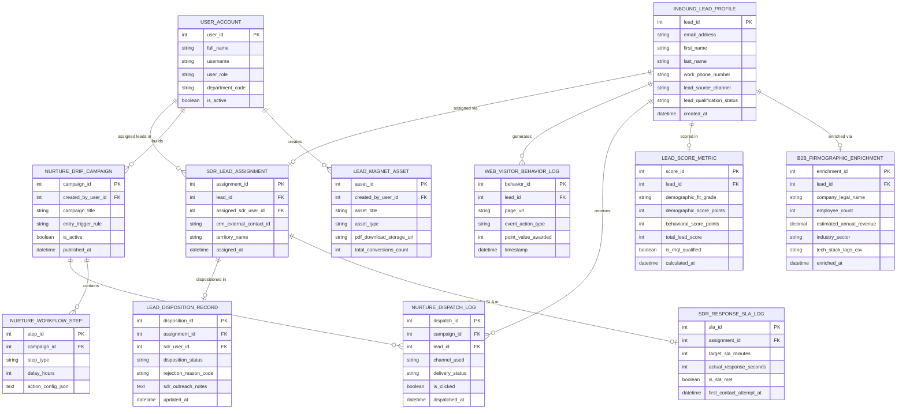

# Conceptual ERD — Lead Generation & Nurturing System

## Mermaid Code

## Entity Description Table | Bảng mô tả Entity

| # | Entity Name | Vietnamese Name | Description | Key Attributes | Main Relationships |
|---|-------------|-----------------|-------------|----------------|-------------------|
| 1 | USER_ACCOUNT | Tài khoản Nguời dùng | System user credentials and access roles for demand gen specialists, SDRs, and sales VPs. | `user_id`, `username`, `user_role`, `department_code` | Creates `LEAD_MAGNET_ASSET`, builds `NURTURE_DRIP_CAMPAIGN`, assigned leads in `SDR_LEAD_ASSIGNMENT`. |
| 2 | LEAD_MAGNET_ASSET | Asset Lead Magnet Gated | Gated whitepaper, e-book, or webinar recording assets used to capture inbound leads. | `asset_id`, `created_by_user_id`, `asset_title`, `asset_type`, `pdf_download_storage_uri`, `total_conversions_count` | Created by `USER_ACCOUNT`. |
| 3 | INBOUND_LEAD_PROFILE | Profile Lead Inbound Master | Central B2B lead profile entity storing work email, name, phone, lead source, and qualification status. | `lead_id`, `email_address`, `first_name`, `last_name`, `lead_source_channel`, `lead_qualification_status` | Enriched via `B2B_FIRMOGRAPHIC_ENRICHMENT`, scored in `LEAD_SCORE_METRIC`, assigned via `SDR_LEAD_ASSIGNMENT`. |
| 4 | B2B_FIRMOGRAPHIC_ENRICHMENT | Thông tin Doanh nghiệp Enrichment | Enriched B2B company data (Clearbit/ZoomInfo) storing company name, employee count, annual revenue, and tech stack. | `enrichment_id`, `lead_id`, `company_legal_name`, `employee_count`, `estimated_annual_revenue`, `industry_sector` | Belongs to `INBOUND_LEAD_PROFILE`. |
| 5 | LEAD_SCORE_METRIC | Chỉ số Điểm Lead | Calculated demographic fit grade (A-D), demographic points, behavioral points, total score, and MQL flag. | `score_id`, `lead_id`, `demographic_fit_grade`, `demographic_score_points`, `behavioral_score_points`, `total_lead_score`, `is_mql_qualified` | Belongs to `INBOUND_LEAD_PROFILE`. |
| 6 | NURTURE_DRIP_CAMPAIGN | Chiến dịch Nurture Drip | Multi-branch automated lead nurture campaign header storing entry triggers, activation status, and published dates. | `campaign_id`, `created_by_user_id`, `campaign_title`, `entry_trigger_rule`, `is_active`, `published_at` | Contains `NURTURE_WORKFLOW_STEP`, dispatches `NURTURE_DISPATCH_LOG`, built by `USER_ACCOUNT`. |
| 7 | NURTURE_WORKFLOW_STEP | Nút Bước Luồng Nurture | Individual execution steps (Send Email, Delay Timer, Decision Split, Send SMS) within a nurture workflow. | `step_id`, `campaign_id`, `step_type`, `delay_hours`, `action_config_json` | Belongs to `NURTURE_DRIP_CAMPAIGN`. |
| 8 | NURTURE_DISPATCH_LOG | Nhật ký Dispatch Nurture | Nurture email and SMS dispatch execution log tracking delivery status, opens, clicks, and bounces. | `dispatch_id`, `campaign_id`, `lead_id`, `channel_used`, `delivery_status`, `is_clicked`, `dispatched_at` | Relates `NURTURE_DRIP_CAMPAIGN` and `INBOUND_LEAD_PROFILE`. |
| 9 | WEB_VISITOR_BEHAVIOR_LOG | Nhật ký Hành vi Visitor Web | Digital body language tracking log recording web page views, pricing visits, whitepaper downloads, and awarded points. | `behavior_id`, `lead_id`, `page_url`, `event_action_type`, `point_value_awarded`, `timestamp` | Belongs to `INBOUND_LEAD_PROFILE`. |
| 10 | SDR_LEAD_ASSIGNMENT | Phân bổ Lead cho SDR | SDR sales handoff assignment entity linking qualified MQL leads to specific SDRs via round-robin matrices. | `assignment_id`, `lead_id`, `assigned_sdr_user_id`, `crm_external_contact_id`, `territory_name`, `assigned_at` | Belongs to `INBOUND_LEAD_PROFILE`, monitored for SLA in `SDR_RESPONSE_SLA_LOG`, dispositioned in `LEAD_DISPOSITION_RECORD`. |
| 11 | SDR_RESPONSE_SLA_LOG | Nhật ký SLA Phản hồi SDR | 5-minute SDR response SLA monitoring log recording target SLA minutes, actual response seconds, and SLA met flag. | `sla_id`, `assignment_id`, `target_sla_minutes`, `actual_response_seconds`, `is_sla_met`, `first_contact_attempt_at` | Belongs to `SDR_LEAD_ASSIGNMENT`. |
| 12 | LEAD_DISPOSITION_RECORD | Bản ghi Đánh giá Lead SDR | SDR lead disposition record storing qualification decision (Accepted SQL, Rejected, Returned to Nurture) and notes. | `disposition_id`, `assignment_id`, `sdr_user_id`, `disposition_status`, `rejection_reason_code`, `sdr_outreach_notes` | Belongs to `SDR_LEAD_ASSIGNMENT`. |

## Relationship Description | Mô tả Quan hệ

| # | From Entity | Cardinality | To Entity | Label | Business Explanation |
|---|-------------|-------------|-----------|-------|----------------------|
| 1 | INBOUND_LEAD_PROFILE | 1 to 0..1 | B2B_FIRMOGRAPHIC_ENRICHMENT | enriched via | An inbound lead profile is enriched via B2B firmographic intelligence. |
| 2 | INBOUND_LEAD_PROFILE | 1 to 0..1 | LEAD_SCORE_METRIC | scored in | An inbound lead profile is scored in lead score metrics. |
| 3 | INBOUND_LEAD_PROFILE | 1 to 0..N | NURTURE_DISPATCH_LOG | receives | An inbound lead profile receives automated nurture drip dispatches. |
| 4 | INBOUND_LEAD_PROFILE | 1 to 0..N | WEB_VISITOR_BEHAVIOR_LOG | generates | An inbound lead profile generates digital body language behavior logs. |
| 5 | INBOUND_LEAD_PROFILE | 1 to 0..1 | SDR_LEAD_ASSIGNMENT | assigned via | A qualified lead profile is assigned via an SDR lead assignment. |
| 6 | NURTURE_DRIP_CAMPAIGN | 1 to 1..N | NURTURE_WORKFLOW_STEP | contains | A nurture drip campaign contains multiple workflow steps. |
| 7 | NURTURE_DRIP_CAMPAIGN | 1 to 0..N | NURTURE_DISPATCH_LOG | dispatches | A nurture drip campaign dispatches automated emails and SMS. |
| 8 | SDR_LEAD_ASSIGNMENT | 1 to 0..1 | SDR_RESPONSE_SLA_LOG | monitored for SLA in | An SDR lead assignment is monitored for 5-minute response SLA compliance. |
| 9 | SDR_LEAD_ASSIGNMENT | 1 to 0..1 | LEAD_DISPOSITION_RECORD | dispositioned in | An SDR lead assignment is dispositioned in a lead disposition record. |
| 10 | USER_ACCOUNT | 1 to 0..N | LEAD_MAGNET_ASSET | creates | A demand gen user account creates lead magnet assets. |
| 11 | USER_ACCOUNT | 1 to 0..N | NURTURE_DRIP_CAMPAIGN | builds | A demand gen user account builds nurture drip campaigns. |
| 12 | USER_ACCOUNT | 1 to 0..N | SDR_LEAD_ASSIGNMENT | assigned leads in | An SDR user account is assigned qualified MQL leads. |
