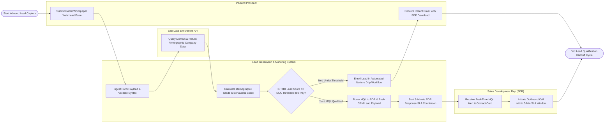

# Swimlane Diagram — Lead Generation & Nurturing System

## Mermaid Code

## Flow Description | Mô tả luồng

| Lane | Actor | Role in Flow |
|------|-------|-------------|
| 1 | Inbound Prospect | Fills out landing page web lead forms or submits instant social lead ads, receiving automated gated PDF download links and nurture communications. |
| 2 | Lead Generation & Nurturing System | Ingests lead payloads, validates email syntax, deduplicates entries, queries B2B enrichment APIs, computes dynamic lead scores, evaluates MQL thresholds (Score >= 80), enrolls unqualified leads in nurture drips, routes qualified MQLs via round-robin, and monitors 5-minute SDR response SLAs. |
| 3 | B2B Data Enrichment API | Receives corporate email domain queries (Clearbit/ZoomInfo API), searches enterprise firmographic databases, and returns company size, revenue, industry, and tech stack tags. |
| 4 | Sales Development Rep (SDR) | Receives real-time MQL desktop/mobile alerts and enriched CRM contact cards, placing outbound discovery calls to qualified prospects within the 5-minute SLA target. |
