# Action Tree — Lead Generation & Nurturing System

## Mermaid Code

```mermaid
graph TD
    Root["Lead Generation & Nurturing System"]

    Root --> M1["Inbound Lead Capture & Form Management"]
    Root --> M2["B2B Firmographic Intelligence Enrichment"]
    Root --> M3["Behavioral & Demographic Lead Scoring"]
    Root --> M4["Multi-Branch Automated Nurture Drips"]
    Root --> M5["Real-Time SDR Handoff & 5-Min SLA"]
    Root --> M6["Lead Funnel Velocity & Pipeline Analytics"]

    M1 --> A11["Publish Drag-and-Drop Dynamic Web Lead Forms"]
    M1 --> A12["Ingest Instant Lead Ads from Meta & LinkedIn APIs"]
    M1 --> A13["Configure Progressive Profiling Smart Form Fields"]
    M1 --> A14["Execute Lead Syntax Validation & Deduplication"]

    M2 --> A21["Extract Business Email Domains for B2B API Lookups"]
    M2 --> A22["Enrich Company Size, Revenue & Industry (Clearbit/ZoomInfo)"]
    M2 --> A23["Tag Lead Profiles with Enterprise Technology Stack Data"]
    M2 --> A24["Filter Disposable Personal Email Domains (@gmail.com)"]

    M3 --> A31["Calculate Demographic Fit Grades (Grade A, B, C, D)"]
    M3 --> A32["Track Web Visitor Digital Body Language & Pricing Page Visits"]
    M3 --> A33["Calculate Total Lead Qualification Scores (Demographic + Behavioral)"]
    M3 --> A34["Apply Automated Score Decay for Inactive Leads (-10 Pts/30 Days)"]

    M4 --> A41["Design Multi-Branch Nurture Drip Canvases with Time Delays"]
    M4 --> A42["Configure Conditional If/Else Decision Split Trees"]
    M4 --> A43["Dispatch Automated Nurture Emails & SMS Text Follow-Ups"]
    M4 --> A44["Auto-Exit Leads from Nurture when Demo Requested or MQL Achieved"]

    M5 --> A51["Qualify Marketing Qualified Leads (MQL Score >= 80 Points)"]
    M5 --> A52["Route MQL Leads to SDRs via Round-Robin Territory Matrices"]
    M5 --> A53["Initialize Real-Time 5-Minute SDR Response SLA Timers"]
    M5 --> A54["Alert Sales Managers on SDR Response SLA Breaches"]

    M6 --> A61["Track Lead Funnel Stage Conversion Rates (Inbound -> MQL -> SQL)"]
    M6 --> A62["Measure Lead Funnel Velocity (Average Days to MQL Handoff)"]
    M6 --> A63["Track SDR Lead Disposition Decisions (Accepted vs Rejected)"]
    M6 --> A64["Export Executive Lead Generation Channel ROI PDF Reports"]
```

## Module Description | Mô tả Module

| # | Module | Description | Actions |
|---|--------|-------------|---------|
| 1 | Inbound Lead Capture & Form Management | Publishes web lead forms, ingests Meta/LinkedIn lead ads, configures progressive profiling, and deduplicates leads. | Publish Dynamic Web Forms, Ingest Meta/LinkedIn Lead Ads, Configure Progressive Profiling, Execute Lead Deduplication. |
| 2 | B2B Firmographic Intelligence Enrichment | Extracts business email domains, queries Clearbit/ZoomInfo APIs, enriches firmographics, and tags company tech stacks. | Extract Email Domains, Enrich Firmographics via API, Tag Enterprise Tech Stacks, Filter Personal Personal Email Domains. |
| 3 | Behavioral & Demographic Lead Scoring | Calculates demographic fit grades, tracks web visitor digital body language, computes total scores, and applies score decay. | Calculate Demographic Fit Grades, Track Digital Body Language, Calculate Total Lead Scores, Apply Score Decay. |
| 4 | Multi-Branch Automated Nurture Drips | Designs nurture drip campaigns, sets delay timers and decision trees, dispatches emails/SMS, and handles automated nurture exits. | Design Nurture Drip Canvases, Configure Conditional Decision Trees, Dispatch Nurture Emails & SMS, Auto-Exit Leads on MQL. |
| 5 | Real-Time SDR Handoff & 5-Min SLA | Qualifies MQL thresholds, routes leads via round-robin matrices, tracks 5-minute SDR response SLAs, and alerts on SLA breaches. | Qualify MQL Thresholds, Route Leads via Round-Robin, Initialize 5-Min SDR Response SLAs, Alert Managers on SLA Breaches. |
| 6 | Lead Funnel Velocity & Pipeline Analytics | Tracks lead funnel stage conversion rates, measures lead velocity, tracks SDR dispositions, and exports channel ROI reports. | Track Funnel Stage Conversion Rates, Measure Lead Velocity, Track SDR Lead Dispositions, Export Executive Lead ROI Reports. |
