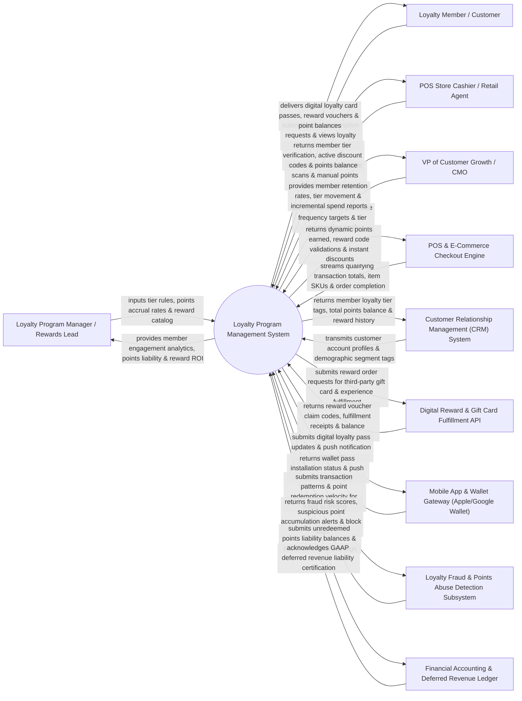

# Context Diagram — Loyalty Program Management System

## Mermaid Code

## Actor & Interaction Table | Bảng Actor & Tương tác

| # | Actor | Actor Type | Data Sent TO System | Data Received FROM System | Notes |
|---|-------|------------|---------------------|---------------------------|-------|
| 1 | Loyalty Program Manager / Rewards Lead | Primary | Tier rules (Silver/Gold/Platinum), points accrual rates ($1 = 10 pts), reward catalog items, promotional point multiplier campaigns. | Member engagement analytics, points liability reports, reward redemption frequency, program ROI scorecards. | Rewards manager defining loyalty program tier structures and managing reward catalogs. |
| 2 | Loyalty Member / Customer | Primary | Points redemption requests, reward voucher selections, loyalty barcode scans, birthday preferences. | Digital loyalty card passes, reward vouchers, point balance notifications, personalized tier perks. | Consumer earning points on purchases and redeeming rewards for discounts or perks. |
| 3 | POS Store Cashier / Retail Agent | Primary | Member barcode scans, physical loyalty card swipes, manual points correction requests. | Member tier status confirmation, active reward discount codes, real-time points balance. | In-store cashier processing loyalty transactions and scanning digital wallet passes at checkout. |
| 4 | VP of Customer Growth / CMO | Primary | Repeat purchase frequency targets, tier migration goals, maximum points liability caps. | Member retention rates, tier progression heatmaps, incremental spend reports, customer LTV lift. | Executive overseeing customer retention, loyalty program profitability, and brand advocate growth. |
| 5 | POS & E-Commerce Checkout Engine | Supporting | Qualifying purchase order totals, line-item SKUs, customer checkout webhooks, return/refund events. | Calculated points earned, reward promo code validations, instant checkout discount applications. | Storefront checkout engine calculating points accrual and applying reward vouchers at checkout. |
| 6 | Customer Relationship Management (CRM) System | Supporting | Customer master profiles, contact details, demographic segment tags. | Member loyalty tier tags (`TIER_GOLD`), total points balance, reward redemption history. | Enterprise CRM synchronizing customer loyalty status with master sales contact cards. |
| 7 | Digital Reward & Gift Card Fulfillment API | Supporting | Third-party gift card claim codes, digital voucher delivery receipts, reward inventory webhooks. | Automated digital gift card orders (TangoCard/Starbucks API), experience voucher fulfillment requests. | Reward fulfillment API delivering digital gift cards and partner rewards to members. |
| 8 | Mobile App & Wallet Gateway | Supporting | Mobile wallet pass installation events (Apple Wallet / Google Pay), push notification delivery receipts. | Pass update payloads (PKPass files), real-time points push notifications, location-based pass popups. | Wallet infrastructure updating digital loyalty cards on members' smartphones. |
| 9 | Loyalty Fraud & Points Abuse Detection Subsystem | Supporting | Fraud risk scores, velocity abuse flags, fake receipt scan alerts, suspicious points accumulation flags. | Point redemption event telemetry, barcode scan frequency, IP/device fingerprint data. | Security engine detecting points theft, fake receipt uploads, employee points abuse, and bot redemptions. |
| 10 | Financial Accounting & Deferred Revenue Ledger | Supporting / Regulatory | GAAP/IFRS deferred revenue accounting rules, point valuation rates ($1 \text{ pt} = \$0.01$). | Unredeemed points financial liability balances, breakage estimation reports, deferred revenue logs. | Financial accounting ledger auditing unredeemed points liability on company financial statements. |

## System Boundary Description | Mô tả Phạm vi Hệ thống

The **Loyalty Program Management System** is an enterprise customer loyalty, points accrual, tier management, reward catalog fulfillment, and deferred revenue accounting platform designed to drive customer retention, repeat purchase frequency, and brand advocacy.

**Inside System Scope:**
- Multi-tier loyalty program builder (Silver, Gold, Platinum, VIP) with dynamic tier qualification rules.
- Real-time points accrual engine calculating points based on spend, item categories, and promotional multipliers.
- Dynamic reward catalog management (Store credit, free products, digital gift cards, experiential perks).
- Digital loyalty card pass generation for Apple Wallet and Google Pay with real-time balance updates.
- Points fraud prevention (detecting receipt abuse and velocity fraud) and GAAP-compliant deferred revenue liability accounting.

**Outside System Scope:**
- Direct physical manufacturing of plastic loyalty card tokens (handled by External Card Printers).
- Direct physical shipping of physical reward items (handled by Logistics & Order Fulfillment Services).
- Direct payment processing of credit card purchases at POS (handled by Merchant Payment Processors).
