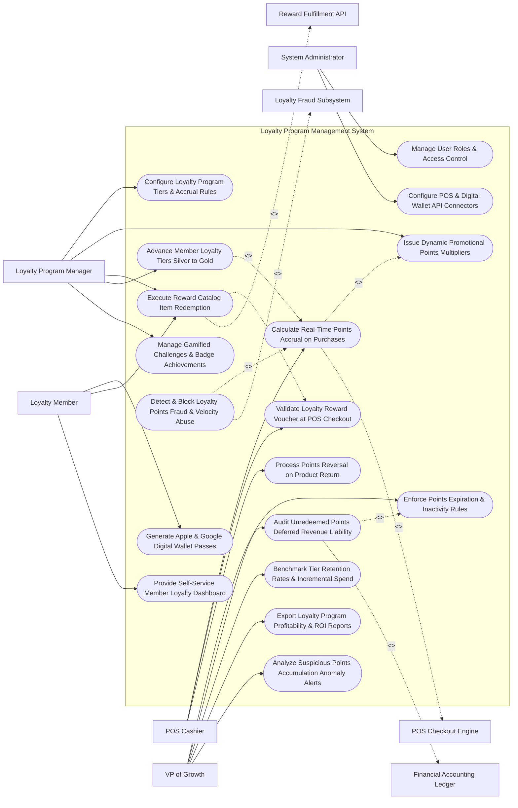

# Use Case Diagram — Loyalty Program Management System

## Mermaid Code

## Actor Table | Bảng Actor

| # | Actor | Actor Type | Role Description | Related Use Cases |
|---|-------|------------|------------------|-------------------|
| 1 | Loyalty Program Manager | Primary | Rewards manager configuring tier structures, points accrual rates, promotional multipliers, and reward catalogs. | UC01, UC03, UC05, UC08, UC09 |
| 2 | Loyalty Member | Primary | Customer earning points, viewing wallet passes, redeeming rewards, and completing loyalty challenges. | UC04, UC05, UC13 |
| 3 | POS Cashier | Primary | Retail staff scanning loyalty barcodes at checkout, validating vouchers, and processing points reversals on returns. | UC02, UC06, UC07 |
| 4 | VP of Growth | Primary | Executive monitoring points liability, points expiration, tier retention rates, program ROI, and fraud alerts. | UC11, UC12, UC14, UC15, UC18 |
| 5 | System Administrator | Primary | IT admin managing user security roles, POS API credentials, and digital wallet pass certificate keys. | UC16, UC17 |
| 6 | POS Checkout Engine | System (Secondary) | Storefront checkout system streaming purchase transactions and applying reward discounts. | UC02 |
| 7 | Reward Fulfillment API | System (Secondary) | Digital reward service (TangoCard/Starbucks) fulfilling third-party gift card redemptions. | UC05 |
| 8 | Loyalty Fraud Subsystem | System (Secondary) | Security engine monitoring transaction velocity, suspicious points accumulation, and receipt fraud. | UC10 |
| 9 | Financial Accounting Ledger | System (Secondary) | Enterprise accounting system recording unredeemed points liability and deferred revenue. | UC12 |

## Use Case Table | Bảng Use Case

| # | UC ID | Use Case Name | Primary Actor | Secondary Actor | Description | Priority |
|---|-------|---------------|---------------|-----------------|-------------|----------|
| 1 | UC01 | Configure Loyalty Program Tiers & Accrual Rules | LoyaltyManager | None | Configures loyalty tier levels (Silver/Gold/Platinum), spend thresholds, and points accrual rules ($1 = 10 pts). | Critical |
| 2 | UC02 | Calculate Real-Time Points Accrual on Purchases | Cashier | POS System | Calculates points earned on qualifying checkout transactions in real time, incorporating active promotional multipliers. | Critical |
| 3 | UC03 | Issue Dynamic Promotional Points Multipliers | LoyaltyManager | None | Launches promotional point multiplier campaigns (e.g., "Double Points Weekend" or "3x Points on Coffee"). | High |
| 4 | UC04 | Generate Apple & Google Digital Wallet Passes | Member | None | Generates dynamic PKPass files for Apple Wallet and Google Pay with real-time barcode and points updates. | High |
| 5 | UC05 | Execute Reward Catalog Item Redemption | Member | Fulfillment API | Deducts points balance and dispatches selected reward (store credit, free item voucher, or digital gift card). | Critical |
| 6 | UC06 | Validate Loyalty Reward Voucher at POS Checkout | Cashier | POS System | Validates single-use reward voucher barcodes at retail POS, applying the discount to the transaction total. | Critical |
| 7 | UC07 | Process Points Reversal on Product Return | Cashier | None | Deducts previously earned points from member balance when a product is returned and refunded. | High |
| 8 | UC08 | Advance Member Loyalty Tiers Silver to Gold | LoyaltyManager | None | Automatically upgrades member loyalty tier when annual spend or points threshold is met, unlocking new tier perks. | Critical |
| 9 | UC09 | Manage Gamified Challenges & Badge Achievements | LoyaltyManager | None | Configures gamified customer challenges (e.g., "Make 3 purchases this month to earn 500 bonus points"). | High |
| 10 | UC10 | Detect & Block Loyalty Points Fraud & Velocity Abuse | System | Fraud Engine | Scans transaction patterns for suspicious points accumulation, employee points theft, or barcode cloning. | Critical |
| 11 | UC11 | Enforce Points Expiration & Inactivity Rules | GrowthVP | None | Automatically expires unredeemed points for accounts inactive for 12+ months, notifying members in advance. | High |
| 12 | UC12 | Audit Unredeemed Points Deferred Revenue Liability | GrowthVP | Accounting Ledger | Computes total financial liability of unredeemed points, calculating breakage estimation and GAAP deferred revenue. | Critical |
| 13 | UC13 | Provide Self-Service Member Loyalty Dashboard | Member | None | Displays real-time points balance, tier progress bar, transaction history, available vouchers, and active challenges. | High |
| 14 | UC14 | Benchmark Tier Retention Rates & Incremental Spend | GrowthVP | None | Measures member retention rates across tiers and quantifies incremental spend lift vs non-loyalty customers. | High |
| 15 | UC15 | Export Loyalty Program Profitability & ROI Reports | GrowthVP | None | Renders executive scorecards detailing gross points issued, rewards redeemed, program cost, and Net ROMI. | High |
| 16 | UC16 | Manage User Roles & Access Control | Admin | None | Controls user login credentials, RBAC permissions, and points adjustment authorization limits. | High |
| 17 | UC17 | Configure POS & Digital Wallet API Connectors | Admin | None | Manages API keys, OAuth tokens, and webhook endpoints for POS systems, Apple Wallet, and Google Pay. | High |
| 18 | UC18 | Analyze Suspicious Points Accumulation Anomaly Alerts | GrowthVP | None | Dispatches urgent alerts when an account accumulates > 50,000 points in 24 hours or passes fraud risk limits. | High |

## Use Case Specification | Đặc tả Use Case

---

### UC02 — Calculate Real-Time Points Accrual on Purchases

| Field | Detail |
|-------|--------|
| **UC ID** | UC02 |
| **Use Case Name** | Calculate Real-Time Points Accrual on Purchases |
| **Actor(s)** | Primary: POS Store Cashier, Loyalty Member   Secondary: POS & E-Commerce Checkout Engine |
| **Description** | Calculates qualifying loyalty points earned on a purchase transaction in real time based on member tier status, product category rules, and active promotional point multipliers. |
| **Precondition** | 1. Member loyalty ID or barcode is scanned at checkout.   2. Points accrual rules and active promotional multipliers are active. |
| **Main Flow** | 1. Cashier scans member digital wallet barcode (`MEMBER_99412`) at POS checkout.   2. POS checkout completes order: `Order Total: $150.00` (Eligible Spend: `$150.00`).   3. System retrieves Member Tier Profile: `Gold Tier Member (1.5x Multiplier Base)`.   4. System checks Active Promotional Campaigns: `Double Points Weekend Campaign (2.0x Promotional Multiplier)`.   5. System evaluates Points Accrual Formula:   $$\text{Base Rate} = 10 \text{ Points / \$1.00 Spend}$$   $$\text{Base Points} = \$150.00 \times 10 = 1,500 \text{ Points}$$   $$\text{Effective Multiplier} = 1.5 (\text{Tier}) \times 2.0 (\text{Promo}) = 3.0\times \text{ Multiplier}$$   $$\text{Total Points Earned} = 1,500 \times 3.0 = 4,500 \text{ Loyalty Points}$$   6. System credits 4,500 points to Member `MEMBER_99412` balance, updating total balance to `12,500 Points`.   7. System dispatches real-time push notification to member's Apple Wallet pass: *"You earned 4,500 points on your purchase! New balance: 12,500 pts"*. |
| **Alternative Flow** | **AF1** — Non-Eligible Item Exclusion: Order includes $20 gift card purchase; System excludes gift card purchase from eligible spend ($150 - $20 = $130 eligible spend), calculating points on $130. |
| **Exception Flow** | **EX1** — Unrecognized Member Barcode: Scanned barcode does not exist in member database; POS displays prompt "Unregistered Member - Create New Loyalty Account to Earn 500 Welcome Points". |
| **Postcondition** | Qualifying points are calculated using tier and promo multipliers, credited to member balance, and pushed to digital wallet pass. |
| **Business Rule** | **BR1**: Loyalty points MUST be calculated strictly on net eligible spend (excluding gift card purchases, sales tax, and shipping fees). |

---

### UC05 — Execute Reward Catalog Item Redemption

| Field | Detail |
|-------|--------|
| **UC ID** | UC05 |
| **Use Case Name** | Execute Reward Catalog Item Redemption |
| **Actor(s)** | Primary: Loyalty Member, Loyalty Program Manager   Secondary: Digital Reward & Gift Card Fulfillment API |
| **Description** | Deducts required loyalty points from member balance and fulfills selected reward item (store credit voucher, free product coupon, or third-party digital gift card) in real time. |
| **Precondition** | 1. Member holds sufficient approved points balance.   2. Selected reward item is active in reward catalog. |
| **Main Flow** | 1. Member opens "Reward Catalog" on mobile app or website.   2. Member selects Reward Item: `$10 Off Store Credit Voucher (Cost: 1,000 Points)`.   3. System checks Member Points Balance: Balance (`12,500 Points`) >= Required Points (`1,000 Points`) -> `BALANCE_VERIFIED`.   4. System deducts 1,000 points from member balance, updating balance to `11,500 Points`.   5. System generates single-use digital reward voucher:   &nbsp;&nbsp;&nbsp;&nbsp; a. Voucher Code: `REWARD-10OFF-99412-X82`.   &nbsp;&nbsp;&nbsp;&nbsp; b. Barcode Format: Code 128 / QR Code.   &nbsp;&nbsp;&nbsp;&nbsp; c. Expiration Date: `30 Days from Issue`.   6. System registers voucher in POS discount database as active and single-use.   7. System renders digital voucher barcode on member app screen and emails confirmation receipt. |
| **Alternative Flow** | **AF1** — Third-Party Digital Gift Card Fulfillment: Member redeems points for $25 Starbucks Gift Card; System calls TangoCard API (`POST /v2/orders`), generating a digital gift card claim code and delivering it via SMS. |
| **Exception Flow** | **EX1** — Insufficient Points Balance: Member attempts to redeem 5,000-point reward with only 2,000 points balance; System blocks transaction, displaying message "Insufficient Points - You need 3,000 more points to redeem this item". |
| **Postcondition** | Points are deducted from member balance, digital reward voucher is generated and registered in POS, and receipt is delivered. |
| **Business Rule** | **BR1**: Reward item redemptions MUST deduct points instantaneously from the member balance before issuing reward voucher codes. |

---

### UC08 — Advance Member Loyalty Tiers (Silver to Gold)

| Field | Detail |
|-------|--------|
| **UC ID** | UC08 |
| **Use Case Name** | Advance Member Loyalty Tiers (Silver to Gold) |
| **Actor(s)** | Primary: Loyalty Program Manager   Secondary: None |
| **Description** | Automatically evaluates annual member spend and points accumulation, upgrading eligible members to higher loyalty tier levels (e.g., Silver to Gold) and unlocking elevated tier benefits. |
| **Precondition** | 1. Member completes qualifying purchase or points transaction (UC02).   2. Tier progression thresholds (Silver = $0-$499, Gold = $500-$1,499, Platinum = $1,500+) are configured. |
| **Main Flow** | 1. System processes points transaction for Member `MEMBER_99412` (Current Tier: `Silver Tier`).   2. System updates Member Annual Qualifying Spend Counter: Previous Spend ($450.00) + New Order ($150.00) = `$600.00 Annual Spend`.   3. System checks Tier Progression Thresholds: Gold Tier Threshold = `$500.00 Spend`.   4. Qualifying Spend ($600.00) >= Gold Threshold ($500.00) -> `TIER_UPGRADE_QUALIFIED`.   5. System updates Member Profile:   &nbsp;&nbsp;&nbsp;&nbsp; a. New Tier Status: `Gold Tier`.   &nbsp;&nbsp;&nbsp;&nbsp; b. New Base Accrual Multiplier: `1.5x Points Multiplier` (was 1.0x).   &nbsp;&nbsp;&nbsp;&nbsp; c. Tier Expiration Date: `December 31, 2027` (Maintains tier for current + following calendar year).   6. System credits Tier Upgrade Bonus: Adds `500 Welcome-to-Gold Bonus Points` to member balance.   7. System updates Apple Wallet / Google Pay Pass, changing pass background color to Gold and updating tier label.   8. System dispatches congratulations email and push notification: *"Congratulations! You've unlocked Gold Tier status with 1.5x points and free shipping!"*. |
| **Alternative Flow** | **AF1** — Annual Tier Demotion Evaluation: On January 1st, System evaluates members who failed to meet annual spend maintenance thresholds, gracefully stepping down un-qualified Gold members to Silver. |
| **Exception Flow** | **EX1** — Tier Lock Protection: Member is subject to "VIP Lifetime Protection Status"; System bypasses annual spend demotion checks, maintaining VIP tier status regardless of annual spend. |
| **Postcondition** | Member profile is upgraded to new tier, base accrual multiplier increases, digital wallet pass updates, and upgrade bonus points are credited. |
| **Business Rule** | **BR1**: Tier upgrades MUST take effect immediately upon crossing qualifying spend thresholds and unlock elevated accrual multipliers on subsequent transactions. |

---

### UC10 — Detect & Block Loyalty Points Fraud & Velocity Abuse

| Field | Detail |
|-------|--------|
| **UC ID** | UC10 |
| **Use Case Name** | Detect & Block Loyalty Points Fraud & Velocity Abuse |
| **Actor(s)** | Primary: System   Secondary: Loyalty Fraud & Points Abuse Detection Subsystem |
| **Description** | Scans real-time points accrual and redemption transactions for velocity abuse (e.g., 10 transactions in 1 hour), barcode cloning, receipt scan fraud, and employee points theft, blocking fraudulent accounts. |
| **Precondition** | 1. Transaction or points redemption event is submitted.   2. Fraud detection velocity rules and threshold limits are configured. |
| **Main Flow** | 1. Member `MEMBER_99412` attempts to scan a receipt for points at retail POS.   2. System captures transaction telemetry tokens:   &nbsp;&nbsp;&nbsp;&nbsp; a. Transaction Frequency: `8 receipt scans in 30 minutes across 4 different retail stores`.   &nbsp;&nbsp;&nbsp;&nbsp; b. IP Address & Device Fingerprint: Shared with an employee POS login ID.   &nbsp;&nbsp;&nbsp;&nbsp; c. Points Velocity: `45,000 points accumulated in 2 hours`.   3. System submits telemetry to Loyalty Fraud Subsystem.   4. Fraud Subsystem evaluates Security Violation Rules:   &nbsp;&nbsp;&nbsp;&nbsp; a. Rule 1 (Velocity Threshold): > 5 receipt scans in 1 hour -> `VIOLATION_DETECTED`.   &nbsp;&nbsp;&nbsp;&nbsp; b. Rule 2 (Employee Point Theft Pattern): Member device matches cashier employee ID -> `CRITICAL_FRAUD`.   5. Fraud Subsystem calculates Fraud Risk Score: `96 / 100` (`HIGH_FRAUD_RISK`).   6. System blocks points accrual and freezes account:   &nbsp;&nbsp;&nbsp;&nbsp; a. Transaction Status: Rejects receipt scan (`REJECTED_FRAUD_PREVENTION`).   &nbsp;&nbsp;&nbsp;&nbsp; b. Account Status: Sets account status to `FROZEN_PENDING_AUDIT`.   &nbsp;&nbsp;&nbsp;&nbsp; c. Wallet Pass: Disables digital wallet pass redemption barcodes.   7. System triggers UC18 (Analyze Suspicious Points Accumulation Anomaly Alerts), sending high-priority alert to VP of Growth and Internal Audit. |
| **Alternative Flow** | **AF1** — Manual Cashier Receipt Fraud Investigation: Internal Audit verifies employee was scanning uncollected customer receipts onto personal loyalty account; System permanently revokes employee points and terminates account. |
| **Exception Flow** | **EX1** — Genuine High-Volume Family Purchase Override: Member placed genuine corporate party order ($5,000 spend); Member contacts support, proves receipt authenticity, and agent un-freezes account. |
| **Postcondition** | Suspicious points accrual is blocked, member account is frozen, wallet barcodes are disabled, and fraud alerts update. |
| **Business Rule** | **BR1**: Accounts accumulating points at an uncharacteristic velocity (> 5 transactions/hour) MUST be automatically frozen pending fraud audit. |

---

### UC12 — Audit Unredeemed Points Deferred Revenue Liability

| Field | Detail |
|-------|--------|
| **UC ID** | UC12 |
| **Use Case Name** | Audit Unredeemed Points Deferred Revenue Liability |
| **Actor(s)** | Primary: Chief Marketing Officer, VP of Customer Growth   Secondary: Financial Accounting & Deferred Revenue Ledger |
| **Description** | Computes the total financial liability of unredeemed outstanding loyalty points, calculating statistical breakage rates (unredeemed points estimation) to comply with GAAP and IFRS 15 deferred revenue accounting rules. |
| **Precondition** | 1. Outstanding points balances across all active member accounts are logged in database.   2. Point fair value rates ($1 \text{ pt} = \$0.01$) and historical breakage rates are configured. |
| **Main Flow** | 1. User opens "Loyalty Financial Liability & Breakage Console".   2. User selects Accounting Period: `Q3 2026 Close` and Accounting Standard: `GAAP / IFRS 15 Revenue Recognition`.   3. System retrieves Outstanding Points Statistics:   &nbsp;&nbsp;&nbsp;&nbsp; a. Total Outstanding Unredeemed Points: `150,000,000 Points`.   &nbsp;&nbsp;&nbsp;&nbsp; b. Point Fair Value Rate ($V$): `$0.01 per Point`.   &nbsp;&nbsp;&nbsp;&nbsp; c. Gross Points Financial Value: $150,000,000 \times \$0.01 = \$1,500,000.00 \text{ Gross Liability}$.   4. System calculates Statistical Breakage Rate ($B$):   &nbsp;&nbsp;&nbsp;&nbsp; a. Historical Analysis: 20% of issued points expire or remain unredeemed indefinitely -> `Breakage Rate = 20.0%`.   &nbsp;&nbsp;&nbsp;&nbsp; b. Expected Redemption Rate ($1 - B$): `80.0% Expected Redemption`.   5. System calculates GAAP Net Deferred Revenue Financial Liability ($L$):   $$L = \text{Gross Liability} \times (1 - B) = \$1,500,000.00 \times 80.0\% = \$1,200,000.00 \text{ Net Deferred Liability}$$   6. System generates GAAP Deferred Revenue Journal Entry:   &nbsp;&nbsp;&nbsp;&nbsp; a. Debit: Deferred Loyalty Revenue `$1,200,000.00`.   &nbsp;&nbsp;&nbsp;&nbsp; b. Credit: Recognized Points Revenue `$300,000.00` (Breakage Revenue Realized).   7. System transmits audited financial ledger payload to Financial Accounting Ledger and exports certified audit PDF for Chief Financial Officer (CFO). |
| **Alternative Flow** | **AF1** — Expired Points Revenue Recognition: Batch processing expires 2,000,000 inactive points (UC11); System recognizes $20,000.00 ($2M x $0.01) in breakage revenue, reducing net deferred liability. |
| **Exception Flow** | **EX1** — Breakage Rate Change Variance Alert: Historical breakage rate shifts from 20% to 12% due to increased redemption; System recalculates liability (+ $120,000 liability adjustment) and flags variance for auditors. |
| **Postcondition** | Net deferred revenue liability is calculated using breakage estimations, GAAP journal entries are logged, and financial audit reports export. |
| **Business Rule** | **BR1**: Unredeemed loyalty points liability MUST be calculated under GAAP/IFRS 15 guidelines by adjusting gross points value by historical breakage estimates. |
