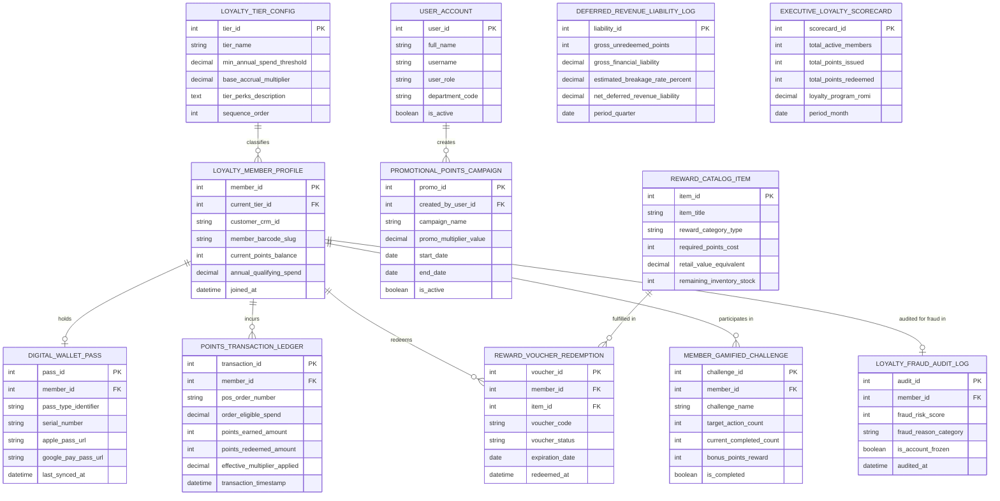

# Conceptual ERD — Loyalty Program Management System

## Mermaid Code

## Entity Description Table | Bảng mô tả Entity

| # | Entity Name | Vietnamese Name | Description | Key Attributes | Main Relationships |
|---|-------------|-----------------|-------------|----------------|-------------------|
| 1 | USER_ACCOUNT | Tài khoản Nguời dùng | System credentials and access roles for loyalty managers, cashiers, growth VPs, and admins. | `user_id`, `username`, `user_role`, `department_code` | Creates `PROMOTIONAL_POINTS_CAMPAIGN`. |
| 2 | LOYALTY_TIER_CONFIG | Cấu hình Tier Loyalty | Loyalty tier definition entity storing tier names (Silver, Gold, Platinum), spend thresholds, and accrual multipliers. | `tier_id`, `tier_name`, `min_annual_spend_threshold`, `base_accrual_multiplier`, `sequence_order` | Classifies `LOYALTY_MEMBER_PROFILE`. |
| 3 | LOYALTY_MEMBER_PROFILE | Profile Thành viên Loyalty | Central member profile entity tracking customer CRM ID, barcode slug, points balance, annual spend, and tier status. | `member_id`, `current_tier_id`, `customer_crm_id`, `member_barcode_slug`, `current_points_balance`, `annual_qualifying_spend` | Classified by `LOYALTY_TIER_CONFIG`, holds `DIGITAL_WALLET_PASS`, incurs `POINTS_TRANSACTION_LEDGER`, redeems `REWARD_VOUCHER_REDEMPTION`. |
| 4 | DIGITAL_WALLET_PASS | Pass Wallet Kỹ thuật số | Apple Wallet and Google Pay digital pass record storing serial numbers, pass URLs, and sync timestamps. | `pass_id`, `member_id`, `pass_type_identifier`, `serial_number`, `apple_pass_url`, `google_pay_pass_url` | Belongs to `LOYALTY_MEMBER_PROFILE`. |
| 5 | POINTS_TRANSACTION_LEDGER | Sổ cái Giao dịch Điểm | Individual points transaction log recording POS order numbers, spend amounts, points earned/redeemed, and multipliers applied. | `transaction_id`, `member_id`, `pos_order_number`, `order_eligible_spend`, `points_earned_amount`, `points_redeemed_amount` | Belongs to `LOYALTY_MEMBER_PROFILE`. |
| 6 | PROMOTIONAL_POINTS_CAMPAIGN | Chiến dịch Multiplier Promo | Promotional points multiplier campaign storing campaign names, multiplier values ($2.0\times$), and active dates. | `promo_id`, `created_by_user_id`, `campaign_name`, `promo_multiplier_value`, `start_date`, `end_date` | Created by `USER_ACCOUNT`. |
| 7 | REWARD_CATALOG_ITEM | Mục Catalog Phần thưởng | Reward catalog item storing title, category type, required points cost, retail value, and remaining inventory stock. | `item_id`, `item_title`, `reward_category_type`, `required_points_cost`, `retail_value_equivalent`, `remaining_inventory_stock` | Fulfilled in `REWARD_VOUCHER_REDEMPTION`. |
| 8 | REWARD_VOUCHER_REDEMPTION | Voucher Phần thưởng Đổi | Issued reward voucher record tracking voucher codes, status (Active/Redeemed/Expired), and expiration dates. | `voucher_id`, `member_id`, `item_id`, `voucher_code`, `voucher_status`, `expiration_date` | Belongs to `LOYALTY_MEMBER_PROFILE` and `REWARD_CATALOG_ITEM`. |
| 9 | MEMBER_GAMIFIED_CHALLENGE | Challenge Gamified Thành viên | Customer gamified challenge tracking target action counts, completed counts, bonus point rewards, and completion flags. | `challenge_id`, `member_id`, `challenge_name`, `target_action_count`, `current_completed_count`, `bonus_points_reward` | Belongs to `LOYALTY_MEMBER_PROFILE`. |
| 10 | LOYALTY_FRAUD_AUDIT_LOG | Nhật ký Audit Fraud Loyalty | Security audit log evaluating fraud risk scores, fraud reason categories, and account freeze statuses. | `audit_id`, `member_id`, `fraud_risk_score`, `fraud_reason_category`, `is_account_frozen` | Belongs to `LOYALTY_MEMBER_PROFILE`. |
| 11 | DEFERRED_REVENUE_LIABILITY_LOG | Sổ cái Nợ Doanh thu Hoãn lại | Financial liability ledger tracking gross unredeemed points, breakage rates %, and GAAP net deferred revenue liability. | `liability_id`, `gross_unredeemed_points`, `gross_financial_liability`, `estimated_breakage_rate_percent`, `net_deferred_revenue_liability` | Standalone financial accounting entity. |
| 12 | EXECUTIVE_LOYALTY_SCORECARD | Scorecard Executive Loyalty | Executive loyalty program scorecard aggregating total active members, points issued, points redeemed, and ROMI multipliers. | `scorecard_id`, `total_active_members`, `total_points_issued`, `total_points_redeemed`, `loyalty_program_romi` | Standalone executive performance entity. |

## Relationship Description | Mô tả Quan hệ

| # | From Entity | Cardinality | To Entity | Label | Business Explanation |
|---|-------------|-------------|-----------|-------|----------------------|
| 1 | LOYALTY_TIER_CONFIG | 1 to 0..N | LOYALTY_MEMBER_PROFILE | classifies | A loyalty tier config classifies multiple loyalty member profiles. |
| 2 | LOYALTY_MEMBER_PROFILE | 1 to 0..1 | DIGITAL_WALLET_PASS | holds | A loyalty member profile holds an Apple/Google digital wallet pass. |
| 3 | LOYALTY_MEMBER_PROFILE | 1 to 0..N | POINTS_TRANSACTION_LEDGER | incurs | A loyalty member profile incurs points transactions on checkout. |
| 4 | LOYALTY_MEMBER_PROFILE | 1 to 0..N | REWARD_VOUCHER_REDEMPTION | redeems | A loyalty member profile redeems points for reward vouchers. |
| 5 | LOYALTY_MEMBER_PROFILE | 1 to 0..N | MEMBER_GAMIFIED_CHALLENGE | participates in | A loyalty member profile participates in gamified challenges. |
| 6 | LOYALTY_MEMBER_PROFILE | 1 to 0..1 | LOYALTY_FRAUD_AUDIT_LOG | audited for fraud in | A member profile is audited for points fraud and velocity abuse. |
| 7 | REWARD_CATALOG_ITEM | 1 to 0..N | REWARD_VOUCHER_REDEMPTION | fulfilled in | A reward catalog item is fulfilled in reward voucher redemptions. |
| 8 | USER_ACCOUNT | 1 to 0..N | PROMOTIONAL_POINTS_CAMPAIGN | creates | A loyalty manager user account creates promotional multiplier campaigns. |
