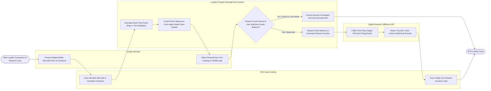

# Swimlane Diagram — Loyalty Program Management System

## Mermaid Code

## Flow Description | Mô tả luồng

| Lane | Actor | Role in Flow |
|------|-------|-------------|
| 1 | Loyalty Member | Presents digital wallet pass barcode at retail checkout, views points balance, selects reward items from mobile app catalog, and receives digital reward vouchers. |
| 2 | POS Store Cashier | Scans member barcode passes at retail POS, processes checkout transactions, and scans single-use reward voucher codes to apply checkout discounts. |
| 3 | Loyalty Program Management System | Calculates real-time points accrual using tier and promotional multipliers, credits member balances, pushes digital wallet pass updates, evaluates fraud velocity rules, verifies points balances, deducts points, and registers voucher codes. |
| 4 | Digital Reward Fulfillment API | Fulfills third-party digital gift cards and partner reward vouchers (TangoCard API), returning digital claim codes and delivery receipt webhooks. |
