# Action Tree — Loyalty Program Management System

## Mermaid Code

```mermaid
graph TD
    Root["Loyalty Program Management System"]

    Root --> M1["Tier Configuration & Accrual Engine"]
    Root --> M2["Digital Wallet Passes & Member Dashboard"]
    Root --> M3["Reward Catalog & Voucher Fulfillment"]
    Root --> M4["Gamified Challenges & Tier Progression"]
    Root --> M5["Points Fraud & Velocity Abuse Security"]
    Root --> M6["Deferred Revenue Liability & GAAP Accounting"]

    M1 --> A11["Configure Loyalty Tiers (Silver, Gold, Platinum) & Spend Thresholds"]
    M1 --> A12["Calculate Real-Time Points Accrual on POS & E-Commerce Purchases"]
    M1 --> A13["Launch Dynamic Promotional Points Multiplier Campaigns (2x/3x)"]
    M1 --> A14["Process Points Reversals & Adjustments on Product Returns"]

    M2 --> A21["Generate Dynamic PKPass Files for Apple Wallet & Google Pay"]
    M2 --> A22["Push Real-Time Points Balance Updates & Pass Background Shifts"]
    M2 --> A23["Provide Self-Service Mobile & Web Member Loyalty Dashboards"]
    M2 --> A24["Render Personal Member Barcodes & Digital Loyalty IDs"]

    M3 --> A31["Manage Multi-Category Reward Catalogs (Store Credit, Gift Cards)"]
    M3 --> A32["Execute Instant Points Deductions for Reward Redemptions"]
    M3 --> A33["Fulfill Third-Party Digital Gift Cards via TangoCard API"]
    M3 --> A34["Validate Single-Use Discount Voucher Codes at POS Checkout"]

    M4 --> A41["Automatically Upgrade Member Tiers upon Meeting Annual Spend"]
    M4 --> A42["Issue Tier Upgrade Bonus Points & Exclusive Tier Perks"]
    M4 --> A43["Configure Gamified Member Challenges & Badges (Make 3 Purchases)"]
    M4 --> A44["Enforce Annual Tier Demotion & Maintenance Spend Evaluations"]

    M5 --> A51["Detect Transaction Velocity Abuse (> 5 Purchases / Hour)"]
    M5 --> A52["Detect Barcode Cloning & Employee Receipt Fraud Patterns"]
    M5 --> A53["Freeze Suspicious Member Accounts Pending Fraud Audit"]
    M5 --> A54["Alert Security Teams on High Points Accumulation Anomalies"]

    M6 --> A61["Enforce Points Expiration Rules for Inactive Accounts (12+ Months)"]
    M6 --> A62["Calculate Statistical Breakage Rates for Unredeemed Points"]
    M6 --> A63["Audit GAAP & IFRS 15 Deferred Revenue Financial Liabilities"]
    M6 --> A64["Export Executive Loyalty Program Profitability & Net ROMI PDFs"]
```

## Module Description | Mô tả Module

| # | Module | Description | Actions |
|---|--------|-------------|---------|
| 1 | Tier Configuration & Accrual Engine | Configures loyalty tiers and spend thresholds, calculates real-time points accrual, launches promotional multipliers, and handles returns. | Configure Loyalty Tiers, Calculate Real-Time Points Accrual, Launch Promotional Multipliers, Process Points Reversals on Returns. |
| 2 | Digital Wallet Passes & Member Dashboard | Generates PKPass files for Apple/Google Wallet, pushes real-time balance updates, provides self-service member dashboards, and renders barcodes. | Generate Digital Wallet Passes, Push Real-Time Pass Updates, Provide Member Dashboards, Render Digital Barcodes. |
| 3 | Reward Catalog & Voucher Fulfillment | Manages reward catalogs, executes points deductions, fulfills digital gift cards via TangoCard API, and validates single-use vouchers at POS. | Manage Reward Catalogs, Execute Points Deductions, Fulfill Digital Gift Cards via API, Validate Voucher Codes at POS. |
| 4 | Gamified Challenges & Tier Progression | Upgrades member tiers upon meeting annual spend, issues upgrade bonuses, configures gamified challenges, and evaluates annual demotions. | Automatically Upgrade Member Tiers, Issue Tier Upgrade Bonus Points, Configure Gamified Challenges, Evaluate Annual Tier Demotions. |
| 5 | Points Fraud & Velocity Abuse Security | Scans for transaction velocity abuse, detects barcode cloning and employee receipt fraud, freezes suspicious accounts, and alerts security. | Detect Transaction Velocity Abuse, Detect Barcode Cloning & Employee Fraud, Freeze Suspicious Member Accounts, Alert Security on Fraud Anomalies. |
| 6 | Deferred Revenue Liability & GAAP Accounting | Enforces points expiration rules, calculates statistical breakage rates %, audits GAAP deferred revenue liabilities, and exports ROMI reports. | Enforce Points Expiration Rules, Calculate Statistical Breakage Rates %, Audit GAAP Deferred Revenue Liabilities, Export Executive Loyalty ROMI Reports. |
