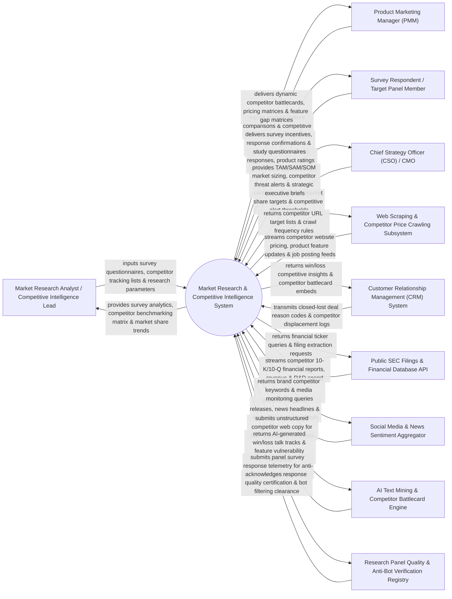

# Context Diagram — Market Research & Competitive Intelligence System

## Mermaid Code

## Actor & Interaction Table | Bảng Actor & Tương tác

| # | Actor | Actor Type | Data Sent TO System | Data Received FROM System | Notes |
|---|-------|------------|---------------------|---------------------------|-------|
| 1 | Market Research Analyst / Competitive Intelligence Lead | Primary | Survey questionnaires, competitor tracking lists, market segmentation parameters, research study designs. | Survey response analytics, competitor benchmarking matrix, market share trends, SWOT reports. | CI professional managing market research studies, surveying target panels, and analyzing competitor moves. |
| 2 | Product Marketing Manager (PMM) | Primary | Product feature comparison matrices, win/loss research queries, competitor battlecard update requests. | Dynamic competitor battlecards, competitive pricing matrices, product feature gap heatmaps. | Product marketer equipping sales teams with competitive battlecards and product positioning. |
| 3 | Survey Respondent / Target Panel Member | Primary | Market research survey responses, brand perception ratings, product feature ranking preferences. | Study questionnaires, response completion receipts, digital incentive rewards. | Consumer or enterprise buyer participating in paid market research panel surveys. |
| 4 | Chief Strategy Officer (CSO) / CMO | Primary | Strategic market share targets, Total Addressable Market (TAM) boundaries, threat threshold rules. | TAM/SAM/SOM market sizing, competitor threat alerts, market share shift reports, strategic briefs. | Executive monitoring macro market trends, competitive disruption, and overall market share trajectory. |
| 5 | Web Scraping & Competitor Price Crawling Subsystem | Supporting | Real-time competitor pricing changes, product feature updates, career site job postings, website HTML diffs. | Competitor URL target lists, scraping frequency rules, proxy rotation parameters. | Automated web scraping engine monitoring competitor websites, pricing pages, and job boards. |
| 6 | Customer Relationship Management (CRM) System | Supporting | Closed-lost sales deal reason codes, competitor displacement logs, sales rep competitive feedback. | Win/loss competitive insights, embedded competitor battlecards, competitor win rate analytics. | Enterprise CRM providing real-time sales win/loss data against specific competitors. |
| 7 | Public SEC Filings & Financial Database API | Supporting | Competitor SEC 10-K/10-Q financial filings, revenue breakdowns, R&D expenditure data, M&A filings. | Financial ticker queries, SEC filing extraction requests, financial metric queries. | Financial database supplying audited competitor revenue, profit margin, and financial filings. |
| 8 | Social Media & News Sentiment Aggregator | Supporting | PR press releases, news headlines, executive departure announcements, social sentiment feeds. | Competitor brand keywords, media monitoring query parameters, press release alerts. | Media monitoring service tracking news releases, executive movements, and public PR announcements. |
| 9 | AI Text Mining & Competitor Battlecard Engine | Supporting | NLP text analysis models, competitive sentiment classifiers, battlecard synthesis algorithms. | AI-generated win/loss talk tracks, feature vulnerability analyses, automated battlecard drafts. | AI engine processing unstructured competitor content into actionable sales battlecard bullet points. |
| 10 | Research Panel Quality & Anti-Bot Verification Registry | Supporting / Regulatory | Panel fraud detection rules, response time velocity thresholds, anti-bot verification tokens. | Response quality verification certificates, bot filtering clearance tokens. | Quality control service filtering speeders, gibberish responses, and automated survey bots. |

## System Boundary Description | Mô tả Phạm vi Hệ thống

The **Market Research & Competitive Intelligence System** is an enterprise market research, competitive tracking, AI battlecard generation, win/loss analysis, and market sizing platform designed to deliver actionable intelligence on competitors, market trends, and customer perceptions.

**Inside System Scope:**
- Quantitative survey research engine supporting logic branching, target panel sampling, and incentive management.
- Automated web scraping and price crawling tracking competitor website changes, pricing plans, and job postings.
- Win/loss analysis engine integrating CRM closed-lost deal reasons with qualitative buyer interview notes.
- AI-driven Competitor Battlecard generator synthesizing pricing, feature gaps, objection handling, and landmine questions for sales.
- TAM/SAM/SOM market sizing modeling and macro competitive threat alert monitoring.

**Outside System Scope:**
- Direct physical conducting of focus group interviews in physical research facilities (handled by Physical Research Agencies).
- Direct legal filing of patent application documents with patent offices (handled by IP Law Firms).
- Direct execution of hostile corporate mergers and acquisitions (handled by Investment Banking Teams).
