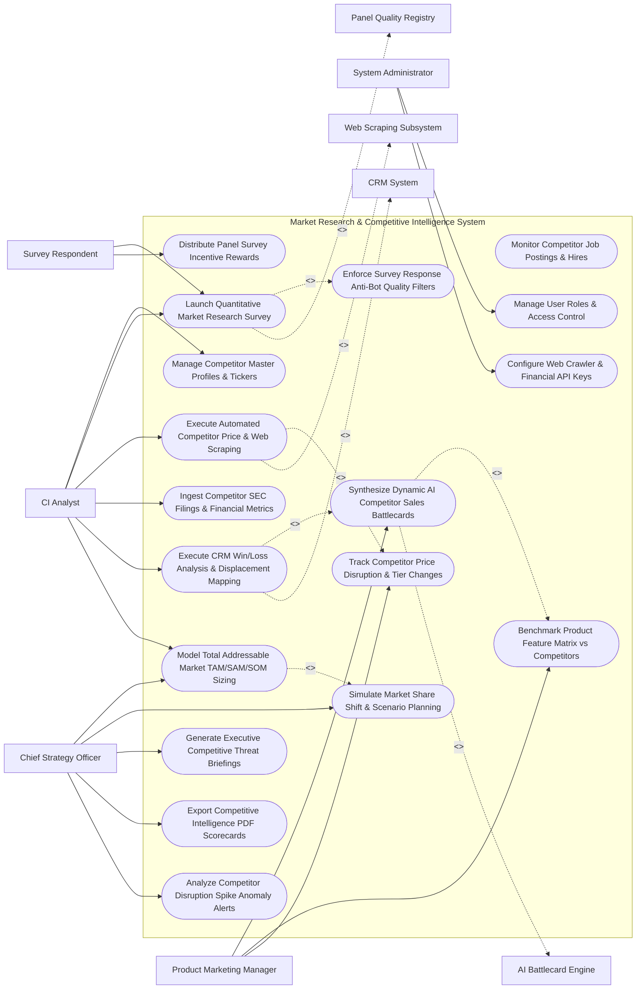

# Use Case Diagram — Market Research & Competitive Intelligence System

## Mermaid Code

## Actor Table | Bảng Actor

| # | Actor | Actor Type | Role Description | Related Use Cases |
|---|-------|------------|------------------|-------------------|
| 1 | CI Analyst | Primary | Competitive intelligence analyst creating market surveys, configuring web scraping rules, analyzing SEC filings, and modeling TAM/SAM/SOM. | UC01, UC02, UC05, UC07, UC10, UC12 |
| 2 | Product Marketing Manager | Primary | Product marketer generating AI sales battlecards, benchmarking feature matrices, and tracking competitor price moves. | UC08, UC09, UC11 |
| 3 | Survey Respondent | Primary | Target panel member completing paid market research surveys and receiving incentive rewards. | UC02, UC04 |
| 4 | Chief Strategy Officer | Primary | Executive reviewing competitive threat briefs, market share scenario simulations, TAM sizing, and threat alerts. | UC12, UC13, UC14, UC15, UC18 |
| 5 | System Administrator | Primary | IT admin managing user security roles, web crawler proxy tokens, and financial API credentials. | UC16, UC17 |
| 6 | Web Scraping Subsystem | System (Secondary) | Automated crawler monitoring competitor website HTML diffs, pricing pages, and job boards. | UC05 |
| 7 | CRM System | System (Secondary) | Enterprise CRM providing closed-lost deal reason codes and sales rep win/loss feedback. | UC10 |
| 8 | AI Battlecard Engine | System (Secondary) | Machine learning NLP engine synthesizing unstructured competitor text into sales battlecard talk tracks. | UC08 |
| 9 | Panel Quality Registry | System (Secondary) | Quality verification service detecting survey bots, speeders, and fraudulent panel responses. | UC02 |

## Use Case Table | Bảng Use Case

| # | UC ID | Use Case Name | Primary Actor | Secondary Actor | Description | Priority |
|---|-------|---------------|---------------|-----------------|-------------|----------|
| 1 | UC01 | Manage Competitor Master Profiles & Tickers | CIAnalyst | None | Centralizes competitor master profiles, corporate tickers, key executives, product names, and pricing URLs. | Critical |
| 2 | UC02 | Launch Quantitative Market Research Survey | CIAnalyst | Panel Reg | Builds and distributes market research surveys to target respondent panels, tracking real-time completion. | Critical |
| 3 | UC03 | Enforce Survey Response Anti-Bot Quality Filters | System | Panel Reg | Filters out survey bots, speeders (completion time < 30 seconds), and gibberish text responses in real time. | High |
| 4 | UC04 | Distribute Panel Survey Incentive Rewards | Respondent | None | Automatically fulfills digital gift card or cash incentive rewards to verified survey panel respondents. | Medium |
| 5 | UC05 | Execute Automated Competitor Price & Web Scraping | CIAnalyst | Web Crawler | Runs daily web scraping crawlers to monitor competitor pricing tables, feature changes, and career job posts. | Critical |
| 6 | UC06 | Monitor Competitor Job Postings & Hires | CIAnalyst | None | Analyzes competitor job posting trends (e.g., 20 new AI engineer hires) to infer upcoming product R&D focus. | High |
| 7 | UC07 | Ingest Competitor SEC Filings & Financial Metrics | CIAnalyst | None | Imports audited 10-K/10-Q financial filings, revenue totals, gross margins, and R&D spending metrics. | High |
| 8 | UC08 | Synthesize Dynamic AI Competitor Sales Battlecards | PMM | AI Battlecard | Uses NLP AI to generate interactive sales battlecards featuring win/loss talk tracks and objection handling. | Critical |
| 9 | UC09 | Benchmark Product Feature Matrix vs Competitors | PMM | None | Renders side-by-side product feature parity matrices highlighting competitive advantages and product gaps. | High |
| 10 | UC10 | Execute CRM Win/Loss Analysis & Displacement Mapping | CIAnalyst | CRM System | Analyzes CRM closed-lost deal reason codes to calculate win rates against specific competitors and displacement trends. | Critical |
| 11 | UC11 | Track Competitor Price Disruption & Tier Changes | PMM | None | Triggers alert notifications when a competitor changes subscription prices or launches a new free tier. | High |
| 12 | UC12 | Model Total Addressable Market TAM/SAM/SOM Sizing | CSO | None | Builds financial market sizing models calculating Total Addressable Market (TAM), SAM, and Serviceable Obtainable Market (SOM). | Critical |
| 13 | UC13 | Simulate Market Share Shift & Scenario Planning | CSO | None | Simulates revenue impacts of market share shifts under different competitive pricing or product feature scenarios. | High |
| 14 | UC14 | Generate Executive Competitive Threat Briefings | CSO | None | Compiles strategic competitive threat briefings highlighting top competitor moves, financial health, and risks. | High |
| 15 | UC15 | Export Competitive Intelligence PDF Scorecards | CSO | None | Renders executive scorecards detailing competitor win rates, price benchmarking, and market share trends. | High |
| 16 | UC16 | Manage User Roles & Access Control | Admin | None | Controls user login credentials, RBAC permissions, and confidential battlecard access rights. | High |
| 17 | UC17 | Configure Web Crawler & Financial API Keys | Admin | None | Manages proxy rotation keys, web crawler user-agents, and SEC financial API tokens. | High |
| 18 | UC18 | Analyze Competitor Disruption Spike Anomaly Alerts | CSO | None | Sends urgent alert notifications when a competitor launches a disruptive feature or wins > 30% of sales deals. | High |

## Use Case Specification | Đặc tả Use Case

---

### UC02 — Launch Quantitative Market Research Survey

| Field | Detail |
|-------|--------|
| **UC ID** | UC02 |
| **Use Case Name** | Launch Quantitative Market Research Survey |
| **Actor(s)** | Primary: Market Research Analyst, Survey Respondent   Secondary: Panel Quality & Anti-Bot Verification Registry |
| **Description** | Composes and distributes quantitative market research surveys (featuring skip logic, matrix questions, and max-diff ranking) to targeted buyer panels, collecting verified survey responses. |
| **Precondition** | 1. Research parameters and target respondent quotas (e.g., 500 IT Decision Makers) are set. |
| **Main Flow** | 1. Analyst opens "Market Research Survey Studio".   2. Analyst designs Survey Questionnaire:   &nbsp;&nbsp;&nbsp;&nbsp; a. Screener Questions: `Job Title == IT Director / CIO AND Company Size > 250 Employees`.   &nbsp;&nbsp;&nbsp;&nbsp; b. Question 1 (Brand Awareness): "Which of the following cloud security providers have you heard of? (Select all that apply)".   &nbsp;&nbsp;&nbsp;&nbsp; c. Question 2 (Max-Diff Feature Preference): "Rank the importance of Feature A vs Feature B vs Feature C".   &nbsp;&nbsp;&nbsp;&nbsp; d. Question 3 (Likert Scale Perception): "Rate Competitor X on Pricing Fairness (1 to 5 Stars)".   3. Analyst sets Target Panel Quota: `500 Completed Verified Responses`.   4. Analyst clicks "Publish Survey to Research Panel".   5. System dispatches survey invitations to target respondent panel members.   6. Respondents complete survey; System triggers UC03 (Enforce Survey Response Anti-Bot Quality Filters):   &nbsp;&nbsp;&nbsp;&nbsp; a. Completion Time Check: 4 minutes (Passed min 90 seconds threshold).   &nbsp;&nbsp;&nbsp;&nbsp; b. Straight-Lining Check: Responses exhibit variance across Likert scales -> `PASSED`.   7. System accepts response, increments quota counter (`342 / 500`), and dispatches $10 digital gift card incentive to respondent (UC04). |
| **Alternative Flow** | **AF1** — In-App Customer Micro-Survey: Analyst deploys a 2-question micro-survey inside the active web application, collecting immediate product feedback from logged-in users. |
| **Exception Flow** | **EX1** — Quota Full Screener Rejection: Target quota for "Small Business Owners" is already filled (100/100); System displays message "Thank you, our quota for your category is full", exiting respondent gracefully. |
| **Postcondition** | Market research survey is launched, quality-verified responses are collected, quotas update, and incentive rewards are issued. |
| **Business Rule** | **BR1**: Market research surveys MUST enforce anti-bot quality filters (minimum completion time, straight-lining checks) before accepting response data. |

---

### UC05 — Execute Automated Competitor Price & Web Scraping

| Field | Detail |
|-------|--------|
| **UC ID** | UC05 |
| **Use Case Name** | Execute Automated Competitor Price & Web Scraping |
| **Actor(s)** | Primary: Market Research Analyst / CI Lead   Secondary: Web Scraping & Competitor Price Crawling Subsystem |
| **Description** | Runs scheduled automated web scraping crawlers to monitor competitor website HTML changes, public pricing tiers, feature updates, and career job postings, flagging competitive shifts. |
| **Precondition** | 1. Competitor website URLs (pricing page, feature page, career page) are configured in competitor master profiles (UC01).   2. Web scraping proxy rotation parameters are active. |
| **Main Flow** | 1. System scheduler triggers daily Competitor Crawl Job at 02:00 AM.   2. System dispatches web crawling bot using rotating residential proxies to target URL: `https://competitor.com/pricing`.   3. Crawler fetches web page HTML, renders DOM JavaScript, and captures screenshot baseline.   4. System executes HTML Diff Engine comparing current DOM against yesterday's DOM baseline:   &nbsp;&nbsp;&nbsp;&nbsp; a. DOM Diff Detected: Line 142 changed from `$99/month` to `$129/month` (+30.3% price increase).   &nbsp;&nbsp;&nbsp;&nbsp; b. New Feature Detected: Text node added: `"Includes AI Assistant Feature"`.   5. System extracts structured pricing data:   &nbsp;&nbsp;&nbsp;&nbsp; a. Plan Name: `Enterprise Tier`.   &nbsp;&nbsp;&nbsp;&nbsp; b. Old Price: `$99/mo` | New Price: `$129/mo`.   &nbsp;&nbsp;&nbsp;&nbsp; c. Effective Date: `Oct 30, 2026`.   6. System updates Competitor Pricing Matrix and flags `COMPETITOR_PRICE_INCREASE`.   7. System triggers UC11 (Track Competitor Price Disruption & Tier Changes), sending alert notification to Product Marketing Managers. |
| **Alternative Flow** | **AF1** — Career Page Hiring Scrape: Crawler scrapes competitor careers page (`https://competitor.com/careers`), detecting 15 new job postings for "Kubernetes Architect"; System flags "Competitor R&D Expansion into Cloud Native Infrastructure". |
| **Exception Flow** | **EX1** — Anti-Bot CAPTCHA Challenge: Competitor website displays Cloudflare CAPTCHA challenge; Crawler detects block, rotates proxy IP address, and retries request with headless browser delay. |
| **Postcondition** | Competitor web changes and pricing shifts are scraped, HTML diffs are highlighted, and price disruption alerts are dispatched to PMMs. |
| **Business Rule** | **BR1**: Competitor pricing pages MUST be scraped daily, and any detected price change > 5% MUST automatically trigger a Competitive Price Disruption Alert. |

---

### UC08 — Synthesize Dynamic AI Competitor Sales Battlecards

| Field | Detail |
|-------|--------|
| **UC ID** | UC08 |
| **Use Case Name** | Synthesize Dynamic AI Competitor Sales Battlecards |
| **Actor(s)** | Primary: Product Marketing Manager (PMM)   Secondary: AI Text Mining & Competitor Battlecard Engine |
| **Description** | Uses NLP artificial intelligence to process unstructured competitor web copy, customer win/loss notes, and pricing tables into dynamic, interactive sales battlecards featuring objection handling and landmine questions. |
| **Precondition** | 1. Competitor pricing, feature matrices, and CRM win/loss data are ingested (UC05/UC10). |
| **Main Flow** | 1. PMM opens "AI Competitor Battlecard Studio" and selects Competitor: `Competitor X (Cloud Software)`.   2. PMM clicks "Generate AI Battlecard Update".   3. System gathers input intelligence data:   &nbsp;&nbsp;&nbsp;&nbsp; a. Web Scraped Pricing: Recent 30% price increase to $129/mo (UC05).   &nbsp;&nbsp;&nbsp;&nbsp; b. CRM Win/Loss Notes: 45 closed-lost deals citing "Competitor X lacks multi-region compliance" (UC10).   &nbsp;&nbsp;&nbsp;&nbsp; c. Feature Matrix: Competitor X lacks SOC-2 Type II audit certification (UC09).   4. System invokes AI Battlecard Engine (LLM NLP Synthesis Model).   5. AI Engine synthesizes structured Sales Battlecard sections:   &nbsp;&nbsp;&nbsp;&nbsp; a. Section 1 (Quick Pitch / Overview): High-level summary of Competitor X positioning.   &nbsp;&nbsp;&nbsp;&nbsp; b. Section 2 (Where We Win): "Highlight our multi-region compliance and lower TCO vs Competitor X's recent 30% price hike".   &nbsp;&nbsp;&nbsp;&nbsp; c. Section 3 (Landmine Questions to Ask Prospects): *"Ask prospect: 'Does Competitor X provide native SOC-2 Type II audit compliance for European data centers?'"*.   &nbsp;&nbsp;&nbsp;&nbsp; d. Section 4 (Objection Handling): "If prospect says Competitor X has an AI Assistant -> Respond that ours includes real-time guardrails".   6. PMM reviews AI-generated battlecard draft, approves talk tracks, and publishes battlecard.   7. System updates Sales Battlecard Hub and embeds dynamic battlecard directly into Salesforce CRM deal objects. |
| **Alternative Flow** | **AF1** — Mobile Battlecard Push: PMM publishes battlecard; System pushes real-time mobile notification to sales reps on active enterprise deals involving Competitor X. |
| **Exception Flow** | **EX1** — Unverified Fact Warning: AI battlecard draft contains an unverified claim ("Competitor X is shutting down product line"); System flags claim as `UNVERIFIED_STATEMENT`, requiring manual PMM sign-off. |
| **Postcondition** | AI sales battlecard is synthesized, objection handling talk tracks are updated, PMM approves draft, and battlecards deploy to CRM. |
| **Business Rule** | **BR1**: AI-generated sales battlecards MUST include verified win/loss reasons from CRM deal data and landmine questions tailored to current product gaps. |

---

### UC10 — Execute CRM Win/Loss Analysis & Displacement Mapping

| Field | Detail |
|-------|--------|
| **UC ID** | UC10 |
| **Use Case Name** | Execute CRM Win/Loss Analysis & Displacement Mapping |
| **Actor(s)** | Primary: Market Research Analyst / CI Lead   Secondary: CRM System |
| **Description** | Analyzes CRM closed-won and closed-lost sales deal records to compute win rates against specific competitors, identify primary loss reason codes, and map competitor displacement trends. |
| **Precondition** | 1. Sales reps record primary competitor and loss reason codes in CRM deal objects.   2. CRM API connection is active. |
| **Main Flow** | 1. Analyst opens "CRM Win/Loss & Competitive Displacement Console".   2. Analyst selects Timeframe: `Q3 2026` and Competitor Scope: `All Tracked Competitors`.   3. System queries CRM deal records for competitive opportunities (1,200 deals involving a named competitor).   4. System computes Competitive Win Rate Statistics:   &nbsp;&nbsp;&nbsp;&nbsp; a. Competitor A: 450 Deals | 270 Wins | 180 Losses -> `60.0% Win Rate`.   &nbsp;&nbsp;&nbsp;&nbsp; b. Competitor B: 300 Deals | 120 Wins | 180 Losses -> `40.0% Win Rate` (High Competitive Threat).   &nbsp;&nbsp;&nbsp;&nbsp; c. Competitor C: 150 Deals | 105 Wins | 45 Losses -> `70.0% Win Rate`.   5. System analyzes Primary Loss Reason Codes for Competitor B:   &nbsp;&nbsp;&nbsp;&nbsp; a. Reason 1: `Pricing / Budget Constraints` (42% of losses).   &nbsp;&nbsp;&nbsp;&nbsp; b. Reason 2: `Missing Feature: Dynamic Reporting` (35% of losses).   &nbsp;&nbsp;&nbsp;&nbsp; c. Reason 3: `Existing Relationship / Legacy Contract` (18% of losses).   6. System calculates Competitor Displacement Value: `$4.2 Million in Sales Pipeline Displaced to Competitor B`.   7. System renders Win/Loss Trendline Charts and feeds top loss reasons into UC08 (Synthesize Dynamic AI Competitor Sales Battlecards). |
| **Alternative Flow** | **AF1** — Qualitative Win/Loss Interview Integration: Analyst conducts 1-on-1 buyer win/loss interviews; System attaches transcribed audio interview notes to the corresponding CRM deal record. |
| **Exception Flow** | **EX1** — Missing Competitor Tag Alert: 30% of closed-lost CRM deals have `Competitor == Unspecified`; System flags "Incomplete CRM Data Warning", sending prompt to Sales Operations to enforce competitor selection at deal close. |
| **Postcondition** | CRM win rates per competitor are calculated, loss reason codes are ranked, displacement pipeline values are mapped, and battlecards update. |
| **Business Rule** | **BR1**: Win/loss analysis MUST calculate head-to-head win rates per competitor and isolate product vs pricing loss reasons. |

---

### UC12 — Model Total Addressable Market (TAM/SAM/SOM) Sizing

| Field | Detail |
|-------|--------|
| **UC ID** | UC12 |
| **Use Case Name** | Model Total Addressable Market (TAM/SAM/SOM) Sizing |
| **Actor(s)** | Primary: Chief Strategy Officer, Market Research Analyst   Secondary: None |
| **Description** | Constructs financial market sizing models using top-down industry data and bottom-up customer calculations to model Total Addressable Market (TAM), Serviceable Addressable Market (SAM), and Serviceable Obtainable Market (SOM). |
| **Precondition** | 1. Industry benchmark revenue statistics and customer pricing data are ingested. |
| **Main Flow** | 1. User opens "TAM/SAM/SOM Financial Market Sizing Studio".   2. User selects Market Segment: `Global Enterprise Cloud Security Market (2026 - 2030)`.   3. User configures Bottom-Up Market Sizing Parameters:   &nbsp;&nbsp;&nbsp;&nbsp; a. Total Global Target Enterprise Companies ($N$): `50,000 Companies worldwide`.   &nbsp;&nbsp;&nbsp;&nbsp; b. Average Revenue per User ARPU ($P$): `$100,000 / year`.   &nbsp;&nbsp;&nbsp;&nbsp; c. Total Addressable Market ($\text{TAM} = N \times P$): $50,000 \times \$100,000 = \$5.0 \text{ Billion TAM}$.   4. User configures Serviceable Addressable Market (SAM) Filters:   &nbsp;&nbsp;&nbsp;&nbsp; a. Geographic Scope: North America & Europe (60% of TAM) -> `SAM = $3.0 Billion`.   5. User configures Serviceable Obtainable Market (SOM) Target:   &nbsp;&nbsp;&nbsp;&nbsp; a. Target Market Share Goal: `15% of SAM within 3 Years`.   &nbsp;&nbsp;&nbsp;&nbsp; b. Serviceable Obtainable Market ($\text{SOM}$): $\$3.0 \text{ Billion} \times 15\% = \$450 \text{ Million SOM}$.   6. System evaluates Market Share Trajectory: Current Revenue ($150M) / SOM ($450M) -> `33.3% SOM Realized`.   7. System renders TAM/SAM/SOM Concentric Financial Diagram and exports strategic market sizing report for C-suite strategic planning. |
| **Alternative Flow** | **AF1** — Top-Down Gartner/IDC Data Triangulation: System blends bottom-up calculations with top-down analyst firm revenue projections (Gartner TAM $5.2B) to establish high/low market bounds. |
| **Exception Flow** | **EX1** — Negative Compound Annual Growth Rate (CAGR) Warning: Market sizing model projects market shrinkage (CAGR = -3.5%); System displays red warning "Declining Market Segment - Strategic Diversification Advised". |
| **Postcondition** | TAM, SAM, and SOM financial market sizes are calculated, market share realized percentages are updated, and strategic report is exported. |
| **Business Rule** | **BR1**: Market sizing models MUST provide both top-down industry triangulation and bottom-up ARPU $\times$ Target Company Count calculations. |
