# Conceptual ERD — Market Research & Competitive Intelligence System

## Mermaid Code

```mermaid
erDiagram
    USER_ACCOUNT {
        int user_id PK
        string full_name
        string username
        string user_role
        string department_code
        boolean is_active
    }

    COMPETITOR_MASTER_PROFILE {
        int competitor_id PK
        string competitor_name
        string stock_ticker_symbol
        string website_url
        decimal estimated_annual_revenue
        int total_employees_count
        string primary_threat_level
    }

    COMPETITOR_PRICING_TIER {
        int tier_id PK
        int competitor_id FK
        string plan_name
        decimal price_amount_monthly
        string billing_frequency
        text features_included_list
        date effective_date
    }

    WEB_SCRAPING_CRAWL_LOG {
        int crawl_id PK
        int competitor_id FK
        string scraped_url
        int http_status_code
        boolean is_html_diff_detected
        text diff_summary_text
        datetime crawled_at
    }

    COMPETITOR_JOB_POSTING {
        int job_id PK
        int competitor_id FK
        string job_title
        string department_category
        string location_city
        date posted_date
    }

    MARKET_RESEARCH_SURVEY {
        int survey_id PK
        int analyst_user_id FK
        string survey_title
        int target_quota_count
        int completed_responses_count
        boolean is_active
        datetime launched_at
    }

    SURVEY_RESPONSE_RECORD {
        int response_id PK
        int survey_id FK
        int completion_time_seconds
        boolean is_bot_filtered
        boolean is_quality_verified
        datetime submitted_at
    }

    CRM_WIN_LOSS_DEAL_RECORD {
        int deal_id PK
        int competitor_id FK
        string crm_opportunity_id
        decimal deal_value_amount
        string deal_outcome_status
        string primary_loss_reason_code
        datetime closed_at
    }

    COMPETITOR_SALES_BATTLECARD {
        int battlecard_id PK
        int competitor_id FK
        int pmm_user_id FK
        string battlecard_title
        text where_we_win_text
        text landmine_questions_text
        text objection_handling_text
        datetime updated_at
    }

    PRODUCT_FEATURE_BENCHMARK {
        int benchmark_id PK
        int competitor_id FK
        string feature_name
        string feature_parity_status
        string company_advantage_notes
        date evaluated_date
    }

    TAM_MARKET_SIZING_MODEL {
        int model_id PK
        int cso_user_id FK
        string market_segment_name
        decimal total_addressable_market_tam
        decimal serviceable_addressable_market_sam
        decimal serviceable_obtainable_market_som
        date calculated_date
    }

    COMPETITIVE_THREAT_ALERT {
        int alert_id PK
        int competitor_id FK
        string alert_category_type
        string alert_severity_level
        text alert_description_text
        datetime triggered_at
    }

    COMPETITOR_MASTER_PROFILE ||--o{ COMPETITOR_PRICING_TIER : "offers"
    COMPETITOR_MASTER_PROFILE ||--o{ WEB_SCRAPING_CRAWL_LOG : "monitored via"
    COMPETITOR_MASTER_PROFILE ||--o{ COMPETITOR_JOB_POSTING : "posts jobs in"
    COMPETITOR_MASTER_PROFILE ||--o{ CRM_WIN_LOSS_DEAL_RECORD : "competes in"
    COMPETITOR_MASTER_PROFILE ||--o| COMPETITOR_SALES_BATTLECARD : "analyzed in"
    COMPETITOR_MASTER_PROFILE ||--o{ PRODUCT_FEATURE_BENCHMARK : "benchmarked in"
    COMPETITOR_MASTER_PROFILE ||--o{ COMPETITIVE_THREAT_ALERT : "triggers"
    MARKET_RESEARCH_SURVEY ||--o{ SURVEY_RESPONSE_RECORD : "collects"
    USER_ACCOUNT ||--o{ MARKET_RESEARCH_SURVEY : "launches"
    USER_ACCOUNT ||--o{ COMPETITOR_SALES_BATTLECARD : "authors"
    USER_ACCOUNT ||--o{ TAM_MARKET_SIZING_MODEL : "builds"
```

## Entity Description Table | Bảng mô tả Entity

| # | Entity Name | Vietnamese Name | Description | Key Attributes | Main Relationships |
|---|-------------|-----------------|-------------|----------------|-------------------|
| 1 | USER_ACCOUNT | Tài khoản Nguời dùng | System credentials and access roles for CI analysts, PMMs, CSOs, and administrators. | `user_id`, `username`, `user_role`, `department_code` | Launches `MARKET_RESEARCH_SURVEY`, authors `COMPETITOR_SALES_BATTLECARD`, builds `TAM_MARKET_SIZING_MODEL`. |
| 2 | COMPETITOR_MASTER_PROFILE | Profile Đối thủ Master | Master competitor profile storing company name, ticker, website URL, revenue, employees, and threat level. | `competitor_id`, `competitor_name`, `stock_ticker_symbol`, `estimated_annual_revenue`, `primary_threat_level` | Offers `COMPETITOR_PRICING_TIER`, monitored via `WEB_SCRAPING_CRAWL_LOG`, competes in `CRM_WIN_LOSS_DEAL_RECORD`, analyzed in `COMPETITOR_SALES_BATTLECARD`. |
| 3 | COMPETITOR_PRICING_TIER | Gói Giá Đối thủ | Competitor pricing plan tier record storing plan name, monthly price, billing frequency, and feature lists. | `tier_id`, `competitor_id`, `plan_name`, `price_amount_monthly`, `billing_frequency`, `effective_date` | Belongs to `COMPETITOR_MASTER_PROFILE`. |
| 4 | WEB_SCRAPING_CRAWL_LOG | Nhật ký Crawl Scraping Web | Scraping log tracking crawled competitor URLs, HTTP status codes, HTML diff flags, and change summaries. | `crawl_id`, `competitor_id`, `scraped_url`, `http_status_code`, `is_html_diff_detected`, `crawled_at` | Belongs to `COMPETITOR_MASTER_PROFILE`. |
| 5 | COMPETITOR_JOB_POSTING | Tin Tuyển dụng Đối thủ | Scraped competitor job posting entry tracking job title, department, location, and posting date. | `job_id`, `competitor_id`, `job_title`, `department_category`, `location_city`, `posted_date` | Belongs to `COMPETITOR_MASTER_PROFILE`. |
| 6 | MARKET_RESEARCH_SURVEY | Khảo sát Nghiên cứu Thị trường | Quantitative market research survey header storing survey title, target quota, and launch timestamps. | `survey_id`, `analyst_user_id`, `survey_title`, `target_quota_count`, `completed_responses_count` | Collects `SURVEY_RESPONSE_RECORD`, launched by `USER_ACCOUNT`. |
| 7 | SURVEY_RESPONSE_RECORD | Bản ghi Phản hồi Khảo sát | Respondent survey submission log tracking completion time (seconds), bot filter status, and quality flags. | `response_id`, `survey_id`, `completion_time_seconds`, `is_bot_filtered`, `is_quality_verified` | Belongs to `MARKET_RESEARCH_SURVEY`. |
| 8 | CRM_WIN_LOSS_DEAL_RECORD | Bản ghi Win/Loss CRM | CRM sales opportunity win/loss record tracking deal value, outcome (Win/Loss), and primary loss reasons. | `deal_id`, `competitor_id`, `crm_opportunity_id`, `deal_value_amount`, `deal_outcome_status`, `primary_loss_reason_code` | Belongs to `COMPETITOR_MASTER_PROFILE`. |
| 9 | COMPETITOR_SALES_BATTLECARD | Battlecard Bán hàng Đối thủ | Dynamic AI sales battlecard storing talk tracks, landmine questions, and objection handling responses. | `battlecard_id`, `competitor_id`, `pmm_user_id`, `battlecard_title`, `where_we_win_text`, `landmine_questions_text` | Belongs to `COMPETITOR_MASTER_PROFILE`, authored by `USER_ACCOUNT`. |
| 10 | PRODUCT_FEATURE_BENCHMARK | Benchmark Tính năng Sản phẩm | Product feature parity benchmark tracking feature name, parity status (Ahead, Equal, Behind), and advantage notes. | `benchmark_id`, `competitor_id`, `feature_name`, `feature_parity_status`, `company_advantage_notes` | Belongs to `COMPETITOR_MASTER_PROFILE`. |
| 11 | TAM_MARKET_SIZING_MODEL | Mô hình Sizing Thị trường TAM | Financial market sizing model calculating TAM, SAM, and SOM figures for a target market segment. | `model_id`, `cso_user_id`, `market_segment_name`, `total_addressable_market_tam`, `serviceable_addressable_market_sam` | Built by `USER_ACCOUNT`. |
| 12 | COMPETITIVE_THREAT_ALERT | Cảnh báo Mối đe dọa Cạnh tranh | Real-time threat alert notification recording alert category (Price Hike, New Feature, Disruption), severity, and text. | `alert_id`, `competitor_id`, `alert_category_type`, `alert_severity_level`, `alert_description_text` | Belongs to `COMPETITOR_MASTER_PROFILE`. |

## Relationship Description | Mô tả Quan hệ

| # | From Entity | Cardinality | To Entity | Label | Business Explanation |
|---|-------------|-------------|-----------|-------|----------------------|
| 1 | COMPETITOR_MASTER_PROFILE | 1 to 0..N | COMPETITOR_PRICING_TIER | offers | A competitor profile offers multiple pricing plan tiers. |
| 2 | COMPETITOR_MASTER_PROFILE | 1 to 0..N | WEB_SCRAPING_CRAWL_LOG | monitored via | A competitor profile is monitored via automated web scraping crawl logs. |
| 3 | COMPETITOR_MASTER_PROFILE | 1 to 0..N | COMPETITOR_JOB_POSTING | posts jobs in | A competitor profile posts job openings tracked in job postings. |
| 4 | COMPETITOR_MASTER_PROFILE | 1 to 0..N | CRM_WIN_LOSS_DEAL_RECORD | competes in | A competitor profile competes in CRM sales deal opportunities. |
| 5 | COMPETITOR_MASTER_PROFILE | 1 to 0..1 | COMPETITOR_SALES_BATTLECARD | analyzed in | A competitor profile is analyzed in a dynamic sales battlecard. |
| 6 | COMPETITOR_MASTER_PROFILE | 1 to 0..N | PRODUCT_FEATURE_BENCHMARK | benchmarked in | A competitor profile is benchmarked in product feature parity matrices. |
| 7 | COMPETITOR_MASTER_PROFILE | 1 to 0..N | COMPETITIVE_THREAT_ALERT | triggers | A competitor profile triggers competitive threat alerts. |
| 8 | MARKET_RESEARCH_SURVEY | 1 to 0..N | SURVEY_RESPONSE_RECORD | collects | A market research survey collects verified survey responses. |
| 9 | USER_ACCOUNT | 1 to 0..N | MARKET_RESEARCH_SURVEY | launches | A CI analyst user account launches market research surveys. |
| 10 | USER_ACCOUNT | 1 to 0..N | COMPETITOR_SALES_BATTLECARD | authors | A PMM user account authors sales battlecards. |
| 11 | USER_ACCOUNT | 1 to 0..N | TAM_MARKET_SIZING_MODEL | builds | A CSO user account builds TAM market sizing models. |
