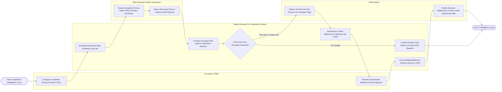

# Swimlane Diagram — Market Research & Competitive Intelligence System

## Mermaid Code

## Flow Description | Mô tả luồng

| Lane | Actor | Role in Flow |
|------|-------|-------------|
| 1 | CI Analyst / PMM | Configures competitor target URLs, defines pricing watch parameters, reviews AI-generated sales battlecard drafts, and approves sales talk tracks. |
| 2 | Market Research & Competitive System | Schedules daily crawling jobs, compares scraped DOM baselines, detects price changes ($> 5\%$) and new features, aggregates CRM win/loss deal reasons, synthesizes AI battlecard talk tracks, and embeds battlecards into CRM. |
| 3 | Web Scraping Crawler Subsystem | Executes scheduled web scraping using rotating residential proxies, renders client-side JavaScript, captures screenshot baselines, and returns structured price/feature JSON payloads. |
| 4 | CRM System | Streams real-time closed-lost deal reason codes and competitor displacement data to the system, displaying dynamic battlecard widgets directly on sales reps' deal tabs. |
