# Action Tree — Market Research & Competitive Intelligence System

## Mermaid Code

```mermaid
graph TD
    Root["Market Research & Competitive Intelligence System"]

    Root --> M1["Competitor Profiling & Web Scraping"]
    Root --> M2["Quantitative Market Research Surveying"]
    Root --> M3["AI Sales Battlecard Synthesis"]
    Root --> M4["CRM Win/Loss & Displacement Analysis"]
    Root --> M5["TAM/SAM/SOM Sizing & Scenario Modeling"]
    Root --> M6["Strategic Threat Alerting & Executive Briefs"]

    M1 --> A11["Manage Competitor Master Profiles & Stock Tickers"]
    M1 --> A12["Execute Automated Daily Web Scraping of Pricing Tiers"]
    M1 --> A13["Monitor Competitor Career Job Postings for R&D Insights"]
    M1 --> A14["Ingest Competitor SEC 10-K/10-Q Financial Filings"]

    M2 --> A21["Build Quantitative Surveys with Skip Logic & Max-Diff Ranking"]
    M2 --> A22["Distribute Surveys to Target Respondent Panels & Enforce Quotas"]
    M2 --> A23["Enforce Anti-Bot Response Quality Filters (Speeder Detection)"]
    M2 --> A24["Distribute Panel Survey Digital Gift Card Incentive Rewards"]

    M3 --> A31["Synthesize Dynamic AI Sales Battlecards using LLM Models"]
    M3 --> A32["Formulate Competitor Landmine Questions & Objection Handling"]
    M3 --> A33["Benchmark Product Feature Parity Matrix vs Competitors"]
    M3 --> A34["Embed Live Battlecard Widgets directly into Salesforce CRM"]

    M4 --> A41["Analyze CRM Closed-Lost Deal Reason Codes per Competitor"]
    M4 --> A42["Calculate Head-to-Head Competitive Sales Win Rates %"]
    M4 --> A43["Map Competitor Displacement Revenue Values ($ Millions)"]
    M4 --> A44["Attach Qualitative Buyer Win/Loss Interview Transcripts"]

    M5 --> A51["Build Bottom-Up Market Sizing Models (ARPU x Target Companies)"]
    M5 --> A52["Calculate Total Addressable Market TAM, SAM & SOM Figures"]
    M5 --> A53["Simulate Market Share Shifts under Competitive Pricing Scenarios"]
    M5 --> A54["Triangulate Bottom-Up Models with Gartner/IDC Analyst Reports"]

    M6 --> A61["Trigger Alerts on Competitor Price Disruption & Tier Changes"]
    M6 --> A62["Alert on Competitor Executive Departures & M&A Filings"]
    M6 --> A63["Generate Strategic Competitive Threat Briefing Documents"]
    M6 --> A64["Export Executive Competitive Intelligence PDF Scorecards"]
```

## Module Description | Mô tả Module

| # | Module | Description | Actions |
|---|--------|-------------|---------|
| 1 | Competitor Profiling & Web Scraping | Centralizes competitor profiles, scrapes pricing tables daily, monitors job boards, and ingests SEC financial filings. | Manage Competitor Master Profiles, Execute Daily Price Web Scraping, Monitor Competitor Job Postings, Ingest SEC Financial Filings. |
| 2 | Quantitative Market Research Surveying | Builds surveys with skip logic, distributes to target panels, enforces anti-bot response quality filters, and fulfills rewards. | Build Quantitative Surveys, Distribute to Target Panels, Enforce Anti-Bot Quality Filters, Distribute Panel Incentive Rewards. |
| 3 | AI Sales Battlecard Synthesis | Synthesizes AI sales battlecards, formulates landmine questions, benchmarks feature parity, and embeds battlecards in CRM. | Synthesize AI Sales Battlecards, Formulate Landmine Questions, Benchmark Feature Parity Matrix, Embed Live Battlecards in CRM. |
| 4 | CRM Win/Loss & Displacement Analysis | Analyzes CRM closed-lost deal reason codes, calculates win rates %, maps displacement pipeline values, and attaches interview notes. | Analyze CRM Closed-Lost Reason Codes, Calculate Competitive Win Rates, Map Competitor Displacement Revenue, Attach Win/Loss Interview Transcripts. |
| 5 | TAM/SAM/SOM Sizing & Scenario Modeling | Builds bottom-up market sizing models, calculates TAM/SAM/SOM, simulates market share shifts, and triangulates analyst reports. | Build Bottom-Up Market Sizing Models, Calculate TAM/SAM/SOM Figures, Simulate Market Share Shifts, Triangulate Analyst Reports. |
| 6 | Strategic Threat Alerting & Executive Briefs | Alerts on price disruption and tier changes, monitors M&A filings, generates competitive briefings, and exports scorecards. | Trigger Price Disruption Alerts, Alert on Competitor M&A Filings, Generate Competitive Threat Briefings, Export Executive CI Scorecards. |
